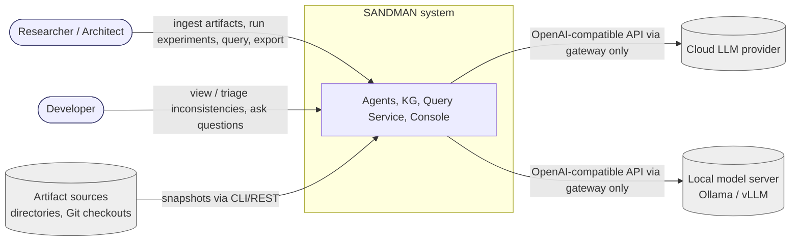
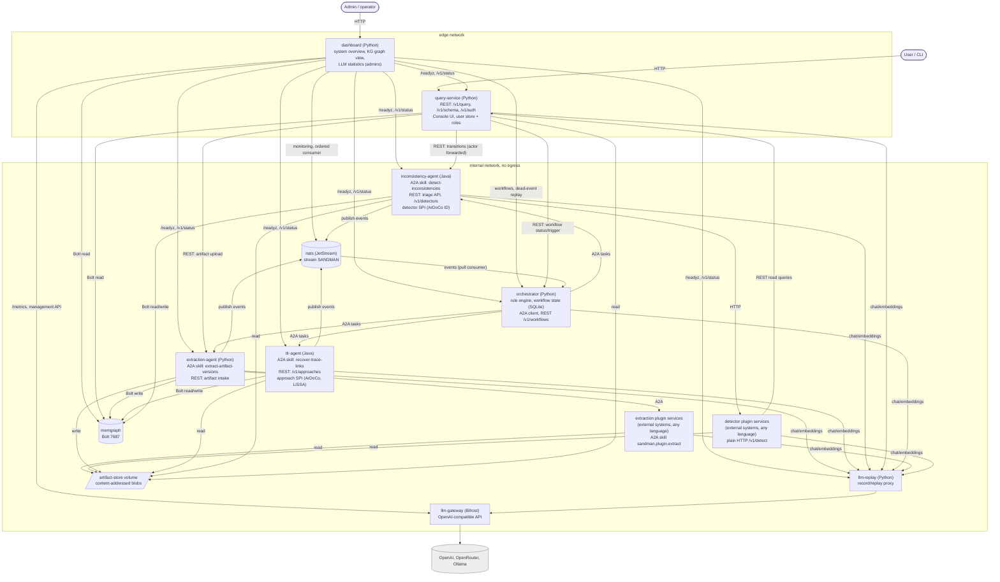
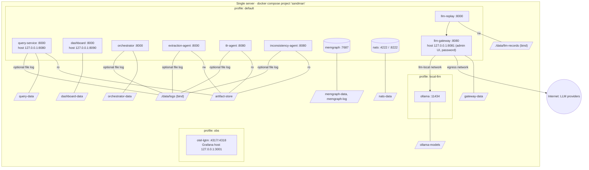
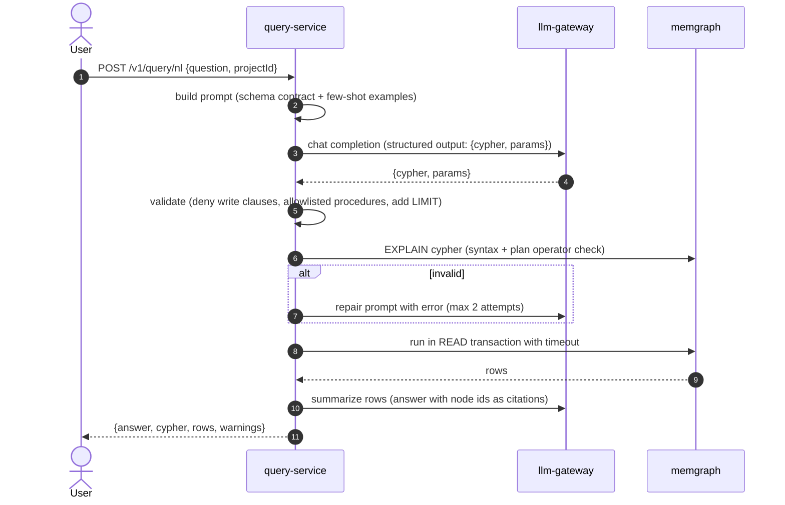
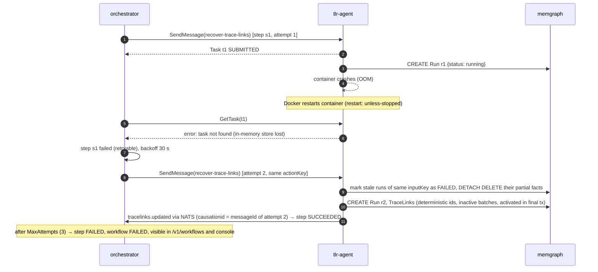
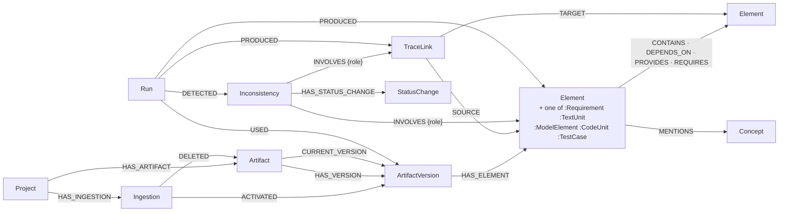
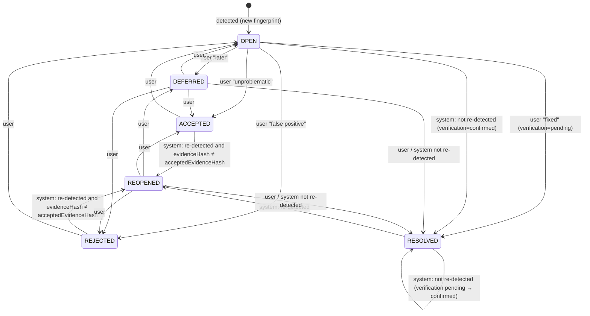

# SANDMAN – Stage 1: Analysis and Architecture

Status: revision 5 (system overview dashboard added, see 0.3) · Date: 2026-10-06 · Scope: Stage 1 of the design (analysis, architecture, ADRs).

### 0.1 Changelog revisions 2 and 3

| Answer | Change |
|---|---|
| Q-1 ArDoCo/LiSSA in Java agents | ADR-0001 accepted; ArDoCo inconsistency detection (branch `feature/make-inconsistency-great-again`) runs in-process in the inconsistency-agent (5.4). |
| Q-2 LangChain4j inside reused code OK | ADR-0010/0012: allowed inside approach/detector adapters, configured to the gateway. |
| Q-3 OpenAI-compatible endpoints, OpenAI, OpenRouter, Ollama | Gateway routes for OpenAI, OpenRouter, Ollama (8.4); Bifrost supports OpenRouter natively. |
| Q-4 default | unchanged (snapshot ingestion); for continuous use the CLI runs in the project's CI on every push (4.2). |
| Q-5 code extraction via plugged-in service | Extraction plugin contract (A2A plugin skill); built-in code extraction reduced to file level (5.2, 3.3). |
| Q-6 detectors via plugged-in service + ArDoCo branch | Detector plugin contract; ArDoCo detectors in-process; invented default rule set removed (5.4). |
| Q-7 continuous use primary, batch for experiments | Deletions in snapshots, retention policy, incremental processing (4.2); both modes in the walking skeleton. |
| Q-8 multi-user with roles | New ADR-0013: user store + per-project roles in the query-service; trusted-forwarder identity to owner APIs (11.2); raw Cypher restricted (7). |
| Q-9 console and logs (optionally file) | Notifications as structured log events, optional JSONL file sink (10). ADR-0011 accepted. |
| Q-10 no proprietary, no Enterprise | Memgraph Lab removed. Memgraph Community kept (task-mandated) but it is BSL 1.1 (source-available, not OSI) → new question Q-11. |
| Q-11 keep Memgraph (speed) | ADR-0014 documents the graph database decision and evaluated alternatives. |
| Q-12 built-in user store | ADR-0013 accepted. |
| Q-13 A2A where it makes sense, HTTP where better | Catalog lookups moved from A2A skills to REST (`GET /v1/approaches`, `GET /v1/detectors`); plugins may use A2A or a synchronous plain-HTTP contract with identical payloads (ADR-0012 accepted). |
| Q-14 GitHub Actions | CI outline (Stage 2) confirmed. |
| Q-15 ArDoCo branch released soon | Pinned-commit build is temporary; switch to Maven Central coordinates when released. |

### 0.2 Changelog revision 4 (Stage 4 review decisions, see [stage-4-review.md](stage-4-review.md))

| Decision | Change |
|---|---|
| D-1 events only chaining signal (R-050) | Steps complete on their completion event (`causationid` = `messageId` of the A2A request); `GetTask` polling only detects failures; one `tracelinks.updated` per task (3.2, 3.3, 6). |
| D-2 per-project reads (R-036) | Parse-tree scope guard for NL and raw Cypher, `analyst` role removed, confidential projects in separate deployments later (7, 11.2). |
| D-3 replay server (R-017) | `llm-replay` proxy in front of the gateway for all callers incl. LangChain4j and embeddings; library-level replay removed (2.2, 9, 11.6). |
| D-4 security baseline (R-033–R-035, R-037, R-045) | Per-service tokens with hash verification, plugin token pairs, gateway admin auth, gateway-enforced `local-only` keys, network hardening, memory limits, session security (2.3, 8.4, 11.2). |
| D-5 semantics (R-001, R-011, R-012, R-015, R-016; R-020 coupled) | Content-based sentence keys, fingerprint without detector version, artifact-based detection scope, completed-detector guard, `artifact-deleted` resolution, `Ingestion` nodes with reactivation of reverted versions, active facts, per-project pipeline lock (4, 6). |
| D-6 Java A2A runtime (R-048) | `a2a-java` on Quarkus provisional; decided in T0.4 with explicit criteria (3.3). |
| D-7 scope trimming (R-051, R-052) | Tool loop (both languages), Java LLM client, `llm-rag`, `external-http`, `cypher-rule` cut; one plugin transport per caller; graph DB benchmark dropped (5, 9). |
| D-9 plugins (R-047) | Plugins are external systems with gateway obligation and own tokens (3.3). |
| Q-20 links for detection | Detectors use the active links of all approaches (5.4, ADR-0015). |
| D-8 evaluation protocol (R-038, R-043, R-044) | Pre-registered protocol in `experiments/PROTOCOL.md` (Stage 3 §3.3); 11.6. |
| D-10 M0 re-baseline (R-003) | M0 planned at 13 weeks (Stage 3 §1.3). |
| Spike T0.12 (applied 2026-10-06) | ArDoCo sentences mapped by an adapter-controlled one-sentence-per-line rendering instead of text matching; two pinned commits; V-27 workaround; V-29 needs upstream change (5.4, ADR-0015) |

### 0.3 Changelog revision 5 (system overview, 2026-10-06)

| Input | Change |
|---|---|
| New requirement: web service giving an overview of the system | FR-21–FR-23; new component `dashboard` (2.2, 2.3, 10.1); `GET /v1/status` on every SANDMAN service (contract 0.3.0); ADR-0016 |
| Your decisions | Separate service (keeps working when monitored components fail); admins only; all proposed extras: workflow monitor, event stream viewer, alerts, resource usage, project statistics, graph view extras, record/replay status, history charts |

## 0. Summary of key decisions

1. **Languages:** Python for orchestrator, extraction agent and query service; Java 21 for TLR and inconsistency agents (in-process reuse of ArDoCo/LiSSA). Two small agent libraries with shared contracts and conformance tests. Code extraction and further detectors come from **plugged-in services** behind fixed plugin operations (A2A skill or plain HTTP).
2. **Communication:** commands to agents via **A2A 1.0** (JSON-RPC binding, non-blocking send; `GetTask` polling only to detect failures); domain events via **NATS JetStream** (CloudEvents envelope, at-least-once, dedup, replayable log), which are the only signal the orchestrator chains steps on; plain REST for queries, triage and uploads; Bolt for the KG.
3. **Orchestration:** deterministic rule table driven by events, with debounce/coalescing, idempotent action keys and SQLite workflow state; optional LLM planner only for ad-hoc natural-language requests.
4. **Knowledge graph:** single writer per node type; reified `TraceLink` and `Inconsistency` nodes; PROV-style `Run` nodes for provenance; immutable snapshots per artifact version with stable, content-based element keys; `Ingestion` nodes record how the current state changed (incl. reverts); readers see only facts of finished runs ("active facts"); inconsistency fingerprints over keys enable re-detection across versions.
5. **Inconsistency lifecycle:** `OPEN, DEFERRED, ACCEPTED, REJECTED (false positive), RESOLVED (verification pending/confirmed), REOPENED`, with system transitions on re-detection.
6. **Query service:** schema-grounded NL-to-Cypher with a parse-tree scope guard (allowlisted clauses, every pattern anchored to one project) + `EXPLAIN` validation, read transactions as primary write guard (Memgraph Community has no read-only roles), bounded repair; hosts a minimal server-rendered console.
7. **LLM gateway:** **Bifrost** preferred (single container, Apache-2.0; providers OpenAI, OpenRouter, Ollama), **LiteLLM** runner-up; decision final after an M0 smoke test. Agents use the OpenAI-compatible API only; no egress except through the gateway (internal Docker network); the gateway enforces the `local-only` project policy through Ollama-only virtual keys.
8. **Reproducibility:** run provenance in the KG, record/replay in one OpenAI-compatible proxy (`llm-replay`) in front of the gateway that also covers LangChain4j inside reused Java code, experiment manifests, JetStream event log.
9. **Users:** multi-user with per-project roles (`viewer`, `triager`, `maintainer`) and global `admin`; projects are isolated, all reads are per project; the query-service is the only user entry point and forwards the authenticated actor to owner APIs.
10. **Open source only:** no Enterprise features, no proprietary tools (Memgraph Lab removed); Memgraph Community (BSL 1.1) kept for speed (Q-11, ADR-0014).

## 1. Requirements analysis

### 1.1 Functional requirements

| ID | Requirement | Source |
|---|---|---|
| FR-1 | Ingest artifacts of a project (requirements, architecture documentation, architecture models, code, tests); detect new and changed artifacts by content hash; keep every ingested version. | Extraction Agent |
| FR-2 | Extract structural information (files, elements, containment, dependencies) and content information (text units, names, summaries, mentioned concepts) from artifacts and store it in the KG. | Extraction Agent |
| FR-3 | Store relations that are explicit in artifacts (e.g., requirement IDs referenced in tests or code) as trace links with origin "explicit". | Extraction Agent |
| FR-4 | Recover trace links between artifact types on request, using pluggable approaches; several approaches may run for the same artifact pair; every link carries confidence and origin approach. | TLR Agent |
| FR-5 | Detect potential inconsistencies on request using pluggable detectors over KG content and trace links. | Inconsistency Agent |
| FR-6 | Inform users about new and reopened inconsistencies. | Inconsistency Agent, UI |
| FR-7 | Let users view inconsistencies with their evidence and change their status (resolve, defer, accept as unproblematic, reject as false positive, reopen) with a reason. | Inconsistency Agent, UI |
| FR-8 | Re-detect inconsistencies after the underlying artifacts change and apply automatic status transitions (reopen, auto-resolve). | Inconsistency Agent |
| FR-9 | Notify the orchestrator about changes (new/changed artifacts, extraction finished, new trace links, new inconsistencies, status changes). | all agents |
| FR-10 | The orchestrator decides which agent/service call runs next, tracks workflow state, handles failures, and exposes workflow status. | Orchestrator |
| FR-11 | Answer natural-language questions about the KG and execute direct Cypher queries, for users and agents. | Query Service |
| FR-12 | Record provenance for every stored fact: producing agent, tool/approach, model, run, confidence, timestamps, artifact version. | all writers |
| FR-13 | Provide all LLM access through a gateway; agents hold only gateway keys. | LLM Gateway |
| FR-14 | Agents are independent and can communicate with each other. | all agents |
| FR-15 | Every component can run as a stub that honors the final contract. | all |
| FR-16 *(derived)* | Manually trigger workflows (e.g., re-run TLR with approach X on project P) for experiments. | Orchestrator |
| FR-17 *(derived)* | Export trace links and inconsistencies in a benchmark-friendly format (CSV/JSON) for evaluation. | Query Service |
| FR-18 *(Q-8)* | Manage users with per-project roles; restrict reads, triage, ingestion and workflow control by role. | Query Service |
| FR-19 *(Q-5, Q-6)* | Plug in external services for extraction (e.g., code) and inconsistency detection without changing contracts. | Extraction, Inconsistency Agent |
| FR-20 *(Q-7)* | Process an evolving project continuously: incremental ingestion from CI, deletions, incremental re-processing; batch mode for experiments. | all |
| FR-21 *(new)* | Show all services with their health and whether they are working or idle; show the LLM gateway's usage statistics (requests, tokens, cost, errors, latency, budgets). | Dashboard |
| FR-22 *(new)* | Open a graphical view of the knowledge graph (nodes and edges) per project, with exploration, a read-only Cypher box, paths between elements and export. | Dashboard |
| FR-23 *(new, confirmed extras)* | Operations and insight views: workflow monitor with dead-event replay, event stream viewer, alerts on failures, container resource usage, project statistics, record/replay status, history charts. | Dashboard |

### 1.2 Non-functional requirements

| ID | Requirement |
|---|---|
| NFR-1 | Each agent/service is deployable as one Docker container; one Compose file starts the whole system on one server. |
| NFR-2 | Each agent is implemented in exactly one language (Python or Java); the number of languages stays minimal. |
| NFR-3 | No agent frameworks (LangChain, LangGraph, DeepAgents, …); agents call LLM APIs directly through the gateway using a minimal shared agent library per language. |
| NFR-4 | Python and Java libraries implement the same documented contracts (behavioral parity, checked by shared contract tests). |
| NFR-5 | Contracts are stable: replacing a stub with a real implementation requires no contract change. |
| NFR-6 | Reproducibility: every run records code version, configuration, prompts, model identifiers and parameters; LLM responses can be recorded and replayed. |
| NFR-7 | Observability: structured logs, distributed traces across A2A, event, KG and LLM calls; LLM cost/token tracking. |
| NFR-8 | Security: provider keys only in the gateway; authenticated inter-service calls; read-only query path guarded against writes; artifacts treated as untrusted input (prompt injection). |
| NFR-9 | Robustness: an agent failure does not corrupt the KG; retries are idempotent; events are delivered at least once. |
| NFR-10 | Persistence: KG, event log, workflow state, artifact store and gateway data survive restarts and can be backed up. |
| NFR-11 | Extensibility: new TLR approaches and inconsistency detectors are added without changing contracts or the orchestrator. |
| NFR-12 | Local models (Ollama/vLLM) are usable through the same gateway (confidential artifacts). |
| NFR-13 | Free/open-source components only; licenses compatible with distributing the repository under AGPL-3.0. |
| NFR-14 | Testability: LLM-dependent behavior can be tested offline (mock LLM, record/replay). |
| NFR-15 | Simplicity: single-server research prototype; target size per project ≤ ~5 000 artifacts/files, ≤ ~200 000 KG nodes (assumption A-6). |
| NFR-16 | Architecture decisions are documented as ADRs (`adr/`). |

### 1.3 Gaps, ambiguities, risks

| # | Observation | Consequence / handling |
|---|---|---|
| G-1 | How artifacts arrive is not specified (upload, Git, watched folder). | Assumption A-1: explicit snapshot ingestion via REST/CLI; Git hooks later. |
| G-2 | Artifact formats are unspecified (PDF? UML/PCM? which programming languages?). | Assumption A-2; extraction is format-pluggable. |
| G-3 | "Inconsistency" has no definition or type catalog. | Types come from ArDoCo and plugged-in detectors (A-3); the KG stores a free `type` string plus detector id. |
| G-4 | Trace link granularity (artifact, section, sentence, class, method) is open. | KG supports element-level links at any granularity; approaches declare their granularity. |
| G-5 | "Users are informed": channel not specified. | Console shows new/reopened items; event stream allows a notifier later. |
| G-6 | Users, roles, multi-project use unspecified. | Assumption A-4/A-5. |
| G-7 | No statement on confidentiality of artifacts sent to cloud LLMs. | Gateway routes per model alias; local models available (NFR-12). Open question Q-3. |
| G-8 | Agents "independent but can communicate": unclear whether agents may call each other directly or only via orchestrator. | Commands normally go through the orchestrator; direct A2A calls allowed for sub-requests and must be visible via events (Section 3). |
| G-9 | Whether user decisions on trace links (confirm/reject) are in scope. | KG models link review status; review UI is out of scope for the first milestones. |
| R-1 | LLM nondeterminism threatens reproducibility of research results. | Record/replay, pinned model versions, temperature 0, run provenance (NFR-6). |
| R-2 | Two languages double the library and contract maintenance. | Small libraries, schema-first contracts, shared conformance tests (Section 9). |
| R-3 | KG schema churn breaks the NL-to-Cypher prompts and detectors. | Versioned schema contract; NL-to-Cypher grounded in that contract; evaluation set as regression test. |
| R-4 | Prompt injection through artifacts (code comments, docs). | LLM output is data, never executed; only read-only tools exposed to LLM loops; validated structured outputs. |
| R-5 | Per-project isolation is not provided by Memgraph Community (no label-based access control, no multi-tenancy). | Isolation enforced in the query-service: parse-tree scope guard on every NL and raw Cypher query plus result post-check (Section 7); confidential projects in separate deployments (future). |

### 1.4 Open questions (prioritized)

**Answers (revision 2):** Q-1 Java agents in-process · Q-2 yes · Q-3 OpenAI-compatible endpoints (OpenAI), OpenRouter, local Ollama · Q-4 default · Q-5 default formats, code extraction more general via a plugged-in service · Q-6 detectors via a plugged-in service; ArDoCo branch `feature/make-inconsistency-great-again` provides some · Q-7 continuous use on an evolving project is the core, batch for experiments · Q-8 multi-user with roles · Q-9 console and logs (optionally to file) · Q-10 open source only, no Enterprise features.

**Answers (revision 3):** Q-11 keep Memgraph — speed is key, Neo4j too slow; alternatives evaluated in ADR-0014 · Q-12 built-in user store · Q-13 A2A where it makes sense, plain HTTP where better (catalog lookups and a plain-HTTP plugin variant, ADR-0012) · Q-14 GitHub Actions · Q-15 ArDoCo branch will be released/merged soon (pinned commit is temporary).

Questions raised in revision 2 (now answered):

| # | Question | Default if unanswered |
|---|---|---|
| Q-11 | Memgraph Community is BSL 1.1 (source-available; each version converts to Apache-2.0 after ≤ 4 years), not OSI open source. Keep Memgraph (task-mandated), or switch to an OSI-licensed Cypher database (e.g., Neo4j Community, GPL-3.0, same Bolt drivers)? | Keep Memgraph Community; contracts use portable Cypher so a switch stays possible. |
| Q-12 | User identities: built-in user store, or login via an existing identity provider (e.g., KIT OIDC/Shibboleth, Keycloak)? | Built-in store with per-project roles (ADR-0013); OIDC later. |
| Q-13 | Plugged-in extraction/detection services: can they speak A2A (using our libraries), or must the contract be plain HTTP? | A2A with fixed SANDMAN plugin skills; a plain-HTTP adapter only if a plugin cannot use A2A. |

Original questions (answered, kept for traceability):

| # | Question | Default if unanswered |
|---|---|---|
| Q-1 | Should the TLR and Inconsistency agents embed ArDoCo/LiSSA **in-process** (Java), or should these run as external tool containers behind an all-Python agent layer? | In-process Java for TLR and Inconsistency agents; Python for Orchestrator, Extraction, Query Service (ADR-0001). |
| Q-2 | LiSSA and ArDoCo `llm-access` use **LangChain4j** internally (as LLM client, per their POMs). Is that acceptable inside a wrapped TLR approach, given the "no agent frameworks" rule? | Acceptable as a transitive library inside approach adapters only, configured to the gateway base URL; agent code itself uses the SANDMAN library. The internal-only network enforces gateway-only access anyway. |
| Q-3 | Which LLM providers may be used (cloud provider(s)? local GPU available?) and may artifact content leave the server? | Both: one cloud provider plus local Ollama; per-project policy (`cloud-allowed`/`local-only`) selects models; confidential projects use local models only. |
| Q-4 | How do artifacts arrive? | Snapshot ingestion via REST/CLI (directory or Git checkout uploaded as a batch); no live repository watching. |
| Q-5 | Which artifact formats are in scope first? | Text/Markdown documentation, requirements as Markdown/CSV, architecture models as PCM/UML (XMI), Java code and JUnit tests. |
| Q-6 | Which inconsistency types are in scope first? | Rule-based: untraced requirement, model element without documentation, documented element without model element, model element without code; LLM-based doc–code contradictions in a later milestone. |
| Q-7 | Main usage mode: batch research experiments on benchmark projects, or continuous use on an evolving project? | Both, batch experiments are the primary mode (drives reproducibility features). |
| Q-8 | Users and access: few trusted users or multi-user with roles? | Few trusted users, console login per user from a password file, user name recorded on every status change. |
| Q-9 | Is a notification channel beyond the console needed (mail, Mattermost, Slack)? | No; console only, event stream allows adding a notifier. |
| Q-10 | Licensing: are source-available/proprietary-free components acceptable — Memgraph Community (BSL 1.1, internal use grant) and Memgraph Lab (proprietary freeware, dev/eval use)? | Yes; Lab only in the `dev` profile; no Enterprise features. |

## 2. Architecture overview

### 2.1 Context



### 2.2 Containers and components



Component responsibilities in one line each (details in Section 5):

| Component | Language | Role | Writes to KG |
|---|---|---|---|
| `orchestrator` | Python | Consumes events, applies rules, issues A2A tasks, tracks workflows | none (correlation via `Run.workflowId`) |
| `extraction-agent` | Python | Artifact intake, built-in extractors, calls extraction plugins, writes their results | `Project`, `Artifact`, `ArtifactVersion`, `Element`, `Concept`, structural relations, explicit `TraceLink`s, `Run` |
| `tlr-agent` | Java | Pluggable TLR approaches (ArDoCo, LiSSA in-process) | `TraceLink`, `Run` |
| `inconsistency-agent` | Java | Detectors (ArDoCo in-process, plugins), status lifecycle, triage API | `Inconsistency`, `StatusChange`, `Run` |
| `query-service` | Python | NL/Cypher read access, console UI, export, users/roles | none in KG (user store in own SQLite) |
| extraction/detector plugins | any | Plugged-in external systems (Q-5, Q-6, ADR-0012); return results, never write the KG; LLM calls only via the gateway with own keys | none |
| `llm-replay` | Python | OpenAI-compatible record/replay proxy in front of the gateway (modes `live`, `record`, `replay`) | – |
| `llm-gateway` | (off-the-shelf, Bifrost) | Unified LLM access, virtual keys, budgets, logging | – |
| `memgraph` | (off-the-shelf) | Knowledge graph | – |
| `nats` | (off-the-shelf) | Durable event log / bus | – |
| `dashboard` | Python | System overview for admins: health and activity of all services, KG graph view, LLM statistics, operations and insight views (10.1, ADR-0016) | none (own SQLite for history samples) |
| `cadvisor` | (off-the-shelf, optional profile `resources`) | Container resource metrics for the dashboard | – |

**Single-writer rule:** each KG node type has exactly one owning component (table above). Other components read it and request changes through the owner's API; plugins return results to their owner, which validates and writes them. This keeps stubs and plugins replaceable and avoids write conflicts.

### 2.3 Deployment (Docker Compose view)



| Network | Type | Members | Purpose |
|---|---|---|---|
| `internal` | bridge, `internal: true` (no egress) | all services | service-to-service traffic; agents cannot reach the internet, which **enforces gateway-only LLM access**, including for libraries inside approaches |
| `egress` | bridge | `llm-gateway` (also publishes its admin port), `ollama` (model pulls) | outbound provider calls |
| `edge` | bridge without IP masquerading (no outbound traffic, to verify V-31) | `query-service`, `otel-lgtm` | published ports, all bound to `127.0.0.1` (remote access via SSH tunnel or a TLS reverse proxy added later) |
| `llm-local` | bridge, `internal: true` | `llm-gateway`, `ollama` | local models reachable only through the gateway (keys, budgets, logs) |

| Volume | Mounted by | Content |
|---|---|---|
| `memgraph-data` → `/var/lib/memgraph`, `memgraph-log` → `/var/log/memgraph` | memgraph | snapshots + WAL, logs |
| `nats-data` → `/data` | nats | JetStream file store (event log) |
| `gateway-data` | llm-gateway | Bifrost config + SQLite logs (container path to verify) |
| `query-data` → `/data` | query-service | SQLite user store (users, project memberships, API token hashes) |
| `./data/logs` → `/logs` | all services (optional) | JSONL log files incl. notifications (`SANDMAN_LOG_FILE`) |
| `dashboard-data` → `/data` | dashboard | SQLite with history samples (14 days) and admin sessions |
| `orchestrator-data` → `/data` | orchestrator | SQLite workflow state |
| `artifact-store` → `/artifacts` | extraction-agent (rw), tlr-agent/inconsistency-agent/query-service (ro) | content-addressed blobs `/{projectId}/{sha256}` |
| `./data/llm-records` → `/llm-records` | llm-replay | record/replay cassettes per experiment |
| `ollama-models` | ollama | local model weights |

| Secret (Compose `secrets:`, file-based, `/run/secrets/<name>`) | Used by |
|---|---|
| `gateway.env` (env file: provider keys, virtual key values, encryption key, admin password — Bifrost reads secrets from env vars only) | llm-gateway only |
| `memgraph.env` (env file: `MEMGRAPH_USER`/`MEMGRAPH_PASSWORD`, read by the Memgraph binary) | memgraph only |
| `gateway_admin_password` (copy of the admin password in `gateway.env`) | operator only, never mounted |
| `llm_key_<component>` and `llm_key_<component>_local` (gateway virtual keys; `_local` = Ollama only) for extraction, tlr, inconsistency, query; `llm_key_orchestrator` | respective service |
| `svc_token_<name>` (own bearer token of one service or plugin) | that service only |
| `svc_tokens_verify` (JSON map caller → sha256 of its token) | all receivers (A2A, owner REST APIs, query API) |
| `plugin_in_<plugin>` (token owners present when calling the plugin) | the plugin and its calling owner |
| `memgraph_password` | memgraph and all KG clients |
| `admin_bootstrap_password` (first admin account) | query-service |
| `session_secret` (cookie signing) | query-service |
| `dashboard_admin_password`, `dashboard_session_secret`; read access to `gateway_admin_password` and `memgraph_password` | dashboard (admin-only operator tool, ADR-0016) |

Startup order via `depends_on: condition: service_healthy`: `memgraph`, `nats`, `llm-gateway` → `llm-replay` → agents → `orchestrator` → `query-service`. All services `restart: unless-stopped` and have a `mem_limit` (memory budget in Stage 2 §3.2). Profiles: `default` (core), `obs` (OpenTelemetry backend), `local-llm` (Ollama), `stubs` (plugin stubs); a `docker-compose.dev.yml` overlay publishes Bolt and NATS ports on localhost (Memgraph Lab is excluded as proprietary). Full Compose file: [deploy/docker-compose.yml](../deploy/docker-compose.yml) (Stage 2).

## 3. Communication design

### 3.1 Interaction styles

| Interaction | Style | Mechanism | Why |
|---|---|---|---|
| Orchestrator → agent "do X" (extract, recover links, detect) | async command, long-running | **A2A** `SendMessage` with `returnImmediately=true`; completion via the task's event; `GetTask` polling only for failures (`CancelTask` on timeout) | Task lifecycle, cancel, discovery via Agent Card, cross-language SDKs |
| Agent → anyone "fact changed" (artifact ingested, links updated, …) | async event, fan-out | **NATS JetStream** stream `SANDMAN` | Durable, replayable, decoupled from orchestrator uptime, multiple consumers |
| User/agent → Query Service | sync request/response | REST (OpenAPI) | Simple, cacheable, used by UI and CLI; no task semantics needed |
| Catalog lookups (TLR approaches, detectors) | sync | REST `GET /v1/approaches`, `GET /v1/detectors` | Static lists; an A2A task lifecycle adds nothing (Q-13) |
| Agent → plugin service | async command or sync call | A2A plugin skill, **or** plain HTTP plugin contract | A2A for long-running/cancellable work; plain HTTP for fast calls and wrapped existing services (Q-13, ADR-0012) |
| User → triage of inconsistencies | sync request/response | REST on `inconsistency-agent`, called by the console | Owner of `Inconsistency` nodes handles writes (single-writer rule) |
| User/CLI → artifact upload | sync request (202 Accepted) | REST on `extraction-agent` (via console or CLI) | Owner of `Artifact` nodes |
| User → workflow status / manual trigger | sync | REST on `orchestrator` | Workflow state lives there |
| Any component → LLM | sync (optionally streaming) | OpenAI-compatible HTTP via `llm-gateway` | Gateway-only access |
| Any component → KG | sync | Bolt (Neo4j driver) | Native protocol |
| Agent → agent sub-request (optional) | async command | A2A, same as orchestrator | Allowed, but the callee still publishes its fact events, so the orchestrator sees all changes |

### 3.2 How the orchestrator is informed about changes

| Option | Delivery semantics | Pros | Cons |
|---|---|---|---|
| A. Agents push events to orchestrator via HTTP/A2A | at-most-once unless every producer implements retry/outbox | no extra container | orchestrator is a single intake point; producers block or lose events while it is down; fan-out to other consumers must be re-implemented; A2A has no pub/sub (it is point-to-point task delegation) |
| **B. Message broker: NATS JetStream** | at-least-once (publish ack + consumer ack/redelivery); dedup window via `Nats-Msg-Id` | one small container; durable, replayable log (useful as experiment record); official Python and Java clients; consumers independent | one more component; publish-after-KG-commit is not atomic (handled below) |
| B'. Redis Streams / Valkey | at-least-once (consumer groups, XACK, XCLAIM) | well known | Redis license history (see To verify); similar footprint to NATS, no advantage |
| B''. RabbitMQ | at-least-once | mature | heavier (Erlang VM), more operations than needed |
| C. Memgraph triggers | `BEFORE COMMIT` in-transaction, `AFTER COMMIT` asynchronous; external delivery only via a custom Python query module called from the trigger | atomic with the write (BEFORE COMMIT) | network I/O inside the DB process (a hanging module affects the DB); no official example of trigger→broker publishing; business logic hidden in DB; Memgraph streams are inbound only |
| D. Transactional outbox in the KG (`:Event` nodes polled by orchestrator) | at-least-once, atomic with facts | no broker | polling latency, ordering needs a sequence generator, event data pollutes the KG |

**Recommendation: B (NATS JetStream)** → ADR-0003. Details:

- **Envelope:** CloudEvents 1.0 JSON structure (`specversion`, `id`, `source`, `type`, `subject`, `time`, `datacontenttype`, `data`) plus extension attributes `correlationid` (workflow id), `causationid` (event/task that caused it), `traceparent` (W3C trace context). `subject` = `projectId`.
- **Subjects:** `sandman.<eventType>` (e.g., `sandman.ingestion.completed`). One stream `SANDMAN` captures `sandman.>`; file storage; retention by age (default 90 days) so whole experiments can be replayed.
- **Chaining (D-1):** events are the only signal the orchestrator chains steps on. Every A2A skill task publishes exactly one completion event (`extraction.completed`, `tracelinks.updated`, `inconsistencies.updated`) with `causationid` = `messageId` of the A2A request; the orchestrator marks the step succeeded when it arrives. `GetTask` polling only detects failures, rejections and timeouts.
- **Producer rule "commit, validate, publish, then complete":** an agent (1) commits its KG writes, (2) the library validates the skill output, (3) publishes the event and waits for the JetStream publish ack (retries 3× with backoff), (4) only then reports the A2A task as completed. Skills return output and event; they never publish completion events themselves. If (2) or (3) fails the task fails, the orchestrator retries, and idempotent writes (deterministic IDs + `MERGE`) make the retry safe. The REST intake returns `202` only after the publish ack.
- **Deduplication:** `Nats-Msg-Id = event.id`, stream duplicate window 2 min (protects against producer retries); consumers additionally deduplicate on `event.id` (orchestrator inbox table with primary key on `event.id`).
- **Consumer:** orchestrator uses one durable pull consumer, `AckExplicit`, `AckWait` 60 s, `MaxDeliver` 5, backoff 5 s/30 s/2 min. Events that exceed `MaxDeliver` are logged and stored in the orchestrator's `dead_events` table for manual replay.
- **Ordering:** JetStream preserves stream order; the orchestrator processes events per project sequentially, across projects concurrently. Handlers must not rely on global ordering (events of different producers can interleave).
- **Idempotency:** every orchestrator action is keyed (`actionKey = hash(agent, skill, canonical input, trigger id)`, trigger id = id of the triggering event, or of the manual request); a completed step with the same key is not repeated. This deduplicates redelivered events and retries, but a later trigger with the same input (e.g. a revert re-activating an already extracted version, R-039) runs again. Config changes are applied by a manual trigger.

Event catalog (contracts in Stage 2):

| Type | Producer | Consumers | Payload (key fields) |
|---|---|---|---|
| `ingestion.completed` | extraction-agent (intake; only if the state changed) | orchestrator | `projectId, ingestionId, seq, mode (full\|partial), sourceRevision?, createdVersionIds[], reactivatedVersionIds[], deletedArtifactIds[], unchangedCount` |
| `extraction.completed` | extraction-agent | orchestrator | `projectId, runId, artifactVersionIds[], elementCount, explicitLinkCount, pluginRuns[{pluginId, runId, status}]` |
| `tracelinks.updated` | tlr-agent (one per task) | orchestrator | `projectId, sourceVersionIds, targetVersionIds, runs[{approach, approachVersion, runId, status, linkCount}]` |
| `inconsistencies.updated` | inconsistency-agent | orchestrator, console (read via KG) | `projectId, runId, scopeArtifactIds?, newIds[], reopenedIds[], autoResolvedIds[]` |
| `inconsistency.status.changed` | inconsistency-agent (triage API) | orchestrator (audit log only) | `inconsistencyId, from, to, actor, reason` |

### 3.3 A2A usage

Version pinned: **A2A spec 1.0.x**, JSON-RPC 2.0 binding over HTTP (most widely implemented; both SDKs support it). Python: `a2a-sdk` (Starlette-based server extra). Java: `a2a-java` (reference server runs on Quarkus).

- **Agent Cards** served at `/.well-known/agent-card.json` (spec 1.0 path). Each card declares `supportedInterfaces` (one JSON-RPC interface), `capabilities.streaming=false` initially, `pushNotifications=false`, `securitySchemes.bearer` (HTTP bearer), and skills.
- **Skill invocation convention (SANDMAN-specific):** A2A messages carry no skill selector. We put the skill id in `message.metadata["sandman.skill"]` and the input as one `data` Part validated against the skill's JSON Schema. Results are returned as one Task artifact named `result` with one `data` Part validated against the output schema. Correlation (`workflowId`, `traceparent`) goes into `message.metadata`. This convention is part of the contracts and implemented once per agent library.
- **Skills per agent:**

| Agent | Skill id | Input → output (summary) |
|---|---|---|
| extraction-agent | `extract-artifact-versions` | `{projectId, artifactVersionIds[], options?}` → `{runId, elementCount, explicitLinkCount, pluginRuns[]}` |
| tlr-agent | `recover-trace-links` | `{projectId, sourceVersionIds[], targetVersionIds[], approaches?[], params?}` → `{runs:[{runId, approach, linkCount}]}` |
| inconsistency-agent | `detect-inconsistencies` | `{projectId, scopeArtifactIds?[], detectors?[]}` → `{runId, newIds, reopenedIds, autoResolvedIds, stillOpenCount}` |
| extraction plugin (plugged-in service; HTTP variant `POST /v1/extract` in the contract, not yet called) | `sandman.plugin.extract` | `{projectId, llmPolicy, artifacts:[{artifactVersionId, path, kind, format, storagePath, contentHash}], context:{currentArtifacts[]}}` → `{elements[], relations[], explicitReferences[], warnings[]}` (owner writes) |
| detector plugin (plugged-in service; called via `POST /v1/detect`; A2A variant not yet called) | `sandman.plugin.detect` | `{projectId, llmPolicy, scopeArtifactIds?[], queryServiceUrl}` → `{findings:[{type, severity, title, description, confidence, involved:[{elementKey \| traceLinkId, role}], evidence?}]}` (owner fingerprints, applies lifecycle, writes) |

- **Task lifecycle:** `SUBMITTED → WORKING → COMPLETED | FAILED | CANCELED | REJECTED` (input validation errors → `REJECTED`). `INPUT_REQUIRED` and `AUTH_REQUIRED` are not used in the prototype; human decisions are asynchronous through the triage API, not blocking tasks.
- **Long-running tasks:** the orchestrator stores the A2A task id in its SQLite state; the step completes when the task's completion event arrives. It polls `GetTask` with backoff (30 s → 2 min) only to detect `FAILED`/`REJECTED`/lost tasks and timeouts. Polling survives orchestrator restarts, unlike an open SSE stream. Streaming (`SendStreamingMessage`) and push notifications are not needed for the prototype; they can be enabled later without contract changes for existing callers.
- **Task store:** in-memory task store in all agents. If an agent restarts and loses a task, `GetTask` returns "task not found"; the orchestrator treats this as a retryable failure (scenario d). Durable task state lives in the orchestrator, and agent work is idempotent, so a durable agent-side task store adds nothing. *(Ceiling: lost progress on agent restart; switch to the SDKs' SQL/JPA stores if tasks get long enough for this to hurt.)*
- **Java runtime (provisional, D-6):** the `a2a-java` server integration is CDI-based with Quarkus as reference runtime; Java agents run on Quarkus (3.x LTS) using the reference JSON-RPC server module, unless T0.4 shows that a custom executor cannot run in a plain Quarkus app or that `a2a-java` conflicts with the ArDoCo/LiSSA dependencies. Then a hand-written JSON-RPC endpoint (`SendMessage`, `GetTask`, `CancelTask`, static card) without Quarkus replaces it. Quarkus is an application framework, not an agent framework.
- **Auth between agents:** HTTP bearer token declared in the card. Each service holds only its own token (secret `svc_token_<name>`); receivers verify tokens against a file of sha256 hashes (`svc_tokens_verify`) and map each to a caller name, so no service can impersonate another. Trusted forwarders: only the `query-service` may carry an end-user identity in REST calls (`X-Sandman-Actor`, `X-Sandman-Roles`), only the `orchestrator` in A2A metadata (`sandman.actor`); owners ignore these from other callers. Network isolation (internal Docker network) is the second line of defense. mTLS/OAuth2 are out of scope (single server).
- **Plugins:** extraction and detector plugins implement one fixed SANDMAN plugin operation each, either as A2A skill (`sandman.plugin.extract`, `sandman.plugin.detect`) or via the synchronous plain-HTTP contract (`GET /manifest`, `POST /v1/extract`, `POST /v1/detect`, [contracts/openapi/plugin-http.yaml](../contracts/openapi/plugin-http.yaml)) with identical payloads (Q-13). A2A when calls can run long, must be cancellable or the plugin is itself an agent; HTTP for fast calls or wrapped existing services. They are registered in the owner's configuration (`config/extraction/plugins.yaml`, `config/inconsistency/plugins.yaml`: id, URL, inbound token file, which kinds/formats or detector types they handle). Until a need arises, the extraction-agent calls plugins via A2A only and the inconsistency-agent via HTTP only (D-7). Plugins are external systems (D-9): any language and design, but no egress, LLM calls only through the gateway with their own virtual keys, honoring `llmPolicy`. Owners call a plugin with its inbound token (`plugin_in_<plugin>`), never with their own service token. Plugins return results; the owner validates against the plugin output schema and writes to the KG, so provenance (`Run.tool = plugin id@version` from the plugin's Agent Card or manifest) and the single-writer rule hold. Plugins read artifact content from the read-only artifact store mount; detector plugins read the KG through the query-service API with their own plugin token (caller `plugin:<id>`, read-only, project-scoped queries).

**Where A2A fits and where not** (→ ADR-0002): A2A is used for *commands to agents* (task delegation with lifecycle, discovery of skills, cross-language standard). It is **not** used for domain events (no pub/sub in A2A), for KG access (Bolt), for user-facing CRUD/query APIs (plain REST is simpler and better tooled: OpenAPI, curl, browser), or for LLM access (OpenAI-compatible API).

### 3.4 Sequence diagrams

**(a) New artifact → extraction → TLR → inconsistency check**

```mermaid
sequenceDiagram
  autonumber
  actor U as User / CLI
  participant QS as query-service (console)
  participant EX as extraction-agent
  participant KG as memgraph
  participant BUS as nats
  participant OR as orchestrator
  participant TLR as tlr-agent
  participant IN as inconsistency-agent

  U->>QS: POST /v1/projects/p1/ingestions (archive, mode=full)
  QS->>QS: authenticate, check role maintainer on p1
  QS->>EX: POST /v1/projects/p1/ingestions (X-Sandman-Actor)
  EX->>EX: store blob (sha256), dedupe by hash
  EX->>KG: MERGE Artifacts, CREATE ArtifactVersions, move CURRENT_VERSION, mark deleted (full snapshot)
  EX->>BUS: publish ingestion.completed (await ack)
  EX-->>QS: 202 {ingestionId, createdVersionIds}
  BUS-->>OR: deliver event
  OR->>OR: inbox dedupe, rule: extract
  OR->>EX: A2A SendMessage(extract-artifact-versions)
  EX-->>OR: Task SUBMITTED
  opt code artifacts
    EX->>EX: A2A SendMessage(sandman.plugin.extract) to code-extraction plugin, poll GetTask
  end
  EX->>KG: CREATE Run, Elements, relations, explicit TraceLinks (one tx per version)
  EX->>EX: validate output
  EX->>BUS: publish extraction.completed (causationid = task)
  EX->>EX: Task COMPLETED (result artifact)
  BUS-->>OR: extraction.completed → step SUCCEEDED
  OR->>OR: debounce per project (10 s), rule: recover links
  OR->>TLR: A2A SendMessage(recover-trace-links)
  TLR->>KG: read elements; run approaches (LLM via gateway)
  TLR->>KG: CREATE Run + TraceLinks (inactive batches, activated in final tx)
  TLR->>BUS: publish tracelinks.updated (one per task)
  BUS-->>OR: tracelinks.updated
  OR->>IN: A2A SendMessage(detect-inconsistencies)
  IN->>KG: read active links/elements; run ArDoCo detectors in-process
  IN->>IN: call detector plugins (HTTP), collect findings
  IN->>KG: match fingerprints; apply auto transitions; write (one tx)
  IN->>IN: log notification events (new/reopened) to stdout/file
  IN->>BUS: publish inconsistencies.updated
  BUS-->>OR: inconsistencies.updated (workflow done)
  U->>QS: GET /console/projects/p1/inconsistencies (sees new items)
```

**(b) Natural-language question**



**(c) User resolves/marks an inconsistency**

```mermaid
sequenceDiagram
  autonumber
  actor U as User
  participant QS as query-service (console)
  participant IN as inconsistency-agent
  participant KG as memgraph
  participant BUS as nats
  participant OR as orchestrator
  U->>QS: POST /console/inconsistencies/i42/transition {to: DEFERRED, reason}
  QS->>QS: authenticate session, check role triager on the project of i42
  QS->>IN: POST /v1/inconsistencies/i42/transitions {to, reason, actor, expectedStatus}
  IN->>IN: check transition allowed by state machine
  IN->>KG: SET status WHERE status = expectedStatus; CREATE StatusChange (one tx)
  alt status changed concurrently
    IN-->>QS: 409 Conflict
  else ok
    IN->>BUS: publish inconsistency.status.changed
    IN-->>QS: 200 {inconsistency}
    BUS-->>OR: event (recorded in audit log; no action by default)
  end
  QS-->>U: updated view
```

**(d) Agent fails mid-task**



Failure handling rules:
- Agents write results so that readers see only facts of finished runs ("active facts", 4.2): extraction one transaction per artifact version, detection one transaction per run, trace links in batches of 5 000 written inactive and activated in the run's final transaction. A retry first removes facts of earlier non-completed runs with the same `inputKey`. Memgraph write conflicts are retried per batch (driver transient-error retry; behavior to verify, V-35).
- A2A errors are classified: `REJECTED` (bad input) → no retry; `FAILED` with `retryable=true` in the result metadata, timeouts, connection errors, "task not found" → retry with backoff (max 3); gateway budget exceeded → no retry, workflow `BLOCKED` until a user acts.
- Timeouts per skill (config): extraction 15 min, TLR 60 min, detection 30 min → `CancelTask`, then retry.

## 4. Knowledge graph design

### 4.1 Schema



| Node | Key properties | Owner |
|---|---|---|
| `Project` | `id`, `name`, `llmPolicy` (`cloud-allowed`/`local-only`), `ingestionSeq` | extraction-agent |
| `Ingestion` | `id` (= hash(projectId, seq)), `seq`, `mode`, `sourceRevision`, `actor`, `unchangedCount`, `createdAt`; `ACTIVATED` → versions created or made current again, `DELETED` → artifacts | extraction-agent |
| `Artifact` | `id` (= hash(projectId, path)), `projectId`, `path`, `kind` (`requirements`, `architecture-doc`, `architecture-model`, `code`, `test`, `other`), `format`, `deletedAt?` (set when a full snapshot no longer contains the path, cleared when it returns) | extraction-agent |
| `ArtifactVersion` | `id` (= hash(artifactId, contentHash)), `artifactId`, `projectId`, `contentHash` (sha256), `storageUri`, `sourceRevision` (e.g., Git commit), `ingestedAt`, `sizeBytes` | extraction-agent |
| `Element` (+ kind label) | `id` (= hash(artifactVersionId, localKey)), `key` (= artifactId + `#` + localKey, stable across versions; TextUnit local keys are content-based, see 4.2), `projectId`, `name`, `qualifiedName`, `kind`, `text` (bounded excerpt), `startLine`, `endLine`, `contentHash`, `runId` | extraction-agent |
| `Concept` | `id` (= hash(projectId, normalizedName)), `name` | extraction-agent |
| `TraceLink` | `id` (= hash(approach, approachVersion, configHash, sourceId, targetId)), `projectId`, `linkType` (`documents`, `implements`, `satisfies`, `verifies`, `relates`), `confidence` (0..1), `approach`, `approachVersion`, `configHash`, `status` (`candidate`, `confirmed`, `rejected`), `active` (see 4.2), `runId`, `createdAt`, `rationale` (optional, LLM explanation) | tlr-agent (extraction-agent for `approach = "explicit-reference"`) |
| `Inconsistency` | `id`, `fingerprint`, `projectId`, `type`, `severity` (`info`/`warning`/`error`), `title`, `description`, `status`, `verification` (`none`/`pending`/`confirmed`), `confidence`, `detector` (id without version), `detectorVersion`, `firstRunId`, `lastRunId`, `evidenceHash`, `acceptedEvidenceHash`, `createdAt`, `updatedAt` | inconsistency-agent |
| `StatusChange` | `from`, `to`, `actor` (`user:<name>` or `system:<detector>`), `reason`, `at`, `runId?` | inconsistency-agent |
| `Run` | `id`, `agent`, `agentVersion` (image tag + Git commit), `skill`, `tool` (approach/detector/extractor id), `toolVersion`, `model` (gateway alias), `resolvedModel` (provider model id returned by the gateway), `params` (JSON string incl. temperature, seed), `promptIds` (template id@version list), `inputKey`, `workflowId`, `a2aTaskId`, `status` (`running`/`completed`/`failed`), `startedAt`, `endedAt`, `replayMode` (`live`/`record`/`replay`) | each writer for its own runs |

Rules:
- Timestamps are ISO-8601 UTC strings (portable across drivers; temporal types optional later).
- Every fact node carries `projectId` and `runId` (cheap filters) in addition to `Run-[:PRODUCED]->` edges (traversable provenance).
- Relationship vocabulary is closed and versioned in `contracts/kg/schema.yaml` (Stage 2); new types require a schema version bump. The NL-to-Cypher prompt is generated from this file.
- Uniqueness constraints on `id` for every label; indexes on `Element(key)`, `Element(projectId)`, `TraceLink(projectId)`, `Inconsistency(fingerprint)`, `Inconsistency(projectId, status)` (label-property indexes; composite index support to verify).

### 4.2 Versioning and artifact changes

Chosen approach: **immutable snapshot per artifact version with stable element keys** (→ ADR-0005).

- A new content hash for an artifact path creates a new `ArtifactVersion`; `CURRENT_VERSION` moves to it. A path that returns to earlier content (revert A→B→A, or a deleted file re-added) **re-activates** the existing version: `CURRENT_VERSION` moves back, `deletedAt` is cleared, and the version is reported in `reactivatedVersionIds` and processed like a new one. Every intake is an `Ingestion` node with a per-project sequence number; `ACTIVATED`/`DELETED` edges give the version history (ordered by `seq`), so no `PREVIOUS` chain is needed. Idempotency is state-based: a manifest that matches the current state changes nothing (the ingestion is recorded with empty lists, no event). Because a retry of a request whose publish failed would then change nothing, `Ingestion.eventPublished` is set after the publish ack; unpublished ingestions are re-published (deterministic event id) at startup and before every intake.
- Elements are created per version. `key` identifies "the same" element across versions; `contentHash` tells whether it changed. Keys must not depend on positions: a `TextUnit` sentence key is its section path + a hash of the normalized sentence text + an occurrence counter (`contracts/kg/schema.yaml`, vectors `sectionKey`, `sentenceKey`); `sentenceIndex` is only a property. Inserting a sentence therefore changes no other key.
- **Active facts:** readers never see facts of unfinished or superseded runs. Extraction writes the element set of a version in one transaction; re-extracting a version (new extractor, plugin replacing the stub) replaces the set, and elements not produced again lose their `HAS_ELEMENT` edge. Trace links carry `active`: a run writes its links inactive and activates them in its final transaction, which also deactivates earlier links of the same approach (any version or configuration) between the same source and target versions; links of approaches disabled in the tlr-agent configuration are deactivated at its startup.
- Trace links attach to versioned elements. "Current links" are active links whose both endpoints belong to current versions. Links on old versions stay as history.
- After a change, the orchestrator triggers TLR only for pairs involving changed versions. Carrying over links for unchanged elements (same `key` and `contentHash`) is a later optimization inside the tlr-agent.
- Inconsistencies are matched across versions by `fingerprint` = hash(type, detector id without version, involved keys sorted byte-wise; a link counts as `sourceKey->targetKey`) — keys, not ids, so re-detection on a new version or with a new detector version hits the same inconsistency. `INVOLVES` edges are re-pointed to the element nodes of the latest detection.
- **Continuous use (Q-7):** the project's CI runs `sandman ingest --mode full --revision <commit>` on every push; the CLI uploads only files whose hash the server does not know (hash check first), so a commit with three changed files creates three new versions. `mode=full` marks paths missing from the snapshot as deleted (`Artifact.deletedAt`, `CURRENT_VERSION` removed); renames appear as delete + add (ceiling: rename detection later). Batch experiments use the same path with a fixed snapshot.
- **Incremental processing:** extraction only for new or re-activated versions; TLR only for pairs involving changed versions; detection scoped to affected artifacts (Section 6).
- **Retention:** keep all versions referenced by an experiment manifest, by an inconsistency (`INVOLVES`) or by a non-rejected link of the current version graph; keep the last N (default 20) versions per artifact; older versions are pruned by `prune` skills of each owner (tlr-agent: links; extraction-agent: versions, elements, runs), triggered in that order by a scheduled orchestrator workflow. Growth is therefore proportional to changes, bounded per artifact. *(Implemented in M5, T5.2.)*

Alternatives considered: (i) current-state-only graph with history only in events — loses reproducibility of earlier results; (ii) shared element nodes with validity intervals per version — less duplication, but every query needs interval predicates and writes become complex.

### 4.3 Inconsistency lifecycle



- `REOPENED` behaves like `OPEN` but signals history to the user.
- `REJECTED` (false positive) is kept separate from `ACCEPTED` (real but intentional) because it is labeled evaluation data for detector precision.
- **Re-detection algorithm** for a detection run with scope S (set of artifact ids; absent = whole project):
  1. Run detectors on the current versions of the artifacts in S → candidate set D with fingerprints; C = detectors that completed.
  2. For each d in D: no existing node → create `OPEN`. Existing `OPEN/REOPENED/DEFERRED` → update `lastRunId`, evidence. Existing `RESOLVED` → `REOPENED`. Existing `ACCEPTED/REJECTED` → `REOPENED` only if `evidenceHash` changed since acceptance (the user accepted different content), else update `lastRunId` only.
  3. Auto-resolvable states are `OPEN`, `REOPENED`, `DEFERRED` and `RESOLVED` with `verification=pending`. For each existing auto-resolvable inconsistency whose detector is in C, whose involved artifacts are all in S, and whose fingerprint is not in D → `RESOLVED` (system, reason `not-redetected`, `verification=confirmed`). Inconsistencies partly outside S, or of detectors that did not run or failed, are untouched (scope safety).
  4. Independent of S and C: auto-resolvable inconsistencies that involve an artifact without current version → `RESOLVED` (reason `artifact-deleted`, `verification=confirmed`). If the artifact returns and the finding is re-detected, step 2 reopens it.
  5. All system transitions are conditional on the status read in step 2 (`WHERE i.status = $observed`); if a user changed the status meanwhile, the user's decision wins and the system transition is skipped. The run's writes form one transaction.
- Every transition writes a `StatusChange` (actor `system:<detector>` or `user:<name>`). User transitions use optimistic concurrency (`expectedStatus`) → `409` on conflict.
- Deferral deadlines and assignment to persons are out of scope (no requirement); can be added as properties.

### 4.4 Example Cypher

Writes (parameterized, run by the owning agent; constructs to be verified against Memgraph in contract tests):

```cypher
// extraction-agent: activate a new or earlier version of one path (inside the ingestion transaction;
// $ingestionId's Ingestion node was created first; only called when the current version differs)
MATCH (p:Project {id: $projectId}), (g:Ingestion {id: $ingestionId})
MERGE (a:Artifact {id: $artifactId})
  ON CREATE SET a.projectId = $projectId, a.path = $path, a.kind = $kind, a.format = $format
MERGE (p)-[:HAS_ARTIFACT]->(a)
MERGE (v:ArtifactVersion {id: $versionId})
  ON CREATE SET v.artifactId = $artifactId, v.projectId = $projectId, v.contentHash = $hash,
                v.storageUri = $uri, v.sizeBytes = $size, v.ingestionId = $ingestionId,
                v.ingestedAt = $now, v.sourceRevision = $rev
MERGE (a)-[:HAS_VERSION]->(v)
CREATE (g)-[:ACTIVATED]->(v)
REMOVE a.deletedAt
WITH a, v
OPTIONAL MATCH (a)-[c:CURRENT_VERSION]->(:ArtifactVersion)
DELETE c
CREATE (a)-[:CURRENT_VERSION]->(v);
```

```cypher
// extraction-agent: batch of code elements (static label per batch kind)
MATCH (v:ArtifactVersion {id: $versionId}), (r:Run {id: $runId})
UNWIND $elements AS e
MERGE (n:Element:CodeUnit {id: e.id})
  ON CREATE SET n.runId = $runId               // runId only on create: retries never delete pre-existing elements
SET n.key = e.key, n.projectId = $projectId, n.kind = e.kind, n.name = e.name,
    n.qualifiedName = e.qualifiedName, n.text = e.text, n.startLine = e.startLine,
    n.endLine = e.endLine, n.contentHash = e.contentHash
MERGE (v)-[:HAS_ELEMENT]->(n)
MERGE (r)-[:PRODUCED]->(n);
// same transaction, re-extraction only: elements of the version not produced again stop being current
MATCH (:ArtifactVersion {id: $versionId})-[h:HAS_ELEMENT]->(old:Element)
WHERE NOT old.id IN $elementIds
DELETE h;
```

```cypher
// tlr-agent: one batch of candidate links with provenance (inactive until the run completes)
MATCH (r:Run {id: $runId})
UNWIND $links AS l
MATCH (s:Element {id: l.sourceId}), (t:Element {id: l.targetId})
MERGE (x:TraceLink {id: l.id})
  ON CREATE SET x.projectId = $projectId, x.linkType = l.linkType, x.confidence = l.confidence,
                x.approach = $approach, x.approachVersion = $approachVersion,
                x.configHash = $configHash, x.status = 'candidate', x.active = false, x.runId = $runId,
                x.createdAt = $now, x.rationale = l.rationale
MERGE (x)-[:SOURCE]->(s)
MERGE (x)-[:TARGET]->(t)
MERGE (r)-[:PRODUCED]->(x);
```

```cypher
// tlr-agent: final transaction of the run — supersede earlier links of the approach, activate this run's links
// (links recomputed with an existing id, e.g. after a revert or retry, are PRODUCED by this run too and stay active)
MATCH (r:Run {id: $runId})
MATCH (old:TraceLink {projectId: $projectId, approach: $approach, active: true})-[:SOURCE]->(:Element)<-[:HAS_ELEMENT]-(sv:ArtifactVersion),
      (old)-[:TARGET]->(:Element)<-[:HAS_ELEMENT]-(tv:ArtifactVersion)
WHERE sv.id IN $sourceVersionIds AND tv.id IN $targetVersionIds AND NOT (r)-[:PRODUCED]->(old)
SET old.active = false
WITH count(*) AS superseded
MATCH (:Run {id: $runId})-[:PRODUCED]->(x:TraceLink)
SET x.active = true
WITH count(*) AS activated
MATCH (r:Run {id: $runId}) SET r.status = 'completed', r.endedAt = $now;
```

```cypher
// inconsistency-agent: user transition with optimistic concurrency
MATCH (i:Inconsistency {id: $id})
WHERE i.status = $expectedStatus
SET i.status = $to, i.updatedAt = $now,
    i.verification = CASE WHEN $to = 'RESOLVED' THEN 'pending' ELSE i.verification END,
    i.acceptedEvidenceHash = CASE WHEN $to IN ['ACCEPTED','REJECTED'] THEN i.evidenceHash
                                  ELSE i.acceptedEvidenceHash END
CREATE (i)-[:HAS_STATUS_CHANGE]->(:StatusChange {from: $expectedStatus, to: $to,
        actor: $actor, reason: $reason, at: $now})
RETURN i;   // zero rows → 409 Conflict
```

Reads:

```cypher
// current requirements without any non-rejected link above a threshold
MATCH (:Project {id: $projectId})-[:HAS_ARTIFACT]->(a:Artifact {kind: 'requirements'})
      -[:CURRENT_VERSION]->(:ArtifactVersion)-[:HAS_ELEMENT]->(r:Requirement)
OPTIONAL MATCH (r)<-[:SOURCE|TARGET]-(l:TraceLink {active: true})-[:SOURCE|TARGET]->(o:Element)
      <-[:HAS_ELEMENT]-(:ArtifactVersion)<-[:CURRENT_VERSION]-(:Artifact)
WHERE o <> r AND l.status <> 'rejected' AND l.confidence >= $minConfidence
WITH r, count(l) AS links
WHERE links = 0
RETURN r.key AS key, r.name AS name, r.text AS text
ORDER BY key;
```

```cypher
// current links between documentation and code, with origin approach
MATCH (a1:Artifact {projectId: $projectId, kind: 'architecture-doc'})-[:CURRENT_VERSION]->(v1)-[:HAS_ELEMENT]->(s)
MATCH (s)<-[:SOURCE]-(l:TraceLink {active: true})-[:TARGET]->(t:CodeUnit)<-[:HAS_ELEMENT]-(v2)<-[:CURRENT_VERSION]-(:Artifact)
WHERE l.status <> 'rejected'
RETURN s.key AS source, t.qualifiedName AS target, l.approach AS approach, l.confidence AS confidence
ORDER BY confidence DESC LIMIT 200;
```

```cypher
// provenance of one link
MATCH (l:TraceLink {id: $linkId})<-[:PRODUCED]-(run:Run)
OPTIONAL MATCH (run)-[:USED]->(v:ArtifactVersion)
RETURN run.agent AS agent, run.tool AS approach, run.toolVersion AS approachVersion,
       run.model AS model, run.resolvedModel AS resolvedModel, run.params AS params,
       run.startedAt AS startedAt, collect(v.id) AS inputVersions;
```

```cypher
// open inconsistencies per artifact (console overview)
MATCH (i:Inconsistency {projectId: $projectId})-[:INVOLVES]->(e:Element)<-[:HAS_ELEMENT]-(v)<-[:HAS_VERSION]-(a:Artifact)
WHERE i.status IN ['OPEN', 'REOPENED']
RETURN a.path AS artifact, count(DISTINCT i) AS open
ORDER BY open DESC;
```

## 5. Agent design

Common to all agents: built on the shared agent library (Section 9); stateless apart from the A2A task store; configuration via environment variables; health endpoint `GET /healthz` (liveness) and `GET /readyz` (KG, NATS, LLM proxy reachable); every invocation creates a `Run` node and ends with exactly one completion event.

### 5.1 Orchestrator (Python)

| Aspect | Design |
|---|---|
| Responsibilities | Consume events; map events to actions via rules; issue A2A tasks; track workflows/steps; retries/timeouts; debounce/coalesce; expose workflow REST API; manual triggers. |
| Inputs | NATS events (incl. completion events of its own tasks); REST `POST /v1/workflows` (manual trigger); Agent Cards (fetched at startup and every 5 min); `GetTask` polling for failures. |
| Outputs | A2A tasks; workflow state (REST `GET /v1/workflows[/{id}]`). |
| Tools | A2A client, NATS consumer, SQLite. No KG writes. |
| State | SQLite (`/data/orchestrator.db`): `inbox`, `workflows`, `steps`, `dead_events`. |
| Failure modes | Crash → restart; JetStream redelivers unacked events; in-flight steps resumed by polling persisted task ids. Agent down → step retries; KG/NATS down → readiness false, consumer paused. |
| LLM usage | None in the rule path. Final version: optional planner for natural-language user requests (Section 6), behind a feature flag. |
| Language | **Python**: reference A2A SDK, fast iteration on rules, same stack as query-service; no dependency on Java tools. |
| Stub | Full rule path with the fixed rule table; no planner (`/v1/requests` returns 501). The orchestrator is thin enough that the stub *is* most of the final logic. |
| Final | + planner, + per-project TLR/detector configuration, + approval gate for planner plans. |

### 5.2 Information Extraction Agent (Python)

| Aspect | Design |
|---|---|
| Responsibilities | Artifact intake (REST); content-addressed storage; artifact/version nodes incl. deletions; built-in extraction of documentation, requirements and architecture models; delegation of code (and any other configured format) to extraction plugins; validation and KG writing of all results. |
| Inputs | REST `POST /v1/projects/{projectId}/ingestions` (archive or multipart files, `mode=full\|partial`, `sourceRevision`, kind mapping by glob), `POST /v1/projects/{projectId}/ingestions/check` (hashes → unknown hashes, so CI uploads only changes); A2A `extract-artifact-versions`. |
| Outputs | KG nodes (see ownership), events `ingestion.completed`, `extraction.completed`. |
| Built-in extractors | Markdown/plain text (section + sentence `TextUnit`s), PDF/DOCX via Docling, requirements CSV/Markdown, architecture models (PCM repository XML, UML XMI; XMI/PCM ids kept as `localKey` so ArDoCo results map exactly), explicit reference matcher (configurable ID regexes, e.g., `REQ-\d+`). Generic fallback for code and unknown formats: one `CodeUnit`/`Element` per file (`kind=file`, language from extension). |
| Plugins (Q-5) | `config/extraction/plugins.yaml` routes artifacts by kind/format/glob to plugin services (`sandman.plugin.extract` via A2A; the HTTP variant `POST /v1/extract` is in the contract but not implemented in the agent until needed). A code-extraction plugin receives the whole batch of changed code files plus the list of current code artifacts (cross-file relations), returns elements and relations keyed by `(path, localKey)`; the agent resolves relation endpoints to current element ids and writes everything in one transaction, with one `Run` per plugin call. If a plugin fails, the fallback file-level elements are written and the run is marked `partial`. |
| State | Artifact store volume (blobs). |
| Failure modes | Unsupported format → fallback elements + warning; parser error on one file → that file gets fallback elements, others continue; plugin timeout/failure → fallback + retryable flag in result; LLM unavailable → LLM enrichment marked skipped. |
| LLM usage | Deterministic: parsing, structure, explicit references. LLM: requirement splitting for unstructured text, concept extraction (`MENTIONS`), short element summaries. Every LLM output validated against a JSON Schema. |
| Language | **Python**: strongest document parsing ecosystem (Docling); code parsing is delegated to plugins anyway. |
| Stub | Accepts ingestions, stores blobs, creates `Artifact`/`ArtifactVersion` (incl. deletions for `mode=full`) and one `Element` per file (kind label by artifact kind, `text` = first 500 chars), emits both events; no plugins. |
| Final | Built-in extractors, plugin routing, explicit references, LLM enrichment, per-project ID regex config. |

### 5.3 TLR Agent (Java)

| Aspect | Design |
|---|---|
| Responsibilities | Run one or more TLR approaches on given source/target artifact versions; persist candidate links with provenance. |
| Inputs | A2A `recover-trace-links`; REST `GET /v1/approaches`. Elements from KG; raw artifacts from store (read-only) for approaches that need them (ArDoCo). |
| Outputs | `Run` + `TraceLink` nodes (activated per run, 4.2); one event `tracelinks.updated` per task. |
| Pluggability | Java SPI (`java.util.ServiceLoader`) interface `TraceLinkApproach { String id(); String version(); Set<KindPair> supports(); List<CandidateLink> recover(TlrInput in, TlrContext ctx); }`. `TlrContext` gives KG read access, artifact store, `LlmAccess`, config. Approaches are enabled and parameterized via `config/tlr/approaches.yaml`; `configHash` enters the link id. `TlrContext` offers no LLM client: LLM-based approaches use LangChain4j inside the reused code, configured through `LlmAccess` (base URL, key and route by project policy). |
| Built-in approaches (final) | `lexical-baseline` (TF-IDF/BM25 cosine, deterministic, cheap reference), `ardoco` (ArDoCo pipelines in-process, e.g., SAD↔SAM, SAD↔code via TransArC), `lissa` (LiSSA in-process; LangChain4j inside is configured to the gateway URL and the agent's virtual key). |
| State | none |
| Failure modes | One approach fails → its run `failed`, other approaches continue, task result lists per-approach status; LLM rate limit → retry inside gateway, then approach fails as retryable. |
| LLM usage | Only inside LLM-based approaches; baseline approaches are deterministic. |
| Language | **Java**: ArDoCo (`io.github.ardoco`, Java 21) and LiSSA are Java; in-process use avoids wrapper services and gives direct access to pipeline APIs. |
| Stub | Approach `stub-name-match`: links elements whose names share a token (case-insensitive), confidence 0.5; `GET /v1/approaches` returns it. |
| Final | Approaches above; evaluation export of links in benchmark CSV format via query-service. |

### 5.4 Inconsistency Agent (Java)

| Aspect | Design |
|---|---|
| Responsibilities | Run detectors (in-process and plugins); fingerprinting and re-detection algorithm (4.3); lifecycle state machine; triage REST API; notification log events. |
| Inputs | A2A `detect-inconsistencies`; REST `GET /v1/detectors`, `GET /v1/projects/{p}/inconsistencies`, `GET /v1/inconsistencies/{id}`, `POST /v1/inconsistencies/{id}/transitions` (actor from trusted forwarder). |
| Outputs | `Inconsistency`, `StatusChange`, `Run`; events `inconsistencies.updated`, `inconsistency.status.changed`; log events `notification` (new/reopened). |
| Pluggability | (1) In-process SPI `InconsistencyDetector { String id(); String version(); Set<String> types(); List<Finding> detect(DetectionScope s, DetectorContext ctx); }`. (2) Detector plugins (Q-6) via plain HTTP `POST /v1/detect` (the A2A variant `sandman.plugin.detect` is in the contract but not implemented in the agent until needed), registered in `config/inconsistency/plugins.yaml`; findings go through the same fingerprint/lifecycle path. Detectors read **active links of all approaches** (Q-20). |
| Detectors (final) | **ArDoCo inconsistency detection** from branch `feature/make-inconsistency-great-again` (pinned commits of ArDoCo and `named-architecture-entity-recognition`, built in a bootstrap order until published), in-process: `InconsistencyDetection` (documentation text + PCM/UML model) → `ModelEntityAbsentFromText` mapped to type `undocumented-model-element` (involves the `ModelElement` matched by model id), `TextEntityAbsentFromModel` mapped to `missing-model-element` (involves the `TextUnit` sentence; the adapter hands ArDoCo its own one-sentence-per-line rendering, so ArDoCo sentence *i* = rendered line *i* = a known `TextUnit`; ADR-0015, spike T0.12); `ArtemisInconsistencyDetection` (LLM-based NER strategies, optional code) mapped analogously once its output types are analyzed. Further types from plugged-in detector services. |
| State | none (lifecycle state in KG) |
| Failure modes | Detector or plugin fails → partial run; its inconsistencies are not auto-resolved (only detectors that completed may auto-resolve their own items); concurrent user transition → 409 for the user, system transition skipped for the detector. |
| LLM usage | Only inside LLM-based detectors (ArDoCo Artemis variant via its LLM client configured to the gateway); lifecycle deterministic. |
| Language | **Java**: ArDoCo inconsistency detection in-process; shares SPI style, library and build with tlr-agent. |
| Stub | Detector `stub-untraced`: every current `Requirement` element without an active, non-rejected link to a current element → `untraced-requirement` (fingerprinting and lifecycle fully implemented already, since they define the contract behavior). |
| Final | ArDoCo detectors + plugin support. |

### 5.5 Query Service (Python)

| Aspect | Design |
|---|---|
| Responsibilities | Read-only query API (Cypher, NL), schema endpoint, exports, console UI (server-rendered), user authentication and role checks (ADR-0013), forwarding of uploads/transitions/workflow triggers to owners with the actor identity. |
| Inputs | REST `POST /v1/query/cypher`, `POST /v1/query/nl`, `GET /v1/schema`, `GET /v1/projects/{p}/export/{tracelinks|inconsistencies}`, `/v1/auth/*`, `/v1/admin/users*`; console routes `/console/...`. |
| Outputs | JSON results; HTML pages. No KG writes, no events. |
| Tools | Cypher validator, KG read session, LLM client. |
| State | SQLite user store (`query-data` volume): users, password hashes (Argon2id), project memberships with roles, API token hashes. Few-shot examples and schema contract are files in the image. |
| Failure modes | LLM fails → NL endpoint 503, Cypher endpoint unaffected; invalid generated Cypher after repairs → 422 with the attempts. |
| LLM usage | NL→Cypher generation and answer summarization; everything else deterministic. |
| Language | **Python**: LLM prompting/evaluation iteration, FastAPI + Jinja2 for the console. |
| Stub | Cypher endpoint fully working (validation + read-only); NL endpoint maps a fixed set of question patterns (regex) to canned Cypher templates; console list/detail/transition pages; login with users/roles (needed from M0 because owners rely on the forwarded actor). |
| Final | LLM NL-to-Cypher with validation/repair (Section 7), evaluation set. |

The A2A exposure of the query service is deliberately omitted: it is a synchronous read API, and agents call it through REST. If an LLM-based agent later needs to discover it, an Agent Card with skill `answer-question` can wrap the same endpoint.

## 6. Orchestration design

**Strategy: rule-based core, optional LLM planner for ad-hoc natural-language requests** (→ ADR-0006).
Rules are deterministic, cheap, testable and reproducible — essential for experiments. The planner adds flexibility only where no rule exists (user says "check whether component X's docs are consistent with its code"), and its output is a validated plan of skill calls, not free actions.

Rule table (prototype; config file `config/orchestrator/rules.yaml`, evaluated in order):

| Trigger | Condition | Action | Coalescing |
|---|---|---|---|
| `ingestion.completed` | `createdVersionIds` or `reactivatedVersionIds` not empty | `extraction-agent/extract-artifact-versions {created ∪ reactivated}` | one per ingestion |
| `ingestion.completed` | only deletions | `inconsistency-agent/detect-inconsistencies {scopeArtifactIds = deletedArtifactIds}` (deleted artifacts resolve their findings, 4.3 step 4) | debounce 10 s per project |
| `extraction.completed` | a kind pair configured for TLR involves the extracted artifacts | `tlr-agent/recover-trace-links {changed versions × counterpart current versions, project approaches}` | debounce 10 s per project, union of changed versions |
| `extraction.completed` | no TLR kind pair involves the extracted artifacts | `inconsistency-agent/detect-inconsistencies {scopeArtifactIds = artifacts of the extracted versions}` | debounce 10 s per project |
| `tracelinks.updated` | – | `inconsistency-agent/detect-inconsistencies {scopeArtifactIds = artifacts of the source and target versions}` | debounce 10 s per project |
| schedule (later) | – | `prune` workflow (retention, 4.2) | – |
| `inconsistencies.updated` | – | close workflow; nothing else (console reads KG) | – |
| `inconsistency.status.changed` | – | audit log only | – |
| REST `POST /v1/workflows {type, projectId, params}` | – | run the named pipeline (`full`, `extract`, `tlr`, `detect`) | `force=true` bypasses idempotency |

Workflow state model: a `workflow` groups steps caused by one root event or manual trigger (`correlationid` propagates through A2A metadata and events). Step states: `PENDING → RUNNING → SUCCEEDED | FAILED | CANCELED | BLOCKED`; a step becomes `SUCCEEDED` when its completion event (`causationid` = `messageId` of the A2A request) arrives, and `FAILED`/`CANCELED` from `GetTask` polling or timeouts. Workflow state is derived from steps. Version ids are resolved to artifact ids by a KG read (the orchestrator's only KG access).

Concurrency: **per-project pipeline lock** — at most one running step per project, so extract → tlr → detect never overlap (no detection on half-written links, no write conflicts between agents of one project); triggers that arrive meanwhile are coalesced into the next step. Global per-agent concurrency limit (default 2) protects agents and LLM budgets. Events of one project are processed sequentially by one asyncio task; projects run in parallel.

Human in the loop:
1. **Inconsistency triage** (asynchronous, non-blocking) via console → inconsistency-agent.
2. **Trace link review** (later): `TraceLink.status` `confirmed`/`rejected` via a tlr-agent REST endpoint; prepared in the schema only.
3. **Approval gate** for planner-generated plans (final version): workflow `BLOCKED` with the proposed plan visible in the console until approved.
4. **Budget stop**: gateway budget exhaustion blocks the workflow; a user raises the budget or cancels.

Planner (final, optional): input = user request + Agent Cards (skills, schemas) + project summary; output = JSON plan `[{agent, skill, input}]` validated against the cards' skill schemas and an allowlist; executed as a normal workflow. Prompt and response recorded in the workflow for reproducibility.

## 7. Query Service design

**Approach: schema-grounded single-shot generation with validation and bounded repair** (→ ADR-0009).

API (users and agents use the same endpoints; agents and plugins authenticate with their service or plugin token, users with session cookie or personal API token). Authorization (ADR-0013):

| Endpoint | Allowed for |
|---|---|
| `POST /v1/query/nl`, `POST /v1/query/cypher` (with `projectId`), exports, `GET /v1/schema` | project `viewer` and above; services; plugins only for projects granted in `config/query/plugins.yaml` (grant `local-only` projects only to locally operated plugins) |
| `POST /v1/query/cypher` without `projectId` | global `admin` only |

**Projects are isolated (D-2):** one Memgraph database holds all projects and Memgraph Community has neither label-based access control nor multi-tenancy, so the query-service confines every query to one project with a **parse-tree scope guard** (step 4) and post-checks the results. Projects with confidential artifacts will run in separate deployments (future).

| Endpoint | Request | Response |
|---|---|---|
| `POST /v1/query/cypher` | `{projectId?, cypher, params?, limit? (≤1000, default 200), timeoutMs? (≤30000)}` | `{columns[], rows[][], truncated, elapsedMs}` |
| `POST /v1/query/nl` | `{projectId, question, mode: "answer" \| "cypher-only", execute?: true}` | `{answer?, cypher, params, columns[], rows[][], truncated, attempts[{cypher, error}], warnings[], model, resolvedModel}` |
| `GET /v1/schema` | – | schema contract (labels, relationship types, properties with descriptions and allowed values, schema version) |
| `GET /v1/projects/{p}/export/tracelinks?format=csv\|json&approach=&minConfidence=` | – | benchmark-friendly link list (source key, target key, approach, confidence) |
| `GET /v1/projects/{p}/export/inconsistencies?format=csv\|json` | – | inconsistencies with status and history |

Rows contain only JSON-serializable values; nodes/relationships are returned as maps of their properties plus `_labels`/`_type` (no internal Memgraph ids, which are not stable).

NL-to-Cypher pipeline:
1. **Schema grounding:** prompt contains the schema contract `contracts/kg/schema.yaml` (labels, relationship types with endpoint labels, properties, enumerations, short descriptions). At startup the service compares it with `SHOW SCHEMA INFO` (Memgraph flag `--schema-info-enabled=true`) and logs drift. Memgraph-specific dialect notes (e.g., no pattern expressions in `size()`) are part of the system prompt.
2. **Few-shot examples:** curated question→Cypher pairs in `query-service/examples.yaml`; top-k (k=5) selected by embedding similarity. The same file, split into dev/test, is the evaluation set.
3. **Generation:** structured output `{cypher, params, explanation}` validated against a JSON Schema. `projectId` is always bound by the service as parameter `$projectId`.
4. **Validation (also applied to the direct Cypher endpoint):**
   - **scope guard on the parse tree** (openCypher grammar, parser to verify V-28): only allowlisted clauses (`MATCH`, `OPTIONAL MATCH`, `WHERE`, `WITH`, `UNWIND`, `RETURN`, `ORDER BY`, `SKIP`, `LIMIT`, `UNION`); no `CALL`, no write or Memgraph-specific clauses (`SHOW …`, `DUMP DATABASE`, `TERMINATE TRANSACTIONS`, streams, settings); every connected pattern component in every `MATCH`, pattern comprehension and existential subquery contains a node anchored by `{projectId: $projectId}` or `(:Project {id: $projectId})`, or a variable bound by an earlier anchored pattern. This relies on the writer invariant that no relationship connects nodes of different projects. Example rejected: `WITH $projectId AS p MATCH (r:Requirement) RETURN r`;
   - `EXPLAIN <query>` against Memgraph to catch syntax/semantic errors without execution;
   - enforce `LIMIT` (append if no top-level `LIMIT`; fetch `limit+1` rows to set `truncated`).
5. **Execution:** inside a driver **read transaction** (`execute_read`); results are post-checked (every returned node/relationship map with a `projectId` must carry the requested project). Memgraph rejects write queries in read-access transactions (documented and visible in source) — this is the primary write guard, because Memgraph Community has no read-only roles (RBAC is Enterprise). Server-side `--query-execution-timeout-sec` bounds runaway queries; user queries additionally get a driver timeout ≤ 10 s and a per-query memory limit (`QUERY MEMORY LIMIT`, syntax to verify) against cartesian products.
6. **Repair:** on validation/execution error, the error message is fed back once or twice (max 2 repairs); all attempts are returned.
7. **Answer synthesis** (`mode=answer`): the LLM receives question + rows (truncated to a token budget) and must cite element keys/ids; empty result → explicit "no matching data" answer. The answer LLM has no tools, so injected instructions in artifact text cannot trigger actions.

Considered options (details in ADR-0009): intent templates only (no generation) — robust but too narrow; single-shot with validation/repair — chosen; agentic multi-query loop with schema/query tools — kept as extension if evaluation shows multi-hop failures; fine-tuned text2cypher model — needs training data in our schema and a serving GPU; GraphRAG/vector retrieval over element text — complementary for "fuzzy" questions, later (Memgraph vector index is available in Community).

Stub: regex intent matching for ~5 canned questions ("untraced requirements", "links of X", "open inconsistencies", …) mapped to fixed Cypher templates; Cypher endpoint complete.

## 8. LLM gateway exploration

### 8.1 Search approach

1. Start set: LiteLLM proxy (given), plus names from the task (Portkey, Helicone, Bifrost, "LLM Gateway").
2. Expansion: web searches for "LiteLLM alternatives 2026", "open source AI gateway self-hosted", gateway lists in API-gateway ecosystems (Envoy, Kong, APISIX, kgateway/agentgateway); new finds: GoModel, Otari, AxonHub, new-api, One API, TensorZero.
3. Per candidate: GitHub API (license file, `ee/`/`enterprise/` folders, latest release, last push, archived flag), official docs/pricing pages for feature gating, Docker image names, dependencies; GitHub security advisories for LiteLLM.
4. Not done: no candidate was run. Tool calling/embeddings support mostly from documentation.

Research date: 2026-10-06. Details and sources: Section 14 and ADR-0004.

### 8.2 Comparison

| Candidate | OpenAI-compatible | Virtual keys / budgets / rate limits (OSS) | Logging / cost / tracing | Routing / fallback / retry | Local models | Deps | License / paywalled | Maturity | Ops |
|---|---|---|---|---|---|---|---|---|---|
| **Bifrost** (Maxim) | yes (chat, embeddings, streaming) | VKs, budgets, rate limits (VK level) documented as OSS; pricing page lists "Governance" as Enterprise → **ambiguous, to verify** | built-in UI + logs, Prometheus, OTel plugin (Langfuse documented) | fallbacks, load balancing, routing rules (OSS); adaptive LB Enterprise | Ollama | none (SQLite default; Postgres optional) | Apache-2.0; Enterprise: SSO, RBAC, audit, guardrails, clustering, log export | v2.2.x, very active | low (single Go binary) |
| **LiteLLM proxy** | yes, broadest provider coverage | VKs, key/user/team budgets, rpm/tpm (OSS); per-model budgets per key Enterprise | spend logs (Postgres), admin UI, Prometheus, Langfuse/OTel callbacks (OSS) | router with fallbacks/retries/LB (OSS) | Ollama, vLLM, any OpenAI-compatible | **Postgres required** for VKs; Redis only for multi-instance | MIT outside `enterprise/`; Enterprise: SSO (>5 users), audit logs, key rotation, secret managers, tag budgets, per-key guardrails | v1.104, very active; **17 advisories in 2026 (4 critical)**; PyPI supply-chain compromise 2026-03-24 (Docker image unaffected per vendor) | medium |
| agentgateway (LF) | yes | static API keys in config, token rate limits (in-memory, reset on restart; Redis for global) | OTel, UI, cost tracking | weighted/failover/conditional | Ollama, OpenAI-compatible | none | Apache-2.0 | v1.6, active, breaking changes | medium (CEL config) |
| LLM Gateway (llmgateway.io) | yes | keys, limits, budgets in self-host | UI, cost tracking; OTel not found | routing | Ollama/custom | Postgres + Redis | AGPL-3.0 + commercial `ee/` | v1.20, active | medium |
| Portkey OSS gateway | yes | not confirmed in OSS (governance hosted/enterprise) | no DB/UI in OSS | retries, fallbacks, LB | Ollama | none | MIT | last release 2026-01, "2.0" pending | low, but thin governance |
| GoModel / Otari / AxonHub | yes | claimed | partly | yes | partly | Redis/Postgres (varies) | MIT / Apache-2.0 / Apache+LGPL | all < 1 year old, pre-1.0 | – |
| APISIX ai-proxy | chat/streaming | consumer keys + token rate limits; no USD budgets | generic logger plugins | `ai-proxy-multi` | via OpenAI-compatible | etcd or standalone | Apache-2.0 | mature | high (general API gateway) |
| Agent Router (ex Envoy AI Gateway) | yes | via Envoy CRDs; no key store | OTel | failover | yes | Kubernetes | Apache-2.0 | active | high for Compose |
| Kong OSS | basic `ai-proxy` | advanced AI plugins Enterprise | logging plugins | Enterprise | yes | Postgres/DB-less | Apache-2.0 (OSS frozen at 3.9) | frozen | – |
| Helicone AI Gateway | yes | unconfirmed | separate product | yes | – | Redis/S3 | relicensed to GPL-3.0 (2025-11); maintenance mode | stale | excluded |
| TensorZero | – | – | – | – | – | – | Apache-2.0 | **archived 2026-06** | excluded |
| new-api / One API | yes | quotas | billing UI | channels | – | DB | AGPL-3.0 / MIT | reseller-oriented / stale | excluded |

### 8.3 Recommendation

- **Preferred: Bifrost** — one container, no mandatory database, Apache-2.0, OpenAI-compatible, virtual keys with budgets and rate limits, built-in request log UI, OTel export, Ollama support. Lowest operational cost for a single-server prototype and a smaller attack surface than LiteLLM's 2026 advisory record.
- **Runner-up: LiteLLM proxy** (Docker image, pinned to a patched release, Postgres for keys) — most mature, best documented, broadest provider support.
- **What would change the recommendation:** (1) the M0 smoke test shows Bifrost's virtual keys/budgets are runtime-gated in the OSS build (pricing page lists "Governance" as Enterprise) → LiteLLM; (2) a provider we need is unsupported by Bifrost → LiteLLM; (3) MCP/A2A traffic governance becomes a requirement → agentgateway.
- **Smoke test (M0 task, half a day):** Python and Java OpenAI clients through the gateway with one virtual key each: chat, tool calling, streaming, embeddings, Ollama route, budget cut-off behavior (HTTP status and error body), rate limit, request log visible, `traceparent` propagation.

### 8.4 Configuration and usage

- **Providers (Q-3):** OpenAI (and any further OpenAI-compatible endpoint), OpenRouter, local Ollama. Bifrost supports all three natively (`openai/<model>`, `openrouter/<model>`, Ollama provider); with LiteLLM the same holds (`openai/`, `openrouter/`, `ollama/` prefixes).
- **Model names:** agents never hard-code provider models. Each agent's config maps logical roles to gateway model names, e.g.:

  ```yaml
  # config/llm/models.yaml (mounted into every LLM-using service)
  routes:
    chat-default:  openai/<pinned-dated-model>
    chat-alt:      openrouter/<vendor>/<model>      # e.g. for model comparison experiments
    chat-local:    ollama/<model>:<tag>
    embed-default: openai/<embedding-model>
    embed-local:   ollama/<embedding-model>
  ```
  Concrete models are chosen per experiment and recorded in the experiment manifest and every `Run` (`model` = route, `resolvedModel` = name returned by the gateway). No cross-provider fallbacks are configured (they would move `local-only` content to the cloud and mix models within experiments); the resolved model is always logged.
- **Keys:** one virtual key per component (`orchestrator`, `extraction`, `tlr`, `inconsistency`, `query`) plus, for every LLM-using component, a `<component>-local` key restricted to the Ollama provider; plugins that use LLMs get `plugin-<id>` and `plugin-<id>-local` keys (provisioned by the operator, ADR-0012); one `experiments` key for evaluation scripts. Each key: allowed providers/models, monthly USD budget, requests/min and tokens/min limits. Initial budgets are placeholders to be set by you (tlr highest). The admin UI/API is password-protected (`governance.auth_config`); the password never enters agent containers.
- **Project policy:** `Project.llmPolicy = local-only` makes the caller use its `-local` virtual key (Python `ModelSelector`, Java `LlmAccess`, plugins via `llmPolicy` in their input) and `*-local` routes; the gateway rejects any other provider for that key, so the policy also holds for LangChain4j inside reused code. OpenRouter is used only for `cloud-allowed` projects, with the account-level privacy setting that excludes providers training on data (to verify, V-32). Gateway request logs serve as audit trail (retention 30 days).
- **Agent usage:** `SANDMAN_LLM_BASE_URL` = the `llm-replay` proxy (`http://llm-replay:8000/openai`), which forwards to the gateway's OpenAI-compatible path (`/openai`, V-2); keys from `/run/secrets/llm_key_<component>[_local]`. The library sends only standard OpenAI fields (`model`, `messages`, `tools`, `response_format`, `temperature`, `seed`, `user` = runId for attribution) plus the W3C `traceparent` header. No gateway-specific headers in agent code → the gateway can be swapped by changing URL and keys. Reused Java code (LiSSA, ArDoCo `llm-access`, LangChain4j inside) gets the same base URL and the policy-dependent key through its own configuration (`LlmAccess`).

## 9. Agent library design

Goal: the smallest set of building blocks that every agent would otherwise re-implement; no control flow is imposed (→ ADR-0010). Cut until a consumer exists (D-7): tool registry and tool-calling loop (M6 planner), Java LLM client. Official protocol/client SDKs are used underneath (OpenAI SDK, A2A SDK, Neo4j driver, NATS client); the library wraps them behind small interfaces so that tests can substitute them and both languages behave the same.

### 9.1 Package structure

```text
libs/python/sandman-agent/            # Python 3.13, package sandman_agent
  sandman_agent/
    config.py      # Settings from env + *_FILE secrets
    ids.py         # stable_id(*parts) – shared id function
    llm.py         # LlmClient protocol, OpenAiLlmClient, ModelSelector (route + key by policy), data types
    a2a.py         # Skill, SkillContext, SkillResult, serve(), A2aClient (wraps a2a-sdk)
    plugins.py     # A2aPluginClient (extraction plugins)
    auth.py        # service-token verification, trusted forwarders
    events.py      # Event, EventPublisher, EventConsumer (wraps nats-py)
    kg.py          # KgClient (wraps neo4j driver), RunRecorder
    artifacts.py   # ArtifactStore (read/write content-addressed blobs)
    telemetry.py   # JSON logging, OTel setup, context propagation
    contracts.py   # loads + validates against contracts/ JSON Schemas
    testing.py     # ScriptedLlmClient, InMemoryEventBus, conformance runner

libs/java/                             # Java 21, Maven
  agent-lib/        # plain Java: config, ids, LlmAccess, events, kg, artifacts, HttpPluginClient, auth, telemetry, contracts, testing
  agent-lib-a2a/    # Quarkus/CDI glue: SkillServer (AgentExecutor), A2aClient (runtime decided in T0.4, D-6)
```

### 9.2 Public API sketch

Python (async, since the A2A server and NATS client are asyncio-based):

```python
# llm.py
@dataclass(frozen=True)
class ToolCall: id: str; name: str; arguments: str          # raw JSON string
@dataclass(frozen=True)
class ChatMessage:
    role: Literal["system", "user", "assistant", "tool"]
    content: str | None = None
    tool_calls: tuple[ToolCall, ...] = ()
    tool_call_id: str | None = None
@dataclass(frozen=True)
class ChatRequest:
    model: str                                  # logical route, e.g. "chat-default"
    messages: tuple[ChatMessage, ...]
    tools: tuple[ToolSpec, ...] = ()
    response_schema: dict | None = None         # JSON Schema → structured output
    temperature: float = 0.0
    seed: int | None = None
    max_tokens: int | None = None
@dataclass(frozen=True)
class ChatResponse: message: ChatMessage; finish_reason: str; usage: Usage; resolved_model: str

class LlmClient(Protocol):
    async def chat(self, req: ChatRequest) -> ChatResponse: ...
    async def embed(self, model: str, texts: Sequence[str]) -> list[list[float]]: ...

class ModelSelector:                            # enforces Project.llmPolicy (route and virtual key)
    def chat_model(self, policy: str) -> str: ...
    def embed_model(self, policy: str) -> str: ...
    def client(self, policy: str) -> LlmClient: ...             # uses the -local key for local-only

# a2a.py
@dataclass(frozen=True)
class SkillResult: output: dict; event_type: str; event_data: dict   # the task's single completion event
class Skill(Protocol):
    id: str; name: str; description: str; input_schema: dict; output_schema: dict
    async def run(self, ctx: "SkillContext", input: dict) -> SkillResult: ...
@dataclass
class SkillContext:
    task_id: str; workflow_id: str | None
    llm: LlmClient; kg: "KgClient"; events: "EventPublisher"; artifacts: "ArtifactStore"; settings: Settings
    async def progress(self, text: str) -> None: ...            # TASK_STATE_WORKING status message
def serve(agent: AgentInfo, skills: Sequence[Skill], settings: Settings) -> ASGIApp: ...
    # builds Agent Card, validates input (→ REJECTED), runs skill, validates output,
    # publishes the completion event (causationid = messageId of the A2A request), then emits the result artifact
class A2aClient:
    async def submit(self, agent_url: str, skill: str, input: dict, workflow_id: str | None = None) -> str: ...  # task id
    async def get(self, agent_url: str, task_id: str) -> TaskSnapshot: ...   # state, result, error
    async def cancel(self, agent_url: str, task_id: str) -> None: ...
    async def card(self, agent_url: str) -> dict: ...

# events.py
@dataclass(frozen=True)
class Event: id: str; type: str; source: str; subject: str; time: str; data: dict
             correlation_id: str | None; causation_id: str | None; traceparent: str | None
class EventPublisher:
    async def publish(self, type: str, subject: str, data: dict, *, correlation_id=None, causation_id=None) -> Event: ...
        # validates data against contracts/events.schema.json, waits for JetStream ack, Nats-Msg-Id = id
class EventConsumer:
    async def run(self, durable: str, subjects: Sequence[str], handler: Callable[[Event], Awaitable[None]]) -> None: ...
        # ack on success, nak with backoff on exception

# kg.py
class KgClient:
    async def read(self, cypher: str, **params) -> list[dict]: ...     # execute_read
    async def write(self, cypher: str, **params) -> list[dict]: ...    # execute_write, retries transient errors
    async def write_tx(self, fn: Callable[[Tx], Awaitable[T]]) -> T: ...
class RunRecorder:
    async def start(self, *, agent, skill, tool, tool_version, model=None, params=None,
                    input_key, used_version_ids=(), workflow_id=None, task_id=None) -> str: ...  # runId
    async def complete(self, run_id: str, usage: Usage | None = None) -> None: ...
    async def fail(self, run_id: str, error: str) -> None: ...
    async def cleanup_stale(self, input_key: str) -> int: ...   # removes facts of non-completed runs
```

Java (synchronous API on virtual threads; same names and semantics):

```java
public record LlmAccess(URI baseUrl, String apiKey, String chatModel, String embedModel) {
  static LlmAccess forPolicy(Settings s, String llmPolicy);  // -local key and routes for local-only
}                                                             // used to configure LangChain4j in adapters

public interface Skill {
  String id(); String name(); String description(); JsonNode inputSchema(); JsonNode outputSchema();
  SkillResult run(SkillContext ctx, JsonNode input) throws SkillException; // output + completion event; SkillException(retryable)
}
public final class A2aClient { String submit(URI agent, String skill, JsonNode input, String workflowId);
                               TaskSnapshot get(URI agent, String taskId); void cancel(URI agent, String taskId); }
public final class EventPublisher { Event publish(String type, String subject, JsonNode data, EventContext ctx); }
public final class KgClient { List<Map<String,Object>> read(String cypher, Map<String,?> params);
                              List<Map<String,Object>> write(String cypher, Map<String,?> params);
                              <T> T writeTx(Function<Tx,T> work); }
public final class RunRecorder { String start(RunSpec spec); void complete(String runId, Usage u);
                                 void fail(String runId, String error); int cleanupStale(String inputKey); }
```

### 9.3 Deliberately left out

Tool registry and tool-calling loop (until the M6 planner needs them), prompt template engine (prompts are versioned text files, formatted with `str.format`/`String.formatted`; prompt id = file path + content hash), memory/conversation stores, vector stores (use Memgraph's vector index if needed), planners, agent graphs/multi-agent abstractions, LLM retries/fallbacks (the client retries only on connection errors; no cross-provider fallbacks), response caching and record/replay (the `llm-replay` proxy covers experiments), dependency injection containers (Quarkus CDI only where the A2A SDK needs it).

### 9.4 Extension points

`LlmClient` implementations (live, scripted), `Skill`s, event handlers. TLR approach and detector SPIs live in the respective agents, not in the library (single user each).

### 9.5 Testing support

- `ScriptedLlmClient`: returns queued responses and records requests for assertions.
- **Record/replay in the `llm-replay` proxy (D-3)**, not in the libraries: every caller, including LangChain4j inside LiSSA/ArDoCo, reaches the gateway through it, for chat and embeddings. Cassette = JSONL file per experiment, one entry `{key, endpoint, request, response, recordedAt}` (`CassetteEntry`); `key = sha256(JCS(request body without user, stream, stream_options))`. The body contains the gateway model name (e.g. `openai/<pinned model>`), so re-pointing a route invalidates recordings instead of replaying stale answers. Strict replay: a miss is an error. Streaming requests are rejected in record/replay mode (ceiling). Prompt-building KG reads must use `ORDER BY` so requests are reproducible.
- `InMemoryEventBus`; Memgraph and NATS integration tests via Testcontainers (both languages).
- Conformance runner: executes the shared vectors in `contracts/conformance/`.

### 9.6 Parity between Python and Java

1. **Single source of truth:** `contracts/` holds JSON Schemas (skill inputs/outputs, event payloads, event envelope, cassette entry), Agent Cards, OpenAPI files and the KG schema; both libraries load and validate against these files at runtime.
2. **Conformance vectors:** `contracts/conformance/*.json` — language-neutral cases with input and expected output for: `stable_id`, section and sentence keys, fingerprints, event envelope validation, skill invocation (valid → result artifact, invalid → `REJECTED`), A2A metadata convention. Both CI jobs run them; the cassette-key cases are checked by the `llm-replay` tests.
3. **Cross-language integration test:** Python orchestrator stub ↔ Java agent stub through A2A and NATS in Compose (part of the walking skeleton).
4. **Change rule:** a contract change touches `contracts/` first, then both libraries in the same pull request; CI fails if one side lags (conformance suite).

## 10. User interface for inconsistencies

| Option | Pros | Cons |
|---|---|---|
| Memgraph Lab | zero effort, good graph browsing | proprietary freeware (excluded by Q-10); writes would bypass the owner API, lifecycle rules and events |
| CLI only (`sandman` Python CLI) | cheapest, scriptable | poor for reading evidence (excerpts, links, history); unsuitable for non-developer users in studies |
| **REST API (owner) + server-rendered console in query-service** | small (FastAPI + Jinja2 templates + vendored htmx, no own JavaScript, no extra language/build), evidence is easy to show, one exposed port | console is coupled to the query-service release; limited interactivity |
| Separate SPA (TypeScript) | rich UI, could reuse ArDoCo `traceview-v2` later | third language, build chain, more code |

**Recommendation:** REST triage API owned by the inconsistency-agent (the contract) + minimal server-rendered console in the query-service, plus a thin Python CLI for scripted research tasks and CI ingestion (→ ADR-0011). Login and per-project roles per ADR-0013; pages and buttons are shown according to role.

**Notifications (Q-9):** the inconsistency-agent emits one structured log event per new or reopened inconsistency (`event=notification, projectId, inconsistencyId, type, severity, status, title`) on stdout and, if `SANDMAN_LOG_FILE` is set, to a JSONL file on the `./data/logs` mount. The console shows "new/reopened since last visit" badges per user (last-visit timestamp stored in the user store).

Console pages (project members):
1. **Projects** – projects the user is a member of: counts by status, "new/reopened since last visit" badge, last workflow status.
2. **Inconsistency list** – filter by status/type/severity/artifact, sort by severity/date.
3. **Inconsistency detail** – description, detector + confidence, involved elements with artifact path, line range and excerpt, involved trace links (approach, confidence), status history, transition form (allowed target states only, reason required for `ACCEPTED`/`REJECTED`/`DEFERRED`).
4. **Upload** – artifacts (directory archive + kind mapping) for a project.
5. **Ask** – NL question box showing answer, generated Cypher and rows.
6. **Workflows** – recent workflows/steps with status, errors and manual trigger buttons (`maintainer`).
7. **Administration** (`admin`) – users, project memberships and roles, API tokens.

### 10.1 System overview dashboard (FR-21–FR-23, ADR-0016)

A separate service `dashboard` for **global admins** (operators). It is independent of the query-service and the agents, so it keeps showing their state when they fail. Server-rendered (FastAPI, Jinja2, vendored htmx, Cytoscape.js and uPlot; no build chain), port `127.0.0.1:8090`, own admin login (`dashboard_admin_password`) with the session rules of 11.2.

| Page | Content | Data source |
|---|---|---|
| **Services** (start page) | Every service and infrastructure component: health (`up`/`degraded`/`down`), activity (`working`/`idle`, active tasks, last activity), version; Memgraph nodes/edges/memory, NATS stream size and consumer lag, gateway health; refreshed every 5 s | `GET /readyz` + `GET /v1/status` of SANDMAN services, Memgraph `SHOW STORAGE INFO`, NATS `/jsz`, Bifrost `/health` |
| **Knowledge graph** | Per project (or all): start from a label, a search by key/name or a Cypher query; expand neighbors on click; filters by label and relationship type; node/edge properties panel; at most 500 nodes per view; read-only Cypher box; path between two elements; export of the visible subgraph as PNG or JSON | Memgraph read transactions with timeout (10 s) and `QUERY MEMORY LIMIT`; Cytoscape.js |
| **LLM gateway** | Requests, tokens, cost, errors and latency per virtual key, model and provider over time; budget usage per key | Bifrost `/metrics` (Prometheus) and management API with the gateway admin credentials (V-36) |
| **Workflows** | Running and recent workflows with steps, durations and errors; dead events with replay; cancel | orchestrator REST API (dashboard service token) |
| **Events** | Recent events per type and project, payload view; consumer pending/redelivered counts | NATS ephemeral ordered consumer (read-only), `/jsz` |
| **Projects** | Per project: artifacts and versions, elements by label, active links per approach, inconsistencies by status and type, last ingestion | Memgraph read transactions |
| **Experiments** | `llm-replay` mode, experiment name, cassette entries, hits, misses, recordings | `llm-replay` `GET /v1/status` |
| **Resources** (profile `resources`) | Memory and CPU per container against its `mem_limit`; Memgraph memory against `--memory-limit` | cAdvisor API, `SHOW STORAGE INFO` |
| **History** | Health, activity and LLM usage over time (charts) | own SQLite samples every 30 s, 14 days retention |

- **Working vs. idle:** a service is `working` while `activeTasks > 0`: A2A tasks for agents, ingestions in progress for the extraction-agent, running workflow steps for the orchestrator, in-flight requests for the query-service and `llm-replay`. Both agent libraries implement `GET /v1/status` (`ServiceStatus`, contracts 0.3.0).
- **Alerts:** a banner and one structured log line (`event=alert`) when a service is down for more than 30 s, a workflow fails or is blocked, dead events exist, a gateway budget reaches 80 % or Memgraph memory reaches 80 % of its limit.
- **Security:** the dashboard is privileged (Memgraph password, gateway admin password, a token the orchestrator accepts for workflow cancel and dead-event replay; cAdvisor with read-only host mounts). Mitigations: localhost-only port, own admin login, KG access only in read transactions, cAdvisor only in the opt-in `resources` profile on the internal network.

## 11. Cross-cutting concerns

### 11.1 Configuration and secrets
- Environment variables per service (12-factor), defaults in `deploy/.env.example`; behavior configuration in mounted YAML files (`config/orchestrator/rules.yaml`, `config/tlr/approaches.yaml`, `config/inconsistency/plugins.yaml`, `config/extraction/*.yaml`). The hash of the effective configuration is stored in each `Run`.
- Secrets only as Compose file secrets; services read `<NAME>_FILE` paths (no secrets in env values, images or logs). `deploy/secrets/` is git-ignored; a script generates tokens and passwords.

### 11.2 Authentication and authorization
- **Users → console/API (ADR-0013):** built-in user store in the query-service (SQLite; Argon2id password hashes; personal API tokens stored as hashes for CLI/CI use). Global role `admin` (users, projects, unscoped queries); per-project roles `viewer` (read, NL and scoped raw Cypher queries, export) < `triager` (+ inconsistency transitions, later link review) < `maintainer` (+ ingestion, workflow triggers, planner approval). All reads are per project (Section 7). **Console sessions:** server-side session table (revocable), cookies `HttpOnly` + `SameSite=Strict` (+ `Secure` behind TLS), CSRF tokens on all forms, `/v1/*` accepts bearer tokens only, login rate limiting, forced change of the bootstrap password at first login. The query-service is the only user entry point and the policy decision point; it forwards `X-Sandman-Actor`/`X-Sandman-Roles` to owner APIs, which accept these headers only from the query-service's service token. The user name becomes `actor` in `StatusChange` and `Run.triggeredBy`.
- **CI ingestion:** a project-scoped API token with `maintainer` role is stored as CI secret; the CLI uses it.
- **Service → service (A2A, owner REST APIs, query API):** each service holds only its own bearer token (`svc_token_<name>`); receivers verify against sha256 hashes (`svc_tokens_verify`) and map token → caller name for logs/audit. Trusted forwarders: query-service (REST actor headers), orchestrator (A2A `sandman.actor`). Plugins: own token, registered in the hash file as caller `plugin:<id>`; every receiver except the query-service rejects `plugin:` callers, and the query-service allows them only scoped read queries on the projects granted in `config/query/plugins.yaml`; owners call plugins with the plugin's inbound token. *(Ceiling: no mTLS; tokens are static until rotated by regenerating secrets.)*
- **Services → Memgraph:** one database user with password (Community has users, but roles/read-only users are Enterprise). Plugins get no Bolt credentials; they read through the query-service. Write discipline is enforced by the single-writer rule and code review; the read path is enforced by read transactions (Section 7).
- **Services → LLM:** per-component virtual keys with provider/model allowlists and budgets; `-local` keys restricted to Ollama enforce `local-only` in the gateway.
- **Dashboard:** admins log in with the dashboard's own password; it calls services with its own service token (accepted by the orchestrator for workflow cancel and dead-event replay, recorded as `service:dashboard`).
- **Network:** internal network without egress; `edge` (published ports, only on `127.0.0.1`) without IP masquerading; Ollama only on a network shared with the gateway.

### 11.3 Observability
- **Logs:** JSON lines on stdout with `ts, level, service, msg, traceId, spanId, workflowId, taskId, runId, projectId, actor`; optional file sink (`SANDMAN_LOG_FILE`, rotated by size) on `./data/logs`.
- **Traces:** OpenTelemetry SDKs (Python/Java) exporting OTLP to `otel-lgtm` (Grafana + Tempo + Loki + Prometheus in one dev/test image, `obs` profile). Spans: A2A client/server (SDK telemetry modules where available), event publish/consume (context carried in the CloudEvents `traceparent` attribute), Bolt queries (manual spans), LLM calls with `gen_ai.*` attributes (conventions still "Development" status — names pinned in the library and updated deliberately).
- **LLM usage and cost:** gateway request log and per-key spend; token usage summed per `Run` in the KG.
- **Not chosen by default:** Langfuse (five services incl. ClickHouse, Redis, S3) — optional later if prompt-level analysis UI is needed; Arize Phoenix (Elastic License 2.0, not OSI → conflicts with NFR-13).

### 11.4 Error handling
- REST errors as RFC 9457 `application/problem+json`; A2A errors per spec; skill failures carry `retryable` flag.
- Retry policy centralized in the orchestrator (Section 3.4 d); agents do not retry whole skills themselves.
- Poison events: after `MaxDeliver` → `dead_events` table + console list.

### 11.5 Persistence and backup
- Memgraph: periodic snapshots + WAL in `memgraph-data` (defaults: snapshot every 300 s, WAL enabled, keep 3 snapshots). Backup = `CREATE SNAPSHOT;` then copy the snapshot directory (procedure to verify) plus a portable Cypher/JSONL export for experiment archives.
- NATS JetStream file store, SQLite files, artifact store, gateway data: volume tarballs via `make backup` (services paused briefly for SQLite consistency, or SQLite `.backup`).
- Restore drill introduced in M5 (T5.3), then part of the definition of done of every later milestone.

### 11.6 Reproducibility of experiments
- **Experiment manifest** (`experiments/<name>/experiment.yaml`): SANDMAN Git commit, image digests, configuration files, gateway model routes with pinned provider model versions, project snapshot hashes, LLM mode (`record`/`replay`), seeds.
- **Run provenance** in the KG (Section 4.1) links every fact to code version, tool version, model, parameters and prompts.
- **Record/replay:** experiments run once in `record` mode of the `llm-replay` proxy; re-runs use `replay` and are deterministic independent of provider drift, including LangChain4j calls inside LiSSA/ArDoCo. Determinism is checked on a canonical KG export without ids and timestamps. Temperature 0 and seeds are set but not relied upon (providers do not guarantee determinism).
- **Evaluation protocol (D-8):** pre-registered in `experiments/PROTOCOL.md` (statistics, reproduction, contamination probe, labeling study; Stage 3 §3.3).
- **Artifacts of an experiment:** cassettes, KG export, JetStream stream export (`nats stream backup` or consumer dump), metrics output — archived together.
- Benchmark exports (FR-17) use the formats of the ArDoCo/LiSSA benchmark repositories so that existing evaluation scripts can be reused (format details in Stage 3).

### 11.7 Security and privacy
- **Prompt injection via artifacts:** artifact text is always placed in delimited data sections of prompts; LLM outputs are parsed as data and validated against JSON Schemas; tool-calling loops get only read-only tools; no LLM output is executed except validated read-only Cypher.
- **Cypher injection:** agent queries are parameterized only (no string concatenation of values; labels come from a fixed enum); NL/direct Cypher goes through the guarded read path.
- **Code confidentiality:** `local-only` project policy, enforced by the gateway through Ollama-only virtual keys; gateway logs as audit trail. Retention: gateway request logs 30 days; JSONL log files rotated, 30 days; cassettes and KG exports kept with their experiment and deleted with it; backups of confidential projects stay on the server.
- **Supply chain:** pinned versions and image digests; signed images where available (Memgraph images carry cosign signatures since 3.12); dependency updates via a bot with CI; gateway kept internal (LiteLLM's 2026 incidents show the risk class).

## 12. Architecture Decision Records

ADRs are in [`adr/`](../adr/README.md) (MADR 4 format). Status `proposed` = depends on an open question or a pending verification; `accepted` = decided by the architect, still subject to your review in Stage 4.

| ADR | Title | Status | Depends on |
|---|---|---|---|
| [0001](../adr/0001-language-per-component.md) | Python for orchestrator/extraction/query, Java for TLR/inconsistency | accepted | Q-1, Q-2 answered |
| [0002](../adr/0002-use-a2a-for-agent-commands.md) | A2A 1.0 (JSON-RPC) for commands to agents, not for events/queries | accepted | – |
| [0003](../adr/0003-nats-jetstream-event-bus.md) | NATS JetStream as event bus with CloudEvents envelope | accepted | – |
| [0004](../adr/0004-llm-gateway.md) | Bifrost as LLM gateway, LiteLLM as fallback | accepted | smoke test T0.4 passed (2026-10-07) |
| [0005](../adr/0005-kg-schema-provenance-versioning.md) | Reified links, Run-based provenance, immutable version snapshots | accepted | – |
| [0006](../adr/0006-rule-based-orchestration.md) | Rule-based orchestration, optional LLM planner for NL requests | accepted | – |
| [0007](../adr/0007-inconsistency-lifecycle.md) | Inconsistency status model and re-detection by fingerprint | accepted | – |
| [0008](../adr/0008-monorepo-layout.md) | Monorepo with shared `contracts/` | accepted | – |
| [0009](../adr/0009-nl-to-cypher.md) | Schema-grounded NL-to-Cypher with validation, read transactions, repair | accepted | – |
| [0010](../adr/0010-minimal-agent-library.md) | Minimal agent library per language; record/replay in the `llm-replay` proxy (amendment) | accepted | – |
| [0011](../adr/0011-inconsistency-console.md) | Server-rendered console in query-service + owner REST API, log-based notifications | accepted | Q-8, Q-9 answered |
| [0012](../adr/0012-pluggable-approaches-and-detectors.md) | In-process SPI + plugin services (A2A or plain HTTP) for extraction and detection | accepted | Q-13 answered |
| [0013](../adr/0013-users-and-roles.md) | Built-in user store with per-project roles in the query-service | accepted | Q-12 answered |
| [0014](../adr/0014-graph-database.md) | Memgraph Community as graph database | accepted | Q-11 answered |
| [0015](../adr/0015-ardoco-integration.md) | ArDoCo integration: links of all approaches, adapter-controlled sentence rendering, two pinned commits | proposed | upstream changes (spike T0.12) |
| [0016](../adr/0016-system-overview-dashboard.md) | System overview dashboard: separate admin-only service | accepted | decided 2026-10-06 |

Review decisions of Stage 4 are recorded as dated `Amendments` in ADR-0002…0007, 0009, 0010, 0012…0014.

## 13. Assumptions

| ID | Assumption |
|---|---|
| A-1 | Artifacts arrive as explicit snapshots (upload via console, CLI or REST); for continuous use the CLI runs in the project's CI on each push; no repository watching. |
| A-2 | Built-in formats: Markdown/plain text/PDF/DOCX documentation, requirements as Markdown/CSV, PCM/UML (XMI) models. Code (any language) and tests via a plugged-in extraction service; file-level fallback built in. English text. |
| A-3 | Inconsistency types come from ArDoCo (branch `feature/make-inconsistency-great-again`, pinned commit, built from source until released) and plugged-in detector services. |
| A-4 | Multiple users with per-project roles; user count small (< 100); no SSO initially. |
| A-5 | Several projects per deployment, separated by `projectId` in one Memgraph database (multi-database is Enterprise); read isolation by the query-service scope guard; no relationship connects nodes of different projects. |
| A-6 | Size per project ≤ ~5 000 files, ≤ ~200 000 KG nodes; whole KG fits in RAM (Memgraph in-memory mode). |
| A-7 | Server: ≥ 8 cores, ≥ 32 GB RAM; GPU only if local models are used. |
| A-8 | The gateway has internet egress; all other containers do not. Build-time downloads (parsers, Docling models) happen during image build. |
| A-9 | Runtime versions: Python 3.13 (uv), Java 21 (ArDoCo targets 21), Quarkus 3.x LTS for Java agents, Maven for Java builds. |
| A-10 | Pinned protocol versions: A2A 1.0.x (JSON-RPC binding), CloudEvents 1.0 structure, OpenAI Chat Completions API. |
| A-11 | Human triage never blocks workflows; trace link review is prepared in the schema but not built initially. |
| A-12 | Naming (decided 2026-10-07): Maven groupId `io.github.ardoco` with artifactIds prefixed `sandman-`; Java packages under `edu.kit.kastel.mcse.ardoco.sandman`; Python packages `sandman_*`. |
| A-13 | Content-addressed artifact store on a shared volume is sufficient on one server (ceiling: switch to HTTP/MinIO for multi-host). |
| A-14 | The KG stores bounded excerpts (`text`), not full artifact content; full content stays in the artifact store. |
| A-15 | ArDoCo (MIT per POM) and LiSSA (MIT) can be used as libraries; licenses are compatible with the AGPL-3.0 repository. |

## 14. To verify

| # | Item | Why it matters | How |
|---|---|---|---|
| V-1 | Bifrost OSS: virtual keys, budgets and rate limits work without Enterprise license (pricing page lists "Governance" as Enterprise, docs say OSS) | ADR-0004 | M0 smoke test |
| V-2 | Bifrost: data/config path for the volume, model alias support, tool calling + embeddings pass-through, behavior on budget exhaustion, `traceparent` propagation | Compose, library | smoke test |
| V-3 | LiteLLM (fallback): exact SPDX/feature split, whether team budgets are OSS (not marked Enterprise on pages read) | fallback readiness | docs |
| V-4 | `a2a-java` server can host a custom `AgentExecutor` in a plain Quarkus app; Java client usable outside CDI | Java agents | spike in M0 |
| V-5 | `a2a-sdk` (Python 1.2.x, weekly releases) API stability; JSON field name of `returnImmediately`; error returned by `GetTask` for unknown task ids in both SDKs | orchestrator polling/failure path | contract tests |
| V-6 | Neo4j drivers 6.x against Memgraph 3.13 (docs show 5.x; Bolt overlap 4.4/5.2) — else pin 5.x | KG client | integration test |
| V-7 | Memgraph support for the Cypher used: `FOREACH`+`CASE` idiom, `OPTIONAL MATCH … WHERE`, `MERGE … ON CREATE SET`, composite indexes, `QUERY MEMORY LIMIT` syntax, driver transaction timeout honored, `EXPLAIN` output on unknown labels | Section 4.4, 7 | contract tests |
| V-8 | Read-mode enforcement for auto-commit queries and for procedures; whether `LOAD CSV` can be disabled by flag | query guard | test |
| V-9 | Memgraph Docker: user/password bootstrap via env, healthcheck command availability (`mgconsole` in image) | Compose | Stage 2 |
| V-10 | Which license text governs Memgraph Docker binaries (BSL 1.1 vs Community Release EULA) | Q-11 | legal read |
| V-11 | NATS image variant with a shell/wget for healthchecks (`nats:<ver>-alpine`) | Compose | Stage 2 |
| V-12 | LiSSA reuse path: LiSSA is not on Maven Central; ArDoCo core has a `pipeline-lissa` module — usable as library? LangChain4j base URL configurable to the gateway | ADR-0001/0012 | spike |
| V-13 | Docling and tree-sitter-language-pack fully offline after build-time prefetch; licenses of Docling's models | extraction image | build test |
| V-14 | OTel GenAI semantic convention attribute names (status "Development") | telemetry | pin at implementation time |
| V-15 | Bifrost/LiteLLM request log contains enough to reconstruct prompts for audits (retention, PII) | reproducibility/privacy | smoke test |
| V-16 | Mapping ArDoCo results to KG elements: sentence numbering of ArDoCo (CoreNLP) vs. extraction agent's `TextUnit`s (map by sentence text); model entity ids vs. XMI/PCM ids | ArDoCo detector adapter | spike |
| V-17 | ArDoCo branch `feature/make-inconsistency-great-again` builds standalone with Java 21 and runner APIs (`InconsistencyDetection`, `ArtemisInconsistencyDetection`) accept files from the artifact store; output types of the Artemis variant | inconsistency-agent | spike |
| V-18 | Bifrost provider prefixes and config format for OpenAI, OpenRouter and Ollama in `config.json` | gateway config | smoke test |

New items from the review decisions (V-28…V-35) are listed in Stage 3 §7.

Research basis (2026-10-06): A2A spec v1.0.1 (2026-05-28), `a2a-sdk` 1.2.2, `a2a-java` 1.4.0.Final (Java 17+, Quarkus/CDI server); Memgraph 3.13.1 (BSL 1.1 Community; RBAC, multi-tenancy, audit, TTL Enterprise; triggers, replication, vector/text search, schema info Community); NATS server 2.15.0 (Apache-2.0); Bifrost 2.2.x (Apache-2.0); LiteLLM 1.104 (MIT + `enterprise/`); ArDoCo 2.0.1 on Maven Central (`io.github.ardoco`, Java 21); `grafana/otel-lgtm` 0.35.0 (dev/test image). Version numbers come from GitHub/PyPI/Maven Central metadata collected by research subagents; license statements marked unverified above were not confirmed from primary text.

## 15. Open questions

All questions Q-1…Q-15 are answered (1.4, 0.1, Stage 2 §8). New questions are collected in the Stage 3 document.
