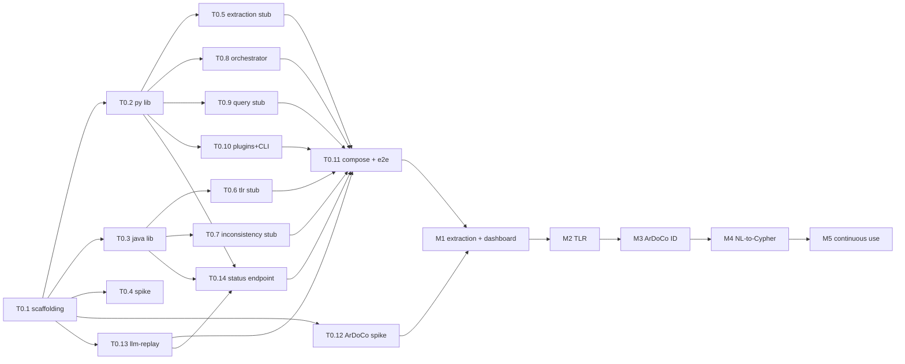

# SANDMAN – Stage 3: Implementation Plan

Status: revision 5 (system overview dashboard added: T0.14, T1.9–T1.11, ADR-0016) · Date: 2026-10-06 · Builds on [Stage 1](stage-1-analysis-architecture.md) (rev. 4), [Stage 2](stage-2-contracts-repository.md) (rev. 3) and the [ADRs](../adr/README.md).

## 0. Summary of key decisions

1. **Seven milestones.** M0 is the walking skeleton: all components as contract-true stubs in Compose, one end-to-end flow. M1–M4 replace stubs one at a time (extraction → TLR → inconsistency detection → NL-to-Cypher). M5 hardens the system for continuous use. M6 (LLM planner, link review) is optional.
2. **Replacement order:** extraction first, because every later result depends on element quality. Then TLR (ArDoCo first, LiSSA second), because inconsistency detection uses TLR information (Q-18). Then ArDoCo inconsistency detection, then NL-to-Cypher. The ArDoCo mapping risk is reduced early by the M0 spike T0.12.
3. **Every replacement is a configuration switch.** Stubs stay selectable (`enabled` flags), so a real component can be compared with or rolled back to its stub without changing contracts.
4. **Testing:** contract tests and conformance vectors are written once in M0 and never change during replacement. Tests that depend on LLM output run on recorded cassettes. Quality is measured on benchmark gold standards with fixed protocols and repeated runs.
5. **Task specs:** the first eight M0 tasks are written as self-contained specs in [docs/tasks/](tasks/), ready to hand to a coding assistant.

## 1. Work breakdown

Effort: **S** ≤ 2 days, **M** 3–5 days, **L** 1–2 weeks (one developer, with coding assistant).

### 1.1 Milestones

| Milestone | Goal | Exit criterion |
|---|---|---|
| **M0 Walking skeleton** | All components as stubs, Compose, CI, one end-to-end flow | Walking-skeleton test (Stage 2 §5) green in CI; gateway smoke test done; ADR-0004 accepted or switched |
| **M1 Real extraction + dashboard** | Built-in extractors for documentation, requirements and models; LLM enrichment; record/replay end to end; observability profile; system overview dashboard (ADR-0016) | Golden-file tests on benchmark projects; replay determinism test green; dashboard shows every service's health and activity, the KG graph view and gateway statistics on the walking-skeleton deployment |
| **M2 TLR approaches** | ArDoCo TLR and LiSSA in-process; evaluation exports and harness | ArDoCo: link set identical to the standalone runner on ≥ 2 benchmark projects; LiSSA: live re-run with the closest available model on ≥ 2 projects, Δ F1 to the published value reported with a 95 % CI, then recorded for replay (§3.3) |
| **M3 ArDoCo inconsistency detection** | ArDoCo ID (standard + Artemis variant) running in-process, using the TLR results of M2, mapped to the KG | Same findings as the standalone ArDoCo runner on its benchmark inputs; lifecycle scenario on real data |
| **M4 NL-to-Cypher** | LLM generation with validation and repair; evaluation set; console evidence views | Execution accuracy ≥ target (Q-16) on the held-out split; security suite green |
| **M5 Continuous use** | GitHub Action for ingesting user projects, retention/prune skills, backup/restore drill, performance budget | 30-day soak on an evolving project without manual intervention; restore drill passes |
| **M6 (optional)** | LLM planner with approval gate; trace-link review in console | Planner plans validated against skill schemas; no unapproved execution |

### 1.2 Tasks

| ID | Task | Effort | Depends on | Spec |
|---|---|---|---|---|
| **M0** | | | | |
| T0.1 | Repository scaffolding, build tooling (Java: Maven; Python: uv), CI (contracts job, Python/Java skeleton jobs), Makefile | M | – | [T0.1](tasks/T0.1-repo-scaffolding-ci.md) |
| T0.2 | Python agent library (`sandman_agent`) incl. A2A glue and conformance runner | L | T0.1 | [T0.2](tasks/T0.2-python-agent-library.md) |
| T0.3 | Java agent library (`agent-lib`, `agent-lib-a2a`) incl. conformance runner; no LLM client, tool loop or replay (D-3, D-7) | M | T0.1 | [T0.3](tasks/T0.3-java-agent-library.md) |
| T0.4 | Gateway smoke test (Bifrost incl. admin auth and local-only keys), Memgraph/A2A interoperability spike, Java A2A runtime decision (D-6), network and memory checks (V-1, V-2, V-4–V-8, V-18–V-21, V-30–V-35) | M | T0.1 | [T0.4](tasks/T0.4-gateway-and-interop-spike.md) |
| T0.5 | Extraction-agent stub (intake with `Ingestion` nodes, versions, reactivation, deletions, per-version element sets, stub extraction, A2A plugin client, KG init) | L | T0.2 | [T0.5](tasks/T0.5-extraction-agent-stub.md) |
| T0.6 | TLR-agent stub (`stub-name-match`, approach SPI, `/v1/approaches`) | M | T0.3 | [T0.6](tasks/T0.6-tlr-agent-stub.md) |
| T0.7 | Inconsistency-agent stub with **real** lifecycle, fingerprinting, triage API, plugin client | L | T0.3 | [T0.7](tasks/T0.7-inconsistency-agent-stub.md) |
| T0.8 | Orchestrator (rule engine, SQLite state, event-driven step completion, per-project pipeline lock, failure polling, retries, REST) | L | T0.2 | [T0.8](tasks/T0.8-orchestrator.md) |
| T0.9 | Query-service stub (users/roles, per-service token verification, forwarding, parse-tree scope guard for Cypher (D-2, V-28), NL intents, minimal console with session security) | L+S | T0.2 | [T0.9](tasks/T0.9-query-service.md) |
| T0.10 | Plugin stubs (extract via A2A — reference for the code-extraction team, Q-19; detect via HTTP), plugin-author kit (`docs/plugins.md`: contracts, Agent Card template, contract tests, obligations of external plugins: no egress, gateway keys, `llmPolicy`, token pair; D-9), fixtures `mini/`, `sandman` CLI (`ingest`, `workflows`, `export`) | M | T0.2 | – |
| T0.11 | Dockerfiles, Compose integration, walking-skeleton e2e test, CI `compose` and `e2e` jobs | M | T0.5–T0.10, T0.13, T0.14 | – |
| T0.12 | ArDoCo spike: build branch at pinned commit, run `InconsistencyDetection` on fixtures, analyze sentence/model id mapping and whether external trace links can be fed in (V-16, V-17, V-27; ADR-0015) | S | T0.1 | – |
| T0.13 | `llm-replay` proxy (standalone Python, no `sandman_agent`): OpenAI-compatible pass-through/record/replay for chat and embeddings, cassette format and key per contracts (D-3) | S | T0.1 | – |
| T0.14 | `GET /v1/status` (`ServiceStatus`, working/idle) in both agent libraries and `llm-replay` (mode, experiment, hits/misses/recordings) | S | T0.2, T0.3, T0.13 | – |
| **M1** | | | | |
| T1.1 | Markdown/text extractor (sections, sentences with content-based keys and `sentenceIndex`; also one-sentence-per-line rendering stored per version for ArDoCo, ADR-0015) | M | T0.5, T0.12 | |
| T1.2 | PCM and UML model extractors (ids preserved, `PROVIDES`/`REQUIRES`) | M | T0.5 | |
| T1.3 | Requirements extractor (Markdown/CSV) + explicit references | S | T0.5 | |
| T1.4 | PDF/DOCX via Docling, offline prefetch | M | T0.5 | |
| T1.5 | LLM enrichment (concepts, summaries) with schemas, replay tests | M | T1.1 | |
| T1.6 | Record/replay end to end through `llm-replay` (experiment manifest, cassette dirs), replay determinism test on a canonical KG export without ids and timestamps; `ORDER BY` in prompt-building reads | M | T0.11, T0.13 | |
| T1.7 | Observability: OTel in both libraries, `obs` profile dashboards (A2A, events, LLM tokens) | S | T0.11 | |
| T1.9 | Dashboard core (Stage 1 §10.1): admin login, services page (health + working/idle, Memgraph/NATS/gateway), KG graph view with Cytoscape.js incl. extras (Cypher box in read transactions, paths, PNG/JSON export), LLM gateway statistics and budgets, Dockerfile + Compose | L | T0.11, T0.14 | |
| T1.10 | Dashboard operations: workflow monitor with cancel and dead-event replay, event stream viewer, alerts (banner + `event=alert` log), record/replay status page | M | T1.9 | |
| T1.11 | Dashboard insights: project statistics, history charts (SQLite samples, uPlot), resource usage via cAdvisor (profile `resources`) | M | T1.9 | |
| **M2** | | | | |
| T2.1 | ArDoCo TLR approach adapter(s) (SAD↔SAM, SAD↔code) | L | T1.1, T1.2, T0.6 | |
| T2.2 | LiSSA adapter (LangChain4j configured via `LlmAccess` to `llm-replay`/gateway with the policy-dependent key; embeddings likewise) | L | T0.6 | |
| T2.3 | Evaluation harness: exports in benchmark formats, metric computation (paired bootstrap CIs, McNemar, effect sizes, Holm correction), experiment manifests; pre-registered protocol `experiments/PROTOCOL.md` (§3.3) | M | T2.1 | |
| T2.4 | Reproduction study per §3.3 (ArDoCo exact equality; LiSSA live re-run with Δ and CI), variance pilot deciding the number of runs, perturbed-benchmark contamination probe | M | T2.3 | |
| **M3** | | | | |
| T3.1 | ArDoCo `InconsistencyDetection` adapter: own pipeline from public factories, `runWithoutSaving()`; hands in the one-sentence-per-line rendering as pre-annotated `PreprocessingData` (`ssplit.eolonly`), maps sentence *i* to line *i* (hash as assertion), model elements by XMI id incl. interfaces; **active trace links of all approaches** via a custom step after `ConnectionGenerator` (Q-20 workaround; exact semantics need the upstream extension); deduplicates text findings by (sentence, word) (ADR-0015, spike T0.12) | L | T2.1, T0.7 | |
| T3.2 | ArDoCo `ArtemisInconsistencyDetection` adapter (LLM via gateway through ArDoCo's client) | M | T3.1 | |
| T3.3 | Equivalence test vs. standalone ArDoCo runner on benchmark inputs (`linkApproaches: [ardoco]`) | M | T3.1 | |
| T3.4 | Console evidence view (sentence text, model element, involved links, history) | S | T3.1, T0.9 | |
| T3.5 | Switch to released ArDoCo artifact when available (Q-15) | S | release | |
| T3.6 | Labeling study for detector precision: stratified random sample of findings, two blinded raters with written guidelines, Cohen's κ (§3.3) | M | T3.1 | |
| **M4** | | | | |
| T4.1 | NL-to-Cypher generation + validation + repair | M | T0.9 | |
| T4.2 | Example/evaluation set (≥ 150 question–Cypher pairs on benchmark projects, split by template and by project; test questions written by people not tuning the prompts); intent-template baseline | M | T1.x data | |
| T4.3 | Answer synthesis with citations; console "Ask" page | S | T4.1 | |
| T4.4 | Security test suite for the query path | S | T4.1 | |
| **M5** | | | | |
| T5.1 | GitHub Action `sandman-ingest` for user projects (token from secrets) | S | T0.10 | |
| T5.2 | Retention: `prune` skills (tlr, extraction) + scheduled workflow | M | M2 | |
| T5.3 | Backup/restore scripts + drill | S | T0.11 | |
| T5.4 | Performance budget (ingest 1 000 changed files, detection latency, Memgraph query latency and memory against the budget; ADR-0014 fallback only if it fails) and fixes | M | M3 | |
| T5.5 | Soak test on an evolving open-source project (30 days, nightly ingest) | M | T5.1 | |

### 1.3 Dependency graph and recommended order

Recommended order inside M0: T0.1 → (T0.2 ∥ T0.3 ∥ T0.4 ∥ T0.12 ∥ T0.13) → (T0.5, T0.8, T0.9, T0.10 ∥ T0.6, T0.7) → T0.11. T0.3 does not start its A2A glue before T0.4 has decided the Java runtime (D-6). With two developers, one takes the Python track and one the Java track. T0.4 and T0.12 are early risk spikes. Their results may change ADR-0002, ADR-0004 and the ArDoCo mapping design before much code depends on them.

Rough calendar (one developer), **re-baselined after the review decisions (D-10 confirmed 2026-10-06):** M0 tasks sum to ≈ 46 days at the lower and ≈ 86 days at the upper end of the effort classes (S = 1–2, M = 3–5, L = 5–10 days; T0.9 = L + S for the scope guard), i.e. 9–17 weeks; **planning value M0 = 13 weeks** (midpoint). The D-7 cuts save ≈ 1 week, the scope guard (D-2), the replay proxy (D-3) and the reactivation logic (D-5) add ≈ 2 weeks. T0.14 adds ≈ 2 days to M0 (planning value stays 13 weeks, within the range). M1 ≈ 7 weeks (T1.8 dropped; dashboard T1.9–T1.11 ≈ 3 weeks), M2 ≈ 4–5 weeks, M3 ≈ 4 weeks (incl. labeling study T3.6), M4 ≈ 3 weeks, M5 ≈ 3 weeks plus the soak period.

## 2. Replacement order

| Order | Replace | Rationale | Risk reduction |
|---|---|---|---|
| 1 | Extraction (M1) | Every other component consumes elements. Sentence and model-id fidelity decides whether ArDoCo results can be mapped. Mostly deterministic, so low LLM risk. | Golden files per format; stub fallback stays; LLM enrichment optional per run |
| 2 | TLR: ArDoCo, then LiSSA (M2) | Inconsistency detection uses TLR information (Q-18), so real links must exist first. ArDoCo is deterministic, which makes it a cheap correctness baseline before the LLM-based LiSSA. | Reproduction per §3.3 (ArDoCo exact, LiSSA live with Δ and CI) before any new experiment; per-approach failure isolation |
| 3 | ArDoCo inconsistency detection (M3) | Builds on M2 links; highest mapping uncertainty (V-16/V-17), de-risked early by spike T0.12; the lifecycle already exists, so real findings exercise it at once | Equivalence test against the standalone runner; `stub-untraced` remains for comparison; adapter isolated behind the detector SPI |
| 4 | NL-to-Cypher (M4) | Needs a stable schema and realistic data from M1–M3 to build a meaningful evaluation set | Stub intents remain as fallback; security suite runs with validation on and off |
| 5 | Orchestrator planner (M6, optional) | The rule engine already covers automatic flows | Feature flag, approval gate |

General rules:
- A replacement PR must not change files under `contracts/`. If it has to, the contract change goes in its own PR with both libraries and the conformance vectors updated.
- Each real component ships with an `enabled` switch and keeps its stub selectable. Experiments compare stub, old and new behavior on recorded inputs.
- Before switching the default, run the walking skeleton and the milestone scenario in `replay` mode.

## 3. Testing strategy

### 3.1 Levels

| Level | Scope | Tools | Runs |
|---|---|---|---|
| Unit | Functions/classes: rule engine, pipeline lock, lifecycle state machine, fingerprinting and sentence keys, Cypher scope guard, extractors, mapping code | pytest, JUnit 5; `ScriptedLlmClient` | every PR |
| Conformance | Library parity on `contracts/conformance/vectors.json` | runners in both libraries | every PR touching libs/contracts |
| Contract | Each service against its OpenAPI/Agent Card/event schemas: request/response validation, property-based API fuzzing | Schemathesis (OpenAPI), schema validation of every published event and skill result in tests | every PR touching a service |
| Integration | Service + Memgraph/NATS via Testcontainers; cross-language A2A (Python client ↔ Java server and vice versa) | Testcontainers | every PR |
| End-to-end | Walking skeleton and one scenario per milestone, full Compose, `replay` mode | pytest against query-service API | PR (label) + nightly |
| Failure injection | Kill agents mid-task, restart NATS/Memgraph, duplicate events, gateway budget exhaustion | Compose + test hooks | nightly |
| Security | Query-path write/admin rejection (validation on/off), cross-project read attempts against the scope guard (unanchored patterns, `WITH $projectId AS p`, subqueries, `UNION`), authorization matrix, token impersonation (a service presenting another's token, plugin tokens on write endpoints), trusted-forwarder spoofing (headers and `sandman.actor`), CSRF and session revocation, `local-only` key rejected by cloud routes, prompt-injection fixtures | pytest | every PR touching query-service/agents |

### 3.2 LLM-dependent behavior

1. **Unit:** `ScriptedLlmClient` (Python) with hand-written responses, including malformed JSON, schema violations and refusals. Assert handling, not model quality.
2. **Record/replay:** small fixture projects are recorded once per prompt version through `llm-replay` (cassettes under `tests/cassettes/<name>/`, mounted as `/llm-records` with `SANDMAN_EXPERIMENT=<name>` in CI; reviewed for secrets and confidential content); this also covers LangChain4j calls of LiSSA/ArDoCo. CI runs strict replay, so a missing cassette fails the test. Changing a prompt requires re-recording, which makes prompt changes visible in review.
3. **Live canary:** nightly, a small budget-capped run through the gateway on one fixture. It detects provider/API drift and is reported only, never blocking.
4. **Evaluation runs:** separate from CI. Experiment manifests on benchmark data, recorded (Section 3.3).

### 3.3 Quality evaluation (outlook)

Evaluation protocol (D-8). It is pre-registered in `experiments/PROTOCOL.md` before the first comparative experiment (T2.3), and changes after data collection are reported as deviations:
- **Reproduction:**
  - ArDoCo is deterministic: its link set must be identical to the standalone runner on the same inputs, with no tolerance.
  - LLM approaches (LiSSA): the published runs used models that were not recorded, so replay cannot reproduce them. A live re-run uses the closest available model; Δ to the published value is reported with a 95 % CI, and that run is then recorded for replay.
- **Statistics:**
  - Per project: paired bootstrap CIs (10 000 resamples) of metric differences, McNemar on link-level decisions, and effect sizes.
  - Across projects: Wilcoxon signed-rank only with ≥ 6 projects (with 5 projects the smallest attainable p is 0.0625).
  - Holm correction for multiple comparisons.
  - The number of live runs per configuration comes from a variance pilot (T2.4), not a fixed n = 5.
- **Contamination:**
  - A perturbed-benchmark probe applies consistent renaming of identifiers and paraphrased text; a drop beyond the run-to-run variance indicates memorization.
  - At least one non-public or post-cutoff project is included.
- **NL-to-Cypher:**
  - The data is split by template and by project, so near-duplicates cannot cross the split.
  - Test questions are written by people who do not tune the prompts.
  - Execution accuracy compares result multisets without truncation (no `LIMIT`).
  - The intent-template stub is reported as a baseline.
- **Triage labels:**
  - Detector precision comes from a separate labeling study (T3.6): a stratified random sample of findings, two raters blinded to detector and confidence, written guidelines, and Cohen's κ.
  - Field triage (REJECTED/triaged) is only a secondary signal.
  - The resolution cause (`user`, `not-redetected`, `artifact-deleted`) is recorded in `StatusChange.reason`.

| Capability | Gold standard (to verify per dataset) | Metrics | Protocol |
|---|---|---|---|
| TLR | ArDoCo benchmark projects (e.g., MediaStore, TeaStore, TEAMMATES, BigBlueButton, JabRef: SAD↔SAM, SAD↔code) and the LiSSA datasets (requirements↔code) | precision, recall, F1, F2; MAP/R-precision for ranked output | Reproduction as above; mean ± sd over n live runs (n from the pilot) for LLM approaches; paired bootstrap / McNemar per project, Wilcoxon across projects only with ≥ 6 projects, Holm correction |
| Inconsistency detection | ArDoCo ID gold standard (model elements removed to simulate missing/undocumented elements); labeling study T3.6; field triage labels as a secondary signal | precision, recall, F1 per type; labeled precision with κ; field precision = 1 − REJECTED/(triaged), secondary | Equivalence with standalone ArDoCo first; then new detectors and plugins against the same gold standard |
| Extraction | Golden files for fixtures; sentence-alignment rate against ArDoCo's splitting | exact match per element, alignment % | Golden files versioned with the code |
| NL-to-Cypher | Own question set on benchmark projects (T4.2), split by template and project; optionally adapted text2cypher items | execution accuracy (multiset equality without truncation), validity rate, repair rate, latency, cost per question; intent-template baseline | Held-out test split used only for release decisions |
| System | Continuous-use soak (M5) | ingest-to-findings latency, failure rate, cost per change | 30 days nightly |

Threats to validity to track: benchmark contamination of LLMs (benchmark projects are public; probe and non-public project above), prompt overfitting to dev splits (independent question authors), model drift (pinned versions and replay), and selection bias in triage labels (labeling study).

## 4. Risk register

| ID | Risk | L | I | Mitigation | When |
|---|---|---|---|---|---|
| RK-1 | A2A SDK churn (weekly Python releases; 1.0 broke 0.3) breaks interop | H | M | Pin SDK versions; cross-language interop test in CI; protocol glue isolated in the libraries | M0 onward |
| RK-2 | `a2a-java` server tied to Quarkus/CDI; integration friction with ArDoCo dependencies | M | M | Decided in T0.4 by two criteria (custom executor in plain Quarkus; tlr-agent skeleton with ArDoCo/LiSSA builds and starts, D-6); fallback: hand-written JSON-RPC endpoint, covered by conformance tests | M0 |
| RK-3 | ArDoCo results cannot be mapped reliably to KG elements (sentence splitting, model ids) | L | H | Spike T0.12: adapter-controlled one-sentence-per-line rendering makes the mapping exact by construction (verified byte-identical on MediaStore); model ids are XMI/PCM ids; equivalence tests (T2.4, T3.3) | M1–M3 |
| RK-4 | LiSSA/LangChain4j bypasses gateway settings or conflicts with dependency versions | M | M | Internal network blocks egress (fails loudly); policy enforced by gateway keys; calls recorded by `llm-replay`; dependency convergence enforced; shaded or isolated module if needed | M2 |
| RK-5 | Bifrost behavior differs from docs (governance, nested model names, read-only config) | M | M | T0.4 smoke test; LiteLLM fallback (library is gateway-agnostic) | M0 |
| RK-6 | Memgraph Community license or feature scope changes; driver 6.x incompatibility | L | H | Portable Cypher (contract tests), drivers pinned, fallback order ArcadeDB → Neo4j (ADR-0014, revisited only on failure) | ongoing |
| RK-7 | LLM nondeterminism and provider drift invalidate experiment comparisons | H | H | Record/replay, pinned dated models, n runs from a variance pilot, pre-registered protocol, manifests | M1 onward |
| RK-8 | LLM costs exceed budget in continuous use | M | M | Per-key budgets, incremental processing, local models for routine runs, cost per change tracked | M5 |
| RK-9 | Prompt injection through artifacts leads to wrong or harmful outputs | M | M | Data-only LLM outputs, schema validation, read-only tools, injection fixtures in the security suite | M1 onward |
| RK-10 | Users see other projects' data through a gap in the scope guard (parser coverage, new Cypher constructs, a writer breaking the no-cross-project-edge invariant) | M | H | Allowlist instead of denylist; result post-check; security suite with bypass corpus; invariant check in contract tests; confidential projects in separate deployments (future) | M0, M4 |
| RK-11 | KG growth in continuous use degrades in-memory Memgraph | M | M | Retention/prune (T5.2), memory monitoring, snapshot sizes tracked | M5 |
| RK-12 | Plugin services (code extraction, detectors) arrive late or deviate from the contract | M | M | Stubs + file-level fallback; plugin-author kit (contracts, Agent Card template, A2A reference stub, contract tests); extract via A2A and detect via HTTP supported (D-7), the other transport added on demand | M1–M3 |
| RK-13 | Large code bases: plugin results pass through the owner (memory, transaction size) | L | M | Batch writes with run cleanup; paging of plugin results if needed | M5 |
| RK-14 | Two-language maintenance overhead slows progress | M | M | Small libraries, conformance vectors, shared contracts, no features without a need | ongoing |
| RK-15 | Benchmark contamination and evaluation bias weaken research claims | M | H | Perturbed-benchmark probe; ≥ 1 non-public or post-cutoff project; splits by template and project; independent question authors; labeling study with two blinded raters (§3.3) | M2–M4 |
| RK-16 | Single server is a single point of failure for continuous use | M | M | Backups + restore drill; health-gated restarts; acceptable for a prototype | M5 |
| RK-17 | Speed advantage of Memgraph not confirmed for our workload (one 2026 third-party test shows Neo4j and FalkorDB ahead on mixed load) | M | M | Check against the T5.4 performance budget (benchmark T1.8 dropped, D-7); switch path via portable Cypher | M5 |
| RK-18 | ArDoCo's inconsistency detection cannot consume externally provided trace links (Q-20 needs it) | M | M | Workaround now (custom pipeline step replacing ArDoCo's links, heuristic mapping to text candidates; reproduces ArDoCo on MediaStore); upstream extension with sentence-level links for exact semantics (TODO for the ArDoCo team) | M1–M3 |
| RK-19 | No maintained openCypher parser for Python covers Memgraph's dialect (scope guard, D-2) | M | M | V-28 in T0.9; fallback: a small own parser for the allowlisted subset (queries outside it are rejected) | M0 |
| RK-20 | The dashboard is a privileged component (Memgraph and gateway admin credentials, orchestrator token, cAdvisor host mounts) | M | H | Admins only, own login, localhost-only port, KG access in read transactions only, cAdvisor opt-in on the internal network, secrets mounted only there (ADR-0016) | M1 |
| RK-21 | Large graphs overwhelm the browser graph view | M | L | At most 500 nodes per view, expand on demand, server-side filters | M1 |
| RK-22 | `named-architecture-entity-recognition` 2.1.0-SNAPSHOT is unpublished and depends on ArDoCo itself (cycle); LangChain4j and old CoreNLP dependencies conflict with the Quarkus BOM (protobuf 3→4, JNA) | M | M | Bootstrap build with two pinned commits; publish the snapshot / break the cycle upstream; T3.3 equivalence test on the Quarkus classpath | M0–M3 |

L = likelihood, I = impact (H/M/L).

## 5. Agent-ready task specs

The first eight tasks are in [docs/tasks/](tasks/). Each file contains everything a coding assistant needs: context, goal, scope, interfaces, deliverables, acceptance criteria and constraints. Shared constraints for all tasks:

- Follow the contracts in `contracts/` exactly; never change them inside an implementation task.
- No agent frameworks (LangChain, LangGraph, DeepAgents, LlamaIndex, CrewAI, AutoGen, LangChain4j in agent code).
- One language per service; Python 3.13 or Java 21. Build tools are fixed: all Java parts use Maven (no Gradle), all Python parts use uv (no pip, Poetry, PDM or Hatch for dependency management; `pyproject.toml` + `uv.lock`).
- Java naming is fixed: Maven groupId `io.github.ardoco` (artifactIds prefixed `sandman-`, e.g. `sandman-agent-lib`), Java packages start with `edu.kit.kastel.mcse.ardoco` (SANDMAN code under `edu.kit.kastel.mcse.ardoco.sandman`).
- Commits follow Conventional Commits, are small, and carry no AI attribution.
- Every non-trivial logic path has a test; CI must be green.

## 6. Assumptions

| ID | Assumption |
|---|---|
| A3-1 | One developer (plus coding assistants) at roughly full time; estimates scale linearly with a second developer on the Java track. |
| A3-2 | Benchmark datasets of ArDoCo and LiSSA are available to the team in machine-readable form, including gold standards. |
| A3-3 | A code-extraction plugin and further detector plugins are developed in parallel by others and become available during M1–M3. |
| A3-4 | GitHub-hosted runners are sufficient for CI (Docker available; e2e job incl. image builds < 15 min, the walking-skeleton test itself < 5 min as in Stage 2 §5). |
| A3-5 | LLM budget for evaluation runs is available separately from continuous-use budgets. |

## 7. To verify

| # | Item |
|---|---|
| V-24 | Exact dataset list and gold-standard formats of the ArDoCo and LiSSA benchmarks (for T2.3 export formats). |
| V-25 | Schemathesis support for OpenAPI 3.1 with external `$ref`s to JSON Schema files. |
| V-26 | Whether GitHub-hosted runners can build the Java images with the ArDoCo stage in acceptable time (cache `~/.m2`). |
| V-27 | **Answered (T0.12):** no built-in input; workaround via a custom pipeline step after `ConnectionGenerator`; exact semantics need an upstream extension (sentence-level links read by both detectors). |
| V-28 | A maintained openCypher parser usable from Python (e.g. the openCypher ANTLR grammar with `antlr4-python3-runtime`) that parses the allowlisted subset incl. pattern comprehensions and existential subqueries (T0.9). |
| V-29 | LiSSA and ArDoCo `llm-access`: LangChain4j base URL and API key configurable per call/project; requests non-streaming. **ArDoCo answered (T0.12):** non-streaming `ChatModel`, but configured only by process-wide env/`.env` (`OLLAMA_GENERIC`, `OLLAMA_TOKEN`, `OLLAMA_HOST`); per-project keys need an upstream change accepting a `ChatModel`. LiSSA still open (T2.2). |
| V-30 | Memgraph `--memory-limit` unit (MiB) and behavior when reached (query abort vs. process kill) (T0.4). |
| V-31 | **Answered (T0.4):** disabling IP masquerading does not block egress on Docker Desktop; replaced by `edge-proxy` in front of internal-only services (verified: published port works, internal service has no egress). |
| V-32 | OpenRouter account-level privacy setting excluding providers that train on prompts; whether Bifrost can pass provider preferences (`data_collection: deny`) (T0.4). |
| V-33 | Bifrost: `governance.auth_config` protects the management API (not only the UI) against unauthenticated calls from other containers; a virtual key with only the Ollama provider is rejected on OpenAI/OpenRouter routes; log retention configuration (T0.4). |
| V-34 | Bifrost starts healthy with empty provider keys (keyless walking skeleton; see review R-040). |
| V-35 | Memgraph write-write conflict errors are classified as transient by the Neo4j drivers' managed transactions (retry per batch) (T0.4). |
| V-36 | Bifrost: `/metrics` metric names and labels per virtual key/model/provider (tokens, cost, errors, latency); management API for budget usage; both with `auth_config` Basic auth (T1.9). |
| V-37 | cAdvisor v0.60.x image registry, required mounts and metrics on Docker Desktop (macOS) and Linux; license Apache-2.0 (T1.11). |
| V-38 | Memgraph syntax for path queries between two nodes (e.g. BFS `[*BFS ..n]`) and `QUERY MEMORY LIMIT` in the dashboard's Cypher box (T1.9). |
| V-39 | Versions and licenses of the vendored front-end libraries (Cytoscape.js 3.34.x MIT, uPlot 1.6.x MIT, htmx) and offline use without a CDN (T1.9). |

## 8. Open questions

Answered 2026-10-06: Q-16 default (80 % execution accuracy) · Q-17 default (TEAMMATES or JabRef) · Q-18 TLR (M2) before inconsistency detection (M3), because detection uses TLR information · Q-19 code-extraction plugin by a separate team; A2A is demoed first (plugin stub + plugin-author kit in T0.10) · Q-20 links from all approaches: ArDoCo and other approaches write their links to the KG, and inconsistency detection uses them (T3.1, ADR-0015).

Review decisions D-8 (evaluation protocol, §3.3) and D-10 (M0 = 13 weeks, §1.3) were taken on 2026-10-06; no review decision is open ([stage-4-review.md](stage-4-review.md) §4).
