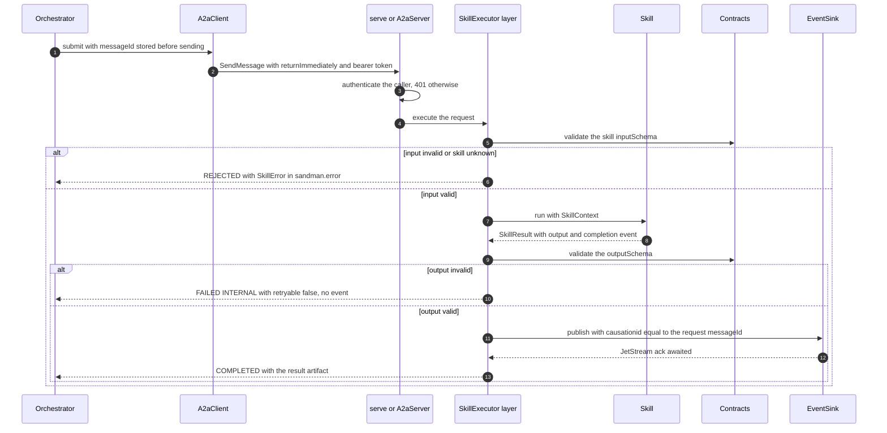
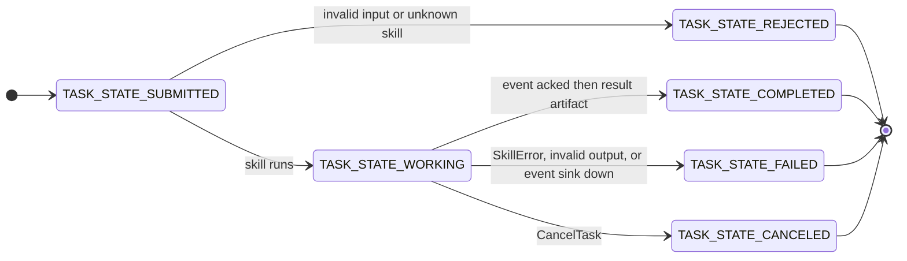

# Agent Libraries (Python and Java)

Every SANDMAN agent is **plain code** (a skill function plus configuration) on top of one small shared library per language. The libraries exist so that the common building blocks — settings, contract validation, deterministic ids, A2A glue, event publishing, knowledge-graph access, LLM access, provenance, artifact storage, status — are implemented once per language instead of per agent, and so that Python and Java agents behave **identically at the contract level**.

ADR-0010 (*Minimal agent library per language*) chose **S1 + R1 + P1**:

* **S1 – thin wrappers over official SDKs.** The libraries wrap `a2a-sdk` (Python) / `a2a-java` (Java), `openai`, `neo4j` / `neo4j-java-driver`, `nats-py` / `jnats`, `jsonschema` + `referencing` / `networknt json-schema-validator`, `rfc8785` / `java-json-canonicalization`. They never re-implement a protocol.
* **R1 – client-level record/replay, later moved out.** Amendment D-3 (R-017) relocated record/replay to one OpenAI-compatible **`llm-replay` proxy** in front of the gateway, used by *all* callers (including LangChain4j inside reused LiSSA/ArDoCo code). The library `replay` modules and the cross-language cassette vectors for library clients were removed; the libraries contain no cassette code.
* **P1 – shared schemas plus language-neutral conformance vectors.** `contracts/conformance/vectors.json` is the parity oracle; both libraries (and later kits) must reproduce every `expected*` value.

The Python API is **async**; the Java API is **synchronous on virtual threads**. Names and semantics are the same in both languages (`stable_id` ↔ `stableId`, `ensure_stream` ↔ `Streams.ensure`, `EventPublisher` in both).

## What the libraries deliberately do not contain

ADR-0010 defines the *no control flow* rule — the libraries impose no agent architecture:

* **No agent loop, no planner, no tool dispatch.** The `tools`/`loop` modules were cut in both languages (D-7: no consumer existed). The only orchestration-shaped code is the A2A protocol glue that validates, publishes and completes one task.
* **No LLM retries/fallbacks** — that is the gateway's job (`make`-level: `Bifrost`). The only translation the client does is gateway HTTP **402 → `BudgetExceededError`**.
* **No record/replay** — `llm-replay` in front of the gateway covers all callers, including LangChain4j inside reused ArDoCo/LiSSA code.
* **No prompt templating, memory, vector stores, agent graphs, or DI** — the one DI container allowed is Quarkus CDI, and only inside `agent-lib-a2a`.
* **No agent frameworks (NFR-3).** See [Guards](#guards-nfr-3).

## Location, naming and consumers

| | Python | Java |
|---|---|---|
| Path | `libs/python/sandman-agent` | `libs/java/agent-lib` (plain Java 21, no CDI) + `libs/java/agent-lib-a2a` (Quarkus/CDI glue for a2a-java) |
| Package / artifact | `sandman_agent` (uv workspace member, version 0.1.0) | `io.github.ardoco:sandman-agent-lib` and `sandman-agent-lib-a2a`, package `edu.kit.kastel.mcse.ardoco.sandman.agent[.a2a]` |
| Consumers | `orchestrator`, `extraction-agent`, `query-service`, `plugin-stubs` (all Python services) | `tlr-agent`, `inconsistency-agent` (both Quarkus apps) |

An agent is written as: read `Settings.from_env()`, build `Contracts`, implement one `Skill` per A2A skill, and let the library serve it (`serve()` in Python; CDI beans + `SkillExecutor` in Java). The Java `A2aServer` provides `@DefaultBean` producers for `Settings`, `Contracts` and `StatusTracker` so an agent only overrides what it needs.

## Python module surface (`sandman_agent`)

All public names are re-exported from `sandman_agent/__init__.py`.

| Module | Purpose | Headline names |
|---|---|---|
| `config` | `Settings` from the `SANDMAN_*` environment; `*_FILE` variables read from files; `DEFAULT_CONTRACTS_DIR` points at the repository `contracts/` | `Settings.from_env()`, `Settings.require()`, `ConfigError` |
| `ids` | Deterministic ids, keys, fingerprints and RFC 8785 canonical JSON | `stable_id`, `section_local_key`, `sentence_local_key`, `fingerprint`, `new_run_id`, `new_workflow_id`, `sha256_hex`, `canonical_json` |
| `contracts` | Validation against the JSON Schemas in `contracts/`, no network | `Contracts.validate(ref, instance)` → `ContractError` with **all** messages; `Contracts.is_valid` |
| `a2a` | A2A glue implementing the SANDMAN skill-invocation convention on `a2a-sdk` (JSON-RPC binding, Starlette) | `serve()`, `Skill` (Protocol), `SkillContext`, `SkillResult`, `SkillError`, `A2aClient`, `TaskSnapshot`, `TaskNotFoundError` |
| `events` | CloudEvents envelope on NATS JetStream | `Event`, `EventSink` (Protocol), `EventPublisher`, `EventConsumer`, `ensure_stream`, `PublishError`, `handle_message` |
| `kg` | Neo4j async driver over Bolt to Memgraph + run provenance | `KgClient` (`read`/`write`/`write_tx`/`run_autocommit`/`init_schema`), `RunRecorder` (`start`/`complete`/`fail`/`cleanup_stale`), `MemoryLimitError` |
| `llm` | OpenAI-compatible chat/embeddings through `llm-replay` and the gateway | `ChatRequest`, `ChatResponse`, `LlmClient` (Protocol), `OpenAiLlmClient`, `ModelSelector`, `BudgetExceededError`, `PolicyError` |
| `auth` | Service-token verification and trusted forwarders | `TokenVerifier`, `require_service`, `trusted_actor`, `actor_from_metadata` |
| `artifacts` | Content-addressed blob store | `ArtifactStore.put/path_for/open` |
| `plugins` | Extraction-plugin client via A2A | `A2aPluginClient`, `PluginError` |
| `status` | Working/idle status for the system overview | `StatusTracker`, `status_route` (GET `/v1/status`) |
| `telemetry` | JSON logging with context fields, optional file sink, optional OTel | `setup_logging`, `bind`/`reset`, `trace_headers` |
| `testing` | Test helpers | `ScriptedLlmClient`, `InMemoryEventBus`, `run_conformance` |

## Java module surface

`agent-lib` (plain Java 21, synchronous API):

| Class | Purpose |
|---|---|
| `Settings` | Record of the same `SANDMAN_*` variables; `fromEnv()`, `require(componentNames…)`; `defaultContractsDir()` searches upwards from the working directory; `toString()` never prints secrets |
| `Ids` | `stableId`, `sectionLocalKey`, `sentenceLocalKey`, `fingerprint`, `newRunId`, `newWorkflowId` — byte-wise UTF-8 sorting, **not** `String.compareTo` (UTF-16 order differs for astral characters) |
| `Jcs` | RFC 8785 canonicalization via `java-json-canonicalization` (used for `Run.configHash`) |
| `Contracts` | networknt validator over the same three schema files; `$id` URIs resolve to local files; `Locale.ROOT` forces English validation messages (they end up in `sandman.error`) |
| `ServiceAuth` | Own token (`ownToken()`), caller verification (`callerFromHeader`, `requireService` — 401 unknown, 403 plugin callers), trusted forwarders `trustedActor` / `actorFromMetadata` |
| `LlmAccess` | `forPolicy(settings, llmPolicy)` → base URL (the `llm-replay` proxy), cloud or `-local` virtual key, routes from `models.yaml`; **configures LangChain4j inside approach/detector adapters** — there is deliberately no Java `LlmClient`/`ModelSelector` (D-7) |
| `Event` | CloudEvents 1.0 envelope record + `Event.build()` (validates) / `toJson()` / `fromJson()` |
| `EventPublisher` | JetStream publish with `Nats-Msg-Id` = event id, ack awaited, 3 retries with backoff, then `PublishException` |
| `EventConsumer` | Durable pull consumer: ack on success, `nakWithDelay` on handler exceptions |
| `Streams` | The `SANDMAN` stream config + idempotent `ensure(jsm)` |
| `KgClient` | `read`/`write`/`writeTx`/`runAutoCommit`/`initSchema`; `MemoryLimitException` |
| `RunRecorder` | `RunInfo` record + `start`/`complete`/`fail`/`cleanupStale` (identical Cypher to Python) |
| `ArtifactStore` | `put` returns `Stored(sha256, uri)`; atomic move; `pathFor`/`open` |
| `HttpPluginClient` | Detector plugins: `POST /v1/detect` (`contracts/openapi/plugin-http.yaml`) with the plugin's inbound token; `PluginException.retryable()` |
| `StatusTracker` | `AtomicInteger` counter + `Active` handle (try-with-resources) + `snapshot(details)` |
| `MdcKeys` | SLF4J MDC key constants for the JSON log fields; the JSON format itself is configured by the applications |
| `testing.ConformanceRunner` | `run(vectorsPath, contracts)` → list of failure descriptions |

`agent-lib-a2a` (Quarkus/CDI glue on `a2a-java`, package `…agent.a2a`):

| Class | Purpose |
|---|---|
| `Skill` | CDI-bean interface: `id()` and `run(SkillContext, JsonNode) -> SkillResult`, throwing `SkillException` for expected failures |
| `SkillResult` | `record(output, eventType, eventData)`; `SkillResult.of(output)` for plugin skills (no event) |
| `SkillContext` | `taskId`, `messageId`, `workflowId`, `caller`, `actor`, `cancelled()` flag, `progress(text)` |
| `SkillExecutor` | `AgentExecutor` implementing the SANDMAN invocation convention (`@ApplicationScoped`); discovers `Skill` beans via `Instance<Skill>`, fails startup if a skill has no schema in the card |
| `EventSink` | Functional CDI interface for the completion event; production binds `EventPublisher::publish`; absent for plugins |
| `A2aServer` | Card from `sandman.agent-card` (env `SANDMAN_AGENT_CARD`), bearer filter + path reroute, `GET /v1/status`, `/healthz`, `/readyz`, `@PublicAgentCard` producer, `@DefaultBean` producers for `Settings`/`Contracts`/`StatusTracker` |
| `A2aClient` | `submit` (returnImmediately), `send`, `get`, `cancel`, `card`; nested `TaskSnapshot` record with `terminal()` |

## The A2A skill-invocation convention

Both servers implement the same convention (Stage 2 §1.3, ADR-0002): skill id in `message.metadata["sandman.skill"]`, input = exactly **one** data part, result = task artifact `result` with one data part, errors as `SkillError` (`code`, `message`, `retryable`, defined in `common.schema.json`) in status message metadata `sandman.error`. Input/output schemas are referenced from the Agent Card's skill-invocation extension `https://sandman.invalid/a2a/extensions/skill-invocation/v1` and resolved by `Contracts` — the library refuses to serve a skill whose id has no schema entry.

The ordering invariant (ADR-0010 amendment D-1) is the heart of the convention: **the library validates the output, publishes the skill's single completion event, awaits the ack, and only then completes the task.** So an orchestrator that observes `TASK_STATE_COMPLETED` knows the event is durably published; a task that failed after the KG commit reports `DEPENDENCY_UNAVAILABLE` (retryable) and the retried task republishes.

*The task snapshot travels back to the caller through the `SendMessage` response or `GetTask` polling; the orchestrator stores the `messageId` before sending so a fast completion event always matches.*

Task states produced by the convention:

Error mapping, identical in both languages and pinned by the `skillInvocation` vectors and round-trip tests:

| Situation | State | Code | retryable | Event? |
|---|---|---|---|---|
| Missing `sandman.skill`, not exactly one data part, input fails `inputSchema` | `TASK_STATE_REJECTED` | `INVALID_INPUT` | false | – |
| Skill id not in the card/beans | `TASK_STATE_REJECTED` | `UNKNOWN_SKILL` | false | – |
| Skill raises `SkillError`/`SkillException` | `TASK_STATE_FAILED` | caller-supplied code (e.g. `BUDGET_EXCEEDED`) | caller-supplied | – |
| Output violates `outputSchema` (a bug, not a transient error) | `TASK_STATE_FAILED` | `INTERNAL` | false | **never** |
| Skill wants an event but no `EventSink` is wired / no data | `TASK_STATE_FAILED` | `INTERNAL` | false | – |
| Unexpected exception from the skill | `TASK_STATE_FAILED` | `INTERNAL` | true | – |
| Publishing the completion event fails (KG already committed) | `TASK_STATE_FAILED` | `DEPENDENCY_UNAVAILABLE` | true | retried task republishes |
| Gateway budget exhausted (`BudgetExceededError`) | `TASK_STATE_FAILED` | `BUDGET_EXCEEDED` | false | – (orchestrator sets the workflow to BLOCKED) |

Cancellation is cooperative: `CancelTask` sets a flag on the `SkillContext` (`ctx.cancelled` event in Python, volatile boolean in Java); long-running skills poll it, and the server moves the task to `CANCELED`. Python re-raises `asyncio.CancelledError` so the skill can unwind; Java checks `ctx.cancelled()` after `run` returns and simply returns, because `cancel()` already moved the task to `CANCELED` and no event must be published.

**Caller identity**: the request's `messageId` becomes the event's `causationid`; `sandman.workflowId` metadata becomes `correlationid`; the event subject is the input's `projectId`; `sandman.actor` metadata is accepted **only** when the caller is the `orchestrator` and is otherwise ignored (`ServiceAuth.actorFromMetadata` / `auth.actor_from_metadata`).

**Numbers**: protobuf `Struct` widens every number to a double on the wire. Both libraries normalize integral floats back to `int`/`long` before validation, equality checks and hashing (`json_value` in `a2a.py`, `SkillExecutor.jsonValue` in Java) — otherwise `linkCount: 1.0` would fail an `integer` schema and produce different canonical hashes.

### Client side (`A2aClient`)

Both clients submit with `returnImmediately` and then poll `GetTask` (`TaskNotFoundError` is re-exported so callers can treat it as retryable; the orchestrator does exactly that):

* They send **this service's own token** (`Settings.service_token` / `ServiceAuth.ownToken`), never a user token.
* They send the `A2A-Extensions: https://sandman.invalid/a2a/extensions/skill-invocation/v1` header — `a2a-java` rejects any `SendMessage`/`GetTask`/`CancelTask` that does not list a card's `required: true` extension (spike T0.4, W-2). The Java client also sends `A2A-Version: 1.0`.
* The agent is reached at the **configured address**: the card is fetched from `/.well-known/agent-card.json` (public, no token) and the card's interface URL is rewritten to the configured scheme/host/port, keeping the card's path.
* `TaskSnapshot` exposes `task_id`, `state`, `result` (artifact `result` data part) and `error` (`sandman.error` metadata); `terminal` is true for `COMPLETED`, `FAILED`, `CANCELED`, `REJECTED`.

Callers must not assume the first state after `SendMessage`: the Java server returns `REJECTED` directly, the Python server returns `SUBMITTED` first. The vectors encode this as `TASK_STATE_SUBMITTED_OR_LATER`.

### Authentication modes of the skill server

`serve()` / `A2aServer.authenticate()` pick one of two modes from settings:

* **Plugin mode** — if `SANDMAN_PLUGIN_INBOUND_TOKEN[_FILE]` is set, a constant-time compare against that inbound token maps any valid caller to `owner`. Used by extraction plugins (`tests/plugin-stubs`); plugins never publish events.
* **Agent mode** — otherwise `TokenVerifier(settings.service_verify)` maps the bearer token's sha256 to a caller name, and callers whose name starts with `plugin:` are **rejected**.

In both modes the Agent Card stays public, every other JSON-RPC call without an accepted token gets **401** (Python: `_RequireToken` ASGI middleware on the JSON-RPC path; Java: Vert.x router guard at order −100), and `GET /v1/status` requires a token. REST endpoints of the extraction-agent and orchestrator use `require_service(verifier)` (401 unknown token, 403 plugin callers unless `allow_plugins=True`); the query-service instead implements the ADR-0013 principal/role model in its own `auth.py`, which grants plugin callers viewer access per project grant.

## Events (NATS JetStream, CloudEvents)

The `Event` record is the CloudEvents 1.0 envelope with `source = "sandman/<service-name>"`, `subject = projectId` and second-precision UTC time; it serializes **without null members** (`correlationid`, `causationid`, `traceparent` omitted when absent) and validates against `contracts/events.schema.json` *before* any publish — a completion event without `causationid` therefore fails validation instead of reaching the bus.

`ensure_stream` / `Streams.ensure` create or update (idempotent) the `SANDMAN` stream: subjects `sandman.>`, file storage, limits retention, 90-day max age, 2-minute duplicate window, discard old, one replica. Event **type = NATS subject**, so `publish("sandman.tracelinks.updated", …)` lands on that subject.

* **`EventPublisher`** sets `Nats-Msg-Id` to the event id (JetStream dedup), awaits the ack, retries 3× with backoff `0.5s, 2s, 5s`, then raises `PublishError`/`PublishException`. The same event id republished is deduplicated.
* **`EventConsumer`** is a durable pull consumer: `ack_policy=explicit`, `ack_wait=60s`, `max_deliver=5`, `backoff=[5s, 30s, 120s, 300s]`, `max_ack_pending=100`; the handler sees an `Event`, success acks, an exception naks with the backoff delay for the current delivery count. The orchestrator runs one such consumer (`durable="orchestrator"`) and additionally records the delivery count so the last failed delivery lands in `dead_events` instead of looping.

## Knowledge graph and provenance

`KgClient` mirrors Memgraph's rules found in spike T0.4:

* `read` runs in a **read transaction** — Memgraph rejects writes there, which is the primary write guard; `write`/`writeTx` run in write transactions where the driver retries transient errors (e.g. concurrent-write conflicts).
* `run_autocommit` / `runAutoCommit` is required for schema statements and `SHOW STORAGE INFO` — Memgraph rejects constraint manipulation in multi-command transactions.
* **Memory-limit errors are not retried.** Memgraph reports "Memory limit exceeded" as a `TransientError`, which drivers would otherwise retry for ~30 s; both libraries re-raise it as `MemoryLimitError`/`MemoryLimitException` to stop the retry loop.
* `init_schema` runs `contracts/kg/init.cypher` statement by statement (comments stripped, split on `;`), idempotently, at service startup.

`RunRecorder` writes run provenance per `contracts/kg/schema.yaml`: `start` creates a `Run` node (status `running`, `startedAt`, `inputKey`, `configHash`, `workflowId`, `a2aTaskId`, `triggeredBy`, `replayMode`, …) plus `USED` edges to the consumed `ArtifactVersion` nodes and returns a fresh `run_…` id; `complete` records token usage and status `completed`/`partial`; `fail` records the error; **`cleanup_stale(input_key)` deletes facts produced or detected by non-completed runs with the same input key and marks those runs `failed`** — the idempotency mechanism that lets owners safely re-run a partially written skill. Both implementations use the same Cypher.

## Deterministic ids, keys and fingerprints

Everything that must be idempotent uses `stableId(prefix, parts…)` = `prefix + "_" + first 32 hex chars of sha256(parts joined by U+001F)`. Run and workflow ids are random (`run_`/`wf_` + 32 hex).

* `sectionLocalKey(headings, occurrences)` — `'sec:' + slugs from the top`, where slug = Unicode NFC, ASCII `A–Z` lowercased, runs outside `[a-z0-9]` collapsed to `-`, empty → `section`; the n-th sibling with the same slug gets `~n`.
* `sentenceLocalKey(sectionKey, text, occurrence)` — section key + `/` + first 12 hex of sha256 of the normalized text (NFC, ASCII whitespace runs collapsed to one space, trimmed); identical sentences get `~n`.
* `fingerprint(type, detectorId, involvedKeys)` — sha256 over type, detector id (**without version**) and involved keys **sorted byte-wise by UTF-8** (Java must not use `String.compareTo`, whose UTF-16 order puts e.g. 😀 before Ａ). Inconsistency id = `stableId("inc", projectId, fingerprint)`.
* `canonical_json` / `Jcs.canonicalize` — RFC 8785 (JCS) bytes, used for `inputKey`/`configHash` so the same logical value hashes identically in both languages.

These exact algorithms — with Unicode and whitespace edge cases — are what `contracts/conformance/vectors.json` pins down.

## Contract validation

`Contracts(contracts_dir)` loads `common.schema.json`, `skills.schema.json` and `events.schema.json` once into a registry keyed by `$id`; a ref is either a file name with fragment (`skills.schema.json#/$defs/RecoverTraceLinksInput`) or a full `$id` URI. **No network access** — `$id` URIs such as `https://sandman.invalid/contracts/…` resolve to the local files. `validate` raises `ContractError`/`ContractException` carrying *every* validation message (they surface as `sandman.error.message`), and the Java side pins `Locale.ROOT` so messages are English regardless of the JVM locale.

## LLM access

All LLM traffic goes through the `llm-replay` proxy in front of the Bifrost gateway (`SANDMAN_LLM_BASE_URL`, e.g. `http://llm-replay:8000/openai`) using **logical routes** mapped to gateway model names in `config/llm/models.yaml` (`chat-default`, `chat-local`, `embed-default`, `embed-local`, …). A project's `llmPolicy` is enforced at the library level:

* Python: `ModelSelector(models_file, base_url, key, local_key)` reads the routes; `client(policy)` returns an `OpenAiLlmClient` with the cloud key or, for `local-only`, the local key and `local_only=True`, which rejects any route not ending in `-local` (`PolicyError`). `chat`/`embed` map `response_schema` to OpenAI `response_format` json_schema (`strict: true`), default `temperature=0.0`, set `user=run_id` for attribution, and forward `telemetry.trace_headers()` (W3C `traceparent`). Gateway **HTTP 402 → `BudgetExceededError`** (budget exhausted; the skill layer turns it into `BUDGET_EXCEEDED` and the orchestrator blocks the workflow); 429 stays with the SDK's own retries.
* Java: `LlmAccess.forPolicy(settings, llmPolicy)` returns base URL, the cloud or `-local` key, the routes and a `localOnly` flag; `model(route)` applies the same `-local` restriction (`PolicyException`) and `chatModel()`/`embedModel()` pick the default routes. `LlmAccess` is the data an adapter hands to LangChain4j — Java has **no** `LlmClient` by design (D-7), because Java LLM use happens inside reused ArDoCo/LiSSA code. `toString()` never prints the key.

## Plugin clients (one transport per owner, D-7)

* **Python `A2aPluginClient`** — extraction plugins over A2A: validates `PluginExtractInput`, submits skill `sandman.plugin.extract` with the plugin's inbound token, polls with exponential backoff (`0.5s → 10s`) until terminal or a default 600 s timeout (then `CancelTask`), and validates `PluginExtractOutput`. Unreachable plugin or timeout → `PluginError(retryable=True)`; a schema-invalid plugin result is **not** retryable.
* **Java `HttpPluginClient`** — detector plugins over plain HTTP: validates `PluginDetectInput`, `POST /v1/detect` with `Authorization: Bearer <inbound token>` (10 s connect, default 10 min request timeout); non-200 → `PluginException` retryable only for **503**; a response that fails `PluginDetectOutput` is non-retryable; transport errors are retryable.

The A2A/HTTP variants of the *other* direction were cut until needed (D-7): today the extraction-agent speaks A2A only and the inconsistency-agent HTTP only.

## Artifacts

`ArtifactStore` stores blobs at `<root>/<projectId>/<sha256>` and returns `artifact://<projectId>/<sha256>`. `put` is idempotent and **atomic** (temp file + `os.replace` / `Files.move(ATOMIC_MOVE)`); project ids and URIs are validated against strict regexes (`^[a-z0-9][a-z0-9-]{1,62}$`, `^artifact://…/[0-9a-f]{64}$`), so paths derive only from validated ids — never from user-supplied paths — which blocks `../` traversal and rejects uppercase project ids.

## Status, telemetry and configuration

* **`StatusTracker`** counts active skill tasks (`track()` context manager in Python, `AutoCloseable` handle in Java) and reports `state: working|idle`, `activeTasks`, `lastActivityAt` plus optional service-specific `details` — the `ServiceStatus` of `contracts/openapi/shared.yaml` consumed by the dashboard. `status_route`/`A2aServer` serve it at `GET /v1/status` behind the token check; the Java side additionally registers `/healthz` and `/readyz` (liveness only — dependency checks are to be added when agents need them).
* **`telemetry`** (Python) emits one JSON object per line with `ts, level, service, msg` plus context fields bound via contextvars (`workflowId`, `taskId`, `runId`, `projectId`, `actor`), optional rotating file sink (`SANDMAN_LOG_FILE`, 50 MB × 5), and OpenTelemetry tracing only when `OTEL_SDK_DISABLED=false`; `trace_headers()` injects the current `traceparent` into LLM calls and events. The executor binds/resets the task context around every skill run. Java exposes the same MDC keys via `MdcKeys`; the JSON format is configured by the applications.
* **`Settings`** — the runtime contract of Stage 2 §1.7: `SANDMAN_SERVICE_NAME` is required (fail fast); secret-bearing variables (`SANDMAN_KG_PASSWORD`, `SANDMAN_LLM_KEY`, `SANDMAN_LLM_LOCAL_KEY`, `SANDMAN_SERVICE_TOKEN`, `SANDMAN_PLUGIN_INBOUND_TOKEN`) read from `*_FILE` files; `SANDMAN_SERVICE_VERIFY_FILE` holds `{callerName: sha256(token)}`; `SANDMAN_CONTRACTS_DIR` defaults to the repository `contracts/`. `require("kg_uri", "nats_url", …)` (Python, snake-case names) / `require("kgUri", "natsUrl", …)` (Java, record component names) collects **all** unset names into one error message, and both `toString()` implementations never print secrets.

## Guards (NFR-3)

* **Python**: `make guard` fails the build if any `*.py` under `libs/` or `services/` imports `langchain`, `langgraph`, `deepagents`, `llama_index`, `crewai` or `autogen` (`FRAMEWORKS` regex in the `Makefile`; `make lint` runs it first). The CI `python` job runs `make lint` and then `uv run pytest`.
* **Java**: the Maven aggregator configures `maven-enforcer-plugin` with `bannedDependencies` for `dev.langchain4j`, `org.springframework.ai` and `org.bsc.langgraph4j`. LangChain4j remains acceptable **inside reused LiSSA/ArDoCo code** (ADR-0010 Q-2) and is pinned explicitly in those adapter modules.
* Further languages (ADR-0017) will add per-language guards (LangChain.js/LangGraph.js/LlamaIndex/Mastra for TS, LangChainGo/Eino for Go, langchain-rust/rig for Rust).

## Cross-language parity

`contracts/conformance/vectors.json` (contract version 0.3.0) is the single parity oracle. It contains seven groups; the libraries own five of them:

| Vector group | Checked by | Where |
|---|---|---|
| `stableId`, `sectionKey`, `sentenceKey`, `fingerprint` (+ `expectedInconsistencyId`), `eventEnvelope` | Python `run_conformance` via `tests/conformance/test_python_conformance.py`; Java `ConformanceRunner` via `libs/java/agent-lib/src/test/…/ConformanceTest.java` | pure functions + schema validation, no containers |
| `skillInvocation` (4 cases) | Python `libs/python/sandman-agent/tests/test_a2a.py::test_skill_invocation_vectors` (in-process `serve()` skill); Java `A2aServerTest.skillInvocationVectors` (`@QuarkusTest` test agent) | needs a served skill |
| `cassetteKey` | **not** the libraries — implemented only by the `llm-replay` server (`services/llm-replay`), which asserts them in its own tests | removed from the libraries by ADR-0010 D-3 |

Both runners return a list of failure descriptions and the tests assert it is empty, so a drift in either language breaks that language's CI job (`python` / `java`, both path-filtered on `contracts/**`).

ADR-0017 (*Additional agent languages*) extends the same mechanism: TypeScript, Go and Rust get **minimal agent kits** (`libs/typescript|go|rust/sandman-agent`), built **on demand** when the first agent in that language is planned (tier 1: TS and Go; tier 2: Rust, after the A2A SDK and a Memgraph Bolt-driver check mature). A new language is admitted for an agent only once its kit passes the conformance vectors, a cross-language interop test against the Python orchestrator and a Java agent, and a Memgraph integration test (read transaction rejects writes, `init_schema`, memory-limit not retried). The kits deliberately exclude the cut modules (tool loop, record/replay).

### Interop facts both implementations must respect (spike T0.4)

* a2a-java serves JSON-RPC **only at `POST /`**; `A2aServer` guards both the card's path and `/` and reroutes the card's path to `/` (W-1).
* a2a-java is fail-closed without a `TaskAuthorizationProvider`; `agent-lib-a2a` sets `a2a.authorization.required=false` in `src/main/resources/META-INF/microprofile-config.properties` and authenticates with its own bearer filter (W-3).
* Every client must send the `A2A-Extensions` header listing the (required) skill-invocation extension (W-2); `A2A-Version: 1.0` is sent by the SDK clients.
* Integral doubles are normalized to integers on both sides (W-4).
* `GetTask` on an unknown id yields the identical JSON-RPC error `-32001 Task not found` on both; Python surfaces `TaskNotFoundError`, Java `A2AClientException` caused by `TaskNotFoundError`.
* `sandman.error` metadata round-trips unchanged in both directions; state names (`TASK_STATE_*`) are identical.

## Tests that pin the behavior

**Python** (`uv run pytest`, root `pyproject.toml` includes `libs/python` and `tests/conformance` in `testpaths`):

* `libs/python/sandman-agent/tests/test_units.py` — `*_FILE` secrets and the one-message `require` failure; `ModelSelector` local-only enforcement; token verification, plugin rejection, `X-Sandman-Actor` forwarder rules; publisher retry-then-`PublishError` (and rejection of a completion event without `causationid`); consumer ack/nak with backoff; content-addressed artifact store incl. traversal rejection; gateway 402 → `BudgetExceededError`.
* `tests/test_a2a.py` — full A2A round trip over `httpx.ASGITransport`: exactly one event, `causationid = messageId`, `correlationid = workflowId`, event **before** `COMPLETED`; actor ignored from non-orchestrators; invalid output fails **without** an event; `SkillError` reporting; unknown and plugin tokens rejected (401); card public; the four `skillInvocation` vectors; `/v1/status` idle → working → idle.
* `tests/test_plugins.py` — plugin mode with the inbound token, validated output, non-retryable invalid plugin output.
* `tests/test_integration.py` — real Memgraph and NATS Testcontainers (skipped without Docker): read transaction rejects writes, `cleanup_stale` keeps facts of completed runs, publish → consume round trip.
* `tests/conformance/test_python_conformance.py` — `run_conformance` over the shared vectors.

**Java** (`mvn -B verify`, runs Spotless + enforcer + tests):

* `LibraryTest` — settings/`require`, `Ids` UTF-8 byte ordering (emoji vs. fullwidth A), `Jcs`, `Contracts` message aggregation and `$id` refs, `LlmAccess` local-only policy, `ServiceAuth` forwarders, artifact store traversal, status tracker.
* `EventsTest` — flaky-JetStream proxy: retry/backoff, `Nats-Msg-Id` reuse, envelope omits nulls, consumer ack/nak.
* `HttpPluginClientTest` — local `HttpServer`: inbound token presented, 503 retryable, invalid output not retryable, input rejected before calling.
* `IntegrationTest` — Memgraph + NATS Testcontainers: read/write split, `cleanupStale`, idempotent `initSchema`, memory-limit error **not retried** (< 5 s), publish/consume with deduplication.
* `ConformanceTest` — `ConformanceRunner` over the same vectors file.
* `A2aServerTest` / `TestAgent` / `UnitTest` (`@QuarkusTest` in `agent-lib-a2a`) — the served-skill vectors, round trip with the task state observed at publish time (`TASK_STATE_WORKING`), failure modes, token rejection, cancel flag, `/v1/status`, plus unit tests for the two auth modes and integral-double normalization.

The e2e walking skeleton (`make e2e`) exercises the real stack including the plugin stubs built on `serve()`.

See [Contract-First Interfaces](/openwiki/architecture/contracts.md) for the schema/card files themselves, [A2A Skills](/openwiki/concepts/a2a-skills.md) for the convention from a skill author's perspective, [Event Bus](/openwiki/concepts/event-bus.md) for the event types and orchestrator rules, [Auth and Roles](/openwiki/concepts/auth-and-roles.md) for the token/actor model, [Configuration](/openwiki/operations/configuration.md) for the `SANDMAN_*` variables and mounted config files, and [Testing and CI](/openwiki/testing/testing-and-ci.md) for the CI jobs that run the conformance suites.
