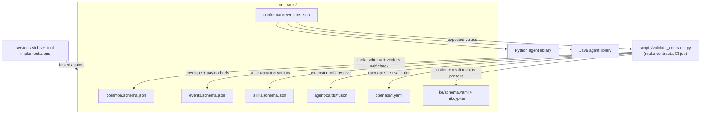

# Contract-First Interfaces

## Overview

SANDMAN follows a strict **contract-first** approach: every interface between components is defined as a machine-readable file in the `contracts/` directory, not as prose in documentation. These files are the single source of truth against which **both stubs and final implementations** are built and tested. Nothing in the system is allowed to drift away from them, because the CI pipeline validates the contracts themselves on every change and re-runs the same validation as part of the language-specific test suites.

The directory contains five families of contracts, plus a validation harness:

| Family | Files |
|---|---|
| Shared JSON Schema types | `contracts/common.schema.json` |
| Domain events | `contracts/events.schema.json` |
| A2A skill inputs/outputs | `contracts/skills.schema.json` (incl. plugin payload schemas and `Finding`) |
| A2A Agent Cards | `contracts/agent-cards/*.json` (3 agent cards + 2 plugin templates) |
| OpenAPI documents | `contracts/openapi/*.yaml` (`shared.yaml`, `extraction-agent.yaml`, `inconsistency-agent.yaml`, `tlr-agent.yaml`, `plugin-http.yaml`, `orchestrator.yaml`, `query-service.yaml`) |
| Knowledge-graph contract | `contracts/kg/schema.yaml` and `contracts/kg/init.cypher` |
| Conformance vectors | `contracts/conformance/vectors.json` |

This mirrors the complete inventory in `docs/stage-2-contracts-repository.md` §1.1; every file listed there exists in `contracts/`.

## Why contracts as files

Because SANDMAN is a polyglot system — a Python agent library, a Java agent library, Python and Quarkus services, and external plugins in arbitrary languages — every behavioral convention that implementations must agree on is pinned down in a schema that CI can verify. The conformance vectors (`contracts/conformance/vectors.json`) are the keystone: they define the **expected values** for deterministic identifiers, sentence keys, fingerprints, `llm-replay` cassette keys (RFC 8785 JSON Canonical Serialization), skill invocation validation, and event envelope validation. Both agent libraries must reproduce every `expected*` value; the CI jobs run the same vectors against both. This makes cross-language divergence a test failure rather than an integration surprise.

## The JSON Schemas

All three schemas are draft 2020-12 and are validated against the meta-schema in CI.

### `common.schema.json` — shared vocabulary

Defines the types every other contract and both agent libraries depend on:

- `StableId` — deterministic identifiers of the form `<prefix>_<32 hex chars>`, with prefixes `art`, `ver`, `el`, `con`, `tl`, `inc`, `ing`.
- `RunId` — **random** (`run_` + uuid4 hex) identifiers for one agent invocation. The split matters: stable ids are used wherever re-running the same work must produce the same id (idempotency); run ids are unique per invocation so concurrent runs don't collide.
- `Timestamp` — ISO-8601 UTC strings (`format: date-time`).
- `Actor` — `user:<name>`, `system:<detector-or-rule>` or `service:<component>`.
- Enums shared across events, skills, OpenAPI and the KG: `ArtifactKind`, `ElementLabel`, `RelationType`, `LinkType`, `LinkStatus`, `InconsistencyStatus`, `Severity`, `LlmPolicy`.
- `ElementLocator` — references an element by `path` + `localKey`; used by plugin payloads *before* ids exist.
- `CassetteEntry` — one line of an `llm-replay` cassette JSONL file, whose key is `sha256` hex of the RFC 8785 (JCS) serialization of the OpenAI request body after dropping the members `user`, `stream` and `stream_options` (ADR-0010).
- `SkillError` — `{code, message, retryable}` with codes like `INVALID_INPUT`, `UNKNOWN_SKILL`, `DEPENDENCY_UNAVAILABLE`, `BUDGET_EXCEEDED`, `INTERNAL`; placed in A2A task-status message metadata under `sandman.error`.
- `SkillInvocationMetadata` — required A2A `message.metadata` members: `sandman.skill` (required), optional `sandman.workflowId`, `sandman.actor` (accepted only from the orchestrator as a trusted forwarder), and W3C `traceparent`.

### `events.schema.json` — CloudEvents envelope and payloads

One `Event` definition with `specversion: "1.0"`, structured JSON, and the NATS subject equal to the event `type`. Five event types form the entire event catalog:

| Type | Producer | Published when |
|---|---|---|
| `sandman.ingestion.completed` | extraction-agent | after an ingestion's KG commit, only if the current state changed |
| `sandman.extraction.completed` | extraction-agent | completion event of the extraction task |
| `sandman.tracelinks.updated` | tlr-agent | completion event of the TLR task (all approach runs) |
| `sandman.inconsistencies.updated` | inconsistency-agent | completion event of the detection task |
| `sandman.inconsistency.status.changed` | inconsistency-agent | user transitions only (system transitions are summarized in `inconsistencies.updated`) |

The `if/then` constraints make the **completion events** (`extraction.completed`, `tracelinks.updated`, `inconsistencies.updated`) require `causationid` = the `messageId` of the A2A `SendMessage` request that started the task. The caller chooses and stores the `messageId` *before* sending, so the event can never arrive before the caller knows it — this is the invariant the orchestrator relies on to chain workflow steps on events rather than polling (ADR-0003). Each A2A skill task of the three SANDMAN agents publishes **exactly one** completion event; plugin skills publish none.

### `skills.schema.json` — A2A skill I/O

Defines input/output pairs per skill: input = the single data part of the A2A message; output = the single data part of task artifact `"result"`. The skills are:

- `extract-artifact-versions` (`ExtractArtifactVersionsInput/Output`) — extraction of elements/relations/explicit references into the KG; output carries per-plugin `PluginRunSummary` entries.
- `recover-trace-links` (`RecoverTraceLinksInput/Output`) — TLR; output `runs` list every approach run including failed ones, identical to the event payload.
- `detect-inconsistencies` (`DetectInconsistenciesInput/Output`) — detection with `newIds`/`reopenedIds`/`autoResolvedIds`/`stillOpenCount` and per-detector run summaries.
- `sandman.plugin.extract` / `sandman.plugin.detect` (`PluginExtractInput/Output`, `PluginDetectInput/Output`) — **plugin** payloads, shared between the A2A skill variant and the plain-HTTP variant (`contracts/openapi/plugin-http.yaml`). The extraction plugin receives artifacts by `storagePath` (read-only artifact-store mount) plus `context.currentArtifacts` for cross-file relations, and returns elements/relations/explicitReferences addressed via `ElementLocator` (path+localKey, pre-id). The detection plugin receives a `queryServiceUrl` and reads the KG with its own plugin token (read-only, project-scoped); it returns `Finding` objects — detector output *before* fingerprinting, where the owning agent computes the fingerprint.
- REST-response shapes that are not A2A skills: `ListApproachesOutput` (tlr-agent `GET /v1/approaches`) and `ListDetectorsOutput` (inconsistency-agent `GET /v1/detectors`, with detector `kind` of `in-process`/`plugin-a2a`/`plugin-http`).

### Deterministic identifiers and fingerprints

The conformance vectors pin the exact rules (`scripts/validate_contracts.py` re-implements them independently):

- `stableId(prefix, parts…)` = `prefix + "_" + first 32 hex of sha256(UTF-8(parts joined by U+001F))`.
- `sentence_key`: `sectionLocalKey + "/" + first 12 hex of sha256(normalized sentence)` plus `~n` for repeated identical sentences; normalization is Unicode NFC, ASCII-whitespace runs collapsed to one space, trimmed.
- `section_key`: `'sec:' + heading slugs from the top joined by '/'`, slug = NFC, ASCII `A-Z` lowercased, non-`[a-z0-9]` runs → `-`, trimmed; duplicate sibling headings get `~2`, `~3`…
- `fingerprint(type, detector, involved)` = `sha256` of UTF-8 of the tuple joined by U+001F with involved keys sorted **byte-wise by UTF-8**; `Inconsistency.id = stableId("inc", [projectId, fingerprint])`.
- Cassette keys: RFC 8785 (JCS) canonicalization of the request body minus `user`/`stream`/`stream_options`, then sha256.

Both agent libraries and the `llm-replay` proxy must reproduce every `expected*` value in `vectors.json`.

## Agent Cards

`contracts/agent-cards/` holds A2A 1.0 Agent Cards for the three SANDMAN agents (`extraction-agent.json`, `tlr-agent.json`, `inconsistency-agent.json`) — one skill each — and two plugin templates (`plugin-extract.template.json`, `plugin-detect.template.json`). Agents and plugins serve their cards at `/.well-known/agent-card.json`; the orchestrator and plugin callers fetch them from there.

Each card declares a JSONRPC protocol binding, bearer security (the SANDMAN service token), and the extension `https://sandman.invalid/a2a/extensions/skill-invocation/v1` (required). The extension's `params.skills` map each skill id to `inputSchema`/`outputSchema` references into `skills.schema.json#/$defs/…`. The validation script checks that **every extension reference resolves to an existing `$defs` entry** in the schemas — so cards and schemas cannot drift apart.

## OpenAPI documents

Every REST interface is described by an OpenAPI document (the files are normative):

- `shared.yaml` — components, not a service (`paths: {}`). Defines the three security schemes (`serviceToken` bearer, `session` cookie, `personalToken` bearer), the `X-Sandman-Actor`/`X-Sandman-Roles` forwarded-identity headers, common parameters, the RFC 9457 `Problem` schema used by all error responses (`application/problem+json` on 400/401/403/404/409/503), `ServiceStatus` + the `GET /v1/status` path item (activity `working`/`idle` for the system overview, ADR-0016), and the unauthenticated `/healthz` / `/readyz` path items with the `Health` schema.
- `extraction-agent.yaml` — project registration and ingestion (check + upload).
- `inconsistency-agent.yaml` — detector catalog, list/detail/transition of inconsistencies.
- `tlr-agent.yaml` — the approach catalog `GET /v1/approaches`; TLR itself is an A2A skill, not REST.
- `plugin-http.yaml` — the **plain-HTTP plugin variant** (ADR-0012): `GET /manifest`, `POST /v1/extract`, `POST /v1/detect`, with the *same payloads* as the A2A plugin skills. Synchronous within the caller's timeout (default 10 min); use A2A instead when a call can run longer, must be cancellable, or reports progress. Plugins never write the KG — results are returned to the owning agent, which validates and writes them.
- `orchestrator.yaml` — workflows, manual triggers, dead events.
- `query-service.yaml` — user/agent entry point: auth, admin, projects, forwarded operations, query, schema, export; per-operation minimum roles via `x-sandman-min-role`.

## Knowledge-graph schema contract

`contracts/kg/schema.yaml` is the source of truth for KG writers, contract tests, the NL-to-Cypher prompt and `GET /v1/schema`. It defines node labels (`Project`, `Ingestion`, `Artifact`, `ArtifactVersion`, `Element`, `Concept`, `TraceLink`, `Inconsistency`, `StatusChange`, `Run`), properties, relationships (`HAS_ARTIFACT`, `ACTIVATED`, `DELETED`, `CURRENT_VERSION`, `HAS_ELEMENT`, `CONTAINS`, `DEPENDS_ON`, `PROVIDES`, `REQUIRES`, `MENTIONS`, `SOURCE`, `TARGET`, `INVOLVES`, `HAS_STATUS_CHANGE`, `USED`, `PRODUCED`, `DETECTED`), per-node **owners** (single-writer rule), and Memgraph dialect notes (MAGE not APOC; never use internal `id()`/`elementId()`). It is versioned independently (`version: 0.2.0` in the file) — see *Versioning* below for why.

`contracts/kg/init.cypher` is applied by the extraction-agent at startup: uniqueness constraints on `id` per node label plus lookup indexes (e.g. `Element(key)`, `Inconsistency(fingerprint)`, `Run(inputKey)`).

See [/openwiki/architecture/knowledge-graph.md](/openwiki/architecture/knowledge-graph.md) for the data model itself.

## Shared conventions

These apply across the whole contract surface:

- **Ids:** `stableId(prefix, parts…)` for everything that must be idempotent; `run_`/`wf_` ids are random. Element keys `artifactId#localKey` are stable across versions.
- **Errors:** REST → RFC 9457 problem details (`application/problem+json`); A2A → task state `TASK_STATE_FAILED`/`TASK_STATE_REJECTED` with a `SkillError` (`code`, `message`, `retryable`) in status message metadata `sandman.error`.
- **Time:** ISO-8601 UTC strings everywhere.
- **Schema strictness asymmetry:** inputs use `additionalProperties: false` (producers never send unknown members); unknown *output* members are tolerated where the schema allows it, so consumers stay forward-compatible within a version.

## Skill invocation behavior

The SANDMAN convention on A2A 1.0 (JSON-RPC binding): the orchestrator calls `SendMessage` non-blocking with `returnImmediately: true`, metadata `sandman.skill` + `sandman.workflowId` + `traceparent`, and the skill input as the single data part. A step **completes on the arrival of the task's completion event** (with `causationid` = the request `messageId`); `GetTask` polling (30 s → 2 min) only exists to detect `_FAILED`, `_CANCELED`, `_REJECTED`, lost tasks and timeouts. The result is exactly one artifact named `"result"` with one data part valid against the skill's output schema referenced from the card extension.

Behavior every agent library implements identically (conformance vectors `skillInvocation`):

- missing `sandman.skill` or schema-invalid input → `TASK_STATE_REJECTED` with `SkillError` code `INVALID_INPUT`; unknown skill → `REJECTED` with `UNKNOWN_SKILL`;
- output violating the output schema → `FAILED` with `INTERNAL`, `retryable=false` (a bug, not a transient fault), and **no event is published**;
- valid output → publish the skill's single completion event (await ack), then set `COMPLETED` with the result artifact;
- `CancelTask` sets a cancellation flag visible in `SkillContext`; long loops check it.

Details on skills and plugins live in [/openwiki/concepts/a2a-skills.md](/openwiki/concepts/a2a-skills.md) and [/openwiki/concepts/plugins.md](/openwiki/concepts/plugins.md); the event catalog and NATS stream/consumer settings in [/openwiki/concepts/event-bus.md](/openwiki/concepts/event-bus.md).

## Versioning discipline

There is **one contract version (0.3.0) for the whole system** — stated in the JSON Schema descriptions and every OpenAPI `info.version` (0.3.0 added `GET /v1/status`; 0.2.0 applied the Stage-4 review decisions). The rules:

- Additive changes → **minor** bump; consumers ignore unknown members where the schema allows it (outputs), and producers never send them (inputs are `additionalProperties: false`).
- Breaking changes → a **new event type with suffix `.v2`** or a **new skill-id suffix**, rather than mutating existing payloads in place — before 1.0, breaking changes bump the minor version.
- The KG schema carries its own version line (`version: 0.2.0` in `contracts/kg/schema.yaml`): additive → minor, renames/removals → major plus a migration script, because it changes the persisted graph rather than just messages.

*Validation flow: `scripts/validate_contracts.py` checks all contracts in `contracts/`; both agent libraries and every service are tested against the same files, and CI runs `make contracts` (i.e. `uv run python scripts/validate_contracts.py`) on every change under `contracts/**`.*

## Validation pipeline

`make contracts` runs `scripts/validate_contracts.py`, which (in one pass, collecting *all* errors before exiting non-zero):

1. Validates the three JSON Schemas against the 2020-12 meta-schema (Python `jsonschema` + `referencing`, with a registry so cross-file `$ref`s like `common.schema.json#/$defs/StableId` resolve).
2. Re-implements the vector rules (`stableId`, `sectionKey`, `sentenceKey`, `fingerprint`, cassette keys via the `rfc8785` package, event envelopes, skill invocation) and checks every `expected*` value in `vectors.json`.
3. Verifies that every Agent Card extension `params.skills` input/output reference resolves to an existing `$defs` entry in the schemas.
4. Validates all OpenAPI documents with `openapi-spec-validator`.
5. Sanity-checks that `kg/schema.yaml` defines both `nodes` and `relationships`.

Exit code is 1 if any check fails. In CI (`.github/workflows/ci.yml`), the `contracts` job runs this script whenever the path filter `contracts/**` matches; the `python` and `java` jobs additionally re-run the conformance vectors against the respective libraries (so the Python and Java implementations must both reproduce the same vectors), and the `e2e` job reruns on PRs touching `contracts/**`. See [/openwiki/testing/testing-and-ci.md](/openwiki/testing/testing-and-ci.md).

Note the vectors self-check design: the expected keys in `vectors.json` are the *specification*, and the validation script's re-implementation is an independent check that the spec is self-consistent — the same pattern used for the two agent libraries, which must each reproduce the vectors from their own implementations of `stableId`, sentence keys, and fingerprints.

## Extension points

The contracts define where the system is designed to grow:

- **Plugins** implement either the A2A skills `sandman.plugin.extract`/`sandman.plugin.detect` or the plain-HTTP endpoints in `plugin-http.yaml`, using the same payload schemas; they may be any language, but LLM calls only through the SANDMAN gateway with their own virtual keys, honoring `llmPolicy` from the input (ADR-0012).
- **New event types** get a new type string (with `.v2` suffix when breaking), not a mutation of an existing payload.
- **New agent languages** (TypeScript, Go, Rust — ADR-0017) must implement the same conformance vectors and skill-invocation behavior; the `agent-cards` templates and schemas are language-neutral.
- **Config file schemas** are added under `contracts/config/` in M0 alongside the first implementation, extending contract-first coverage to the mounted `config/` files.
- **A future planner** is an anticipated consumer of the Agent Cards and the approach catalog (`GET /v1/approaches`).

## Related pages

- [/openwiki/architecture/knowledge-graph.md](/openwiki/architecture/knowledge-graph.md) — the KG data model that `kg/schema.yaml` describes.
- [/openwiki/architecture/system-overview.md](/openwiki/architecture/system-overview.md) — how `ServiceStatus` / `GET /v1/status` feed the dashboard.
- [/openwiki/concepts/a2a-skills.md](/openwiki/concepts/a2a-skills.md) — the skill invocation convention in depth.
- [/openwiki/concepts/event-bus.md](/openwiki/concepts/event-bus.md) — the NATS stream and consumer settings behind the event contract.
- [/openwiki/concepts/plugins.md](/openwiki/concepts/plugins.md) — the plugin system behind the plugin schemas.
- [/openwiki/testing/testing-and-ci.md](/openwiki/testing/testing-and-ci.md) — the CI jobs that run the validation pipeline.
