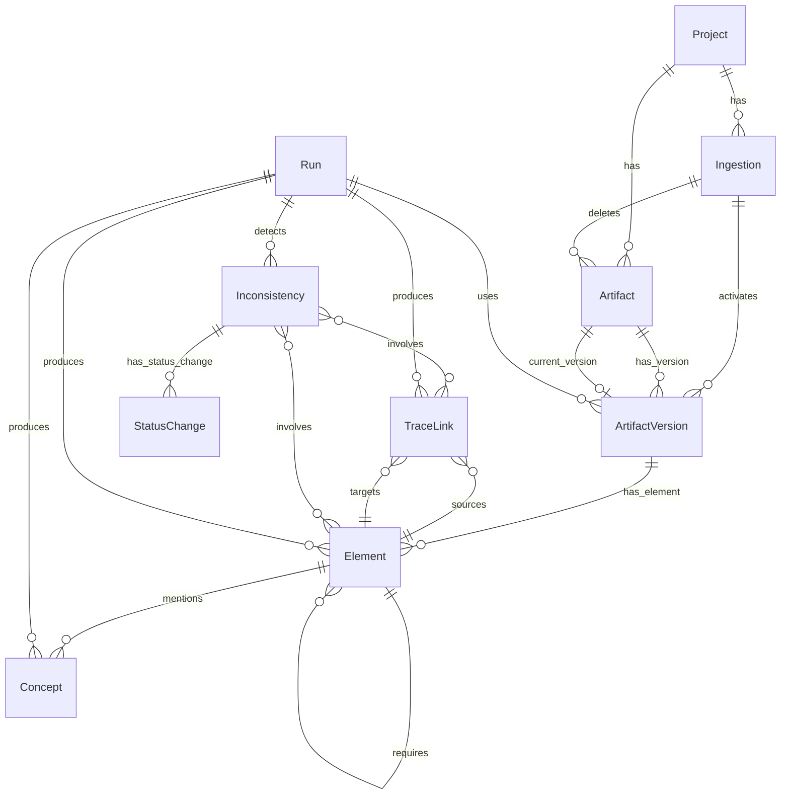

# Knowledge Graph Schema and Persistence

SANDMAN persists all extracted facts — artifacts, elements, trace links, inconsistencies — in a **Memgraph Community** graph database (ADR-0014). The graph is not an implementation detail: it is governed by an explicit, versioned contract, `contracts/kg/schema.yaml` (currently `version: 0.2.0`), which is the source of truth for writers, contract tests, and the NL-to-Cypher prompt.

## Design decisions

The schema follows ADR-0005's choices **L1 + P1 + V1**, plus a **single-writer rule**:

1. **L1 — reified trace links.** Links are `TraceLink` nodes with `SOURCE`/`TARGET` edges to `Element`, not relationships between elements. This lets several approaches produce links for the same pair, gives each link confidence/status/origin properties, and lets `Inconsistency` nodes reference links via `INVOLVES`. The cost is one extra hop in link queries — accepted deliberately.
2. **P1 — `Run` provenance nodes.** Every fact node carries `projectId` and `runId` plus an incoming `PRODUCED` (or `DETECTED`) edge from its `Run`. Provenance is traversable, shared across facts of one run, and failed runs can be cleaned up by `runId`.
3. **V1 — immutable artifact-version snapshots.** Artifacts change over time; instead of validity intervals or a current-state-only graph, each content change creates a new immutable `ArtifactVersion` holding its own element set. Earlier experiment results stay queryable after artifacts change.

Memgraph itself was chosen (ADR-0014) for its in-memory speed, Bolt protocol compatible with the official Neo4j drivers, multi-statement ACID transactions, and Community-edition features (constraints, triggers, vector and text indexes). Its license is BSL 1.1 (internal use fits the grant; the repo does not redistribute it). **Fallbacks**: ArcadeDB first, then Neo4j Community, revisited only if the T5.4 performance budget fails or the license changes. Because the whole graph lives in RAM, deployment runs Memgraph with `--memory-limit` below the container limit, and growth is bounded by the retention/persistence design (each changed file creates a new version with all its elements).

## Node types and ownership

The schema declares a closed vocabulary of node labels. Each node type has exactly **one owning component** (the single-writer rule); only that component writes nodes of the type:

| Node type | Owner | Purpose |
|---|---|---|
| `Project` | extraction-agent | Analysed software project (`id` = slug; `ingestionSeq` = last ingestion sequence) |
| `Ingestion` | extraction-agent | One intake request; `ing_` id, per-project `seq`, records `ACTIVATED`/`DELETED` state changes (recorded even when nothing changed) |
| `Artifact` | extraction-agent | A file identified by path; `deletedAt` set when a full snapshot drops it, cleared when it returns |
| `ArtifactVersion` | extraction-agent | Immutable content at one point in time (`ver_` id, `contentHash`, `storageUri = artifact://<projectId>/<sha256>`) |
| `Element` | extraction-agent | Extracted unit of a version; always carries exactly one secondary label |
| `Concept` | extraction-agent | LLM-extracted named concept mentioned in elements |
| `TraceLink` | tlr-agent (co-owned: extraction-agent writes `explicit-reference` links only) | Candidate/confirmed/rejected link between two elements |
| `Inconsistency` | inconsistency-agent | Potential inconsistency with lifecycle status (ADR-0007) |
| `StatusChange` | inconsistency-agent | Lifecycle transitions, actor-tagged (`user:<name>` / `system:<detector>`) |
| `Run` | each writer for its own runs | One invocation of an agent tool (extractor/plugin/approach/detector) |

`Element` carries exactly one of the secondary labels `Requirement`, `TextUnit`, `ModelElement`, `CodeUnit`, `TestCase` — its `kind` selects the variant. The `Run` node records full provenance: agent and version, skill, tool and toolVersion, logical `model` and `resolvedModel`, parameters (JSON), prompt ids (`template id@hash`), `inputKey` (sha256 of the canonical skill input + tool + config), workflow/task ids, `replayMode` (`live`/`record`/`replay`), token usage, and `status` (`running`/`completed`/`partial`/`failed`).

The full node/relationship model from `contracts/kg/schema.yaml`: `CURRENT_VERSION` points from an `Artifact` to at most one `ArtifactVersion` (absent for deleted artifacts); `HAS_ELEMENT` connects a version to its elements; `CONTAINS`/`DEPENDS_ON`/`PROVIDES`/`REQUIRES` relate elements to elements; `INVOLVES` connects an `Inconsistency` to the elements and trace links it is about (with a `role` property); `USED` records which artifact versions a Run consumed.

## Deterministic ids, keys, and fingerprints

Idempotency and cross-version re-detection rest on three conventions (`conventions.ids`, `conventions.keys`, `conventions.fingerprint`):

- **Ids**: `stableId(...)` per `common.schema.json#/$defs/StableId` (`prefix_hex32`), deterministic from their arguments: `art_` = stableId(projectId, path), `ver_` = stableId(artifactId, contentHash), `el_` = stableId(artifactVersionId, localKey), `tl_` = stableId(approach, approachVersion, configHash, sourceId, targetId), `inc_` = stableId(projectId, fingerprint), `ing_` = stableId(projectId, seq), `con_` = stableId(projectId, normalizedName). Only **Run ids are random** (`run_hex32`). Deterministic ids make re-runs idempotent: re-running the same approach/version/config on the same pair yields the same link node.
- **Element keys**: `Element.key = artifactId + '#' + localKey`, **stable across versions**. TextUnit local keys are content-based: sections use `'sec:' + heading slugs joined by '/'` (with `~2`, `~3`, ... for duplicate siblings; text before the first heading is `sec:`); sentences append `'/' + first 12 hex chars of sha256(normalized sentence text)` plus a `'~' + n` occurrence counter for identical normalized sentences in the section. Normalization is Unicode NFC with runs of ASCII whitespace collapsed to one space and trimmed. Consequence: **inserting text does not change other keys** — `sentenceIndex` remains a separate (non-key) property.
- **Fingerprints** (for `Inconsistency`): `sha256` hex of UTF-8 of `type`, the **detector id without version**, and the involved keys **sorted byte-wise by UTF-8 and joined by U+001F**. An involved key is an `Element.key`, or `sourceKey + '->' + targetKey` for a `TraceLink`. Fingerprints over stable keys make re-detection across artifact versions straightforward (ADR-0007).

Timestamps are ISO-8601 UTC strings.

## Current elements and active facts

Two conventions define what readers see:

- **current** (`conventions.current`): an element is current iff `(:Artifact)-[:CURRENT_VERSION]->(:ArtifactVersion)-[:HAS_ELEMENT]->(element)`. A link is current iff `active = true` **and both endpoints are current**. History is preserved without "superseded" bookkeeping — links on old versions are simply not current.
- **active_facts** (`conventions.active_facts`): *readers never see facts of unfinished runs.* Each writer discipline achieves this differently:
  - The **extraction-agent** writes the complete element set of one artifact version in **one transaction**; re-extraction replaces the set — elements not produced again lose their `HAS_ELEMENT` edge.
  - The **tlr-agent** writes trace links in batches with `active = false` and **activates them in the run's final transaction**, which also **deactivates earlier links of the same approach** (any version/configHash) between the run's source and target versions.
  - The **inconsistency-agent** writes one detection run in one transaction.

Because visibility is guaranteed by these write disciplines, **readers never need to check `Run.status`**. Detection, console, exports, and NL queries use active links only. A path reverting to earlier content re-activates the existing version (moves `CURRENT_VERSION`, clears `deletedAt`) and is processed like a new version.

## Persistence access: KgClient (Java and Python)

Both agent stacks access Memgraph over Bolt via the official Neo4j drivers with a shared `KgClient` shape (`KgClient.java`, `sandman_agent/kg.py`):

- **`read()`** runs in a **read transaction** (`executeRead`) — Memgraph rejects writes there, which is also the basis of the Cypher query guard (see [/openwiki/concepts/cypher-guard.md]).
- **`write()` / `writeTx()`** run in **write transactions**; the driver retries transient errors automatically.
- **`runAutoCommit()`** — Memgraph requires auto-commit for schema statements and `SHOW STORAGE INFO`, so `init.cypher` and schema inspection go through this path.
- **`initSchema(cypher_file)`** executes `contracts/kg/init.cypher` **statement by statement, idempotently**, stripping `//` comment lines and splitting on `;`.

### MemoryLimitError is never retried

Memgraph reports "memory limit exceeded" as a *transient* error, so the driver's automatic retry loop would retry it — and each retry allocates memory again. Both clients therefore wrap every transaction in `noRetryOnMemoryLimit` / `_no_retry_on_memory_limit`, which re-raises a `MemoryLimitException` (Java) / `MemoryLimitError` (Python) as a **non-driver exception that stops the retry loop**. This is why the deployment sets `--memory-limit` below the container limit: the error must surface as a real failure rather than an OOM kill.

### Run provenance recording

The Python `RunRecorder` (`sandman_agent/kg.py`) creates a running `Run` with its `USED` edges to artifact versions in one write, then marks it `completed`/`partial` (with token usage) or `failed` (with error and `endedAt`). `cleanup_stale(input_key)` deletes facts created by non-completed runs with a given input key (`PRODUCED`/`DETECTED` edges, `f.runId = r.id`), marks those runs `failed`, and detaches/deletes the orphaned facts — so aborted runs never leave visible garbage.

## Schema initialization and evolution

`contracts/kg/init.cypher` declares `CREATE CONSTRAINT ON (n:<Label>) ASSERT n.id IS UNIQUE` for `Project`, `Ingestion`, `Artifact`, `ArtifactVersion`, `Element`, `Concept`, `TraceLink`, `Inconsistency`, and `Run`, plus single-property indexes on ids and hot lookup properties (`:Element(key)`, `:Inconsistency(fingerprint)`, `:Run(inputKey)`, various `projectId`s). It is **idempotent at startup of each writer** and is applied **by the extraction-agent** at startup (M0); the other writers rely on it having run. Composite index support is tracked separately (V-7) — single-property indexes are used meanwhile.

Schema evolution is versioned with semantic rules (`schema.yaml` header): **additive changes bump the minor version**; **renames or removals require a major version bump plus a migration script**. ADR-0005's confirmation notes that contract tests run the design document's example writes/reads against Memgraph, and the schema contract is compared with the live `SHOW SCHEMA INFO` at query-service startup.

## Memgraph dialect notes

Cypher in the repo must respect Memgraph's dialect (`memgraph_dialect_notes` in the schema):

- **No pattern expressions inside `size()`** — use `OPTIONAL MATCH` + `count()` instead.
- **Use MAGE procedures, not APOC.**
- **Internal ids (`id()` / `elementId()`) are not stable** — always match on the `id` *property*.

## Relationships to other components

- The **extraction-agent** ([/openwiki/services/extraction-agent.md]) owns Project/Ingestion/Artifact/ArtifactVersion/Element/Concept, applies `init.cypher` at startup, and runs ingestion transactions; TraceLinks with `approach = explicit-reference` are its co-owned exception.
- The **tlr-agent** ([/openwiki/services/tlr-agent.md]) owns `TraceLink` nodes and the inactive-batch → final-activation discipline.
- The **inconsistency-agent** ([/openwiki/services/inconsistency-agent.md]) owns `Inconsistency`/`StatusChange` and the detection-run transaction; fingerprints and lifecycle statuses are detailed in [/openwiki/concepts/inconsistency-lifecycle.md].
- The overall data flow through these writers is described in [/openwiki/workflows/analysis-pipeline.md].
