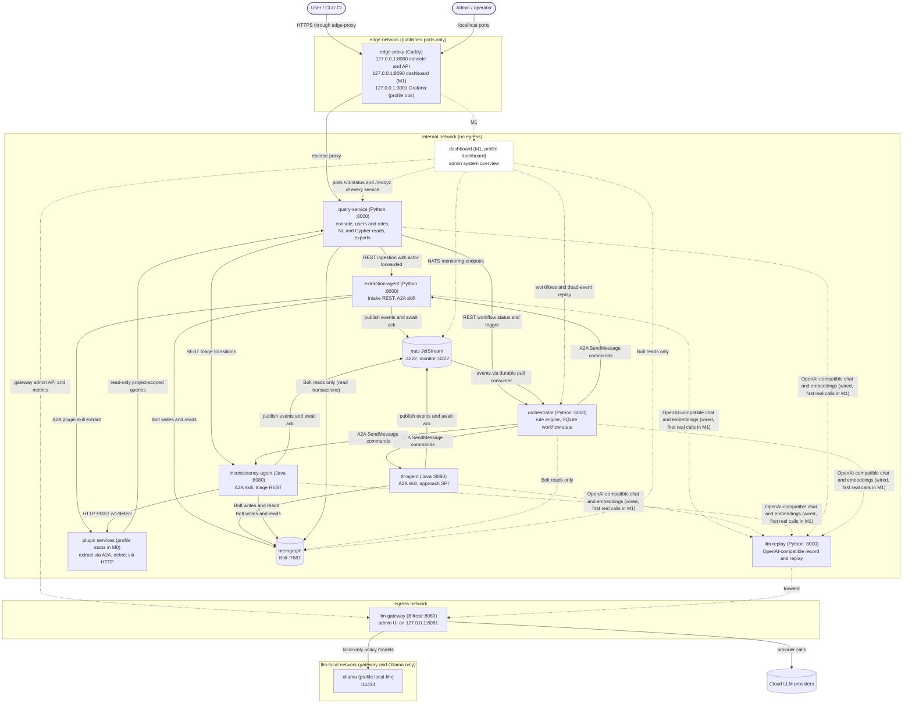

# System Overview

## What SANDMAN is

SANDMAN ("Agent-based system for Software Architecture kNowledge Description and MANagement", see `README.md`) ingests explicit snapshots of a software project's artifacts — requirements, architecture documentation, architecture models, code and tests — extracts their structural and content information into a **knowledge graph**, recovers **trace links** between artifact types with pluggable approaches, detects potential **inconsistencies** with pluggable detectors, and gives users a server-rendered console to triage inconsistencies (resolve, defer, accept, reject, reopen) and to query the graph in natural language or Cypher.

The repository is currently at milestone **M0, the walking skeleton**. All components exist as *contract-true stubs*: real HTTP/A2A servers serving the real Agent Cards and OpenAPI contracts, real authentication, real KG writes with `Run` provenance, real events — only the "intelligence" is trivial (`stub-name-match` for TLR, `stub-untraced` for detection, file-level extraction). The full chain is proven end to end by `tests/e2e/test_walking_skeleton.py`, which runs against `docker compose --profile stubs up` (via `make e2e`) and needs no LLM provider key. Stubs are the M0 state of the real services, not separate images; every later replacement is a configuration switch that keeps the stub selectable.

Design decisions are recorded as MADR-format ADRs in `adr/` (index in `adr/README.md`); the stage documents in `docs/` carry the full analysis. Everything between components is pinned down by machine-readable contracts in `contracts/` (see [Contract-First Interfaces](/openwiki/architecture/contracts.md)).

## Components and languages

The default Compose profile starts six SANDMAN-implemented services plus four infrastructure containers:

| Component | Language / stack | Port (in container) | Role | Writes to KG |
|---|---|---|---|---|
| `orchestrator` | Python (FastAPI) | 8000 | Consumes events, applies the rule table, issues A2A tasks, tracks workflows in SQLite, retries/timeouts, REST `/v1/workflows`, `/v1/dead-events` | none (reads only, to resolve version ids to artifacts) |
| `extraction-agent` | Python (FastAPI + A2A) | 8000 | Artifact intake REST, content-addressed store, versions/ingestions/deletions, built-in extraction, calls extraction plugins | `Project`, `Ingestion`, `Artifact`, `ArtifactVersion`, `Element`, `Concept`, structural relations, `TraceLink` (approach `explicit-reference` only) |
| `tlr-agent` | Java 21, Quarkus | 8080 | A2A skill `recover-trace-links`, in-process approach SPI (`TraceLinkApproach`), REST `GET /v1/approaches` | `TraceLink`, `Run` |
| `inconsistency-agent` | Java 21, Quarkus | 8080 | A2A skill `detect-inconsistencies`, in-process detector SPI + HTTP detector plugins, fingerprinting, lifecycle, triage REST, `GET /v1/detectors` | `Inconsistency`, `StatusChange`, `Run` |
| `query-service` | Python (FastAPI + Jinja2) | 8000 | The only user entry point: auth/users/roles, NL + guarded Cypher reads, exports, console UI; forwards owner operations | none (users in its own SQLite) |
| `llm-replay` | Python (Starlette) | 8000 | OpenAI-compatible live/record/replay proxy in front of the gateway (cassette key = sha256 of RFC 8785 canonical request body) | – |
| `memgraph` | off-the-shelf (Memgraph 3.13.1) | 7687 (Bolt) | The knowledge graph | – |
| `nats` | off-the-shelf (NATS 2.15.0, JetStream) | 4222 / 8222 (monitor) | Durable, replayable event log (stream `SANDMAN`) | – |
| `llm-gateway` | off-the-shelf (Bifrost v2.2.6) | 8080 (admin UI published on `127.0.0.1:8081`) | Unified LLM access: providers (OpenAI, OpenRouter, Ollama), per-component virtual keys, budgets, request log | – |
| `edge-proxy` | off-the-shelf (Caddy 2.11) | 8080 / 8090 / 3001 published on `127.0.0.1` | Reverse proxy publishing the internal-only web UIs | – |

The **language split is deliberate** (ADR-0001): Python where document parsing and LLM-prompt iteration dominate (orchestrator, extraction, query), Java 21 where the core is existing Java research code — ArDoCo and LiSSA run **in-process** inside the tlr-agent and inconsistency-agent, giving direct access to their pipeline APIs. The Java agents run on Quarkus only because the `a2a-java` server integration is CDI-based (decided in spike T0.4, check 16); Quarkus counts as an application framework, not an agent framework.

Every service is **plain code on top of one small shared agent library per language** (ADR-0010): `libs/python/sandman-agent` (package `sandman_agent`) for the Python services, `libs/java/agent-lib` + `agent-lib-a2a` for the Java agents. The libraries are thin wrappers over the official SDKs (`a2a-sdk`/`a2a-java`, `openai`, Neo4j drivers, `nats-py`/`jnats`) with no control flow, and both reproduce the same conformance vectors (`contracts/conformance/vectors.json`). Agent frameworks (LangChain, LangGraph, DeepAgents, LlamaIndex, CrewAI, AutoGen) are forbidden under `libs/` and `services/`, enforced by `make guard`; LangChain4j is tolerated only as a transitive dependency inside the reused ArDoCo/LiSSA adapters. See [Agent Libraries](/openwiki/architecture/agent-libraries.md).

Java naming is fixed: Maven groupId `io.github.ardoco` with `sandman-*` artifactIds, packages under `edu.kit.kastel.mcse.ardoco.sandman`; Python packages are `sandman_*`. Python parts build with uv only, Java parts with Maven only.

## Topology and transports

The following diagram shows every component and transport as wired by `deploy/docker-compose.yml`. Solid arrows are exercised by the implemented M0 walking skeleton (which needs no LLM); dashed arrows are wired infrastructure or opt-in/planned elements (the dashboard arrives in M1 behind its own profile).

SANDMAN's components and transports as wired by `deploy/docker-compose.yml`; the M1 dashboard and the Ollama profile are dashed because they are opt-in/planned, not part of the default M0 stack.

## The four communication rules

ADR-0002 ("Use A2A for commands to agents") fixes which mechanism is used for which interaction, so each interaction gets the simplest fitting transport:

| Interaction | Mechanism | Why |
|---|---|---|
| Orchestrator → agent "do X" (extract, recover links, detect) | **A2A 1.0**, JSON-RPC binding, non-blocking | Task lifecycle, cancellation, skill discovery via Agent Card, cross-language SDKs |
| Fact changed (artifact ingested, links updated, inconsistencies updated, status changed) | **NATS JetStream** events, CloudEvents envelope | Durable at-least-once, decoupled from consumer uptime, replayable log; A2A has no pub/sub |
| Users/CLI/CI → queries, triage, uploads, workflow status; catalog lookups (`GET /v1/approaches`, `GET /v1/detectors`) | **plain REST** (OpenAPI) | Synchronous request/response; browsers, curl and CI are natural clients |
| Any component → knowledge graph | **Bolt** (official Neo4j drivers) | Native protocol of Memgraph |
| Any component → LLM | **OpenAI-compatible HTTP** via `llm-replay` → `llm-gateway` | One egress path, keys only in the gateway |

### Commands to agents: A2A

The orchestrator's `A2aClient` (`libs/python/sandman-agent/src/sandman_agent/a2a.py`) submits `SendMessage` with `returnImmediately=true` and a **`messageId` it stores in SQLite before sending** — so a completion event can never arrive before the caller knows the id. Skill selection follows the SANDMAN convention: the skill id rides in `message.metadata["sandman.skill"]`, the input is a single `data` part validated against the skill's JSON Schema, and the result comes back as one task artifact named `result` (convention details in [A2A Skills](/openwiki/concepts/a2a-skills.md)).

`GetTask` polling (30 s growing to 2 min) exists **only to detect failures** — `FAILED`, `REJECTED`, `CANCELED`, lost tasks (an agent restart empties its in-memory task store, so `GetTask` returns "task not found", which the orchestrator treats as retryable) and timeouts (per skill: extraction 15 min, TLR 60 min, detection 30 min → `CancelTask`, then retry). A step becomes `SUCCEEDED` when the task's **completion event** arrives, not when polling sees `COMPLETED`.

### Step chaining: events only

Events are the **only** signal the orchestrator chains steps on (review decision D-1). The library idempotently ensures a single JetStream stream `SANDMAN` capturing `sandman.>` (file storage, 90-day retention, 2-minute duplicate window, `Nats-Msg-Id` = event id). The NATS subject equals the event type; the CloudEvents 1.0 `subject` attribute carries the `projectId`, plus extension attributes `correlationid` (workflow id), `causationid` (the causing task/event) and `traceparent`. The catalog is exactly five types:

| Type | Producer | Effect in the orchestrator |
|---|---|---|
| `sandman.ingestion.completed` | extraction-agent (only if the state changed) | extract created ∪ reactivated versions; detect on deleted artifacts |
| `sandman.extraction.completed` | extraction-agent | step done; debounced TLR on changed × counterpart versions, or detection if no TLR kind pair applies |
| `sandman.tracelinks.updated` | tlr-agent (one per task) | step done; debounced detection on the artifacts of the source and target versions |
| `sandman.inconsistencies.updated` | inconsistency-agent | step done; closes the workflow |
| `sandman.inconsistency.status.changed` | inconsistency-agent (user transitions) | audit log only |

Agent skills publish **exactly one** completion event, with `causationid` = the `messageId` of the A2A request; plugin skills publish none. The producer ordering is "commit, validate, publish, then complete": the agent commits its KG writes, the library validates the skill output, publishes the event and **waits for the JetStream publish ack** (3 retries with backoff), and only then reports the A2A task as `COMPLETED`. If publishing fails after the KG commit, the task fails as retryable and the retried task republishes — idempotent writes (deterministic ids + `MERGE`) make that safe. Details in [Event Bus](/openwiki/concepts/event-bus.md).

### Queries, triage and uploads: REST

The **query-service is the only user entry point** and the policy decision point (ADR-0013): it authenticates users (session cookie for the console, personal bearer tokens for CLI/CI), checks per-project roles (`viewer` < `triager` < `maintainer`, plus global `admin`), and forwards owner operations with its own service token plus `X-Sandman-Actor`/`X-Sandman-Roles` headers built from the authenticated principal — never copying anything from the user's request. Ingestion goes to the extraction-agent, triage transitions to the inconsistency-agent (the `Inconsistency` owner), workflow status/triggers to the orchestrator. Owners accept the actor headers **only** from the query-service's token (403 otherwise); the orchestrator is the only trusted forwarder of `sandman.actor` in A2A metadata.

The extraction-agent's intake (`POST /v1/projects/{projectId}/ingestions`) stores blobs content-addressed, creates or **re-activates** versions (a path returning to earlier content re-activates the existing version), records an `Ingestion` node with a per-project sequence number, publishes `sandman.ingestion.completed` and returns `201` **only after the publish ack**; an unchanged manifest records empty change lists and publishes no event. Catalog lookups (`GET /v1/approaches` on tlr-agent, `GET /v1/detectors` on inconsistency-agent) are deliberately plain REST — an A2A task lifecycle adds nothing for static lists.

### Knowledge-graph access: Bolt

All KG access goes over Bolt (`bolt://memgraph:7687`) through the shared `KgClient` in both libraries, using the official Neo4j drivers. `read()` runs in a **read transaction** — Memgraph rejects writes there, which is also the primary write guard for the user query path — and `write()`/`write_tx()` in write transactions with driver-side transient-error retry. One deliberate exception: Memgraph reports "memory limit exceeded" as a transient error, so both clients convert it to a non-retried `MemoryLimitError` (otherwise each retry would allocate again). Projects share one Memgraph database (multi-database is Enterprise-only); per-project read isolation is enforced by the query-service's parse-tree scope guard, since Memgraph Community has no label-based access control. See [Knowledge Graph Schema](/openwiki/architecture/knowledge-graph.md) and [Cypher Guard](/openwiki/concepts/cypher-guard.md).

### LLM access: one path through the gateway

Every LLM call — chat and embeddings, from Python services, Java agents *and* LangChain4j inside reused ArDoCo/LiSSA code — goes to `http://llm-replay:8000/openai`, which forwards to the Bifrost gateway at `http://llm-gateway:8080/openai` (pass-through in `live` mode, cassette record/replay otherwise). Because the Compose `internal` network has **no egress** and only the gateway sits on the `egress` network, gateway-only access is enforced by the network itself. Agents send only standard OpenAI fields plus `traceparent`, so the gateway can be swapped by changing URL and keys.

Each LLM-using component holds two gateway virtual keys: a cloud key and an **Ollama-only `<component>-local` key**. A project with `llmPolicy = local-only` makes callers use the `-local` key and `*-local` routes; the gateway rejects cloud providers for that key (spike T0.4 measured HTTP 403 `provider_blocked`), so the policy holds even for code the project does not control. Gateway budget exhaustion surfaces as HTTP 402, which clients translate to `SkillError BUDGET_EXCEEDED`; the orchestrator then ends the step as `BLOCKED` and waits for a user instead of retrying.

## Cross-cutting architecture rules

### The orchestrator is a rule engine

The orchestrator (ADR-0006) is deterministic by design — reproducibility of experiments matters more than emergent behavior. `services/orchestrator/src/sandman_orchestrator/rules.py` implements the fixed rule table (configured by `config/orchestrator/rules.yaml`: debounce, timeouts, retry, per-agent concurrency, TLR kind pairs). Every event is processed exactly once via an `inbox` table keyed by event id; steps are deduplicated by `actionKey` = sha256(agent, skill, canonical input, **trigger id** — so a later trigger with the same input, e.g. a revert, runs again); mergeable steps are debounced (10 s per project) and coalesced by unioning id lists. The executor enforces a **per-project pipeline lock** (at most one running step per project, so extract → tlr → detect never overlap and no detection runs on half-written links) plus a global per-agent limit (default 2). All state lives in SQLite (`inbox`, `workflows`, `steps`, `messages`, `dead_events`); workflow status is derived from step statuses (`PENDING`, `RUNNING`, `SUCCEEDED`, `FAILED`, `CANCELED`, `BLOCKED`). Events that exceed `MaxDeliver` (5) or fail contract validation land in `dead_events` and can be replayed via `POST /v1/dead-events/{eventId}/replay`. An optional LLM planner for ad-hoc natural-language requests is a **planned M6 feature** behind a feature flag with an approval gate — the rule path is all there is today. Details in [Orchestrator](/openwiki/services/orchestrator.md) and [Analysis Pipeline](/openwiki/workflows/analysis-pipeline.md).

### One writer per KG node type

Each node type in `contracts/kg/schema.yaml` has exactly one owning component (see the table above; `TraceLink` is co-owned — the extraction-agent writes only `explicit-reference` links, everything else is the tlr-agent's). Other components read the graph and request changes through the owner's API; this keeps stubs and plugins replaceable and avoids write conflicts. Every writer records provenance: each invocation creates a `Run` node (agent, tool, model, params, input key, workflow/task ids, replay mode) and links its facts via `PRODUCED`/`DETECTED`. Readers never see facts of unfinished runs ("active facts"): extraction writes one version's element set in one transaction, TLR writes links inactive and activates them in the run's final transaction, detection writes one run in one transaction. Full model in [Knowledge Graph Schema](/openwiki/architecture/knowledge-graph.md).

### Plugins are external systems

Code extraction and further detectors come from **plugged-in services** (ADR-0012), not from SANDMAN agents: any language, any internal design, registered in `config/extraction/plugins.yaml` / `config/inconsistency/plugins.yaml`. Each implements one fixed operation — extraction via the A2A plugin skill `sandman.plugin.extract`, detection via plain HTTP `POST /v1/detect` — with identical payload schemas in both transports. Plugins **never write the KG**: they return results, the owner validates them and writes them with provenance (`Run.tool` = plugin id@version). Detector plugins read the graph only through the query-service with their own `plugin:<id>` token (read-only, project-scoped, granted in `config/query/plugins.yaml`); every other receiver rejects plugin callers. Owners call plugins with the plugin's inbound token, never their own service token. Plugin obligations: no egress, LLM calls only via the gateway with their own virtual keys, honor `llmPolicy`, read artifacts only from `storagePath`, be idempotent. In M0 each owner implements exactly one transport (extraction via A2A only, detection via HTTP only, decision D-7), and `tests/plugin-stubs` provides a reference stub for both — the walking skeleton deliberately covers both transports. Details in [Plugins](/openwiki/concepts/plugins.md) and `docs/plugins.md`.

### Every service reports its status

Both agent libraries and `llm-replay` expose `GET /v1/status` returning the shared `ServiceStatus` shape (`contracts/openapi/shared.yaml`): `state` is `working` iff `activeTasks > 0`, plus version, `lastActivityAt` and service-specific details (e.g. llm-replay reports mode, experiment, cassette entries and hit/miss counters). Together with `/readyz` (dependency checks) and `/healthz` (liveness) this is the feed for the planned dashboard and for operators. See [Observability](/openwiki/operations/observability.md).

## Deployment shape

One server, one Compose project (`name: sandman`), four networks:

| Network | Properties | Members | Purpose |
|---|---|---|---|
| `internal` | bridge, `internal: true` (no egress) | all SANDMAN services + infrastructure | service-to-service traffic; **enforces gateway-only LLM access** |
| `egress` | bridge | `llm-gateway` (also publishes its admin port), `ollama` (model pulls) | outbound provider calls |
| `edge` | bridge | `edge-proxy` only | publishes the internal-only web UIs on `127.0.0.1` |
| `llm-local` | bridge, `internal: true` | `llm-gateway`, `ollama` | local models reachable only through the gateway |

The **edge-proxy (Caddy)** is the only container with published web ports: `127.0.0.1:8080` → query-service (console and user/agent API), `127.0.0.1:8090` → dashboard, `127.0.0.1:3001` → Grafana (`obs` profile). This shape came out of spike T0.4 check 13: disabling IP masquerading does *not* block egress on Docker Desktop, so the web services stay on `internal` and a small proxy publishes them; remote access goes through an SSH tunnel. The only other published port is the Bifrost admin UI on `127.0.0.1:8081`.

Startup is health-gated (`depends_on: condition: service_healthy`): `memgraph`, `nats`, `llm-gateway` → `llm-replay` → the three agents → `orchestrator` → `query-service`. All services run `restart: unless-stopped` with per-service `mem_limit` (memgraph 10 GB with `--memory-limit=8192` MiB below it, Java agents 5 GB, extraction-agent 3 GB, query-service and gateway 1 GB, the small services 512 MB, edge-proxy 128 MB). Secrets are Compose file secrets (`deploy/gen-secrets.sh` generates them, never overwriting): each service mounts only its own `svc_token_<name>`, the shared hash file `svc_tokens_verify`, its `llm_key_<component>[_local]`, and — for plugin callers — the plugin's inbound token; the gateway and Memgraph read credentials from env files because their images only support env. Optional profiles: `dashboard` (M1 system overview), `obs` (OpenTelemetry LGTM backend + Grafana), `local-llm` (Ollama), `stubs` (plugin stubs for the walking skeleton), `resources` (cAdvisor, opt-in, for container metrics). A dev overlay (`docker-compose.dev.yml`) additionally publishes Bolt 7687 and NATS 4222/8222 on localhost. Full operational detail in [Deployment](/openwiki/operations/deployment.md).

## Implemented now vs. planned

Implemented and verified today (M0 walking skeleton):

- All six services as contract-true stubs, the four infrastructure containers, the edge proxy, secrets and health-gated startup in `deploy/docker-compose.yml`.
- The full deterministic pipeline: CLI ingest → `ingestion.completed` → extract (stub elements, plugin routing, explicit references) → TLR (`stub-name-match`) → detect (`stub-untraced` + plugin) → triage → auto-resolution → revert/reactivation, with the per-project pipeline lock, retries and dead-event handling.
- Real users/roles/tokens, trusted forwarding, the Cypher scope guard, exports, the console.
- The end-to-end test `tests/e2e/test_walking_skeleton.py` (two ingestions, role checks 403/409, read isolation, unchanged re-ingestion triggers no workflow, CSV exports) — green via `make e2e` with no provider keys.

Planned milestones (Stage 3, `docs/stage-3-implementation-plan.md`):

| Milestone | Content | Status in-repo |
|---|---|---|
| **M1** | Real built-in extractors (Markdown/text, PCM/UML, requirements, PDF/DOCX via Docling), LLM enrichment, record/replay end to end, observability profile, **system overview dashboard** (ADR-0016, tasks T1.9–T1.11) | dashboard Compose entry exists behind profile `dashboard`; no `services/dashboard` implementation yet |
| **M2** | ArDoCo and LiSSA TLR approaches in-process | `config/tlr/approaches.yaml` keeps `ardoco`/`lissa` as **disabled** placeholders |
| **M3** | ArDoCo inconsistency detection in-process | no `ardoco-id` entry in `config/inconsistency/plugins.yaml` yet (only the `stub-untraced` detector and the `detect-stub` plugin); ADR-0015 is still `proposed` (pinned-commit build, upstream changes pending) |
| **M4** | LLM NL-to-Cypher with validation/repair | query-service ships the regex intent stub; `config/query/intents.yaml` |
| **M5** | Continuous use: CI ingestion action, retention/`prune` skills, backup/restore | not implemented |
| **M6** (optional) | LLM planner with approval gate, trace-link review | not implemented |
| **MX** (on demand) | Minimal agent kits for TypeScript, Go (tier 1) and Rust (tier 2), each passing the conformance vectors (ADR-0017) | decided but not started — `libs/` contains only `python` and `java` |

## Where to go next

- [Contract-First Interfaces](/openwiki/architecture/contracts.md) — the `contracts/` inventory and validation pipeline that everything above depends on.
- [Knowledge Graph Schema](/openwiki/architecture/knowledge-graph.md) — node labels, ownership, active facts, provenance, deterministic ids.
- [Agent Libraries](/openwiki/architecture/agent-libraries.md) — the Python/Java library surfaces and the no-control-flow rule.
- [A2A Skills](/openwiki/concepts/a2a-skills.md) — the skill-invocation convention and submit/poll/cancel client behavior.
- [Event Bus](/openwiki/concepts/event-bus.md) — stream/consumer configuration and the five event payloads.
- [Plugins](/openwiki/concepts/plugins.md) — the plugin operations, transports, tokens and obligations.
- [Analysis Pipeline](/openwiki/workflows/analysis-pipeline.md) — the event-to-step chain and the walking-skeleton scenario.
- [Orchestrator](/openwiki/services/orchestrator.md), [Extraction Agent](/openwiki/services/extraction-agent.md), [TLR Agent](/openwiki/services/tlr-agent.md), [Inconsistency Agent](/openwiki/services/inconsistency-agent.md), [Query Service](/openwiki/services/query-service.md), [LLM Replay](/openwiki/services/llm-replay.md) — per-service pages.
- [Deployment](/openwiki/operations/deployment.md), [Configuration](/openwiki/operations/configuration.md), [Observability](/openwiki/operations/observability.md) — running and operating the stack.
- [LLM Gateway](/openwiki/integrations/llm-gateway.md) — Bifrost configuration, virtual keys and budgets.
- [Testing and CI](/openwiki/testing/testing-and-ci.md) — the make targets and CI jobs behind the guarantees above.
