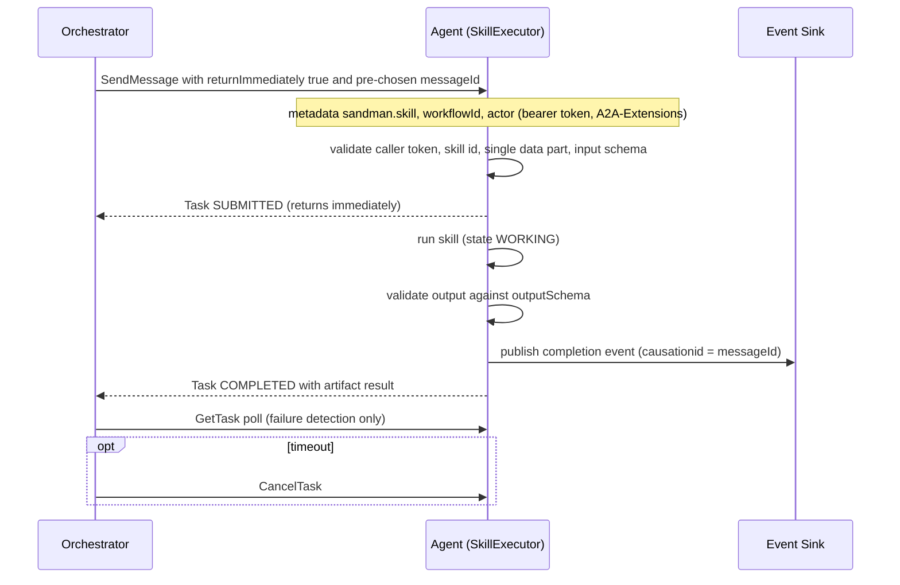

# A2A Skills and Agent Cards

SANDMAN agents (Python and Java) receive commands over the Agent2Agent (A2A) protocol, spec 1.0.x with the JSON-RPC 2.0 binding (ADR-0002, Option A). A2A is used **only for commands to agents**; domain events go through the event broker, and queries/triage/uploads stay plain REST. On top of the standard, SANDMAN defines a *skill-invocation convention* — how a caller selects a skill, passes input, reads the result, and learns about failures — that is identical in the Python library (`a2a-sdk` 1.2.2) and the Java library (`a2a-java` 1.4.0.Final on Quarkus).

## The invocation convention

A skill invocation is an A2A `SendMessage` request whose message carries three SANDMAN metadata keys (declared as a **required** card extension with URI `https://sandman.invalid/a2a/extensions/skill-invocation/v1`):

| Metadata key | Meaning |
|---|---|
| `sandman.skill` | The skill id to invoke (mandatory; missing → `INVALID_INPUT` rejection) |
| `sandman.workflowId` | Optional correlation id linking the task to a workflow |
| `sandman.actor` | End-user actor on whose behalf the orchestrator acts; **accepted only when the caller is the orchestrator**, silently ignored from any other caller |

The **input** is exactly one `data` part of the message; its JSON content must validate against the skill's `inputSchema` (a `$defs` entry in `contracts/skills.schema.json`, referenced from the Agent Card's extension `params.skills`). Any other count of data parts, an unknown skill id, or a schema violation ends the task as a rejection with `SkillError("INVALID_INPUT"|"UNKNOWN_SKILL", ...)`. The **result** is a task artifact named `result` containing exactly one `data` part, validated against the skill's `outputSchema` before the task completes.

**Errors** are reported as a `SkillError` object `{code, message, retryable}` placed in the status message's metadata under `sandman.error`. Expected failures (`SkillError`) reject or fail the task with their own code and `retryable=false`; unexpected exceptions are reported as retryable `INTERNAL`. Codes seen in the libraries: `INVALID_INPUT`, `UNKNOWN_SKILL`, `INTERNAL`, `BUDGET_EXCEEDED` (LLM budget exhausted; the orchestrator blocks the workflow until a user acts), and `DEPENDENCY_UNAVAILABLE` (used when publishing the completion event fails after the KG is committed — the retried task republishes).

Both implementations undo protobuf `Struct` number widening: every number in a data part arrives as a float, so integral floats are converted back to `int` before schema validation (Python `json_value`, Java `toJson`/`jsonValue`).

## Sequence: orchestrator → skill → event

The SANDMAN skill flow: submit with a pre-chosen `messageId`, async execution, one completion event with the messageId as causation id, then a `result` artifact; the client polls only to detect failures and cancels on timeout.

## The completion-event rule

Every **agent** skill publishes **exactly one** completion event (e.g. `sandman.artifacts.extracted`, `sandman.tracelinks.updated`, `sandman.inconsistencies.detected`) on the event bus, with `causationid` equal to the request's `messageId` and `correlationid` equal to `sandman.workflowId`. Ordering is strict: the event is published **after** the output passed output-schema validation and **before** the task transitions to completed. A skill that returns an event type without an available event sink (or without event data) fails with `INTERNAL`. **Plugin** skills publish no completion events — that distinction is the difference between agent skills and plugin skills in the shared executor logic (Python `SkillResult.event_type is None` for plugins).

Because the KG write is already committed when the event publish is attempted, a publish failure returns retryable `DEPENDENCY_UNAVAILABLE` rather than completing silently — the orchestrator retries the task, which republishes.

## Agent Cards

Each agent serves its Agent Card at `/.well-known/agent-card.json`, instantiated from a template in `contracts/agent-cards/` (e.g. `extraction-agent.json`). The card declares:

- `supportedInterfaces` with `protocolBinding: "JSONRPC"` and `protocolVersion: "1.0"` — the interface URL's path is the JSON-RPC route.
- The **skill-invocation extension** (`required: true`) whose `params.skills` maps each skill id to its `inputSchema`/`outputSchema` JSON pointers into `contracts/skills.schema.json`. A skill bean that has no card entry fails agent startup (both libraries check this at boot).
- A bearer `securitySchemes`/`securityRequirements` entry for the SANDMAN service token.
- A top-level `skills` array (id, name, description, input/output modes `application/json`) for discovery, usable later by an LLM planner.

Static catalog lookups (TLR approaches, detectors) are deliberately **not** A2A skills — they are plain REST (`GET /v1/approaches`, `GET /v1/detectors`, schemas `ListApproachesOutput`/`ListDetectorsOutput`) because they need no task lifecycle. Plugins may use A2A or a synchronous plain-HTTP contract (ADR-0012); plugin detectors are reported with `kind: plugin-a2a` or `plugin-http`.

## Client behavior: submit / poll / cancel

The client-side pattern (Python `A2aClient`, used by the orchestrator and by agents calling plugin agents) is:

1. **Submit** — fetch the card, then `SendMessage` with `configuration.returnImmediately: true`. The caller pre-chooses the `messageId` (and should persist it *before* sending) so the eventual completion event's `causationid` can be matched to the request even if the caller crashes. Every request carries the service's own bearer token and an `A2A-Extensions` header listing the skill-invocation extension — `a2a-java` rejects calls that do not list a card's `required: true` extension — plus `A2A-Version: 1.0`.
2. **Poll** — `GetTask` for the task, returning a `TaskSnapshot` (state, `result` artifact, `sandman.error` if present). Since review decision D-1 (ADR-0002 amendment), polling no longer signals step completion; steps complete via their completion event. Polling exists only to detect failures, rejections and timeouts (poll interval grows 30 s → 2 min). An unknown task id raises `TaskNotFoundError`, which the orchestrator treats as retryable.
3. **Cancel** — `CancelTask` on timeout. Server-side, cancellation sets a flag on the running `SkillContext`; a skill that finishes after cancellation simply does not emit its result or event (the task is already `CANCELED`).

Authentication on the server: the SDKs do not check bearer tokens themselves; both libraries add their own filter. Python middleware `_RequireToken` rejects JSON-RPC calls without an accepted token with 401 (the Agent Card route stays public), verifies service tokens and rejects plugin callers for agents, or checks the fixed plugin inbound token for plugins (`caller = "owner"`). Java agents configure `a2a.authorization.required=false` and apply the same bearer filter; the card's JSON-RPC path is routed to a2a-java's root route.

## Where the convention lives

- Python executor/client: `libs/python/sandman-agent/src/sandman_agent/a2a.py` (`_Executor`, `A2aClient`, `serve`, `SkillError`, `Skill`, `SkillContext`, `TaskSnapshot`).
- Java executor: `libs/java/agent-lib-a2a/.../SkillExecutor.java` (a CDI `AgentExecutor`; skills are CDI beans implementing `Skill`).
- Schemas: `contracts/skills.schema.json` (contract version 0.3.0).
- Cards: `contracts/agent-cards/*.json`, served at `/.well-known/agent-card.json`.
- Conformance tests per agent (ADR-0002 "Confirmation"): card validates against the A2A 1.0 schema; send/get/cancel round trip; invalid input → `TASK_STATE_REJECTED`. The Python library is tested in `libs/python/sandman-agent/tests/test_a2a.py`, with integration tests in `test_integration.py` (Testcontainers, skipped without a Docker daemon).

Related pages: [Agent Libraries](/openwiki/architecture/agent-libraries.md), [Contracts](/openwiki/architecture/contracts.md), [Event Bus](/openwiki/concepts/event-bus.md), [Plugins](/openwiki/concepts/plugins.md), [Orchestrator](/openwiki/services/orchestrator.md).
