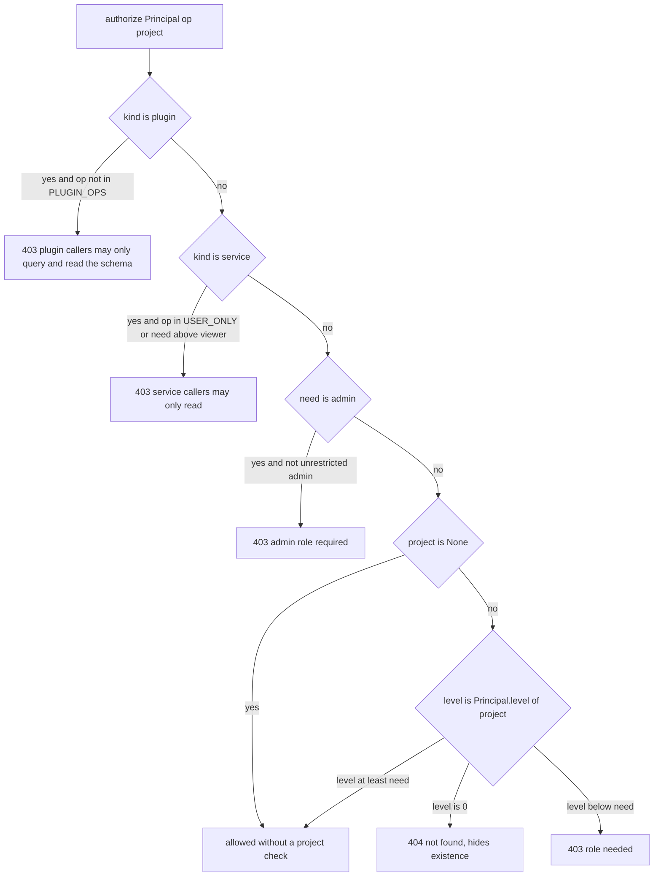
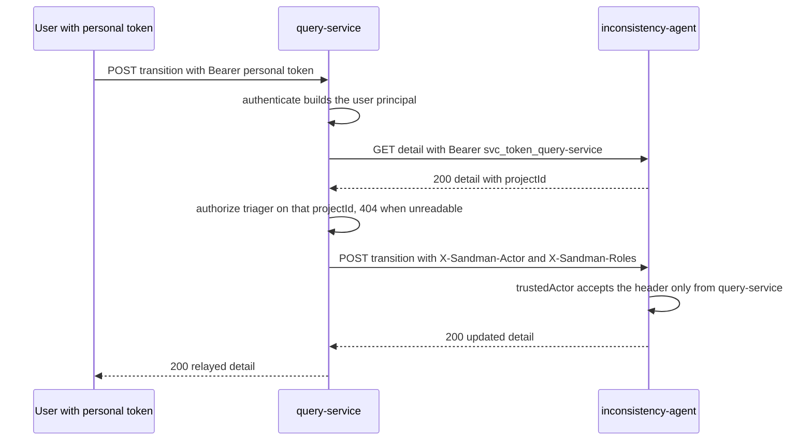

# Authentication, Roles and Trusted Forwarding

SANDMAN deliberately has **no external identity provider** (ADR-0013, option A): the query-service owns a built-in user store, is the only user entry point and the single **policy decision point**, and owner services (extraction-agent, inconsistency-agent, orchestrator) trust exactly two forwarders — the query-service for the `X-Sandman-Actor`/`X-Sandman-Roles` headers and the orchestrator for the `sandman.actor` A2A metadata key. Everything else is a bare bearer-token question: *which caller is this, and what may that caller do?*

There are three credential planes plus one console cookie:

| Credential | Presented as | Verified by | Identifies |
|---|---|---|---|
| Service token (`svc_token_<name>`) | `Authorization: Bearer …` | sha256 hash lookup in `svc_tokens_verify` | a service, or a plugin as `plugin:<id>` |
| Personal API token (`sdm_…`) | `Authorization: Bearer …` | sha256 hash lookup in the user store | a user, optionally scoped to one project and capped |
| Plugin inbound token (`plugin_in_<plugin>`) | `Authorization: Bearer …` | fixed-token compare on the plugin | the owner calling the plugin (caller `"owner"`) |
| Console session | `sandman_session` cookie | server-side session row (HttpOnly, SameSite=Strict) | a logged-in user for `/console/*` only |

`/v1/*` accepts **bearer tokens only** — the session cookie is never consulted on the API (the login route sets it, the logout route consumes it), so a stolen console cookie cannot drive the REST API.

## Service tokens: sha256 verification

Every receiver verifies service tokens the same way, implemented in both agent libraries (`TokenVerifier` in `sandman_agent.auth`, `ServiceAuth` in `libs/java/agent-lib`):

- The presented bearer token is hashed with **sha256** and the hex digest is compared to each entry of the caller→hash map with a **constant-time comparison** (`hmac.compare_digest` in Python, `MessageDigest.isEqual` in Java). No service ever stores or sees another service's plaintext token.
- `require_service(verifier, allow_plugins=False)` (Python) / `ServiceAuth.requireService` (Java) is the standard guard for REST routes: **401** for a missing/unknown token, **403** for a `plugin:`-prefixed caller unless plugins are explicitly allowed.
- The A2A JSON-RPC middleware (`_RequireToken` in `sandman_agent.a2a.serve`) rejects any unauthenticated call with 401, the Agent Card stays public, and in agent mode plugin callers fail authentication outright (no 403 distinction there); in plugin mode the fixed inbound token maps every caller to `"owner"`.

Each service holds **only its own outbound token** (Compose secret `svc_token_<name>`); receivers mount the shared hash file `svc_tokens_verify` (`SANDMAN_SERVICE_VERIFY_FILE`, a JSON map caller→sha256). `deploy/gen-secrets.sh` generates one `openssl rand -hex 24` token per service and plugin (never overwriting existing files), then **regenerates `secrets/svc_tokens_verify.json` on every run**, mapping each name to the sha256 of its token file — plugin entries appear under the key `plugin:<id>` (`plugin-stubs` → `"plugin:plugin-stubs"`), which is what limits plugin callers to read-only paths. The query-service additionally mounts `admin_bootstrap_password` and a `session_secret` — the latter is provisioned (`SANDMAN_SESSION_SECRET_FILE`) but the current code does not read it, since sessions are opaque server-side rows rather than signed cookies.

## The query-service user store

`UserStore` (`services/query-service/src/sandman_query/store.py`) is a single SQLite database (`SANDMAN_USER_DB`, default `/data/users.db`) containing `users`, `memberships`, `tokens`, `sessions` and `last_visits` (migration `001_init.sql`, applied from sorted `*.sql` files tracked by `PRAGMA user_version`):

- **Passwords are Argon2id** (`argon2-cffi PasswordHasher`); `verify_password` hashes against a **pre-computed dummy hash for unknown users**, so login timing does not reveal whether a username exists, and returns the row only for enabled users.
- **Personal tokens** are `"sdm_" + token_urlsafe(32)`; only the **sha256 of the secret** is stored (unique column), together with a name, an optional `project_id` scope, an optional `max_role` cap (`viewer|triager|maintainer`), an optional `expires_at` and a `last_used_at` that `find_token` records on every use. `find_token` matches only unexpired tokens of enabled users.
- **Sessions** store the **sha256 of the session id** plus a CSRF token; a session is valid for 12 h absolute (`SESSION_TTL`) and 2 h idle (`SESSION_IDLE`), and each lookup touches `last_seen`. Disabling a user or changing their password **revokes all their sessions**; password change also forces re-login.
- **Bootstrap admin**: if the store is empty at startup, the service creates user `admin` with global role `admin` and `must_change_password = 1`, reading the password from `SANDMAN_ADMIN_PASSWORD_FILE` (secret `admin_bootstrap_password`). The forced change is enforced everywhere: `must_change_password` users get 403 on personal tokens and are redirected to `/console/password` from any console page.

`Service.authenticate` (in `service.py`) resolves a bearer token to a `Principal`: first via `TokenVerifier` (service or `plugin:<id>` caller), then via `store.find_token` (user with the token's `project_id`/`max_role` attached). Login (`POST /v1/auth/login`) is rate-limited: **5 failures per username or per client address within 15 minutes → 429** with `Retry-After: 900` (in-memory, per process).

## Principals and effective roles

`sandman_query.auth.Principal` is the authorization subject. Role levels are ordered:

```
LEVEL = {"authenticated": 0, "viewer": 1, "triager": 2, "maintainer": 3, "admin": 4}
```

`Principal.level(project)` is the effective project role (0 = none):

- **Users**: the membership role in that project, **capped by the token's `maxRole`** (`min(base, LEVEL[token_max_role])`); a token with a `projectId` yields 0 for every other project. A global `admin` user gets at least `maintainer` in every project.
- **Services**: fixed `viewer` in every project ("services read everything").
- **Plugins** (`plugin:<id>`): `viewer` **only for projects granted** in `config/query/plugins.yaml` (`{plugin-id: [project, …] | "*"}`, loaded once at startup), 0 otherwise.

`unrestricted_admin` means `admin` **and** the token carries neither a `projectId` nor a `maxRole` — only such principals pass operations with `x-sandman-min-role: admin`. A project-scoped admin token therefore acts as a maintainer in its project and cannot administer users. Users whose token is restricted (project or maxRole) additionally cannot create or revoke tokens (403), preventing escalation through token minting.

### The authorization decision

The per-operation minimum role is **declared in the contract** (`x-sandman-min-role` in `contracts/openapi/query-service.yaml`) and loaded at startup (`load_min_roles`); the authorization test asserts that its matrix covers exactly the declared operations.

| Min role | Operations (`operationId`) |
|---|---|
| *(no token)* | `login` (sets the console cookie), `logout` (session) |
| `authenticated` | `me`, `listTokens`, `createToken`, `revokeToken` (the `USER_ONLY` set), `listProjects`, `getSchema` |
| `viewer` | `listInconsistencies`, `getInconsistency`, `listWorkflows`, `getWorkflow`, `queryCypher`, `queryNl`, `exportTraceLinks`, `exportInconsistencies` |
| `triager` | `transitionInconsistency` |
| `maintainer` | `checkIngestion`, `createIngestion`, `createWorkflow` |
| `admin` (unrestricted) | `listUsers`, `createUser`, `updateUser`, `putProject`, `putMember`, `deleteMember` |

`authorize()` (`sandman_query.auth`) implements the kind checks first, then the project check:



The authorize decision: plugins are limited to `queryCypher`/`getSchema`, service callers to reads, admin operations demand an unrestricted admin, and an unreadable project is reported as **404, not 403** — no existence leak.

Two subtleties:

- **403 vs 404**: a project the caller has no role in returns **404** (indistinguishable from a missing project); a project where the caller's level is below the requirement returns **403**. Operations whose path has no `projectId` (`getInconsistency`, `transitionInconsistency`, `getWorkflow`) fetch the object from the owner first and then authorize against the **owner-reported `projectId`** — again 404 when unreadable, and the mutation is never forwarded (the API test asserts no POST reaches the owner for a hidden inconsistency).
- **Unscoped Cypher**: `POST /v1/query/cypher` without a `projectId` requires an **unrestricted admin** (403 otherwise); with a project named, the scope guard anchoring applies even to admins.

## Trusted forwarding

When the query-service relays an owner operation (ingestion check/upload, project put, inconsistency list/detail/transition, workflow list/get/create), `Owners.call` (`forward.py`) sends **only headers built here**: the query-service's **own service token** plus, for user principals, `X-Sandman-Actor: user:<name>` and `X-Sandman-Roles` (the effective role for the addressed project, e.g. `triager`, plus `admin` for global admins). **Nothing from the user's request is copied** — a client-sent `X-Sandman-Actor`/`X-Sandman-Roles` never reaches an owner (asserted by test with forged `user:root`/`admin` headers). Service and plugin principals have no actor (`Principal.actor` is `user:`-prefixed only for users), so their calls are forwarded with the service token alone.



A user-triggered triage transition, forwarded with the query-service's own token and freshly built actor headers.

`relay()` passes the owner's status and body through unchanged (owner 409 conflicts surface as 409, etc.), with one translation: an owner **401** — i.e. the owner rejected *our* token — becomes **503 "owner rejected the query-service token"** (a deployment problem, not the user's); an unreachable owner is likewise 503.

### Receiver-side rules

Every owner independently re-checks who may claim an actor:

- **`trusted_actor(caller, headers)`** (both libraries) returns the `X-Sandman-Actor` value **only when the caller is `query-service`**; any other authenticated caller sending the header gets **403** ("X-Sandman-Actor is accepted only from the query-service").
- **inconsistency-agent**: transitions (`POST /v1/inconsistencies/{id}/transitions`) **require** an actor matching `user:<name>` (400 if missing/malformed, 403 if sent by a non-forwarder); it is stored on the `StatusChange` and published in `sandman.inconsistency.status.changed`. All triage routes first require a service token (`401`) and reject plugin callers (`403`).
- **extraction-agent**: ingestion records the actor (validated against `user:` or `service:`), falling back to `service:<caller>` when the query-service forwards a service caller; `PUT /v1/projects/{projectId}` calls `trusted_actor` to guard against forged headers.
- **orchestrator**: `trigger`/`cancel`/`replay` are limited to `ADMIN_CALLERS = {query-service, dashboard}` (403 otherwise); the actor defaults to `service:<caller>` and an invalid `X-Sandman-Actor` is rejected with 400. A manual trigger stores the actor in the workflow's `trigger`, and the executor passes it into A2A **message metadata as `sandman.actor`** — for manual triggers only.
- **`actor_from_metadata(caller, metadata)`** accepts `sandman.actor` **only from the `orchestrator`** and silently ignores it from any other caller; the skill executors put it on `SkillContext.actor` (and into the telemetry/log context). This is the second trusted forwarder.
- **query-service as a receiver**: it verifies inbound tokens with the same `TokenVerifier` and distinguishes plugin callers by the `plugin:` prefix; `GET /v1/status` additionally rejects plugins and non-admin users (operators/services only). Plugin callers reaching `POST /v1/query/cypher` present their own service token (`svc_token_<plugin>`, mounted for plugin containers) and are confined to granted projects — the read path plugin detectors use, since plugins never touch the KG directly.
- **`X-Sandman-Roles`** is currently informational: owners record the actor but do not parse the roles header; authorization stays with the query-service.

## Console sessions and CSRF

The console (`/console/*`, `console.py`) authenticates with the server-side session: cookie `sandman_session` is `HttpOnly` + `SameSite=Strict` (+ `Secure` when `SANDMAN_COOKIE_SECURE=true`), the session id exists only as a sha256 row in SQLite (logout and password change delete it), and **every form POST must carry the session's CSRF token** (constant-time compare, 403 otherwise; the login form uses a short-lived `sandman_login_csrf` cookie). A `must_change_password` user is redirected to `/console/password` from every page except logout. Console pages authorize through the same `Principal` (`svc.check`, `who.level`), so the UI cannot bypass the API's rules; `Content-Security-Policy: default-src 'self'` is set on console and static responses.

## Configuration summary

| Setting | Meaning |
|---|---|
| `SANDMAN_SERVICE_TOKEN` / `SANDMAN_SERVICE_TOKEN_FILE` | This service's own outbound bearer token |
| `SANDMAN_SERVICE_VERIFY_FILE` | Shared `svc_tokens_verify.json` (caller→sha256), read into `Settings.service_verify` |
| `SANDMAN_PLUGIN_INBOUND_TOKEN` / `…_FILE` | Plugin mode: fixed token for owner→plugin calls |
| `SANDMAN_USER_DB` | SQLite path of the query-service user store |
| `SANDMAN_ADMIN_PASSWORD_FILE` | Bootstrap admin password (used only when the store is empty) |
| `SANDMAN_COOKIE_SECURE` | `true` adds `Secure` to session cookies (behind TLS) |
| `SANDMAN_EXTRACTION_URL` / `SANDMAN_INCONSISTENCY_URL` / `SANDMAN_ORCHESTRATOR_URL` | Owner base URLs for forwarding |
| `config/query/plugins.yaml` | Plugin→project read grants (`"*"` = all) |
| `contracts/openapi/query-service.yaml` | `x-sandman-min-role` per operation — the authorization matrix |

The CLI (`tools/cli`, `sandman`) uses a **personal token** from `SANDMAN_TOKEN` or `--token-file` against `SANDMAN_URL`; the walking-skeleton e2e test obtains tokens through the console (login → forced password change → `/console/tokens`) and creates `maintainer`/`triager`/`viewer` users to prove the matrix end to end.

## Focused tests

- **Authorization matrix** (`services/query-service/tests/test_authz.py`): every operation × caller kind (anonymous, stranger, viewer, triager, maintainer, admin, service, two plugins with different grants, `maxRole`-capped token, project-scoped token, project-scoped admin token), asserting ok/401/403/404 plus contract-validated responses; `test_every_operation_is_covered` pins the matrix to `x-sandman-min-role`.
- **Forwarding** (`test_api.py`): owners receive actor/roles built from the principal, never the client's forged headers; service callers are forwarded without actor; unreadable projects are 404 like missing ones; owner 401 → 503; token lifecycle, restricted tokens cannot mint tokens; login rate limit 429; bootstrap admin `must_change_password`.
- **Queries** (`test_query.py`): unscoped Cypher is admin-only (service, plugin, project-scoped admin tokens → 403); plugin grants (`stub` granted one project → 404 elsewhere, `other` with `"*"` → 200).
- **Console** (`test_console.py`): cookie flags, CSRF 403, session revocation, expired/idle sessions rejected, forced password change.
- **Libraries**: `test_units.py` (TokenVerifier, `require_service` 401/403, `trusted_actor` 403, `actor_from_metadata`) and `LibraryTest.serviceAuthVerifiesTokensAndForwarders` (Java equivalent).
- **Owners**: extraction-agent `test_intake_rejections_and_actor` (actor forwarded by query-service, rejected from others), inconsistency-agent `AgentTest` (401/403/404 matrix, actor required on transitions, 403 when another service sends the header).

Related pages: [Query Service](/openwiki/services/query-service.md), [Agent Libraries](/openwiki/architecture/agent-libraries.md) (A2A auth modes and the library surface), [Plugins](/openwiki/concepts/plugins.md) (inbound tokens and plugin obligations), [CLI](/openwiki/integrations/cli.md), [Deployment](/openwiki/operations/deployment.md) (secret distribution).
