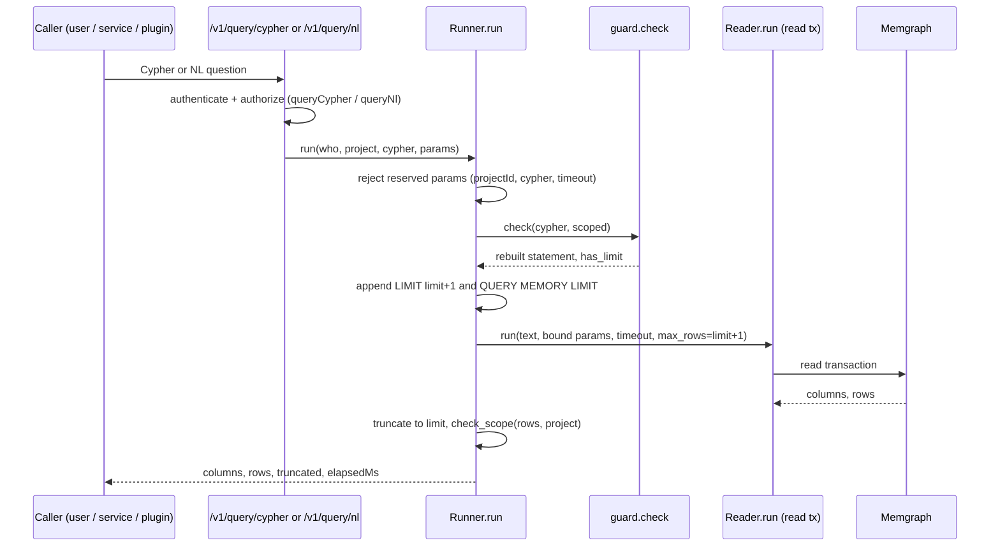

# Cypher Guard and NL Querying

The query-service exposes two ways to ask questions of the knowledge graph: raw Cypher (`POST /v1/query/cypher`) and natural language (`POST /v1/query/nl`). Both funnel through the same guarded read pipeline. Because the backing database is Memgraph Community — which has users but no read-only roles (RBAC is Enterprise, ADR-0009) — read safety is defense in depth built entirely inside the service: a parser-based Cypher guard, a driver read transaction, per-query timeouts and memory limits, reserved parameters, and a result post-check.

The design lineage is ADR-0009 (NL-to-Cypher) with amendment D-2: option B (schema-grounded single-shot LLM generation + validation + repair) is the chosen end state, and the current regex intent stub (option A) is the M0 stand-in that runs today. The lexical denylist originally considered was replaced by the parse-tree scope guard described below, because lexical checks are bypass-prone on their own (see `adr/0009-nl-to-cypher.md`).

## The execution pipeline

Every query — user-submitted Cypher, NL stub, or the service's own export templates — is executed by `Runner.run` in `services/query-service/src/sandman_query/query.py`:

1. **Reserved parameters rejected.** Any caller-supplied parameter named `projectId`, `cypher` or `timeout` is rejected with HTTP 422; these are bound by the service itself.
2. **Guard check.** `check(cypher, scoped=project is not None)` parses and validates the statement (HTTP 422 on `GuardError`, returned as `application/problem+json`).
3. **LIMIT and memory-limit rewriting.** The guard's rebuilt statement gets ` LIMIT {limit+1}` appended when the final `RETURN` has no `LIMIT` of its own, and always ` QUERY MEMORY LIMIT <memory_limit>` (default `100 MB`) appended.
4. **Reader read transaction.** `Reader.run` executes in a driver *read* transaction (`session.execute_read`) with a double timeout: `asyncio.timeout` around the session plus `unit_of_work(timeout=...)` inside. At most `limit+1` rows are fetched, so truncation can be detected without materializing more.
5. **Post-hoc scope check.** When a project was named, `check_scope(rows, project)` walks every returned row: *every map carrying a `projectId` key, at any nesting depth, must match the requested project*, otherwise HTTP 422 with "result contains data of another project" and an `scope_violation` error log. Rows are truncated to `limit` and `truncated: true` is reported when `limit+1` rows came back.

*The guarded read path: every query passes the guard, then runs in a Memgraph read transaction, then gets a post-hoc scope check.*

### Error mapping

`Runner.run` maps database failures to distinct HTTP responses:

- `MemoryLimitError` → 422 "query exceeded the memory limit of …" (raised by `Reader` when Memgraph reports "memory limit exceeded"; the plain exception also stops the driver's retry of transient errors);
- `TimeoutError`, or a `Neo4jError` whose message mentions "timeout"/"aborted" → 422 "query timed out";
- other `ClientError` → 422 "query rejected by the database";
- any other `Neo4jError` → 503 "knowledge graph unavailable".

### Timeouts and limits

Timeout caps differ by caller kind: **10 s** for `user` principals, **30 s** for service/plugin principals (`USER_TIMEOUT_MS`, `SERVICE_TIMEOUT_MS` in `query.py`). The effective timeout is `min(requested timeoutMs, cap)`. The request body caps `timeoutMs` at 100–30000 ms, `limit` at 1–1000 (default 200) and `cypher` length at 20000 characters (406/400-level validation before the guard runs).

> Note on `EXPLAIN`: ADR-0009 describes EXPLAIN validation as part of the planned LLM pipeline. The current M0 implementation has **no** EXPLAIN step; the guard instead rejects `EXPLAIN`/`PROFILE` as denied keywords. Defense rests on the parse guard plus the read transaction (integration tests confirm the read transaction alone blocks writes even with the guard bypassed).

## The Cypher guard (`guard.py`)

`guard.py` is a ~650-line **recursive-descent parser for exactly an allowlisted read subset** (decision D-2, RK-19 fallback; rationale in `docs/notes/cypher-guard.md`). An ANTLR grammar was evaluated and rejected: available openCypher grammars are Neo4j-flavoured, a grammar accepts the full language whereas the guard needs deny-by-default, and every grammar/database mismatch is a potential bypass. Anything the parser does not understand is rejected.

### Hard invariants

- **`DENIED` keyword set** (`CALL`, `CREATE`, `MERGE`, `SET`, `DELETE`, `DETACH`, `REMOVE`, `FOREACH`, `LOAD`, `SHOW`, `DUMP`, `TERMINATE`, `EXPLAIN`, `PROFILE`, `USING`, `DROP`, `GRANT`/`REVOKE`/`DENY`/`ALTER`, `BEGIN`/`COMMIT`/`ROLLBACK`, and more): every write, admin and procedure clause is rejected by name, *even for global admins without a project*. Semicolon-chained second statements and a caller-written `QUERY MEMORY LIMIT` are also rejected.
- **`MAX_LENGTH` 20000** characters and **`MAX_DEPTH` 12** expression nesting (a `RecursionError` from deeper nesting is converted to "query nested too deeply").
- **Mandatory `$projectId` anchoring** (scoped mode): every connected component of every pattern — in each `MATCH`/`OPTIONAL MATCH`, pattern predicate, pattern comprehension and `EXISTS` subquery — must contain a node written as `{projectId: $projectId}` (exactly that bare parameter), a `(:Project {id: $projectId})` node, or a variable bound by an earlier anchored pattern. This relies on the writer invariant that no relationship connects nodes of different projects. Variables only survive `WITH` when projected as a bare (optionally aliased) variable; `UNWIND` and comprehension variables shadow outer ones. Duplicate map keys are rejected. Anchoring is skipped only for unscoped global-admin queries — but the clause allowlist still applies.
- **Tokenization is strict ASCII**: identifiers, numbers with escapes, quoted strings with strict escape validation (including `\u`/`\U`), backtick-quoted names, parameters. Anything else — non-breaking spaces, NUL, non-ASCII — is a syntax error.
- **Comments stripped and statement rebuilt**: the statement actually sent to Memgraph is reconstructed from the parsed tokens (comments dropped, token adjacency kept), so the service and the database see the same text. Keywords inside comments or string literals can neither hide real clauses nor create fake ones (corpus-tested).

The accepted subset covers `MATCH`, `OPTIONAL MATCH`, `WHERE`, `WITH`, `UNWIND`, `RETURN`, `ORDER BY`, `SKIP`, `LIMIT`, `UNION [ALL]`, pattern comprehensions, pattern predicates and `EXISTS { … }`. Deliberately *not* parseable: namespaced (module) function calls like `apoc.*`, map projections, label expressions, Memgraph path algorithms (`*bfs`, `*wShortest`), and `COUNT { }` subqueries.

### Memgraph-enforced write guard

The Reader always uses a driver **read transaction**. Integration tests against Memgraph 3.13.1 confirm that this blocks `CREATE`/`SET`/`DELETE`/`REMOVE`/`MERGE` ("Accessor type READ") and `SHOW STORAGE INFO` — so even with the in-service guard bypassed, writes cannot execute. Caveats from the same findings: `DUMP DATABASE` and read-only `CALL` procedures *do* run in a read transaction (the clause allowlist is the only guard for them), which is why `CALL`, `DUMP` and `SHOW` sit in the `DENIED` set. Memgraph Community lacks read-only roles, which is why this in-service layering exists at all.

### Scope post-check (`check_scope`)

Anchoring cannot guarantee confinement by itself (e.g. a forged cross-project relationship would violate the writer invariant). `check_scope` in `reader.py` therefore walks each returned row recursively and requires every dict with a `projectId` key to carry the requested project, at any depth — nested lists, maps within maps, everything. Non-map values (scalars without `projectId`) pass; the invariant that no cross-project relationships exist is the writers' duty. `jsonable` in `reader.py` converts graph values to property maps with `_labels`/`_type` (no internal ids; non-finite floats become `null`) before this check runs, so the check sees exactly the JSON the caller would see.

## The NL intent stub (M0, no LLM)

`Intents` in `query.py` loads `config/query/intents.yaml` at startup and is the M0 stand-in for the planned LLM NL-to-Cypher (ADR-0009 option B: schema contract + few-shot → structured output → validation → repair). The stub is deterministic and regex-based:

- Each intent has an `id`, a `pattern` and a fixed `cypher` template.
- **Every template must pass the guard** — `Intents.__init__` runs `check(cypher)` on each template at load time, so a misconfigured template fails startup, not at question time.
- `match()` normalizes the question (whitespace collapsed, trailing `?`, `!`, `.` stripped), then requires a **`fullmatch`** of the whole question (case-insensitive). The first matching intent wins.
- **Named groups** in the pattern (e.g. `(?P<name>…)`, `(?P<revision>…)`) become Cypher parameters; `$projectId` is bound by the service, never extracted from the question.
- Current intents: `untraced-requirements`, `links-of`, `open-inconsistencies`, `components-without-documentation`, `changes-since`.
- If nothing matches, HTTP 422 lists the supported intent ids ("question not understood (M0 stub, no LLM)").
- Modes: `answer` (default) executes the mapped Cypher through the same `Runner.run` pipeline; `cypher-only` or `execute: false` return the generated Cypher and extracted params without touching the database. The response mirrors the future LLM shape (`cypher`, `params`, `attempts`, `warnings`) so the console and API contracts do not change when the LLM arrives.

## Endpoints and ownership

- `POST /v1/query/cypher` (`app.py`): body `CypherBody` (`projectId` optional for global admins, `cypher` ≤ 20000 chars, `params`, `limit` 1–1000, `timeoutMs` 100–30000). Authentication via bearer token; authorization via `queryCypher` min-roles. `projectId` is mandatory unless the caller is an unrestricted global admin (others get 403). Plugin principals are confined to the projects granted in `config/query/plugins.yaml`.
- `POST /v1/query/nl`: body `NlBody` (`projectId` required, `question` 3–2000 chars, `mode`, `execute`); authorization via `queryNl`.
- Exports (`Runner.tracelinks`, `Runner.inconsistencies`) use fixed in-code templates (`TRACELINKS`, `INCONSISTENCIES`, `INVOLVED`, `ARTIFACTS`) that are themselves guard-checked by tests; they run with the 30 s service timeout.

`Service` (`service.py`) wires this together: `Runner(reader, memory_limit)` and `Intents(config_dir / "query" / "intents.yaml")` are built once at startup; `Reader` is the single read path of the service (queries, exports, project list, readiness).

## Tests that pin the behavior

- `tests/test_guard.py`: an accepted-query corpus, a large bypass corpus (REJECTED — unanchored patterns in every position: second `MATCH`, `OPTIONAL MATCH`, comprehensions, `EXISTS` subqueries, `UNION` branches, `WITH`-rebound variables, `UNWIND` shadowing; denied keywords; `QUERY MEMORY LIMIT` hijack; comment/string keyword hiding; depth/length limits), admin semantics (`scoped=False` skips only anchoring), and rewriting (comments removed, adjacency kept, `has_limit` for `UNION` branches).
- `tests/test_query.py` (fake reader): limit+1 / memory-limit text appended, reserved parameters rejected, guard rejection as 422 problem+json, truncation, forged cross-project rows rejected and logged, unscoped queries for global admins only, per-caller-kind timeout caps, each NL intent returns its Cypher and params, NL modes and unknown questions.
- `tests/test_memgraph.py` (real Memgraph): accepted corpus runs, REJECTED corpus changes nothing, the read transaction blocks the write corpus even with the guard bypassed, cartesian products hit the memory limit (422, fast, server alive), long queries are aborted by the timeout, projects are isolated, and the post-check catches a deliberately forged cross-project relationship.

## Related pages

- [/openwiki/architecture/knowledge-graph.md] — the schema and writer invariants the anchoring relies on
- [/openwiki/concepts/auth-and-roles.md] — principals, min-roles and plugin grants that gate the query endpoints
- [/openwiki/operations/configuration.md] — `config/query/intents.yaml`, `plugins.yaml` and the schema contract
- [/openwiki/services/query-service.md] — the service that hosts this pipeline
