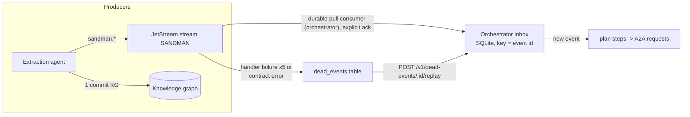

# NATS JetStream Event Bus

SANDMAN components communicate changes through a single NATS JetStream stream. Instead of pushing notifications over HTTP/A2A, producers publish CloudEvents-1.0-encoded domain events to subjects `sandman.<eventType>`; the orchestrator (and, later, other consumers such as a notifier or experiment logger) subscribes with a durable pull consumer. The stream is file-backed and retained for 90 days, so it doubles as a replayable event log for reproducing experiments ([ADR-0003](repo://adr/0003-nats-jetstream-event-bus.md)).

Events are **the only signal the orchestrator chains steps on** (ADR-0003 amendment): every A2A skill task executed by the three SANDMAN agents publishes exactly one completion event — `sandman.extraction.completed`, `sandman.tracelinks.updated`, or `sandman.inconsistencies.updated` — with `causationid` equal to the `messageId` of the A2A request that started the task. The agent library validates the skill output first, then publishes the event and awaits the JetStream ack, and only then completes the task, so an event never precedes a failed output validation ([ADR-0003 amendments](repo://adr/0003-nats-jetstream-event-bus.md#L82-L84), [events.schema.json](repo://contracts/events.schema.json#L5)).

## Stream configuration

Both agent libraries declare the stream identically (idempotently created or updated on startup):

| Setting | Value |
| --- | --- |
| Stream name | `SANDMAN` |
| Subjects | `sandman.>` |
| Storage | File |
| Retention | Limits policy, discard old, 1 replica |
| Max age | 90 days |
| Duplicate window | 120 s |

The 120-second duplicate window is what makes producer-side deduplication work: `Nats-Msg-Id` is set to the **event id** (a UUID), so a producer retrying after a crash within the window is silently accepted by JetStream rather than duplicating the event ([events.py](repo://libs/python/sandman-agent/src/sandman_agent/events.py#L20-L31)). The Python `EventPublisher` additionally retries transport failures three times with backoff `(0.5, 2.0, 5.0)` s before raising `PublishError`; the same config exists on the Java side in `Streams`/`EventPublisher`.

## The CloudEvents envelope

Every event is a structured CloudEvents 1.0 JSON object. NATS subject = event type; `subject` field = projectId. Required members are `specversion`, `id` (UUID), `source` (`sandman/<agent-name>`), `type`, `subject`, `time`, `datacontenttype` (`application/json`), and `data`; optional members `correlationid` (workflow id), `causationid`, and `traceparent` (W3C trace context propagated from telemetry) are only included when non-null ([events.py `Event.to_json`](repo://libs/python/sandman-agent/src/sandman_agent/events.py#L52-L71), [events.schema.json](repo://contracts/events.schema.json#L8-L31)). Payload changes are additive only; breaking changes get a new type with suffix `.v2`.

## The five event types

`contracts/events.schema.json` (contract version 0.3.0) defines exactly five types, each with a schema-validated `data` payload:

| Type | Published when | Notes |
| --- | --- | --- |
| `sandman.ingestion.completed` | An ingestion **changed the current state** — at least one created, reactivated, or deleted artifact version | `mode` full/partial, per-project `seq`, lists of `created/reactivated/deleted` ids, `unchangedCount`; reactived versions (reverts, re-added files) are handled like created ones |
| `sandman.extraction.completed` | An extraction run finished | `causationid` required; payload has `runId`, `status` (completed/partial), `artifactVersionIds` (≥1), `elementCount`, `explicitLinkCount`, `pluginRuns` |
| `sandman.tracelinks.updated` | One **per recover-trace-links task**, listing every approach run (including failed ones) — not one per approach | `causationid` required; `sourceVersionIds`, `targetVersionIds`, `runs` |
| `sandman.inconsistencies.updated` | An inconsistency-detection run changed the inconsistency set | `causationid` required; `newIds`, `reopenedIds`, `autoResolvedIds`, `stillOpenCount`, optional `scopeArtifactIds` (absent = whole project) |
| `sandman.inconsistency.status.changed` | A user (or system actor) triaged an inconsistency | `from`/`to` status, `actor`, `at`, optional `reason`; no `causationid` |

The three completion types require `causationid` = the A2A `messageId` chosen and stored by the caller *before* sending, so the event can never arrive before the caller knows it ([events.schema.json](repo://contracts/events.schema.json#L28), [ADR-0003](repo://adr/0003-nats-jetstream-event-bus.md#L82-L84)).

## Delivery guarantees

The overall model is **at-least-once delivery, exactly-once processing**:

- **Producers**: commit the KG changes, publish and await the JetStream ack, then complete the A2A task. A crash between KG commit and publish loses the event unless the task is retried — and retries are idempotent because the retry republishes the same event id, which the duplicate window deduplicates. REST intake returns `202` only after the publish ack ([ADR-0003 consequences](repo://adr/0003-nats-jetstream-event-bus.md#L36-L40)).
- **Consumer**: a durable pull consumer with explicit ack, so events survive consumer restarts; un-acked messages are redelivered.

### Consumer configuration

Both `libs/python/.../events.py` (`EventConsumer`) and the Java `EventConsumer` use the same values (Stage 2 §1.4):

- durable name, filter subject `sandman.>`
- `AckPolicy.EXPLICIT`, `ack_wait` 60 s
- `max_deliver` 5, `max_ack_pending` 100
- backoff **(5, 30, 120, 300) s**

The fetch loop pulls batches of 10 with a 2 s timeout. On a handler exception the message is **naked with the next backoff delay** (`nakWithDelay` in Java), computed from the delivery count; after a successful handler it is acked ([EventConsumer.java](repo://libs/java/agent-lib/src/main/java/edu/kit/kastel/mcse/ardoco/sandman/agent/EventConsumer.java#L45-L86), [events.py](repo://libs/python/sandman-agent/src/sandman_agent/events.py#L176-L211)).

### Exactly-once processing via the inbox

Because redelivery is possible (and the orchestrator may restart mid-processing), the orchestrator's `handle` records each processed event in a SQLite **`inbox` table keyed by event id** in the same transaction as the steps it plans: if `processed_at` is already set, the event is skipped. Events also undergo **contract validation on intake** — `contracts.validate("events.schema.json", ...)` runs before `handle` in the consumer path ([orchestrator.py `consume`/`handle`](repo://services/orchestrator/src/sandman_orchestrator/orchestrator.py#L82-L120)).

### Dead events

Two failure classes divert events into the `dead_events` table instead of looping forever:

- **Contract-invalid events** go to `dead_events` immediately (and are acked, since retrying cannot fix a bad payload).
- A handler failure on the **last delivery** (`delivered == MAX_DELIVER` = 5, re-raised otherwise) is captured as a dead event with the error message and timestamp ([orchestrator.py `consume`](repo://services/orchestrator/src/sandman_orchestrator/orchestrator.py#L82-L95)).

The orchestrator exposes these via REST:

- `GET /v1/dead-events` — list captured events ordered by received time.
- `POST /v1/dead-events/{eventId}/replay` (202) — moves the dead event back into the inbox (processed via `process_inbox`); a replay that fails again goes back to `dead_events` ([app.py](repo://services/orchestrator/src/sandman_orchestrator/app.py#L144-L154), [orchestrator.py `replay`/`process_inbox`](repo://services/orchestrator/src/sandman_orchestrator/orchestrator.py#L234-L261)).

The durable consumer in the orchestrator app is named `orchestrator` and passes the delivery count into the handler so dead-event capture happens only on the final delivery ([app.py `consume`](repo://services/orchestrator/src/sandman_orchestrator/app.py#L159-L170)).

## Event flow

## Operational notes

- One extra container to operate and back up; the stream file storage plus the 90-day retention define the backup horizon.
- Because `Nats-Msg-Id` = event id, replaying a producer (e.g. re-running an A2A task retry) within the 120 s window is a no-op; outside it the inbox dedup guarantees exactly-once processing.
- The integration test from ADR-0003: kill the orchestrator, publish events, restart — all events are processed exactly once (inbox dedupe), and a duplicate publish within the window is rejected.
- New consumers (notifier, experiment logger) can attach their own durable consumers to `sandman.>` without touching producers — the fan-out rationale of ADR-0003.

## Related pages

- [Agent libraries](/openwiki/architecture/agent-libraries.md) — the Python/Java `EventConsumer`/`EventPublisher` shared by all agents.
- [Contracts](/openwiki/architecture/contracts.md) — `events.schema.json` versioning and validation.
- [Orchestrator](/openwiki/services/orchestrator.md) — inbox, planning, and the dead-events REST API.
- [Analysis pipeline](/openwiki/workflows/analysis-pipeline.md) — which events trigger which steps.
