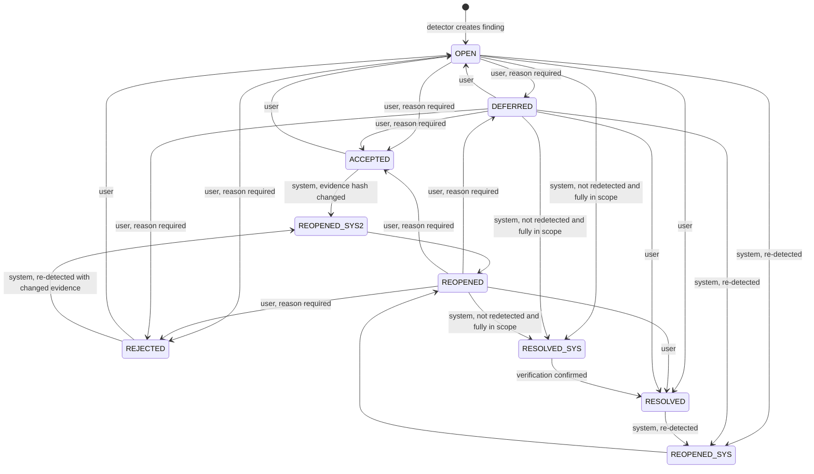

# Inconsistency Lifecycle

Detected inconsistencies are not one-shot events: users triage them (accept, reject, defer, resolve) and detectors run again and again as artifacts change. ADR-0007 (`adr/0007-inconsistency-lifecycle.md`) fixes a six-state machine — `OPEN`, `DEFERRED`, `ACCEPTED`, `REJECTED`, `RESOLVED`, `REOPENED` — with two disjoint transition sources (user and system), deterministic re-detection matching via fingerprints, and full provenance via `StatusChange` nodes. This page documents the rules precisely and where each rule lives in code.

## Where the machine lives

The canonical definition is `Lifecycle` in the inconsistency-agent — a pure, I/O-free Java class:

```java
public enum Status { OPEN, DEFERRED, ACCEPTED, REJECTED, RESOLVED, REOPENED }
```

- `Lifecycle.userTargets(from)` — user-choosable targets per status (`services/inconsistency-agent/src/main/java/edu/kit/kastel/mcse/ardoco/sandman/inconsistency/Lifecycle.java#L28-L35`).
- `Lifecycle.systemTargets(from)` — system targets after a detection run (`.../Lifecycle.java#L42-L48`).
- `Lifecycle.reasonRequired(to)` — a reason is mandatory for `ACCEPTED`, `REJECTED` and `DEFERRED` (`.../Lifecycle.java#L54-L56`).
- `Lifecycle.autoResolvable(status, verification)` — which items a *non-detection* cause may auto-resolve (`.../Lifecycle.java#L58-L64`).

The query-service mirrors the *user* transition table as a literal dict `USER_TRANSITIONS` in `services/query-service/src/sandman_query/query.py#L25-L32`, explicitly commented "mirrors the inconsistency-agent lifecycle (ADR-0007)". Any change to `Lifecycle.userTargets` must be mirrored there by hand — the two tables are not generated from a shared source.

## The state machine



*User and system transitions of the ADR-0007 inconsistency lifecycle. Solid labels marked "user" are chosen via the triage API; labels marked "system" are applied automatically after a detection run (see the system rules below). Every transition writes a `StatusChange` node.*

### User transitions

From the ADR and `Lifecycle.userTargets`:

| from | allowed user targets |
|---|---|
| `OPEN`, `REOPENED` | `DEFERRED`, `ACCEPTED`, `REJECTED`, `RESOLVED` |
| `DEFERRED` | `OPEN`, `ACCEPTED`, `REJECTED`, `RESOLVED` |
| `ACCEPTED`, `REJECTED` | `OPEN` (re-open a decision) |
| `RESOLVED` | none — no user exit from `RESOLVED` |

A reason is **required** for `ACCEPTED`, `REJECTED` and `DEFERRED` (`Lifecycle.reasonRequired`); blank reasons are rejected with HTTP 422 by `TriageService.transition` (`services/inconsistency-agent/src/main/java/edu/kit/kastel/mcse/ardoco/sandman/inconsistency/TriageService.java#L195-L197`).

**Optimistic concurrency.** The user names the status they believe the item is in (`expectedStatus`). `TriageService.transition` first checks `Lifecycle.userAllowed(expected, to)` — the caller's *expected* status, not the stored one — then executes a guarded Cypher update `MATCH ... WHERE i.status = $expected ...` (`TriageService.java#L54-L63`). If the stored status has since changed, the write matches zero rows and the user gets HTTP **409** ("status is no longer ...") (`TriageService.java#L206-L208`). This is why a forbidden transition yields 422 while a stale expectation yields 409.

Side effects on other properties (`TriageService.java#L54-L63`):

- A user `RESOLVED` sets `verification = 'pending'` — the user *claims* fixed; the system later confirms via re-detection.
- A user `ACCEPTED` or `REJECTED` snapshots the current `evidenceHash` into `acceptedEvidenceHash` — the evidence the decision was made against.

On success the agent publishes `sandman.inconsistency.status.changed` via the A2A event sink; a publish failure is logged but the transition stays committed (an outbox is a documented future option) (`TriageService.java#L186-L232`).

### System transitions (after a detection run with scope S)

`DetectionService.detect` runs detectors, prepares validated findings, and then applies all writes in a single transaction (`DetectionService.java#L84-L127`). System rules (ADR-0007 + amendment, implemented in `DetectionService.write`, `DetectionService.java#L269-L357`):

1. **Re-detected `RESOLVED` → `REOPENED`** (`reason = 're-detected'`), regardless of whether the user or system produced the `RESOLVED`.
2. **Re-detected `ACCEPTED`/`REJECTED` → `REOPENED` only if `evidenceHash` differs from `acceptedEvidenceHash`** — i.e. the underlying content actually changed. If the hash matches, the decision stands and only `lastRunId`/`detectorVersion` are touched (`TOUCH`) (`DetectionService.java#L299-L306`).
3. **Re-detected `OPEN`/`REOPENED`/`DEFERRED` → refreshed** in place (props updated, `INVOLVES` edges re-linked), status unchanged.
4. **Not re-detected and fully inside scope → `RESOLVED` with `verification = 'confirmed'`** (`reason = 'not-redetected'`). "Fully inside scope" means *every* artifact of the item's involved keys is in the run's `scopeArtifactIds`; a run without `scopeArtifactIds` means the whole project. Additionally, only items whose detector **completed** in this run may be auto-resolved — a detector that was not selected, disabled, or failed leaves its items untouched (`DetectionService.java#L308-L316`, guard `completed.contains(...)`).
5. **Outside scope → untouched** (the scope check in rule 4 is what enforces this).
6. **Deleted artifacts → `RESOLVED` (`reason = 'artifact-deleted'`, `verification = 'confirmed'`)**: any auto-resolvable item that involves an artifact with no current version is resolved by *every* detection run, independent of scope and of which detectors ran (`DetectionService.java#L286-L293`). If the artifact returns and the finding is re-detected, rule 1 reopens it.
7. **Auto-resolvable states only**: non-detection resolution applies to `OPEN`, `REOPENED`, `DEFERRED`, and `RESOLVED` with `verification = 'pending'` (`Lifecycle.autoResolvable`). `ACCEPTED`, `REJECTED` and confirmed `RESOLVED` are never changed by these rules.

Every system write is **conditional on the observed status** — each Cypher batch statement guards with `WHERE i.status = x.observed` (and, for resolution, `i.verification = x.verification`) against a snapshot taken *before the detectors ran* (`DetectionService.java#L94-L95`, `#L269`). If a user transitioned an item concurrently, the user's decision wins and the system write silently matches zero rows. A failing detector only makes the run `partial` (and its types never auto-resolve); it does not fail the whole run (`DetectionService.java#L111-L115`).

## Fingerprints and evidence hashes

### Fingerprint (identity across runs)

An inconsistency's identity is `Ids.stableId("inc", projectId, fingerprint)`, where

```
fingerprint = sha256(type + U+001F + detectorId + U+001F + k1 + U+001F + ... + kn)
```

with (`libs/java/agent-lib/src/main/java/edu/kit/kastel/mcse/ardoco/sandman/agent/Ids.java#L75-L80`, `#L41-L43`):

- the involved keys `k1..kn` **sorted byte-wise by UTF-8**;
- a key is either an **element key** or, for a finding that involves a trace link, `sourceKey->targetKey` (`DetectionService.prepare`, `DetectionService.java#L226-L244`);
- the **detector id without its version** (`InconsistencyDetector.id()` is documented as "stable id without version; part of the fingerprint").

Consequences (ADR-0007):

- **Survives new artifact versions.** Element keys are stable across versions (a new `ArtifactVersion` gets new element *ids* but the same *keys*), so re-detection after a re-ingest matches the existing `Inconsistency` node and triage decisions persist. This is why option M2 (matching by element ids) was rejected: it breaks on every version.
- **Survives detector upgrades** (version excluded) and new link ids (`sourceKey->targetKey` instead of the `TraceLink.id`).
- **Breaks on renames.** A renamed element gets a new key, so the fingerprint changes and the finding appears as a *new* inconsistency. Accepted as a ceiling; cross-rename key mapping is a possible later amendment.

The fingerprint is stored on the node and indexed (`contracts/kg/init.cypher#L24`: `CREATE INDEX ON :Inconsistency(fingerprint);`), and returned by the triage detail view (`TriageService.java#L133`).

### Evidence hash (content change detection)

`Prepared.evidenceHash` is `sha256` over the involved keys' **current element content hashes** joined distinctly and sorted (`DetectionService.java#L247-L253`): it captures *what the evidence is now*, not just *which elements are involved*. Stored as `evidenceHash` on refresh, and snapshotted into `acceptedEvidenceHash` on user ACCEPT/REJECT — this pair drives rule 2 above.

## StatusChange provenance

Every transition — user and system — creates a `StatusChange` node attached via `HAS_STATUS_CHANGE` with fields `from`, `to`, `actor`, optional `reason`, `at`, and (system) `runId`:

- **User**: `actor = user:<name>`, written by `TriageService.transition`'s `TRANSITION` Cypher (`TriageService.java#L60-L61`).
- **System**: `actor = system:<detector>` — the detector id for detection writes (`DetectionService.java#L396`), or `system:<detector>` via the item's stored detector for resolution (`DetectionService.java#L359-L366`) — with machine reasons `re-detected`, `not-redetected`, or `artifact-deleted` (`DetectionService.java#L430-L431`, `#L447-L448`).

The triage detail view returns the full `history` ordered by `at` (`TriageService.java#L171-L180`), and the query-service's `INCONSISTENCIES` export assembles the same history (`services/query-service/src/sandman_query/query.py#L54-L60`). The detail view also returns `allowedTransitions` computed live from `Lifecycle.userTargets` (`TriageService.java#L181-L182`), so clients never hardcode the table.

## Verification lifecycle

`verification` is a companion property, not a state: `none` while open/reopened/deferred, `pending` after a user claims `RESOLVED`, and `confirmed` when the system confirms via `not-redetected` or `artifact-deleted` resolution (`TriageService.java#L57`, `DetectionService.java#L446`). A `pending`-verified `RESOLVED` item is still auto-resolvable — the system may overwrite the user's unverified claim.

## Confirmation

Per ADR-0007, the decision is confirmed by state-machine unit tests covering every allowed/forbidden transition, and a scenario test `detect → accept → change artifact → re-detect → REOPENED` (`services/inconsistency-agent/src/test/java/edu/kit/kastel/mcse/ardoco/sandman/inconsistency/DetectionScenarioTest.java`), plus `FingerprintTest` checking fingerprints against contract vectors (`contracts/conformance/vectors.json` referenced from `Ids`).

## Related pages

- [/openwiki/services/inconsistency-agent.md](/openwiki/services/inconsistency-agent.md) — the service that owns `Lifecycle`, `DetectionService` and `TriageService`.
- [/openwiki/services/query-service.md](/openwiki/services/query-service.md) — the mirrored `USER_TRANSITIONS` table and the export queries.
- [/openwiki/architecture/knowledge-graph.md](/openwiki/architecture/knowledge-graph.md) — `Inconsistency`/`StatusChange` nodes and indexes.
- [/openwiki/workflows/analysis-pipeline.md](/openwiki/workflows/analysis-pipeline.md) — where detection runs are triggered.
