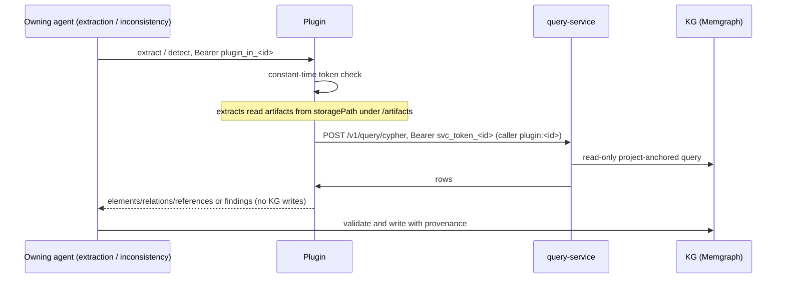

# Plugin System (Extractors and Detectors)

Plugins add **extractors** (e.g. code extraction) and **inconsistency detectors** without changing SANDMAN (ADR-0012). A plugin is an **external system**: any language, any internal design. It receives a request from the owning agent, returns results, and the owner validates and writes them with run provenance. Plugins never write the KG themselves — the single-writer rule is preserved because the owning agent keeps validation, provenance, fingerprinting and lifecycle in one place. This also means plugins need no KG write credentials (which Memgraph Community could not restrict anyway).

Two plugin operations exist, each owned by one agent:

| Operation | Called by | Input / output (`contracts/skills.schema.json`) | Transport in M0 |
|---|---|---|---|
| extract | extraction-agent | `PluginExtractInput` → `PluginExtractOutput` | A2A skill `sandman.plugin.extract` |
| detect | inconsistency-agent | `PluginDetectInput` → `PluginDetectOutput` (`Finding[]`) | plain HTTP `POST /v1/detect` |

Both transports are part of the contract with identical payloads, but per decision D-7 each owner implements one of them in M0: the extraction-agent calls extraction plugins via A2A only (`transport: a2a` in `config/extraction/plugins.yaml`; `http` is cut until needed), and the inconsistency-agent calls detector plugins via plain HTTP only (`transport: http`; A2A is rejected at startup).

## The extract operation

Input lists the artifact versions to process (`path`, `kind`, `storagePath`, `contentHash`) plus `context.currentArtifacts` — all current artifacts routed to the plugin, which enables cross-file relations (e.g. resolving imports to classes in other files). Output:

- `elements`: `path` + `localKey` identify an element. `localKey` must be unique within the artifact and **stable across versions** (e.g. a qualified name plus signature). `label` is one of `CodeUnit`, `TestCase`, `Requirement`, `TextUnit`, `ModelElement`. `parentLocalKey` creates a `CONTAINS` edge from a parent element of the same artifact, so the parent must be in the output too.
- `relations`: `DEPENDS_ON`, `PROVIDES`, `REQUIRES`, `CONTAINS` between `{path, localKey}` locators; targets may be elements in other current artifacts.
- `explicitReferences`: textual references such as `REQ-12` in a comment, each with a `linkType`; the owner resolves them to trace links.
- `warnings`: free text, shown to users.

## The detect operation

Input holds `projectId`, `llmPolicy`, optional `scopeArtifactIds` (absent means the whole project), `queryServiceUrl` and `params`. Output is `findings` with `type` (`^[a-z0-9-]+$`), `severity`, `title`, and `involved` (element keys or trace link ids, each with a `role`). Plugins must **not** compute fingerprints, ids or lifecycle states — the owning agent does that.

## Transports

Rule of thumb (ADR-0012): use A2A when a call can run longer than a few minutes, must be cancellable, reports progress, or the plugin is itself an LLM agent; use plain HTTP for fast, deterministic tools or for wrapping an existing service.

**A2A** (JSON-RPC binding, A2A 1.0). The plugin serves an Agent Card at `/.well-known/agent-card.json` — copy `contracts/agent-cards/plugin-extract.template.json` (or `plugin-detect.template.json`) and set `name` (the plugin id, recorded as `Run.tool`), `version` (`Run.toolVersion`), `description` and `supportedInterfaces[0].url`. The owner reaches the plugin at its configured host, so only the URL path of the card is used. The skill-invocation extension must stay unchanged (`required: true`). Invocation convention:

- the skill id is in `message.metadata["sandman.skill"]`, and the input is the single data part;
- the result is a task artifact named `result` with one data part;
- errors are returned as `{code, message, retryable}` in the status message metadata `sandman.error`.

Callers submit with `returnImmediately`, poll `GetTask` with exponential backoff, and cancel on timeout. In the Python SDK, `A2aPluginClient.extract()` (in `libs/python/sandman-agent/src/sandman_agent/plugins.py`) validates both input and output against `skills.schema.json`, raises `PluginError(retryable=True)` on timeout after cancelling the task or when the plugin is unreachable, and propagates the plugin's own `retryable` flag otherwise. Python plugins can use `sandman_agent.serve(card, skills, settings)` with `SANDMAN_PLUGIN_INBOUND_TOKEN_FILE` set; skills return `SkillResult(output)` without events (see `Extract` in the stub).

**Plain HTTP** (`contracts/openapi/plugin-http.yaml`). Same payload schemas (`skills.schema.json#/$defs/PluginExtractInput|Output` and `PluginDetectInput|Output`), synchronous:

- `GET /manifest` returns `id`, `version` and `operations`, plus `handles` (extract: artifact kinds/formats) or `types` (detect), and `usesLlm`. The manifest identity is recorded as `Run.tool` / `Run.toolVersion`.
- `POST /v1/extract` and `POST /v1/detect` answer synchronously within the caller's timeout (default 10 minutes). `400`/`401` mean bad input or a bad token and are not retried; `503` with an `application/problem+json` body means the caller should retry.
- `GET /healthz` returns `{"status": "ok"}`.

## Tokens and grants

Every plugin has a **token pair**, generated by `deploy/gen-secrets.sh` after the plugin name is added to its `PLUGINS` list (which also generates the service token `svc_token_<id>`):

| Token | Secret | Direction | Rule |
|---|---|---|---|
| inbound | `plugin_in_<id>` (env `SANDMAN_PLUGIN_INBOUND_TOKEN_FILE`) | owner → plugin | The plugin checks `Authorization: Bearer` with a constant-time compare (`hmac.compare_digest` in the stub) on every call except `/healthz` and the Agent Card. Owners never send their own service token to plugins. |
| outbound | `svc_token_<id>` (env `SANDMAN_SERVICE_TOKEN_FILE`) | plugin → query-service | The caller identity is `plugin:<id>`. Only `POST /v1/query/cypher` is allowed, read-only and anchored to the project (every query must contain `{projectId: $projectId}`), and only for projects granted in `config/query/plugins.yaml` (`{plugin-id: [project, ...] | "*"}`). Every other receiver rejects it. |

A detector plugin therefore reads the KG only through the query-service; its grants are explicit per project, and local-only projects should be granted only to locally operated plugins.

The flow from owner to KG read:



A plugin call from the owning agent to result, including auth, KG reads and the single-writer boundary.

## Obligations (ADR-0012, decision D-9)

Every plugin must honor seven obligations:

1. **Never write the KG.** Return results; the owner writes them. Detectors read the KG only through the query-service.
2. **No egress.** Run on the Compose `internal` network only. Prefetch models and parsers at build time.
3. **LLM calls only through the SANDMAN gateway**, using the plugin's own virtual keys `plugin-<id>` and `plugin-<id>-local` (the operator provisions them in `deploy/gateway/config.json` and `gateway.env`). Never use provider keys directly.
4. **Honor `llmPolicy`.** For `local-only` projects, use the `-local` key only (restricted to local models). If the plugin cannot comply, return an error rather than calling a cloud model.
5. **Read artifacts only from `storagePath`.** It points into the read-only artifact store mount (`/artifacts`). Reject paths outside it — the stub refuses any `storagePath` that is not absolute or resolves outside its store root.
6. **Send the outbound token only to the query-service URL from the plugin's own configuration** (the stub reads `SANDMAN_QUERY_SERVICE_URL`, default `http://query-service:8000`). Treat `queryServiceUrl` in the input as a hint that must match (the stub compares origins); on mismatch return `400` and make no outbound call.
7. **Be idempotent.** The same input must give the same output, because owners retry failed calls.

## Registration and deployment

Plugins are registered per owner in `config/extraction/plugins.yaml` and `config/inconsistency/plugins.yaml`:

```yaml
# config/extraction/plugins.yaml
plugins:
  - { id: my-extractor, transport: a2a, url: http://my-extractor:8000, skill: sandman.plugin.extract,
      tokenFile: /run/secrets/plugin_in_my-extractor, match: { kinds: [code, test] }, timeout: 10m }
# config/inconsistency/plugins.yaml
plugins:
  - { id: my-detector, transport: http, url: http://my-detector:8001,
      tokenFile: /run/secrets/plugin_in_my-detector, timeout: 10m }
```

The extraction entry carries `match` (kinds, formats or globs) that routes artifacts to the plugin, and `skill` for A2A; `timeout` defaults to 10 minutes. Deployment follows the compose override pattern: the `plugin-stubs` service in `deploy/docker-compose.yml` (profile `stubs`) shows the template — `SANDMAN_SERVICE_NAME: plugin-stubs`, the two token files as Compose secrets, `SANDMAN_ARTIFACT_STORE: /artifacts` on a read-only `artifact-store` volume, and the `internal` network only. Real plugins follow the same shape in a compose override, with `plugin_in_<id>` and `svc_token_<id>` secrets generated by `deploy/gen-secrets.sh` once the id is in `PLUGINS`. The extraction-agent and inconsistency-agent compose entries mount `plugin_in_<id>` as the token they present; grants for KG reads go in `config/query/plugins.yaml`.

## The reference implementation: tests/plugin-stubs

`tests/plugin-stubs/src/sandman_plugin_stubs/app.py` is the reference plugin used by the walking skeleton and by plugin authors for contract testing. It implements:

- **A2A extract** (port 8000): `serve()` in plugin mode with the extract Agent Card and `SANDMAN_PLUGIN_INBOUND_TOKEN_FILE`; the `Extract` skill reads Java files only via absolute `storagePath` values inside the artifact store, builds `CodeUnit`/`TestCase` elements keyed by qualified name, `DEPENDS_ON` relations across current artifacts, and `REQ-\d+` `explicitReferences` from comments.
- **Plain-HTTP detect** (port 8001): a FastAPI app with `GET /healthz`, `GET /manifest` (guarded by the inbound token) and `POST /v1/detect`. It validates the body against `PluginDetectInput`, rejects a mismatched `queryServiceUrl` hint with `400` problem+json, calls `POST /v1/query/cypher` with its own outbound token and a `projectId`-anchored count query, and returns `503` problem+json if the query-service fails.

Testing against the stubs:

- **Contract tests.** Validate outputs with `sandman_agent.Contracts(contracts_dir).validate("skills.schema.json#/$defs/PluginExtractOutput", out)`; non-Python plugins can use any JSON Schema 2020-12 validator against `contracts/`.
- **A2A extract.** `tests/plugin-stubs/tests/test_stubs.py` calls the stub through `sandman_agent.A2aPluginClient` — the same client the extraction-agent uses — with `httpx.ASGITransport`. To test your own plugin end to end, point the client at its URL with your inbound token.
- **HTTP detect.** The stub test replaces the query-service with an `httpx.MockTransport` and checks that the plugin sends its own outbound token and a project-anchored query.
- **Running the stub.** `SANDMAN_SERVICE_NAME=plugin-stubs SANDMAN_PLUGIN_INBOUND_TOKEN_FILE=… SANDMAN_SERVICE_TOKEN_FILE=… SANDMAN_ARTIFACT_STORE=… SANDMAN_QUERY_SERVICE_URL=http://query-service:8000 uv run python -m sandman_plugin_stubs` serves extract on port 8000 and detect on port 8001. The walking skeleton (`docker compose --profile stubs up`, fixture `tests/e2e/fixtures/mini/`) exercises both plugins against the real agents.

## Related pages

- `/openwiki/concepts/a2a-skills.md` — the A2A skill-invocation protocol both agents and plugins use.
- `/openwiki/concepts/auth-and-roles.md` — service tokens, callers and the `plugin:<id>` role.
- `/openwiki/operations/deployment.md` — secrets generation, compose overrides and the `internal` network.
- `/openwiki/services/extraction-agent.md` and `/openwiki/services/inconsistency-agent.md` — the owning agents that validate and write plugin results.
