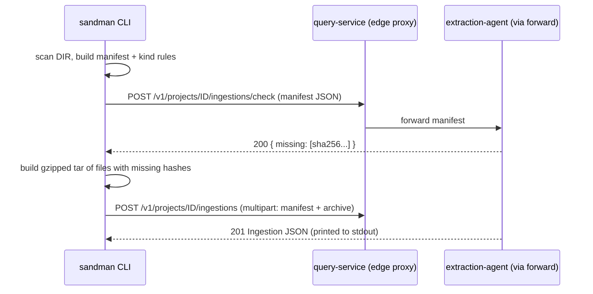

# SANDMAN CLI

The `sandman` command (`tools/cli`, package `sandman_cli`, entrypoint `tools/cli/src/sandman_cli/__main__.py`) is the machine-facing front door of SANDMAN: it turns a directory (typically a Git checkout) into a manifest plus tar archive, uploads it as an *ingestion*, and then lets the same caller list or wait for the analysis workflows that ingestion triggers and export the resulting trace links or inconsistencies. It is a thin HTTP client over the [query-service API](/openwiki/services/query-service.md); the CLI implements no analysis itself.

The architecture (Stage 1, Q-4 default) answers "how do artifacts arrive?" with *snapshot ingestion via REST/CLI*: a directory or Git checkout is uploaded as a batch; there is no live repository watching (see [docs/stage-1-analysis-architecture.md](../../docs/stage-1-analysis-architecture.md)).

## Configuration

| Setting | Source | Default |
| --- | --- | --- |
| Base URL | `$SANDMAN_URL` | `http://127.0.0.1:8080` (the edge proxy; the CLI never talks to internal services directly) |
| Personal API token | `$SANDMAN_TOKEN` or `--token-file` | none — a token is mandatory, the CLI exits with an error otherwise |

The token is sent as `Authorization: Bearer <token>` on every request. All HTTP calls share one `httpx.Client` with a 300 s timeout; any HTTP error status aborts with `sandman: <method> <path>: <status> <body>`, and transport errors abort with `sandman: <exception>`. Because the CLI is the user's entry point, the query-service forwards its ingestion requests to the [extraction-agent](/openwiki/services/extraction-agent.md) and its workflow requests to the orchestrator; the CLI never needs to know those addresses.

Project ids are validated client-side against `[a-z0-9][a-z0-9-]{1,62}`; workflow ids against `wf_[0-9a-f]{32}`.

## Commands

### `sandman ingest`

```
sandman ingest --project ID (--mode full|partial) [--revision REV] [--kind-rule 'glob=kind' ...] DIR
```

`ingest` uploads a snapshot of `DIR` (full mode: the complete project state; partial mode: only changed files). The pipeline is:



Figure: the two-call ingest flow — hash check first, then upload of only the files the server does not know.

**Scan rules.** `scan(root)` walks the directory recursively and produces a sorted map of relative POSIX paths to files, skipping symlinks, any file or directory whose path has a dot-prefixed part (`.git`, ...), and `sandman.yaml` — the optional project-local config file, which is *never ingested*. Each file's SHA-256 is computed into the manifest.

**Kind rules.** Files are classified by the first matching glob rule (`--kind-rule 'glob=kind'`, repeatable, applied *before* rules from `DIR/sandman.yaml`, whose `kindRules` list is appended). Kinds are exactly `requirements`, `architecture-doc`, `architecture-model`, `code`, `test`, `other`; unmatched files default to `other` (the extraction-agent's rule). Matching uses `PurePosixPath.full_match`, so `*` stays within one path segment and `**` crosses segments; the first matching rule wins.

**Manifest and archive.** The manifest (`mode`, `kindRules`, optional `sourceRevision`, `files: [{path, sha256}]`) is posted as JSON to `/ingestions/check`; the response lists the hashes the server does not know. Only files with a *missing* hash go into the archive — an in-memory `tarfile.open(mode="w:gz")` — and the multipart `POST /ingestions` carries `manifest` (JSON) and, when there is anything to upload, `archive` (gzipped tar, `application/gzip`). If nothing is missing, the archive part is omitted entirely (manifest-only request). The server's `Ingestion` response (created/reactivated version ids, deleted artifact ids, sequence number) is printed as JSON on stdout; the file/kind summary goes to stderr. With no files found in `DIR`, the CLI exits with an error.

`mode=full` tells the server that paths missing from the snapshot are deleted; `partial` uploads only the given files without deletion semantics. `--revision` records the source revision (e.g. a Git commit SHA) in the manifest.

### `sandman workflows`

```
sandman workflows --project ID            # list (first page)
sandman workflows --project ID --wait ID [--timeout 600] [--poll 2]
```

Without `--wait`, it prints the first page of `GET /v1/projects/ID/workflows` (forwarded by the query-service to the orchestrator) as tab-separated `id  status  trigger.kind  createdAt` lines.

With `--wait ID`, it polls `GET /v1/workflows/ID` every `--poll` seconds (default 2) until the status is in the DONE set, or until `--timeout` seconds (default 600) elapse — in which case it exits nonzero with `sandman: timeout waiting for ID (status <last>)`. Done statuses are:

- `SUCCEEDED` — the wait exits 0 and prints the workflow JSON;
- `FAILED`, `CANCELED` — done, but the wait exits 1;
- `BLOCKED` — **done for the purposes of polling, but means the workflow is waiting for a user action**; the CLI stops polling and exits 1 rather than spinning until the timeout. A human (via the console) must resolve the block and, if desired, re-run the wait.

### `sandman export`

```
sandman export --project ID (tracelinks|inconsistencies) [--format csv|json]
```

Fetches `GET /v1/projects/ID/export/<what>` with `format` passed through when given, and streams the raw response body to stdout (CSV or JSON, per the query-service contract; the server defaults to `csv` for tracelinks and `json` for inconsistencies).

## CI role and walking skeleton

Per the continuous-use answer (Stage 1, Q-7): the project's CI runs `sandman ingest --mode full --revision <commit>` on every push. Because the CLI uploads only files whose hash the server does not know, a commit with three changed files creates exactly three new versions, and an unchanged snapshot triggers no workflow at all.

The e2e walking skeleton (`tests/e2e/test_walking_skeleton.py`, gated on `SANDMAN_E2E=1`) drives the entire system through the CLI: it mints per-user personal tokens via the console, then calls `sandman_cli.__main__.main(["ingest", ...])` in-process with `SANDMAN_URL` pointed at the stack (default `http://127.0.0.1:8080`) and asserts on the printed `Ingestion` — first full ingest creates six artifact versions in the `mini/s1` fixture, a second snapshot creates one and deletes one, a re-send of an identical snapshot creates/reactivates/deletes nothing and must not trigger a new workflow, and reverting to snapshot 1 reactivates two versions.

## Focused tests

`tools/cli/tests/test_cli.py` unit-tests the CLI against `httpx.MockTransport`:

- kind-rule parsing and matching order (`test_kind_rule_matching`), including first-match-wins and the single-segment `*`;
- manifest construction for the `mini/s1` fixture (six files, `sandman.yaml` excluded, sha256 per file);
- the two-call ingest flow: only files whose hashes are reported missing are tarred and uploaded; when nothing is missing the multipart body is manifest-only;
- wait polling until `SUCCEEDED`, workflow list output, export format pass-through, non-zero exit on HTTP errors, and symlink skipping in `scan`.

## Relationships

- The CLI is a *user* of the [query-service](/openwiki/services/query-service.md); ingestions and workflow reads are forwarded server-side to the [extraction-agent](/openwiki/services/extraction-agent.md) and orchestrator.
- The [analysis pipeline](/openwiki/workflows/analysis-pipeline.md) (extraction → TLR → detection) runs as a workflow per ingestion; `sandman workflows --wait` is how CI observes it.
- Tokens come from the console's personal-token flow (see [auth and roles](/openwiki/concepts/auth-and-roles.md)); ingestions require at least the maintainer role, listings and exports the viewer role.
