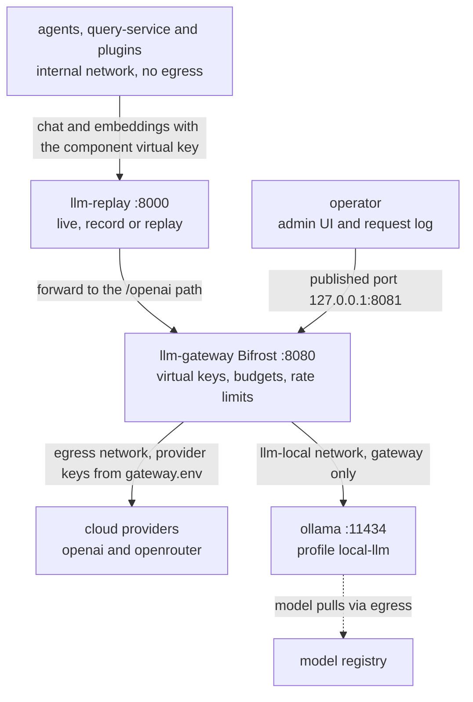
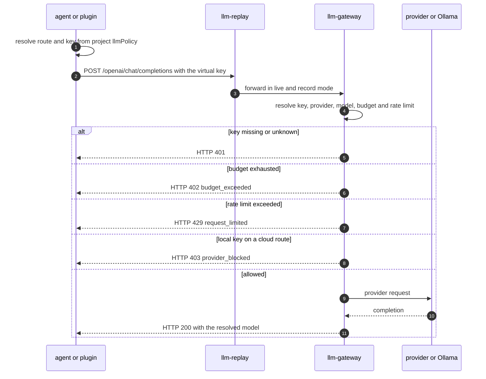

# LLM Gateway (Bifrost)

The `llm-gateway` container (**Bifrost** by Maxim, pinned to `maximhq/bifrost:v2.2.6`) is the single egress point for every LLM call in SANDMAN: chat completions and embeddings from the Python services, the Java agents, LangChain4j running inside reused ArDoCo/LiSSA code, and plugged-in services. It owns the provider keys, per-component virtual keys, monthly USD budgets, rate limits and the request log; no other container can reach an LLM provider. Callers address it only indirectly, through the `llm-replay` proxy, using logical routes and their own virtual key — never a provider key.

## Why Bifrost (ADR-0004)

ADR-0004 (*LLM gateway: Bifrost, LiteLLM as fallback*) requires a free, self-hosted, OpenAI-compatible gateway with per-component virtual keys, budgets and rate limits without a paid license, request logging, cost tracking and Ollama support. Bifrost won because it is a single container with no mandatory database (SQLite default), Apache-2.0, and documents virtual keys, budgets, rate limits, a request-log UI, OpenTelemetry export and Ollama in the open-source build. The runner-up is the **LiteLLM proxy** (Postgres for keys, Docker image pinned to a patched release); the recorded change triggers are *governance turns out to be runtime-gated* or *a needed provider is missing* → LiteLLM, and *MCP/A2A traffic governance* → agentgateway.

The decision was `proposed` until spike T0.4 ([docs/notes/spike-T0.4.md](../../docs/notes/spike-T0.4.md)) resolved the feature-gating ambiguity empirically and was **accepted on 2026-10-07**: virtual keys, budgets (HTTP 402 `budget_exceeded`), rate limits (HTTP 429 `request_limited`), the admin plane and `-local` key isolation all work in the OSS v2.2.6 build, and Bifrost starts healthy with empty provider keys.

## The only egress path

Gateway-only access is enforced by the Compose network topology in [deploy/docker-compose.yml](../../deploy/docker-compose.yml), not by client discipline:

| Network | Property | LLM-relevant members |
|---|---|---|
| `internal` | `internal: true` — **no egress** | all SANDMAN services, `llm-replay`, `llm-gateway` |
| `egress` | outbound internet | `llm-gateway` (provider calls), `ollama` (model pulls) |
| `llm-local` | `internal: true` | `llm-gateway` and `ollama` only |
| `edge` | published ports | `edge-proxy` (web UIs; not on the LLM path) |

Every agent and plugin runs on `internal`, so the only route to a provider is `llm-replay` → `llm-gateway`. Agents are configured with `SANDMAN_LLM_BASE_URL: http://llm-replay:8000/openai`; the proxy forwards to `SANDMAN_LLM_UPSTREAM: http://llm-gateway:8080/openai`. Startup is health-gated along the same chain (`llm-gateway` healthy → `llm-replay` healthy → agents).



The LLM path and its network boundaries as wired by `deploy/docker-compose.yml`.

## Gateway configuration: `deploy/gateway/config.json`

The gateway's whole governance setup is declarative in [deploy/gateway/config.json](../../deploy/gateway/config.json), mounted **read-only** at `/app/data/config.json`; the container image is otherwise stock (`APP_HOST=0.0.0.0`, `APP_PORT=8080`, JSON logs). All secret *values* are `env.*` references resolved at startup from `deploy/secrets/gateway.env` — the config file itself contains no secrets and is committed.

| Section | Contents |
|---|---|
| `client` | `enforce_auth_on_inference: true` (inference requires a valid virtual key) and `enable_logging: true` |
| `config_store` / `logs_store` | SQLite at `./config.db` / `./logs.db` inside the `gateway-data` volume |
| `providers` | `openai` (`env.OPENAI_API_KEY`), `openrouter` (`env.OPENROUTER_API_KEY`), `ollama` (empty key, `ollama_key_config.url: http://ollama:11434`), each with `models: ["*"]` |
| `governance.auth_config` | admin login: username `admin`, password `env.BIFROST_ADMIN_PASSWORD` |
| `governance.virtual_keys` | ten keys, values `env.VK_*` (below) |
| `governance.budgets` | six monthly USD budgets bound to the cloud keys |
| `governance.rate_limits` | `rl-default` and `rl-heavy` |

Spike T0.4 confirmed the gateway starts with this read-only file, loads governance (6 budgets, 2 rate limits) and is healthy after ~10 s — **including with empty provider keys**, which is why the M0 walking skeleton and `tests/e2e/test_walking_skeleton.py` run without any LLM account.

### Model naming: providers and routes

Agents never hard-code provider models. Requests name a **gateway model** of the form `openai/<model>`, `openrouter/<vendor>/<model>` or `ollama/<model>:<tag>`, and the gateway resolves it (e.g. `openai/gpt-4.1-nano` → `gpt-4.1-nano-2025-04-14`; OpenRouter resolved `openrouter/openai/gpt-4.1-nano`). The gateway returns the resolved name, which clients surface as `ChatResponse.resolved_model` and which `Run.resolvedModel` records for provenance (`Run.model` keeps the logical route). **No cross-provider fallbacks are configured**: a fallback would move `local-only` content to the cloud and mix models within one experiment.

OpenRouter is used only for `cloud-allowed` projects, and its account-level privacy setting that excludes providers training on prompts has been enabled (V-32, `TODO.md`).

## Virtual keys: one cloud key and one local-only key per component

Bifrost's virtual keys (VKs) are the only credentials agents hold. Each VK pins the allowed providers, a rate limit and (for cloud keys) a budget:

| Virtual key | Value | Providers | Rate limit | Budget (USD/month) | Compose secret mounted into |
|---|---|---|---|---|---|
| `vk-orchestrator` | `env.VK_ORCHESTRATOR` | openai, openrouter, ollama | `rl-default` | `b-orchestrator` 10 | `orchestrator` → `llm_key_orchestrator` |
| `vk-extraction` | `env.VK_EXTRACTION` | openai, openrouter, ollama | `rl-default` | `b-extraction` 20 | `extraction-agent` → `llm_key_extraction` |
| `vk-tlr` | `env.VK_TLR` | openai, openrouter, ollama | `rl-heavy` | `b-tlr` 50 | `tlr-agent` → `llm_key_tlr` |
| `vk-inconsistency` | `env.VK_INCONSISTENCY` | openai, openrouter, ollama | `rl-heavy` | `b-inconsistency` 30 | `inconsistency-agent` → `llm_key_inconsistency` |
| `vk-query` | `env.VK_QUERY` | openai, openrouter, ollama | `rl-default` | `b-query` 10 | `query-service` → `llm_key_query` |
| `vk-experiments` | `env.VK_EXPERIMENTS` | openai, openrouter, ollama | `rl-heavy` | `b-experiments` 50 | none — evaluation scripts (no compose secret) |
| `vk-extraction-local` | `env.VK_EXTRACTION_LOCAL` | **ollama only** | `rl-default` | – | `extraction-agent` → `llm_key_extraction_local` |
| `vk-tlr-local` | `env.VK_TLR_LOCAL` | **ollama only** | `rl-heavy` | – | `tlr-agent` → `llm_key_tlr_local` |
| `vk-inconsistency-local` | `env.VK_INCONSISTENCY_LOCAL` | **ollama only** | `rl-heavy` | – | `inconsistency-agent` → `llm_key_inconsistency_local` |
| `vk-query-local` | `env.VK_QUERY_LOCAL` | **ollama only** | `rl-default` | – | `query-service` → `llm_key_query_local` |

Design points:

* The **`-local` keys are restricted to the `ollama` provider in the gateway itself** (`provider_configs` lists only ollama), which is how `Project.llmPolicy = local-only` is enforced for code the project does not control (see below). The orchestrator deliberately has no `-local` key — it makes no LLM calls in M0.
* Budget and rate-limit values are **placeholders** to be set by the operator (`TODO.md`: "Set real budgets and rate limits in deploy/gateway/config.json"); the tlr key is intended to get the highest budget.
* **LLM-using plugins** are external systems (ADR-0012, D-9) and get their own keys `plugin-<id>` and `plugin-<id>-local`, provisioned by the operator in `deploy/gateway/config.json` and `gateway.env` when the plugin is added (`gen-secrets.sh` reminds about this in its header). No plugin keys exist in the committed config yet.

### Where the key material lives

The generation and distribution flow, per [deploy/gen-secrets.sh](../../deploy/gen-secrets.sh) (which never overwrites existing files):

1. On first run, the script generates random values for `VK_ORCHESTRATOR`, `VK_EXPERIMENTS` and each of `LLM_COMPONENTS="extraction tlr inconsistency query"` (cloud) plus a second local value per component, and writes them into `deploy/secrets/gateway.env` as `VK_*` entries.
2. It writes the **same values** into per-component Docker secret files `deploy/secrets/llm_key_<component>` and `llm_key_<component>_local`, which the compose file mounts into exactly one agent each (`SANDMAN_LLM_KEY_FILE` / `SANDMAN_LLM_LOCAL_KEY_FILE`). `VK_EXPERIMENTS` gets no secret file — it is for evaluation scripts outside compose.
3. It generates the admin password (random, prefixed to satisfy Bifrost's policy of ≥ 12 characters with upper/lower/digit/special) into `secrets/gateway_admin_password` — operator-only, never mounted into agents — and sets `BIFROST_ADMIN_PASSWORD` in `gateway.env`.
4. `BIFROST_ENCRYPTION_KEY` is generated into `gateway.env`.
5. `OPENAI_API_KEY` and `OPENROUTER_API_KEY` are left **empty** — the operator fills real provider keys into `deploy/secrets/gateway.env` afterwards; only the `llm-gateway` container reads that file (`env_file`), so provider keys never enter agent containers.

## Budgets and rate limits

| Budget | Virtual key | `max_limit` (USD) | Reset |
|---|---|---|---|
| `b-orchestrator` | `vk-orchestrator` | 10.0 | monthly (`1M`) |
| `b-extraction` | `vk-extraction` | 20.0 | `1M` |
| `b-tlr` | `vk-tlr` | 50.0 | `1M` |
| `b-inconsistency` | `vk-inconsistency` | 30.0 | `1M` |
| `b-query` | `vk-query` | 10.0 | `1M` |
| `b-experiments` | `vk-experiments` | 50.0 | `1M` |

| Rate limit | Requests | Tokens |
|---|---|---|
| `rl-default` | 60 / minute (`1m` reset) | 200,000 / hour (`1h` reset) |
| `rl-heavy` | 300 / minute | 2,000,000 / hour |

`rl-heavy` is attached to the tlr, inconsistency and experiments keys (and their `-local` variants); everything else uses `rl-default`. The `-local` (Ollama) keys carry rate limits but no budget — local models cost nothing.

**Operator fact:** budgets and rate limits are edited in `deploy/gateway/config.json`, *not* through the Bifrost UI — in v2.2.6 the UI cannot save a standalone VK budget (the form sends an empty reset duration and fails with "invalid reset duration format:", although the `"1M"` in `config.json` is valid). Since `config.json` is mounted read-only, changing a budget means editing the host file and restarting `llm-gateway`; the spike used a throwaway gateway with a modified copy of the config for the exhaustion test.

### Gateway error semantics

Spike T0.4 (check 5, check 12 and `spikes/T0.4/gateway-results.txt`) measured the exact behavior callers must handle:

| Condition | Gateway response | Caller behavior |
|---|---|---|
| Inference without a key or with an unknown key | **HTTP 401** (because `enforce_auth_on_inference: true`) | configuration error; the spike verified this from the host and from a container on `internal` |
| Budget of the virtual key exhausted | **HTTP 402**, body `{"type":"budget_exceeded", …}` | Python `OpenAiLlmClient` raises `BudgetExceededError`; the skill layer turns it into a non-retryable `SkillError BUDGET_EXCEEDED` and the orchestrator sets the workflow to `BLOCKED` (waits for a user, no retry) |
| Rate limit exceeded | **HTTP 429**, body `{"type":"request_limited", …}`, **no `Retry-After` header** | stays retryable; the OpenAI SDK's own retries apply (`max_retries=2` in `OpenAiLlmClient`) |
| `-local` key used on a cloud route | **HTTP 403** `provider_blocked` | the client-side route restriction normally prevents this first (`PolicyError`) |
| Management API, request log or `/metrics` without admin credentials | **HTTP 401** | operator-only paths, behind the admin login |

Two measured subtleties: the **first call that crosses a budget is still served** (Bifrost counts spending after the call, so exhaustion starts with the next request), and the `X-Ratelimit-*` headers on successful calls are the upstream provider's, not Bifrost's own limits.



One chat request through the chain, with the gateway's decision branches. In `replay` mode the proxy answers from its cassette and the gateway is never reached.

## Admin plane, request log and metrics

The admin plane is secured with `governance.auth_config` (ADR-0004 amendment D-4): username `admin`, password from `BIFROST_ADMIN_PASSWORD`. The **admin UI and request log are published on `127.0.0.1:8081`** (compose port mapping `127.0.0.1:8081:8080`) — the gateway's only published port, and the only published port in the default stack besides the edge-proxy's. The admin password is generated by `gen-secrets.sh` into `secrets/gateway_admin_password` and never enters agent containers.

* **Request log**: enabled via `client.enable_logging` with the SQLite `logs_store` (`./logs.db` in the `gateway-data` volume); readable through the management API (`/api/logs`) with admin Basic auth. Measured limitation: **the gateway request log does not store the `traceparent` header** — correlate LLM calls through OpenTelemetry and the `user` field (= run id) instead. The design target is a 30-day retention for audit purposes (ADR-0004 D-4; the retention mechanism is still to be verified, V-15).
* **Metrics**: `/metrics` with admin Basic auth exposes ~20 `bifrost_*` series including `bifrost_cost_total`, `bifrost_input_tokens_total` / `bifrost_output_tokens_total`, `bifrost_error_requests_total` and latency histograms — the basis for the M1 dashboard's LLM statistics, which reads the gateway with `SANDMAN_GATEWAY_URL: http://llm-gateway:8080` and its own `gateway_admin_password` secret.
* Spike T0.4 additionally confirmed that unauthenticated calls to the management plane are rejected with 401 **also from a container on the `internal` network**, i.e. agents cannot read logs, edit keys or scrape metrics.

## The Ollama local profile

Ollama runs only under the compose **`local-llm` profile** (`ollama/ollama:0.35.1`): it sits on `llm-local` — an `internal: true` network whose only members are the gateway and Ollama, so **local models are reachable only through the gateway** — and on `egress`, because model pulls need internet access. The gateway reaches it at `http://ollama:11434` (the `ollama_key_config.url` in the provider entry; the key value is empty). Health check is `ollama list`; the GPU reservation for NVIDIA is present but commented out. Models are named `ollama/<model>:<tag>` in `models.yaml` routes and must be pulled once (the `chat-local` / `embed-local` route models are an open TODO, as is the concrete route mapping).

## How `llmPolicy` selects keys and routes

`Project.llmPolicy` is a required project property with enum `cloud-allowed` / `local-only` (`contracts/kg/schema.yaml`), created through the extraction-agent's project API and stored on the `Project` node. It drives **both** the client's key/route choice and the gateway's enforcement:

* **Python** — `ModelSelector` (`libs/python/sandman-agent/src/sandman_agent/llm.py`) loads the routes from `models.yaml` (`SANDMAN_LLM_MODELS_FILE`, mounted at `/config/llm/models.yaml`) and picks per policy: `chat_model()` / `embed_model()` return `chat-local` / `embed-local` for `local-only`, otherwise `chat-default` / `embed-default`. `client(policy)` returns an `OpenAiLlmClient` with the cloud key, or — for `local-only` — with the local key and `local_only=True`; if no local key is configured it raises **`PolicyError` ("local-only project but no local virtual key configured")**.
* With `local_only=True`, the client refuses any route not ending in `-local` (`PolicyError: route … is not allowed for local-only projects`); unknown routes raise `PolicyError` too. The gateway adds the second, independent barrier: an Ollama-only `-local` key cannot reach a cloud provider (HTTP 403 `provider_blocked`). Together this makes the policy hold even for LLM code the project does not control — notably LangChain4j inside reused ArDoCo/LiSSA code.
<!-- openwiki: broken internal link [../../libs/java/agent-lib] file "../../libs/java/agent-lib" does not exist. Fix the href or restore the target, then delete this comment. -->
* **Java** — there is deliberately no Java `LlmClient`/`ModelSelector` (ADR-0010 D-7); `LlmAccess.forPolicy(settings, llmPolicy)` (in [libs/java/agent-lib](../../libs/java/agent-lib)) returns the record `(baseUrl, apiKey, routes, localOnly)` for the approach/detector adapters to configure LangChain4j, with the same `-local` route restriction and `PolicyException`, and a `toString()` that never prints the key. The tlr-agent builds it only when an approach `usesLlm()`.
* **Plugins** — `llmPolicy` travels in the plugin inputs (`PluginExtractInput`, `PluginDetectInput` in `contracts/skills.schema.json`); LLM-using plugins must use their own `plugin-<id>` / `plugin-<id>-local` gateway keys and, for `local-only` projects, the `-local` key only — if they cannot comply they must return an error rather than call a cloud model (ADR-0012 D-9, `docs/plugins.md`).

### Logical routes in `config/llm/models.yaml`

The route file is part of the configuration file contracts (Stage 2 §1.6) and is mounted read-only into every LLM-using service:

```yaml
# config/llm/models.yaml – logical routes → gateway model names (all LLM users)
routes:
  chat-default: openai/<pinned-model>
  chat-alt: openrouter/<vendor>/<model>
  chat-local: ollama/<model>:<tag>
  embed-default: openai/<embedding-model>
  embed-local: ollama/<embedding-model>
```

The concrete models are deliberately **not committed yet** — choosing them (and pulling the Ollama models) is an open M0 TODO, so experiments can pin models per run; the chosen names are recorded in the experiment manifest and in every `Run` (`model` = route, `resolvedModel` = gateway-resolved name). Note the interaction with record/replay: the cassette key contains the gateway model name, so **re-pointing a route invalidates recorded cassettes**.

### `OpenAiLlmClient` behavior

The Python client (`sandman_agent.llm`) is a thin wrapper over the official `openai` SDK pointed at `SANDMAN_LLM_BASE_URL`:

* `chat(req)` sends `model` (route → gateway model name via `_model()`), `messages`, `temperature` (default `0.0`), optional `seed`, `max_tokens` and `user` (the run id, for attribution), plus the W3C `traceparent` header from `telemetry.trace_headers()`.
* If `ChatRequest.response_schema` is set, it is sent as OpenAI structured output: `response_format = {"type": "json_schema", "json_schema": {"name": "response", "schema": <schema>, "strict": true}}`.
* Gateway errors: `APIStatusError` with status **402 → `BudgetExceededError`** (everything else passes through); the SDK retries up to `max_retries=2`.
* The response carries the gateway-resolved model name (`ChatResponse.resolved_model`) plus usage, which `RunRecorder.complete` records on the `Run` (`inputTokens` / `outputTokens`).
* `embed(model, texts)` follows the same route/policy rules on the embeddings endpoint.

Callers send only standard OpenAI fields plus `traceparent` — no gateway-specific headers — so the gateway remains swappable by changing URL and keys (the LiteLLM fallback in ADR-0004).

## `llm-replay` in front of the gateway

<!-- openwiki: broken internal link [../../services/llm-replay] file "../../services/llm-replay" does not exist. Fix the href or restore the target, then delete this comment. -->
All callers target the proxy, not the gateway ([services/llm-replay](../../services/llm-replay), ADR-0010 amendment D-3), so record/replay works for every LLM consumer including LangChain4j inside reused code:

* Modes from `SANDMAN_LLM_MODE`: `live` (pure pass-through, streaming included), `record` (store responses) and `replay` (strict: a miss is HTTP 404 `replay_miss`). Cassettes live in `data/llm-records/<SANDMAN_EXPERIMENT>/cassette.jsonl` (default experiment `default`).
* The cassette key is `sha256` of the RFC 8785-canonical request body **without** `user`, `stream` and `stream_options` — so the same prompt replayed for a different run id hits the cassette. Only `chat/completions` and `embeddings` are recordable; streaming requests are rejected with 400 `streaming_not_supported` in record/replay mode.
* It forwards the caller's `Authorization` header unchanged, i.e. the **virtual key** — the proxy holds no keys of its own. `GET /v1/status` (service token required) reports mode, experiment, cassette entries and hit/miss counters; `/readyz` fails only in `record` mode when the records dir is not writable.

Details of the proxy itself are on [LLM Replay](/openwiki/services/llm-replay.md); this page cares about the gateway relationship: the proxy is on `internal` only, reaches the gateway over the internal network, and its cassettes are invalidated by route changes.

## Operations

```sh
make secrets                    # deploy/gen-secrets.sh → deploy/secrets/* (idempotent, never overwrites)
# … then put real provider keys into deploy/secrets/gateway.env (OPENAI_API_KEY, OPENROUTER_API_KEY)
make infra                      # memgraph, nats, llm-gateway (dev overlay, for spike scripts)
cd deploy && docker compose up -d --build      # whole stack; gateway port 8081 stays on 127.0.0.1
```

* **Admin UI / request log**: `http://127.0.0.1:8081`, user `admin`, password in `deploy/secrets/gateway_admin_password`. Remote operators go through an SSH tunnel (the port is bound to localhost).
* **Changing budgets or rate limits**: edit `deploy/gateway/config.json`, restart `llm-gateway` — the UI cannot save standalone VK budgets in v2.2.6. Current values are placeholders.
* **Rotating a component key**: regenerate or hand-edit the `VK_*` value in `gateway.env` *and* the matching `secrets/llm_key_*` file (they must match), then restart the gateway and the component. `gen-secrets.sh` will not touch existing files.
* **Adding an LLM-using plugin**: add the id to `PLUGINS` in `gen-secrets.sh` (token pair), and add `vk-plugin-<id>` / `vk-plugin-<id>-local` to `governance.virtual_keys` in `config.json` plus `VK_PLUGIN_<ID>*` values in `gateway.env`.
* **Verifying the gateway**: `uv run python spikes/T0.4/gateway_checks.py` against a running gateway (virtual-key inference, tool calling, structured output, streaming, embeddings, OpenRouter route, `-local` rejection, admin metrics and log) and `bash spikes/T0.4/budget_check.sh` for budget/rate-limit semantics on a throwaway gateway. Neither script prints key values.

## Tests that pin the behavior

* `libs/python/sandman-agent/tests/test_units.py::test_model_selector_enforces_local_only` — local key and `chat-local` route for `local-only`, cloud key otherwise, `PolicyError` for a non-`-local` route under `local_only`, `PolicyError` when no local key is configured.
* `libs/python/sandman-agent/tests/test_units.py::test_gateway_402_becomes_budget_exceeded` — a mocked HTTP 402 from the gateway surfaces as `BudgetExceededError` through the real openai SDK transport.
* `libs/java/agent-lib/src/test/.../LibraryTest.java::llmAccessEnforcesLocalOnly` — the Java mirror: local/cloud key by policy, `chatModel()`/`embedModel()` route resolution, `PolicyException` for `chat-default` under local-only and for a missing local key file, and `toString()` never containing the key.
* `services/llm-replay/tests/test_app.py` — the `cassetteKey` vectors from `contracts/conformance/vectors.json`, live pass-through, record-then-hit, replay hit/miss, streaming rejection, non-200 responses not recorded, malformed cassette failing startup, and the `/v1/status` counters.
* `spikes/T0.4/gateway_checks.py` + `budget_check.sh` — the manual evidence behind ADR-0004's acceptance (results in `spikes/T0.4/gateway-results.txt` and `docs/notes/spike-T0.4.md`).
* The e2e walking skeleton runs the whole stack — including a keyless gateway — without any provider account.

## Related pages

* [System Overview](/openwiki/architecture/system-overview.md) — the four networks and the "one path through the gateway" rule.
* [Deployment](/openwiki/operations/deployment.md) — compose profiles, secrets and health-gated startup.
* [LLM Replay](/openwiki/services/llm-replay.md) — the record/replay proxy in front of the gateway.
* [Extraction Agent](/openwiki/services/extraction-agent.md) — where `llmPolicy` is created and stored.
* [Agent Libraries](/openwiki/architecture/agent-libraries.md) — `ModelSelector`, `OpenAiLlmClient` and `LlmAccess` in their library context.
* [Plugins](/openwiki/concepts/plugins.md) — the plugin obligations that include the gateway keys.
