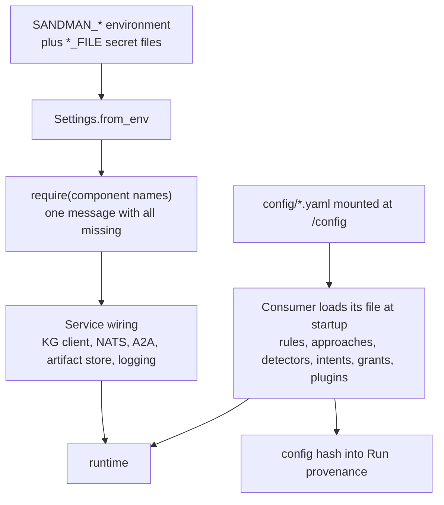

# Configuration and Environment Variables

SANDMAN has exactly two configuration channels: **environment variables** (`SANDMAN_*`, read once at startup by `Settings.from_env()`) and **YAML files** under `config/` (mounted read-only at `/config` by compose). Everything else — tokens, provider keys, passwords — is a file mounted as a Docker secret and referenced by a `*_FILE` variable; no secret value ever enters the environment or the page below.

The two libraries define the same settings model in both languages:

| | Python | Java |
|---|---|---|
| Module | `libs/python/sandman-agent/src/sandman_agent/config.py` | `libs/java/agent-lib/.../Settings.java` |
| Type | frozen `@dataclass` `Settings` | record `Settings` |
| Reader | `Settings.from_env(env=None)` (defaults to `os.environ`) | `Settings.fromEnv()` / `fromEnv(Map env)` |
| Error | `ConfigError` | `Settings.ConfigException` (a `RuntimeException`) |
| Required check | `Settings.require(*names)` | `settings.require(String... names)` |

A service builds one `Settings` at startup, calls `require(...)` for the settings it actually needs, and then wires concrete clients from them. Java agents get this for free: `A2aServer` in `agent-lib-a2a` provides `@DefaultBean` producers that call `Settings.fromEnv()` and build `Contracts(settings.contractsDir())`, so an agent injects `Settings` and can override a bean only when it needs something non-default.

## The Settings fields and their environment variables

| Field | Environment variable | Kind | Meaning |
|---|---|---|---|
| `serviceName` | `SANDMAN_SERVICE_NAME` | plain | This service's name: the log `service` field, the `source` of published events, the `StatusTracker` label and the prefix of `require()` error messages. **The only variable that fails `from_env()` itself when absent** ("SANDMAN_SERVICE_NAME is required") — everything else is loaded as `None` and checked later by `require()`. |
| `contractsDir` | `SANDMAN_CONTRACTS_DIR` | plain path | Directory of the JSON Schemas / OpenAPI / agent cards (`Contracts(contracts_dir)`). Defaults to the repository checkout's `contracts/` — see below. |
| `llmBaseUrl` | `SANDMAN_LLM_BASE_URL` | plain | Base URL of the OpenAI-compatible endpoint, i.e. the `llm-replay` proxy in front of the gateway (compose sets `http://llm-replay:8000/openai`). |
| `llmKey` | `SANDMAN_LLM_KEY` (`*_FILE` supported) | secret | Cloud virtual key for `cloud-allowed` projects. |
| `llmLocalKey` | `SANDMAN_LLM_LOCAL_KEY` (`*_FILE` supported) | secret | `-local` (Ollama-only) virtual key for `local-only` projects. |
| `llmModelsFile` | `SANDMAN_LLM_MODELS_FILE` | plain path | `models.yaml` mapping logical routes (`chat-default`, `chat-local`, …) to gateway model names; compose mounts `/config/llm/models.yaml`. |
| `kgUri` / `kgUser` / `kgPassword` | `SANDMAN_KG_URI` / `SANDMAN_KG_USER` / `SANDMAN_KG_PASSWORD` (`*_FILE` supported) | Bolt URL, user, secret | Memgraph connection. Compose: `bolt://memgraph:7687`, user from `MEMGRAPH_USER` (default `sandman`), password via `SANDMAN_KG_PASSWORD_FILE: /run/secrets/memgraph_password`. |
| `natsUrl` | `SANDMAN_NATS_URL` | plain | NATS JetStream URL (`nats://nats:4222`). |
| `serviceToken` | `SANDMAN_SERVICE_TOKEN` (`*_FILE` supported) | secret | This service's **own outbound** bearer token (compose: `SANDMAN_SERVICE_TOKEN_FILE: /run/secrets/svc_token_<name>`). |
| `serviceVerify` | `SANDMAN_SERVICE_VERIFY_FILE` | JSON file | Shared map `{callerName: sha256(token)}` used to verify *incoming* callers (`svc_tokens_verify.json` is mounted into every service; entries for plugins appear under `plugin:<id>`). Parsed to a `Map<String, String>` / `Mapping[str, str]` at load time — an unreadable or malformed file is an immediate `ConfigException`/`ConfigError`. |
| `pluginInboundToken` | `SANDMAN_PLUGIN_INBOUND_TOKEN` (`*_FILE` supported) | secret | Plugins only: the inbound token owners present when calling the plugin (`plugin_in_<id>`). Its presence also flips the A2A authenticator from service-token mode to plugin mode (caller becomes `"owner"`). |
| `artifactStore` | `SANDMAN_ARTIFACT_STORE` | plain path | Root of the content-addressed artifact store (`/artifacts`). |
| `configDir` | `SANDMAN_CONFIG_DIR` | plain path | Root of the mounted YAML configuration tree (`/config`). |
| `logFile` | `SANDMAN_LOG_FILE` | plain path | Optional JSONL log file inside the container (rotating, 50 MB × 5 backups in Python's `setup_logging`). Python services call `setup_logging` in their lifespan (orchestrator and query-service `__main__` pass `None` and rely on the lifespan wiring); the Java inconsistency-agent appends **one JSON line per new/reopened finding** to it via `Notifications` in addition to the normal log. |

Two conventions keep this predictable:

- **Empty means unset.** Both readers treat an empty string as absent, so `SANDMAN_LOG_FILE: ""` in compose cleanly disables the file sink instead of creating a `Path("")`.
- **Secrets never print.** Java's `Settings.toString()` is hardcoded to `Settings[serviceName=…]` ("never print secrets"), and `LlmAccess.toString()` likewise hides the key; the Python mirror relies on services never logging the dataclass. The unit tests assert this (`assertFalse(local.toString().contains("local-key"))` in `LibraryTest.llmAccessEnforcesLocalOnly`).

### `*_FILE` precedence

For the five secret fields (`SANDMAN_LLM_KEY`, `SANDMAN_LLM_LOCAL_KEY`, `SANDMAN_KG_PASSWORD`, `SANDMAN_SERVICE_TOKEN`, `SANDMAN_PLUGIN_INBOUND_TOKEN`), a `<NAME>_FILE` variable **wins over** the plain variable: if `SANDMAN_KG_PASSWORD_FILE` is present (Python: key present in the environment at all; Java: non-`null`), the value is `read_text().strip()` of that file, and the plain `SANDMAN_KG_PASSWORD` is ignored; only when no `*_FILE` exists does the plain variable apply. The file must be readable — an `OSError`/`IOException` aborts construction with a `ConfigError` naming the offending variable and path ("cannot read SANDMAN_KG_PASSWORD_FILE=…"). Note the asymmetry: `serviceVerify` is *always* a file (`SANDMAN_SERVICE_VERIFY_FILE` has no plain form), while path-typed settings (`contractsDir`, `llmModelsFile`, `artifactStore`, `configDir`, `logFile`) never have a `*_FILE` variant.

### The default `contractsDir` — the repository checkout

When `SANDMAN_CONTRACTS_DIR` is unset, both libraries fall back to a **repository-relative** default:

- **Python**: `DEFAULT_CONTRACTS_DIR = Path(__file__).resolve().parents[5] / "contracts"` — i.e. `libs/python/sandman-agent/src/sandman_agent/` walked five levels up to the repository root. This works for tests and local runs from a checkout; the test suites use it to locate the repository's `config/` too (`DEFAULT_CONTRACTS_DIR.parent / "config"`).
- **Java**: `Settings.defaultContractsDir()` searches **upwards from the working directory** for the first directory containing `contracts/common.schema.json`, falling back to `Path.of("contracts").toAbsolutePath()`.

The containers never rely on this: every Dockerfile copies `contracts/` to `/contracts` and sets `ENV SANDMAN_CONTRACTS_DIR=/contracts` (Python) or additionally `SANDMAN_AGENT_CARD=/contracts/agent-cards/<agent>.json` (Java Quarkus agents). Java agents load their Agent Card from that MicroProfile property (`sandman.agent-card`).

### `require()` — one failure naming everything missing

`Settings.require(*names)` takes **component names** (e.g. `"kgUri"`, `"nats_url"`), never raw environment names:

1. Unknown component names are an immediate `ValueError` / `IllegalArgumentException` ("unknown settings: [...]"), catching typos at the call site.
2. Every requested component is checked; a value counts as unset when it is `null`/`None`, the empty string, or an **empty map** (the `serviceVerify` case).
3. All missing names are translated to their environment form (`SANDMAN_` + SCREAMING_SNAKE) and joined into **one message**: `ConfigException("<service>: missing configuration SANDMAN_A, SANDMAN_B")`.

So a misconfigured deployment fails once, at startup, listing everything an operator must fix — not one variable per restart. Each service declares exactly what it needs:

| Service | `require(...)` call site | Required settings |
|---|---|---|
| orchestrator | `build()` in `app.py` | `kg_uri`, `nats_url`, `service_token`, `config_dir` |
| extraction-agent | `Service.__init__` in `app.py` | `kg_uri`, `nats_url`, `artifact_store` |
| query-service | `create_app` / reader fallback in `app.py` | `service_token` (always); `kg_uri` when no test reader is injected |
| tlr-agent / inconsistency-agent (Java) | `Beans.kg(...)` / `Beans.publisher(...)` | `kgUri` (KG bean); `natsUrl` (first publish) |
| tlr-agent LLM approaches | `LlmAccess.forPolicy` (agent-lib) | `llmBaseUrl`, `llmModelsFile`, then `llmKey` (or `llmLocalKey` for local-only) |
| plugin stubs (A2A extract) | `create_extract_app` | `plugin_inbound_token`, `artifact_store` |
| plugin stubs (HTTP detect) | `create_detect_app` | `plugin_inbound_token`, `service_token` |

The `llmPolicy`-driven pair is worth noting: `LlmAccess.forPolicy(settings, "local-only")` requires `llmBaseUrl` + `llmModelsFile` first, then raises a **`PolicyException`** ("local-only project but no local virtual key configured") when `llmLocalKey` is absent — a distinct, more specific error than a missing-configuration failure. The tlr-agent only reaches this code for approaches with `usesLlm() == true`; the currently enabled `stub-name-match` does not use an LLM, so the tlr-agent runs in compose without ever resolving its key files at startup. (Python's `ModelSelector` in `sandman_agent.llm` mirrors this contract — `ModelSelector(models_file, base_url, key, local_key)` — but no M0 Python service constructs it yet; the extraction-agent and query-service pass `llmPolicy` through without calling an LLM.)

## Where `require` meets YAML: service `build()` wiring

Each Python service has a `build(env)` factory (invoked by uvicorn `--factory`) that composes `Settings.from_env()` with **service-specific** environment variables beyond the `Settings` model:

| Service | Service-specific variables (not in `Settings`) |
|---|---|
| orchestrator | `SANDMAN_STATE_DB` (SQLite path, default `/data/orchestrator.db`), `SANDMAN_AGENTS` (`name=url,...` comma list of A2A agent URLs) |
| query-service | `SANDMAN_USER_DB` (default `/data/users.db`), `SANDMAN_ADMIN_PASSWORD_FILE` (bootstrap admin password; the admin is created only when the user store is empty, flagged must-change), `SANDMAN_COOKIE_SECURE` (`"true"` → secure session cookies), `SANDMAN_EXTRACTION_URL`, `SANDMAN_INCONSISTENCY_URL`, `SANDMAN_ORCHESTRATOR_URL` (owner URLs for forwarding; the map keys are fixed to the three owner names) — all read directly from `env` in `build()`, not via `Settings` |
| extraction-agent | `SANDMAN_MAX_ARCHIVE_BYTES` (upload size cap, default 1 GiB) |
| llm-replay | `SANDMAN_SERVICE_NAME`, `SANDMAN_LLM_MODE` (`live` \| `record` \| `replay`; invalid value → `ValueError` listing the modes), `SANDMAN_LLM_UPSTREAM` (required except in `replay`), `SANDMAN_LLM_RECORDS_DIR`, `SANDMAN_VERSION` (status display, default `dev`), `SANDMAN_SERVICE_VERIFY_FILE` (its own local `Settings.from_env`; sha256 of the caller's service token guards `GET /v1/status`). It does not use the shared `Settings` model — compose's agent-env anchor is therefore not applied to it |
| plugin-stubs (detect) | `SANDMAN_QUERY_SERVICE_URL` (where its outbound token may be sent; default `http://query-service:8000`) |
| dashboard (compose-planned, M1) | `SANDMAN_DASHBOARD_ADMIN_PASSWORD_FILE`, `SANDMAN_SESSION_SECRET_FILE`, `SANDMAN_STATE_DB`, `SANDMAN_NATS_MONITOR_URL`, `SANDMAN_GATEWAY_URL`, `SANDMAN_GATEWAY_ADMIN_PASSWORD_FILE`, `SANDMAN_CADVISOR_URL`, `SANDMAN_TARGETS` |

### The dashboard's target list

`SANDMAN_TARGETS` is a comma list `name=url` of services whose `GET /v1/status` the dashboard polls for its system overview; compose sets it to all six status-reporting services (the three agents, orchestrator, query-service, llm-replay). The dashboard deliberately does **not** `depends_on` the agents ("it must show them when they are down"), so the target list, not the dependency graph, defines what it displays.

## The `config/` tree and its consumers

`config/` is a committed repository directory mounted read-only into every container that needs it (`../config:/config:ro`, `SANDMAN_CONFIG_DIR: /config`). Its files are **operational configuration** — what an operator tunes per deployment — as opposed to `contracts/`, which never changes per task. Six files exist; the planned `config/llm/models.yaml` (logical routes → gateway models, consumed by `LlmAccess`/`ModelSelector`) is referenced by compose (`SANDMAN_LLM_MODELS_FILE: /config/llm/models.yaml`) but not committed yet, so route/model choices remain an open M0 TODO.

| File | Consumer | Loaded by | Keys that matter |
|---|---|---|---|
| `config/extraction/plugins.yaml` | extraction-agent | `Service.__init__` reads it once; `sha256` of the raw bytes becomes `config_hash` | `plugins[]` (`id`, `transport`, `url`, `skill`, `tokenFile`, `match` with `kinds`/`formats`/`globs`, `timeout` — first matching plugin wins per artifact; no match → the stub extractor) and `explicitReferences.patterns` (regexes whose matches become explicit-reference trace links) |
| `config/inconsistency/plugins.yaml` | inconsistency-agent | `DetectorRegistry.load(file, contracts)` at CDI startup | `detectors` (`id: {enabled: bool}` switching ServiceLoader-registered detectors; unknown enabled id → `ConfigException`), `plugins[]` (plain HTTP only — a non-`http` transport fails startup; `tokenFile` unreadable → `ConfigException`) |
| `config/orchestrator/rules.yaml` | orchestrator | `Rules.load(Path(config_dir) / "orchestrator/rules.yaml")` in `build()` | see below |
| `config/query/intents.yaml` | query-service | `Intents(config_dir / "query/intents.yaml")` at startup | `intents[]` with `id`, `pattern`, `cypher` — the M0 NL stub; **every template must pass the Cypher guard at load time**, otherwise startup fails |
| `config/query/plugins.yaml` | query-service | `load_plugin_grants(config_dir / "query/plugins.yaml")` | `{plugin-id: [project, ...] | "*"}` — projects a plugin may read through `POST /v1/query/cypher`; absent file or missing plugin entry grants nothing |
| `config/tlr/approaches.yaml` | tlr-agent | `Approaches(file, ServiceLoader.load(TraceLinkApproach.class))` CDI producer | `approaches.<id>.enabled` + `params` (default parameters per approach, shallow-merged with per-request overrides) |

Two subtleties are load-bearing:

- **The effective-file hash is provenance.** The extraction-agent stores `sha256(raw file bytes)` as `svc.config_hash` and feeds it into run `input_key`s and trace-link ids; the tlr-agent hashes the *effective parameters* (`Ids.sha256Hex(Jcs.canonicalize(params))`) as its `configHash`. Changing these files therefore invalidates run identity and prior trace links by design — results are attributable to the exact configuration that produced them.
- **Absent entries are meaningful.** In `tlr/approaches.yaml` only approaches listed with `enabled: false` are collected as `disabledIds()` (deactivated links at startup); approaches absent from the file (e.g. `explicit-reference`, produced by the extraction skill rather than TLR approaches) are untouched. In `query/plugins.yaml` a missing file means *no* plugin can read anything.

### `config/orchestrator/rules.yaml` in detail

```yaml
debounceSeconds: 10
maxConcurrentPerAgent: 2
timeouts: { extract-artifact-versions: 15m, recover-trace-links: 60m, detect-inconsistencies: 30m }
poll: { initial: 30s, max: 2m }
retry: { maxAttempts: 3, backoff: [30s, 2m, 10m] }
tlr:
  kindPairs:
    - { source: requirements, target: code, approaches: [stub-name-match] }
    - { source: architecture-doc, target: architecture-model, approaches: [stub-name-match] }
```

`Rules.load` (in `sandman_orchestrator/rules.py`) parses durations like `30s` / `2m` / `1h` (or plain numbers = seconds) and merges `timeouts` over the in-code defaults. The executor uses each knob at a specific place:

| Setting | Executor use |
|---|---|
| `debounceSeconds` | Mergeable steps (TLR, detect) wait this long after their triggering event so further events coalesce into one step (a PENDING step inside the window absorbs new specs of the same shape) |
| `maxConcurrentPerAgent` | Per-agent running-step cap in `tick()`; a step whose agent is at the cap stays PENDING |
| `timeouts[skill]` | Elapsed since `attempt_at`; on expiry the orchestrator cancels the A2A task and fails the attempt as retryable `TIMEOUT` |
| `poll.initial` / `poll.max` | First `GetTask` delay and the ceiling of its exponential-ish growth (`min(poll.max, max(poll.initial, elapsed))`); polling detects **failures only** — steps complete on their completion event |
| `retry.maxAttempts` / `retry.backoff` | A retryable failure below the cap re-queues the step after `backoff[min(attempts, len)-1]`, keeping the project's pipeline lock; non-retryable errors fail the step immediately |
| `tlr.kindPairs` | Which (source, target) artifact kinds get linked after extraction, and which approaches to pass (`tlr_steps` builds one step per pair side; empty `kindPairs` skips TLR entirely and unlinked changes go to detection) |

The **rules themselves are fixed in code** (the Stage 1 §6 event → step table, `plan()` and `manual()`); the YAML tunes only timing, concurrency, retries and the TLR kind pairs.



From environment and mounted YAML to a running service; `require` gates startup with a single complete error, and each config file is loaded exactly once by its owning service.

## Per-service environment in compose

`deploy/docker-compose.yml` is the single reference wiring. All agent-ish services share an anchor (`x-agent-env: &agent-env`) and merge it with per-service overrides:

```yaml
x-agent-env: &agent-env
  SANDMAN_LLM_BASE_URL: http://llm-replay:8000/openai
  SANDMAN_LLM_MODELS_FILE: /config/llm/models.yaml
  SANDMAN_KG_URI: bolt://memgraph:7687
  SANDMAN_KG_USER: ${MEMGRAPH_USER:-sandman}
  SANDMAN_KG_PASSWORD_FILE: /run/secrets/memgraph_password
  SANDMAN_NATS_URL: nats://nats:4222
  SANDMAN_SERVICE_VERIFY_FILE: /run/secrets/svc_tokens_verify
  SANDMAN_ARTIFACT_STORE: /artifacts
  SANDMAN_CONFIG_DIR: /config
  SANDMAN_LOG_FILE: ${SANDMAN_LOG_FILE:-}
  OTEL_EXPORTER_OTLP_ENDPOINT: ${OTEL_EXPORTER_OTLP_ENDPOINT:-}
  OTEL_SDK_DISABLED: ${OTEL_SDK_DISABLED:-true}
```

What varies per service:

| Service | Own token secret | LLM keys | Service-specific |
|---|---|---|---|
| extraction-agent | `svc_token_extraction-agent` | `llm_key_extraction`, `llm_key_extraction_local` | write access to `artifact-store` |
| tlr-agent | `svc_token_tlr-agent` | `llm_key_tlr`, `llm_key_tlr_local` | `artifact-store` read-only; `JAVA_TOOL_OPTIONS: -XX:MaxRAMPercentage=75` (of the compose `mem_limit`) |
| inconsistency-agent | `svc_token_inconsistency-agent` | `llm_key_inconsistency`, `llm_key_inconsistency_local` | MicroProfile `sandman.query-service-url` (env `SANDMAN_QUERY_SERVICE_URL`, default `http://query-service:8000`) for triage status queries, read-only artifacts |
| orchestrator | `svc_token_orchestrator` | `llm_key_orchestrator` | `SANDMAN_STATE_DB: /data/orchestrator.db`, `SANDMAN_AGENTS: extraction-agent=http://extraction-agent:8000,tlr-agent=http://tlr-agent:8080,inconsistency-agent=http://inconsistency-agent:8080` |
| query-service | `svc_token_query-service` | `llm_key_query`, `llm_key_query_local` | `SANDMAN_USER_DB: /data/users.db`, `SANDMAN_ADMIN_PASSWORD_FILE`, `SANDMAN_SESSION_SECRET_FILE`, `SANDMAN_EXTRACTION_URL` / `SANDMAN_INCONSISTENCY_URL` / `SANDMAN_ORCHESTRATOR_URL`. Two read-but-unset-by-compose cases: `SANDMAN_COOKIE_SECURE` (defaults to false) and the session secret (provisioned but the current code keeps sessions as opaque server-side rows, so it is not read) |
| dashboard (profile `dashboard`) | `svc_token_dashboard` | none | `SANDMAN_TARGETS`, `SANDMAN_STATE_DB: /data/dashboard.db`, KG/NATS/monitor/gateway URLs, `SANDMAN_CADVISOR_URL` (profile `resources`). The image is planned for M1 (`services/dashboard/` does not exist yet); the compose entry already defines its environment |
| plugin-stubs (profile `stubs`) | `svc_token_plugin-stubs` (outbound) | none | `SANDMAN_PLUGIN_INBOUND_TOKEN_FILE` (inbound), `SANDMAN_ARTIFACT_STORE` read-only |
| llm-replay | none (verifies callers only) | none | `SANDMAN_LLM_UPSTREAM: http://llm-gateway:8080/openai`, `SANDMAN_LLM_MODE`, `SANDMAN_LLM_RECORDS_DIR: /llm-records/${SANDMAN_EXPERIMENT:-default}` |

Cross-cutting notes:

- **The `.env` file.** `deploy/.env.example` is copied to `deploy/.env` and holds only *deployment-tunable* values: `MEMGRAPH_USER` (referenced by compose as `${MEMGRAPH_USER:-sandman}`), `SANDMAN_LLM_MODE` (record/replay), `SANDMAN_EXPERIMENT` (cassette subdirectory under `data/llm-records/`), `SANDMAN_LOG_FILE` (default empty) and the `OTEL_*` pair. Real secrets live in `deploy/secrets/` (generated by `gen-secrets.sh`), never in `.env`.
- **Config file indirection is the only compose mechanism for secrets.** Every credential appears as a `secrets:` entry with `file: ./secrets/...` and is consumed via a `*_FILE` variable — the pattern this page documents is exactly what makes the compose file secret-free.
- **OTel is opt-in.** `OTEL_SDK_DISABLED` defaults to `true`; setting it to `false` activates the OTLP exporter (`_setup_tracing` in `telemetry.py`). Python services read it inside `setup_logging`; the endpoint variable is simply passed through.
- **Java agents have no `SANDMAN_AGENT_CARD` equivalent in compose** — their Dockerfiles bake in `ENV SANDMAN_AGENT_CARD=/contracts/agent-cards/<agent>.json` next to `SANDMAN_CONTRACTS_DIR`, so compose never repeats them.
- **Java agents can override their YAML file by MicroProfile property.** `sandman.tlr.approaches-file` / `sandman.inconsistency.plugins-file` (tests set them via `application.properties`). Production falls back to `(settings.configDir() ?? contractsDir.resolveSibling("config")).resolve("tlr/approaches.yaml" | "inconsistency/plugins.yaml")` — i.e. `SANDMAN_CONFIG_DIR` wins, and without it the file is looked up next to the contracts dir.

## Tests that pin the behavior

- `libs/python/sandman-agent/tests/test_units.py::test_settings_read_file_secrets_and_report_missing` — a `SANDMAN_KG_PASSWORD_FILE` value is read stripped; `SANDMAN_SERVICE_VERIFY_FILE` parses to a mapping; `require("kg_uri", "nats_url", "kg_password")` fails with one message naming `SANDMAN_KG_URI, SANDMAN_NATS_URL`; `from_env({})` fails on the missing service name.
- `libs/java/agent-lib/src/test/.../LibraryTest.java::settingsReadFileSecretsAndReportMissingNames` — the Java mirror, down to the identical message text (`"tlr-agent: missing configuration SANDMAN_KG_URI, SANDMAN_NATS_URL"`), plus `require("nope")` → `IllegalArgumentException` and an unreadable `SANDMAN_LLM_KEY_FILE` → `ConfigException`.
- `services/orchestrator/tests/test_rules.py` and `fakes.py` — rule-level behavior against a `Rules` instance (debounce coalescing, kind-pair step shapes including `approaches` from the config, deletion-only detection), with `Env.with_rules()` swapping rules to prove each knob's effect.
- `services/extraction-agent/tests/conftest.py` — writes a temporary `config/extraction/plugins.yaml` (plugin with `tokenFile`, `match.kinds`, `timeout: 1m`, `explicitReferences.patterns`), mounts it via `settings.config_dir`, and asserts the resulting `config_hash` in every run — the round-trip proof that the file is both read and hashed.
- `services/query-service/tests/conftest.py` + `test_api.py::test_build_from_environment` — `build(env)` with a fake `SANDMAN_USER_DB`, `SANDMAN_ADMIN_PASSWORD_FILE` (must-change bootstrap admin created), `SANDMAN_COOKIE_SECURE=true` and `SANDMAN_EXTRACTION_URL`; `test_query.py` loads the real `config/query/intents.yaml` and exercises every intent.
- `services/llm-replay/tests/test_app.py` — invalid `SANDMAN_LLM_MODE` fails with a message listing the accepted modes; the replay/record/live behaviors those modes select.
- `services/inconsistency-agent/src/test/.../PluginTest.java` — detector plugins registered from the config file: the inbound token from `tokenFile` is presented on `/v1/detect`, and an unreadable file or a non-http transport fails at load.
- `services/tlr-agent/src/test/resources/application.properties` — `sandman.tlr.approaches-file` pointed at a test copy, pinning the MicroProfile override path.

## Related pages

- [Agent Libraries](/openwiki/architecture/agent-libraries.md) — where `Settings`, `Contracts` and `LlmAccess` sit in the library surface
- [LLM Gateway](/openwiki/integrations/llm-gateway.md) — the `models.yaml` routes, the virtual keys behind `SANDMAN_LLM_KEY*`, and `llmPolicy` enforcement
- [Cypher Guard](/openwiki/concepts/cypher-guard.md) — the guard every `intents.yaml` template must pass
- [Plugins](/openwiki/concepts/plugins.md) — the plugin token pair and the grants in `config/query/plugins.yaml`
- [Deployment](/openwiki/operations/deployment.md) — compose profiles, secret generation and health-gated startup
- [Orchestrator](/openwiki/services/orchestrator.md) — the executor that consumes every `rules.yaml` knob
