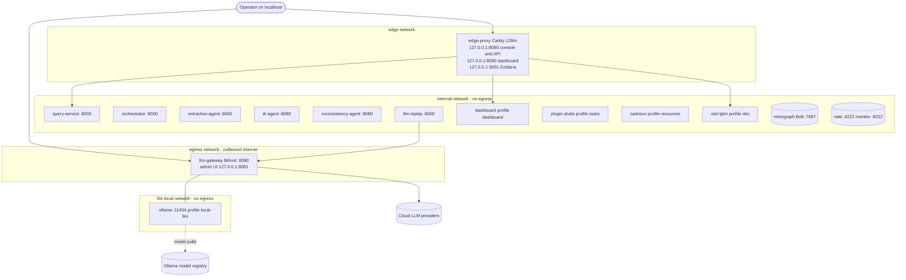
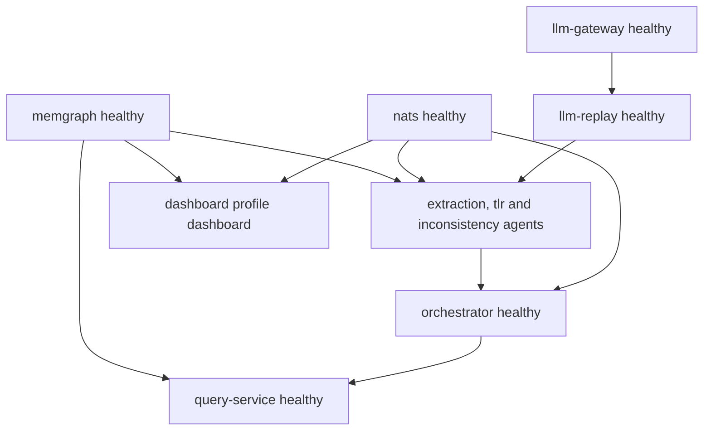

# Deployment and Compose Stack

SANDMAN's reference deployment is a **single-server Docker Compose project** named `sandman`, fully wired by [deploy/docker-compose.yml](../../deploy/docker-compose.yml). The file's own header is the whole quick start:

```sh
cd deploy && ./gen-secrets.sh && docker compose up -d --build
```

From the repository root the same flow is wrapped in Makefile targets (`make secrets`, `make up`). The relative bind mounts (`../config`, `../data/logs`, `../data/llm-records`) resolve against the compose file's directory, so running with `-f deploy/docker-compose.yml` from the root behaves identically.

Beyond the images and the committed read-only mounts (`../config`, `deploy/gateway/config.json`), the stack needs two generated inputs — both gitignored:

- `deploy/gen-secrets.sh` writes everything under `deploy/secrets/` — the Docker secrets and the two `env_file`s. **No secret value is committed or reproduced here — names and flow only.**
- `deploy/.env` (copied from [deploy/.env.example](../../deploy/.env.example)) holds the few non-secret knobs: `MEMGRAPH_USER`, `SANDMAN_LLM_MODE` (`live` | `record` | `replay`), `SANDMAN_EXPERIMENT` (cassette subdirectory), `SANDMAN_LOG_FILE`, and the `OTEL_*` pair. Every variable has a compose default, so the file is optional. Real provider keys belong **only** in `deploy/secrets/gateway.env`.

The per-service environment variables (the shared `x-agent-env` anchor and its per-service overrides) are documented in [Configuration](/openwiki/operations/configuration.md); this page covers the stack itself: services, networks, ports, health gates, memory, secrets flow and the targets that drive it.

## Make targets

| Target | What it runs | Effect |
|---|---|---|
| `make secrets` | `deploy/gen-secrets.sh` | generates `deploy/secrets/*` (never overwrites) |
| `make infra` | `docker compose -f deploy/docker-compose.yml -f deploy/docker-compose.dev.yml up -d memgraph nats llm-gateway` | infrastructure only, with dev ports on localhost |
| `make up` | `docker compose -f deploy/docker-compose.yml up -d --build` | whole default-profile stack (builds images) |
| `make images` | `docker compose -f deploy/docker-compose.yml --profile stubs build` | builds all M0 images including `plugin-stubs` |
| `make down` / `make logs` | `… down` / `… logs -f` | stop the stack / follow all logs |
| `make e2e` | `secrets`, then `… --profile stubs up -d --build --wait --wait-timeout 300`, then `SANDMAN_E2E=1 uv run pytest tests/e2e -q` | walking skeleton against the running stack |
| `make backup` | placeholder | fails with "not implemented (T5.3)" |
| `make test` / `lint` / `guard` / `contracts` | `uv run pytest` + `mvn -B verify` / ruff+mypy / framework-import guard / `scripts/validate_contracts.py` | not deployment-specific — see [Testing and CI](/openwiki/testing/testing-and-ci.md) |

`make up` returns as soon as containers are created — readiness arrives later through the health chain below. `make e2e` is the only target that blocks on health (`--wait`). Note that plain `make up` does **not** start `plugin-stubs` (profile `stubs`), so the extraction plugin path is absent until `make e2e` or an explicit `--profile stubs`.

## The default stack

With no profile flags, compose starts ten services. Nothing an agent serves is published — agents are reachable only inside the `internal` network; the only published ports in the whole default stack are the edge proxy's and the gateway admin UI's.

| Service | Image / build | mem_limit | Healthcheck |
|---|---|---|---|
| `memgraph` | `memgraph/memgraph:3.13.1` | 10g | `mgconsole` runs `RETURN 1;` with the env credentials (10 s, 6 retries) |
| `nats` | `nats:2.15.0-alpine`, `-js -sd /data -m 8222` | 512m | `wget http://127.0.0.1:8222/healthz?js-enabled-only=true` |
| `llm-gateway` | `maximhq/bifrost:v2.2.6` | 1g | `wget http://127.0.0.1:8080/health` |
| `llm-replay` | built (`services/llm-replay/Dockerfile`) | 512m | `GET /readyz` on :8000 |
| `extraction-agent` | built | 3g | `GET /readyz` on :8000 |
| `tlr-agent` | built (Quarkus) | 5g | `curl /readyz` on :8080, 40 s start period |
| `inconsistency-agent` | built (Quarkus) | 5g | `curl /readyz` on :8080 |
| `orchestrator` | built | 512m | `GET /readyz` on :8000 |
| `query-service` | built | 1g | `GET /readyz` on :8000 |
| `edge-proxy` | `caddy:2.11.7-alpine` | 128m | none |

Every service uses `restart: unless-stopped`, so a single-server deployment self-heals container crashes. Memgraph's container-level flags are part of the reference wiring: telemetry off, `allow-load-csv=false`, `--schema-info-enabled=true`, a 300 s query execution timeout, a 300 s snapshot interval, and `--memory-limit=8192` MiB — an internal cap below its 10g container limit (V-30) so a runaway query cannot OOM the host. The gateway's governance (`config.json` mounted read-only, virtual keys, budgets) is covered in [LLM Gateway](/openwiki/integrations/llm-gateway.md).

### Optional profiles

Five profiles gate the non-core services (`deploy/docker-compose.yml` header):

| Profile | Service | Image | mem_limit | Purpose |
|---|---|---|---|---|
| `dashboard` | `dashboard` | planned build (`services/dashboard/` does not exist yet — M1, ADR-0016, T1.9) | 512m | admin system overview; compose already defines its full environment, secrets and `dashboard-data` volume |
| `obs` | `otel-lgtm` | `grafana/otel-lgtm:0.35.0` | 2g | OpenTelemetry backend; Grafana published via the edge proxy. Set `OTEL_SDK_DISABLED=false` and `OTEL_EXPORTER_OTLP_ENDPOINT=http://otel-lgtm:4318` in `deploy/.env` to activate the exporters |
| `local-llm` | `ollama` | `ollama/ollama:0.35.1` | none | local models, reachable only through the gateway; `ollama list` healthcheck; NVIDIA GPU reservation present but commented out |
| `stubs` | `plugin-stubs` | built (`tests/plugin-stubs/Dockerfile`) | 512m | reference plugin implementation for the walking skeleton |
| `resources` | `cadvisor` | `gcr.io/cadvisor/cadvisor:v0.60.6` | 256m | container metrics for the dashboard (opt-in, privileged read-only host mounts, V-37) |

## Networks and the edge proxy

The topology is the security model: four networks, and egress is a property of network membership, not of client discipline.

| Network | Mode | Members |
|---|---|---|
| `internal` | `internal: true` — **no egress** | every SANDMAN service, `llm-replay`, `llm-gateway`, Memgraph, NATS |
| `egress` | outbound internet | `llm-gateway` (provider calls), `ollama` (model pulls) |
| `llm-local` | `internal: true` | `llm-gateway` and `ollama` only |
| `edge` | bridge | `edge-proxy` only (plus Memgraph/NATS under the dev overlay) |



The four Compose networks and their members as wired by `deploy/docker-compose.yml` (Ollama also sits on `egress` for pulls; every published port binds to 127.0.0.1).

The **edge proxy** ([deploy/proxy/Caddyfile](../../deploy/proxy/Caddyfile)) is why user-facing services can stay on the egress-free `internal` network: Caddy joins `internal` + `edge` and reverse-proxies three loopback ports — `:8080` → `query-service:8000` (console + user/agent API), `:8090` → `dashboard:8000`, `:3001` → `otel-lgtm:3000` (Grafana). `admin off` and `auto_https off` keep it a dumb publisher. It is the only container with published ports besides the gateway's admin UI (`127.0.0.1:8081:8080`, mapping the Bifrost admin plane and request log).

All published ports bind to **127.0.0.1 only**, so the stack is reachable from the host and through an SSH tunnel, never directly from the network. The proxy exists because spike T0.4 check 13 showed that disabling IP masquerading does **not** block egress on Docker Desktop: the reliable design keeps query-service, dashboard and Grafana internal-only and publishes through a small reverse proxy (decided 2026-10-07, see [docs/notes/spike-T0.4.md](../../docs/notes/spike-T0.4.md)).

## Health-gated startup

`depends_on` uses `condition: service_healthy` everywhere it matters, so compose starts services in dependency order and only after upstreams pass their healthchecks:



The health gates from `depends_on` with `condition: service_healthy`; the three agents share the `x-depends-core` anchor (healthy Memgraph, NATS and llm-replay).

Details an operator should know:

- The LLM chain is gated end to end: `llm-gateway` healthy → `llm-replay` healthy → agents start. Bifrost reports healthy even with empty provider keys (spike T0.4 check 17), which is why the walking skeleton runs without any LLM account.
- **`plugin-stubs`, `edge-proxy`, `cadvisor` and `otel-lgtm` have no healthcheck and no `depends_on`** — they start immediately and are never waited on.
- The **dashboard deliberately depends only on Memgraph and NATS**, not on the services it monitors ("it must show them when they are down"); its `SANDMAN_TARGETS` list, not the dependency graph, defines what it displays.
- `docker compose up --wait` (used by `make e2e` and CI) blocks until every started service is healthy, with `--wait-timeout 300` as the ceiling. A failing healthcheck therefore surfaces as a failed `up`, not as a broken runtime later.

## Memory limits and JVM sizing

The limits assume a **32 GB host** (A-7) and are initial values to be tuned in T5.4. Infrastructure (memgraph 10g + nats + gateway + replay ≈ 11.5 GB) plus the agents (extraction 3g, tlr and inconsistency 5g each ≈ 13 GB) and the remaining small services leave headroom on the reference machine; the dashboard, obs and resources profiles add more when enabled.

| Service | `mem_limit` | JVM / internal cap |
|---|---|---|
| `memgraph` | 10g | `--memory-limit=8192` MiB (V-30) |
| `tlr-agent` | 5g | `JAVA_TOOL_OPTIONS: -XX:MaxRAMPercentage=75` |
| `inconsistency-agent` | 5g | `JAVA_TOOL_OPTIONS: -XX:MaxRAMPercentage=75` |
| `extraction-agent` | 3g | — (Docling is the M1 consumer) |
| `otel-lgtm` | 2g | — |
| `llm-gateway`, `query-service` | 1g | — |
| `nats`, `llm-replay`, `orchestrator`, `dashboard`, `plugin-stubs` | 512m | — |
| `cadvisor` | 256m | — |
| `edge-proxy` | 128m | — |
| `ollama` | none | — (GPU hosts are sized by the operator) |

The two Java (Quarkus) agents set `JAVA_TOOL_OPTIONS: -XX:MaxRAMPercentage=75`, sizing the JVM heap as a percentage of the compose `mem_limit` — change one and the heap follows the other. Memgraph's own 8192 MiB cap leaves room inside its 10g limit for the process and page cache; a query hitting the internal limit aborts the query, not the server.

## Volumes and state

Named volumes hold everything that must survive a restart; `docker compose down` keeps them, `down -v` (what CI uses) destroys them.

| Volume | Contents |
|---|---|
| `memgraph-data` | the knowledge graph (snapshot-backed by Memgraph's 300 s interval) |
| `nats-data` | the JetStream stream (`-sd /data`) |
| `gateway-data` | Bifrost's `config.db` / `logs.db` |
| `orchestrator-data` | `orchestrator.db` (workflow state) |
| `query-data` | `users.db` — the query-service's user store |
| `artifact-store` | content-addressed artifacts (extraction writes, everyone else reads) |
| `otel-data`, `ollama-models`, `dashboard-data`, `memgraph-log` | profile/ops state |

Bind mounts: `../config` is mounted **read-only** into every agent (`/config`), and `../data/logs` (JSONL logs) plus `../data/llm-records` (record/replay cassettes) are shared host directories; `gen-secrets.sh` creates both `data/` subdirectories on first run.

## Secret generation: `deploy/gen-secrets.sh`

One POSIX-sh script (run with `make secrets` or directly) creates the entire credential set in `deploy/secrets/`. It creates `secrets/` plus the `../data/llm-records` and `../data/logs` host directories first, then generates with `umask 077`. Two rules shape its behavior:

1. **It never overwrites.** `write()` prints `keep secrets/<name>` for an existing file and `created secrets/<name>` for a new one, so re-running to add a new plugin or service never rotates existing credentials.
2. **One file is regenerated every run:** `secrets/svc_tokens_verify.json`, because it is *derived* — the sha256 map of all current tokens.

### Inventory

| File(s) in `deploy/secrets/` | Kind | Consumer | Reaches containers as |
|---|---|---|---|
| `memgraph_password` + `memgraph.env` | DB password | every KG user; `memgraph.env` is the `env_file` of the `memgraph` container only | `/run/secrets/memgraph_password` (`SANDMAN_KG_PASSWORD_FILE`) |
| `svc_token_orchestrator`, `svc_token_extraction-agent`, `svc_token_tlr-agent`, `svc_token_inconsistency-agent`, `svc_token_query-service`, `svc_token_dashboard` | outbound service tokens | exactly one service each | `/run/secrets/svc_token_<name>` (`SANDMAN_SERVICE_TOKEN_FILE`) |
| `svc_token_plugin-stubs` | plugin **outbound** token | plugin-stubs | as above |
| `plugin_in_plugin-stubs` | plugin **inbound** token (owner → plugin) | plugin-stubs | `/run/secrets/plugin_in_<id>` (`SANDMAN_PLUGIN_INBOUND_TOKEN_FILE`) |
| `svc_tokens_verify.json` | verification map (name → sha256) | every service | `/run/secrets/svc_tokens_verify` (`SANDMAN_SERVICE_VERIFY_FILE`) |
| `llm_key_orchestrator` | cloud VK | orchestrator | `/run/secrets/llm_key_orchestrator` |
| `llm_key_{extraction,tlr,inconsistency,query}` + `_local` variants (8 files) | cloud + local-only VKs | one agent each | `SANDMAN_LLM_KEY_FILE` / `SANDMAN_LLM_LOCAL_KEY_FILE` |
| `gateway.env` | provider keys, `BIFROST_*`, all `VK_*` | `llm-gateway` only (`env_file`) | environment of the gateway container |
| `gateway_admin_password` | Bifrost admin password | operator; also the dashboard (gateway admin API) | `/run/secrets/gateway_admin_password` |
| `admin_bootstrap_password` | bootstrap admin | query-service | `/run/secrets/admin_bootstrap_password` |
| `session_secret` | session secret | query-service | `/run/secrets/session_secret` |
| `dashboard_admin_password`, `dashboard_session_secret` | dashboard auth | dashboard | mounted secrets |
| `e2e_admin_password` | new admin password for e2e | **not mounted by compose** — read directly from `deploy/secrets` by the e2e suite | — |

### LLM keys and `gateway.env`

`gateway.env` is created as **one unit** on the first run, together with the `llm_key_*` files that carry the same values: `OPENAI_API_KEY` and `OPENROUTER_API_KEY` are written **empty** — the operator then puts real provider keys into `deploy/secrets/gateway.env`, which only the `llm-gateway` container reads (`env_file`), so provider keys never enter agent containers. The script also generates `BIFROST_ENCRYPTION_KEY`, a `BIFROST_ADMIN_PASSWORD` (random, prefixed to satisfy Bifrost's ≥ 12-character upper/lower/digit/special policy) mirrored into the operator-only `gateway_admin_password`, `VK_ORCHESTRATOR`, `VK_EXPERIMENTS` (evaluation scripts — no secret file) and, per component in `LLM_COMPONENTS="extraction tlr inconsistency query"`, a cloud VK plus a `-local` (Ollama-only) VK written into both `gateway.env` and the per-agent secret files. Because the whole block is skipped once `gateway.env` exists, **regenerating LLM keys means removing `gateway.env`** (or hand-editing both a `VK_*` value and its matching `llm_key_*` file — they must match, then restart the gateway and the component).

### Tokens and the verification map

Each service and plugin gets its own random outbound token; plugins additionally get an inbound token (the owner presents it when calling the plugin). The script then rebuilds `svc_tokens_verify.json` as `{"<caller>": "<sha256 of token>"}` — services under their own name, plugins under `plugin:<id>` (read-only, query-service only). Consequence: to onboard a plugin you add its id to `PLUGINS` in `gen-secrets.sh`, re-run, and the new token pair appears plus the updated verification map — existing tokens untouched.

## The dev overlay and `make infra`

[deploy/docker-compose.dev.yml](../../deploy/docker-compose.dev.yml) is for debugging and local test runs: it publishes Memgraph's Bolt port (`127.0.0.1:7687`) and NATS' client and monitoring ports (`127.0.0.1:4222`, `127.0.0.1:8222`). Because published ports cannot be served from an `internal: true` network, the overlay also attaches `memgraph` and `nats` to the `edge` network. `make infra` applies this overlay to start exactly `memgraph`, `nats` and `llm-gateway` — the three services spike scripts and KG/NATS inspection need, with the gateway's admin UI on its usual `127.0.0.1:8081`. The agents stay down.

## `make e2e`: the walking skeleton

```sh
make e2e     # = make secrets; compose --profile stubs up -d --build --wait --wait-timeout 300;
             #   SANDMAN_E2E=1 uv run pytest tests/e2e -q
```

The suite ([tests/e2e/test_walking_skeleton.py](../../tests/e2e/test_walking_skeleton.py)) drives the whole M0 chain through the **published edge port** (`SANDMAN_E2E_URL`, default `http://127.0.0.1:8080`) and skips itself unless `SANDMAN_E2E=1`. It first asserts `GET /readyz` answers on that URL — i.e. the stack is up *and* the proxy path works. Each run creates its own project and users. Two operational facts matter:

- The admin account is forced to change its bootstrap password on first use; the new password comes from `deploy/secrets/e2e_admin_password` (or `SANDMAN_E2E_ADMIN_NEW_PASSWORD`). **`make e2e` permanently changes the running stack's admin password** to that secret — run it against a throwaway deployment.
- The gateway starts healthy with empty provider keys, so no LLM account is needed; the fixture is `tests/e2e/fixtures/mini/`.

## CI coverage

The `compose` job in [.github/workflows/ci.yml](../../.github/workflows/ci.yml) is the automated guard on this page's content: it copies `deploy/` to a temporary directory, runs `gen-secrets.sh` there, and validates `docker compose config -q` for **no profiles** and for `--profile stubs --profile obs --profile local-llm`, plus the dev-overlay combination — catching missing secret files and malformed YAML before anything boots. It then builds and starts the stack exactly like `make e2e` (`--profile stubs up -d --build --wait --wait-timeout 300`), dumps logs on failure and always tears down with `down -v`. A separate `e2e` job runs `make e2e` on the nightly schedule and whenever compose-relevant paths change.

## Adding a plugged-in service

Plugged-in extractors/detectors (ADR-0012) are **external systems** and are not added to the reference compose file — they go into a `docker-compose.override.yml` next to it, per the template comment in `deploy/docker-compose.yml`:

```yaml
code-extractor:
  image: <registry>/<code-extractor>@sha256:<digest>
  volumes: [artifact-store:/artifacts:ro]
  secrets: [svc_token_code-extractor, plugin_in_code-extractor]   # add the name to PLUGINS in gen-secrets.sh
  networks: [internal]                       # no egress; LLM calls only via llm-replay with the plugin's own VKs
```

An LLM-using plugin additionally needs `vk-plugin-<id>` / `vk-plugin-<id>-local` entries in `deploy/gateway/config.json` and `VK_PLUGIN_<ID>*` values in `gateway.env` (see [Plugins](/openwiki/concepts/plugins.md) and [docs/plugins.md](../../docs/plugins.md)).

## Related pages

- [System Overview](/openwiki/architecture/system-overview.md) — the component/transport view this stack instantiates
- [Configuration and Environment Variables](/openwiki/operations/configuration.md) — the `SANDMAN_*` variables and `*_FILE` indirection the containers consume
- [LLM Gateway](/openwiki/integrations/llm-gateway.md) — `gateway.env`, virtual keys, budgets and the admin plane behind the egress network
- [Testing and CI](/openwiki/testing/testing-and-ci.md) — the CI jobs that validate and boot this stack
