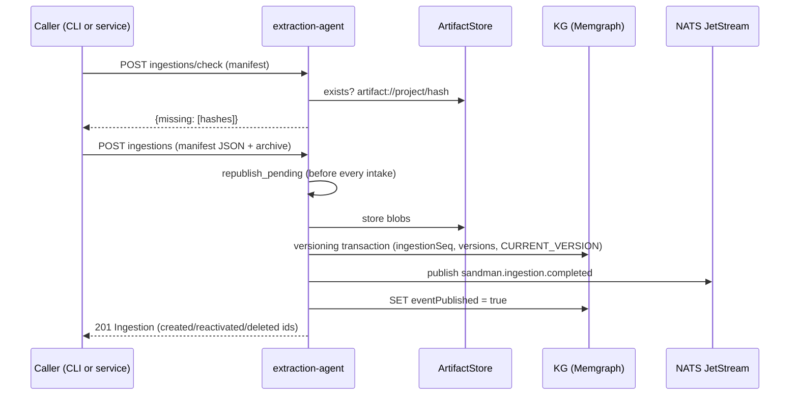

# Extraction Agent

The **extraction-agent** (`sandman-extraction`) is the intake boundary of the SANDMAN stack: it registers projects, ingests artifact snapshots (full or partial) into the artifact store and knowledge graph, and extracts structural facts — Elements, explicit-reference TraceLinks and inter-element relations — for artifact versions. Per its OpenAPI contract it is the owner of `Project`, `Artifact`, `ArtifactVersion` and `Element` nodes (repo://contracts/openapi/extraction-agent.yaml#L5-L8). It is also the *sole writer of the structural facts*: every other agent reads the graph; only extraction-agent (and the plugins it routes to) create the structural layer.

<!-- openwiki: broken internal link [#L1-L3] heading anchor "L1-L3" does not exist in /openwiki/services/extraction-agent.md. Fix the href or restore the target, then delete this comment. -->
The service is a single ASGI app — `uvicorn --factory sandman_extraction.app:create_app` — that serves both the REST intake API (`/v1/...`) and the A2A skill endpoint (`serve(card, [skill], ...)` mounted at `/`), so other services call it as an agent rather than only over REST ([services/extraction-agent/src/sandman_extraction/app.py](#L1-L3), [services/extraction-agent/src/sandman_extraction/app.py#L221-L223)).

## Responsibilities at a glance

| Responsibility | Where |
| --- | --- |
| Project registration (name + fixed `llmPolicy`) | `PUT /v1/projects/{projectId}` |
| Deduplicating snapshot upload (`ingestions/check` + `ingestions`) | `ingest.py` |
| KG schema initialization (`contracts/kg/init.cypher`) and stream setup | `Service.start` |
| `extract-artifact-versions` skill (stub extraction, plugin routing, TraceLinks) | `extract.py` |
| `sandman.ingestion.completed` event publication and at-least-once retry | `ingest.publish` / `republish_pending` |

## Service state and startup duties

`Service.__init__` requires `kg_uri`, `nats_url` and `artifact_store` settings; it loads `config/extraction/plugins.yaml` (hashed with `config_hash = sha256_hex(raw)` so every extracted artifact records the plugin config it was produced under), creates the `ArtifactStore`, a `StatusTracker`, and a `KgClient`. `max_archive_bytes` defaults to `1 << 30` (1 GiB) and can be overridden via `SANDMAN_MAX_ARCHIVE_BYTES` ([services/extraction-agent/src/sandman_extraction/app.py#L60-L75)).

`Service.start` performs, in order ([services/extraction-agent/src/sandman_extraction/app.py#L77-L87)):

1. **`kg.init_schema(contracts_dir / "kg" / "init.cypher")`** — the extraction-agent is the KG schema initializer for the whole stack (constraints/indexes run before any writer touches the graph).
2. **NATS connect + `ensure_stream(js)`** — creates the JetStream stream if absent.
3. **`EventPublisher` creation** and **`ingest.republish_pending`** — any `ingestion.completed` event whose publish ack was never received is re-published at startup. Failures here are logged and swallowed: they are retried before the next intake.

Startup is complemented by `/readyz`, which reports `memgraph` and `nats` checks (503 unless both are `ok`), and `/healthz`. All error responses are `application/problem+json`.

## Ingestion flow

The ingestion flow: clients POST the manifest to `/v1/projects/{projectId}/ingestions/check`, which returns the subset of content hashes the store does not already hold (`missing_hashes`), so re-ingesting an unchanged project uploads nothing. Then `POST .../ingestions` submits a multipart form: a `manifest` JSON string plus an optional `archive` file ([services/extraction-agent/src/sandman_extraction/app.py#L176-L210]).

### Manifest rules

`Manifest` (`extra="forbid"`) carries `mode` (`full` | `partial`), optional `sourceRevision`, `kindRules` (glob → `kind` ∈ requirements/architecture-doc/architecture-model/code/test/other, optional `format`), and `files` — each `{path, sha256}` with a strict 64-hex sha256 pattern, at most `MAX_FILES = 20_000` entries, no duplicate paths ([services/extraction-agent/src/sandman_extraction/ingest.py#L18-L62)). `kind_of` resolves a path to `(kind, format)` via the first matching rule using `PurePosixPath.full_match`, defaulting to `("other", None)`.

### Safe paths and archive limits

Every file path — manifest and archive alike — must pass `safe_path`: relative, forward slashes only, no absolute paths, backslashes, NULs, or empty/`.`/`..` segments ([services/extraction-agent/src/sandman_extraction/ingest.py#L23-L29)). `read_archive` accepts zip or tar(.gz), rejects symlinks/special files/duplicate entries, caps entries at `2 * MAX_FILES` and total content at `max_bytes` (HTTP 400 beyond). Tar members additionally pass the stdlib `tarfile.data_filter`. The HTTP handler reads at most `max_archive_bytes + 1` up front so an oversized archive is rejected without buffering it whole.

### The versioning transaction

`ingest()` first validates the archive against the manifest (every entry must be a manifest path with matching sha256 — 422 otherwise) and checks that no *manifest* hash is missing from the store without archive content. Blobs are stored **before** the transaction; the graph is then updated in one `kg.write_tx` ([services/extraction-agent/src/sandman_extraction/ingest.py#L132-L217)):

1. `Project.ingestionSeq` is incremented (404 if the project does not exist) and the `Ingestion` id is `stable_id("ing", project, seq)` — deterministic per sequence.
2. Current `CURRENT_VERSION` pointers are loaded; each manifest file whose current version id (`stable_id("ver", artifact, sha256)`) differs becomes an item. Versions are keyed by **content hash**, so re-ingesting identical content is a no-op (`unchangedCount`).
3. `MERGE` Artifact + `MERGE` ArtifactVersion` + `CREATE (Ingestion)-[:ACTIVATED]->(v)`, clear `deletedAt`, then delete and recreate `CURRENT_VERSION` — reactivating a previously-seen version (a revert) instead of duplicating it.
4. In `full` mode only, artifacts whose path is absent from the manifest lose their `CURRENT_VERSION` edge, get `deletedAt` set, and gain `(Ingestion)-[:DELETED]->(Artifact)`. Partial mode never deletes.

### Event publication and the `eventPublished` flag

`sandman.ingestion.completed` is published **only when something changed**: `eventPublished` is initialized to `not (items or deleted)`, so a no-op ingestion stores no event at all. `publish()` sends the event with `event_id = uuid5(NAMESPACE_URL, ingestion id)` — a deterministic id, so JetStream dedupes replays — and only then sets `eventPublished = true` ([services/extraction-agent/src/sandman_extraction/ingest.py#L245-L262)). If the publish ack is lost, a `PublishError` handler answers 503 with "ingestion stored, event not published (re-published later)", and the pending event is re-published both at startup and before every subsequent intake. This is the at-least-once delivery invariant: the graph transaction never blocks on NATS, and the `eventPublished` flag is the durable outbox marker.

Responses follow the OpenAPI `Ingestion` schema: `ingestionId`, `seq`, `mode`, `sourceRevision`, `createdVersionIds`, `reactivatedVersionIds`, `deletedArtifactIds`, `unchangedCount`, `createdAt`. `GET .../ingestions/{ingestionId}` (id pattern `^[a-z]+_[0-9a-f]{32}$`) reloads the same view.

### Project registration

`PUT /v1/projects/{projectId}` (`projectId` pattern `^[a-z0-9][a-z0-9-]{1,62}$`) MERGEs a `Project` node, setting `name` and `llmPolicy`. The `llmPolicy` (`cloud-allowed` | `local-only`) is **fixed at project registration** and later read by the skill to constrain what plugins may do; it is deliberately not an ingestion-time parameter.

## The `extract-artifact-versions` skill

The A2A skill (`SKILL = "extract-artifact-versions"`) takes `{projectId, artifactVersionIds}` and rewrites the structural facts for those versions ([services/extraction-agent/src/sandman_extraction/extract.py#L100-L143)):

- **Stub extraction** (`stub_elements`): every version gets exactly one *file* element whose label depends on kind (`TextUnit` for requirements/architecture-doc/other, `ModelElement`, `CodeUnit`, `TestCase`); requirements Markdown additionally gets one `Requirement` element per `## <ID> <title>` heading (`REQ_HEADING = ^##\s+([A-Za-z][\w.-]*\d)\s+(.+?)\s*$`), spanning until the next heading, with `parent = file`. Tool is `stub-extractor` version `0`.
- **Explicit references** (`match_references`): regex matches from `config/extraction/plugins.yaml` `explicitReferences.patterns` (e.g. `['REQ-\d+', 'FR-\d+']`) are attributed to the *innermost* element containing the match line, then resolved against all current-version and run-version elements into `TraceLink` nodes with `approach = "explicit-reference"`, `confidence = 1.0`, `status = 'candidate'`. Links run from the referenced element to the referring one.
- **Plugin routing** (`plugin_for`): the first plugin whose `match.kinds` contains the kind, `match.formats` the format, or `match.globs` matches the path handles those versions; all others go to the stub. Each plugin call goes through `A2aPluginClient` (Agent Card at `/.well-known/agent-card.json`, token from `tokenFile`, parsed `timeout` like `10m`) with a plugin run recorded via `RunRecorder`. A plugin failure is non-fatal: the run is marked failed, a warning added, overall status becomes `partial`, and those versions fall back to file-level stub extraction.

All KG writes happen in **one transaction per artifact version**: `_write_elements` replaces the version's complete element set (MERGE by `localKey`-derived stable id, delete stale `HAS_ELEMENT` edges, parent `CONTAINS`) and `_write_links` deactivates the version's old explicit-reference TraceLinks before (re)activating the found ones. Links and relations are written after all element sets so references into other versions of the same run resolve. Every Element and TraceLink gets `(Run)-[:PRODUCED]->(n)` provenance, and run cleanup (`cleanup_stale` keyed on `sha256(canonical_json({input, tool, configHash}))`) makes re-extraction idempotent. The skill returns `{runId, status, elementCount, explicitLinkCount, pluginRuns}` and publishes `sandman.extraction.completed` — with `re-extraction dropping previous elements` covered by e.g. `test_reextraction_drops_elements_and_is_idempotent` ([services/extraction-agent/tests/test_extraction.py#L181-L243)).

## Security and callers

REST endpoints require a verified service token (`require_service(TokenVerifier(...))`) plus a trusted actor header (`X-Sandman-Actor`, pattern `^(user|service):[A-Za-z0-9._@-]+$`, falling back to the caller identity). Plugin calls carry a separate plugin token. The service is called by the query-service (forwarding user actors) and by other services via A2A; the walking-skeleton e2e drives the full flow through the CLI (`tests/e2e/test_walking_skeleton.py`).

## Focused tests

`services/extraction-agent/tests/test_extraction.py` (against real Memgraph + NATS containers) pins the key invariants: two full ingestions create versions and delete absent paths; re-ingesting the same content changes nothing (`test_same_ingestion_twice_changes_nothing`); revert-and-readd reactivates versions rather than duplicating (`test_revert_and_readd_reactivate`); publish-failure retry publishes exactly once (`test_publish_failure_then_retry_publishes_once`); archive path traversal is rejected; plugin failure falls back to stub extraction; re-extraction drops stale elements and is idempotent.

## Relationships

- Owns the `Project`/`Artifact`/`ArtifactVersion`/`Element`/`TraceLink` structural layer of the knowledge graph; see the [knowledge-graph architecture](/openwiki/architecture/knowledge-graph.md).
- Publishes `sandman.ingestion.completed` and `sandman.extraction.completed` on the event bus; see [event-bus](/openwiki/concepts/event-bus.md).
- Routes extraction to A2A plugins; see [plugins](/openwiki/concepts/plugins.md).
- Driven by users/services via the CLI and other services; see [analysis-pipeline](/openwiki/workflows/analysis-pipeline.md) and [integrations/cli](/openwiki/integrations/cli.md).
