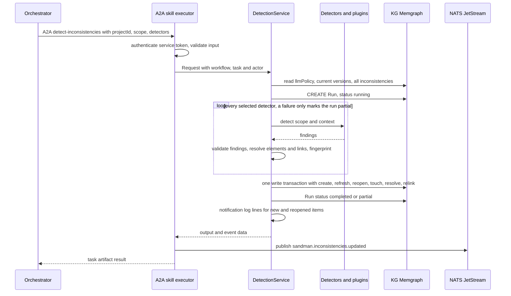
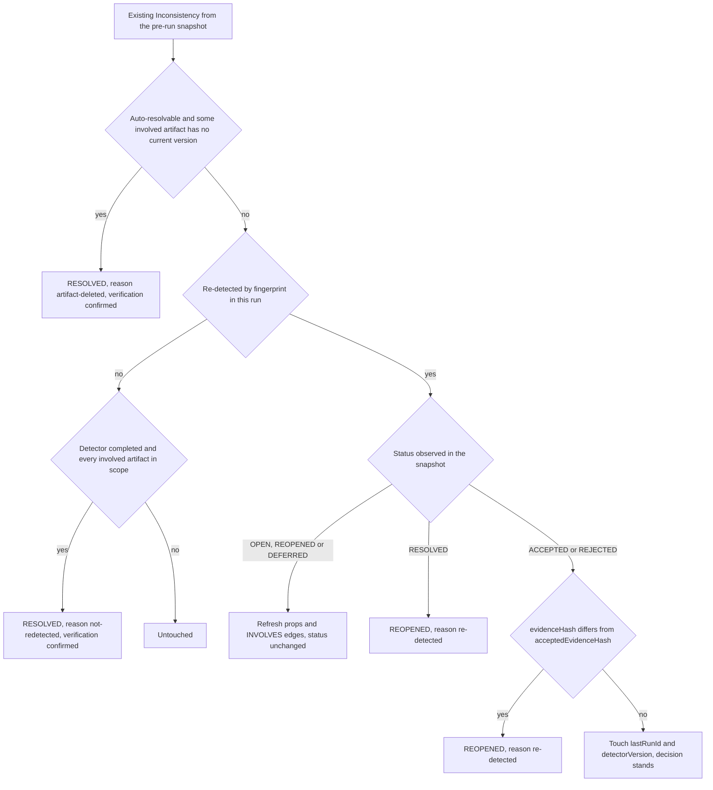

# Inconsistency Agent

The **inconsistency-agent** (`sandman-inconsistency-agent`, Java 21 / Quarkus, port 8080) is the third SANDMAN agent: it reads the current knowledge graph, produces potential inconsistencies, and owns their entire lifecycle. Per the KG contract it is the single writer of `Inconsistency` and `StatusChange` nodes (`contracts/kg/schema.yaml#L114-L146`) and records its own `Run` nodes with `DETECTED` provenance edges. It offers two surfaces on one Vert.x router:

- the A2A skill **`detect-inconsistencies`** (`contracts/agent-cards/inconsistency-agent.json`, JSON-RPC at `/a2a`, served by the shared `A2aServer` from `libs/java/agent-lib-a2a`), called by the orchestrator as the final step of the analysis pipeline; and
- the **triage REST API** (`contracts/openapi/inconsistency-agent.yaml`), which in practice is reached through the query-service forwarder — users never talk to this service directly.

| Responsibility | Where |
| --- | --- |
| Detector SPI, registry, HTTP plugin adapter | `InconsistencyDetector`, `DetectorRegistry`, `PluginDetector` |
| One detection run: one transaction, fingerprints, re-detection transitions | `DetectionService` |
| A2A skill `detect-inconsistencies` | `DetectSkill` |
| Triage REST API (catalog, list, detail, transitions) | `TriageRoutes`, `TriageService` |
| Shared reads of `Inconsistency` nodes (detection + triage) | `InconsistencyStore` |
| Pure lifecycle state machine (ADR-0007) | `Lifecycle` |
| Structured notification log events | `Notifications` |
| Wiring: KG client, registry, services, JetStream event sink, schema init | `Beans` |

All files live in `services/inconsistency-agent/src/main/java/edu/kit/kastel/mcse/ardoco/sandman/inconsistency/` unless noted.

## Detectors: SPI, registry, plugins

### The InconsistencyDetector SPI

In-process detectors implement `InconsistencyDetector` (`InconsistencyDetector.java#L6-L29`) and are discovered via `ServiceLoader` (registered in `src/main/resources/META-INF/services/…InconsistencyDetector`):

```java
String id();        // stable, without version — part of the fingerprint
String version();
Set<String> types();
List<Finding> detect(DetectionScope scope, DetectorContext ctx);
```

`detect` receives a `DetectionScope` (`projectId`, `artifactIds`, `wholeProject` — when the request had no `scopeArtifactIds`, `artifactIds` lists all current artifacts) and a `DetectorContext` with read access to the KG (`KgClient`), the project's `llmPolicy` and the `queryServiceUrl`. The interface contract demands detectors read **only active links and current elements**. A `Finding` (`Finding.java#L12-L26`, schema `skills.schema.json#/$defs/Finding`) is the raw detector output *before* fingerprinting: `type` (`^[a-z0-9-]+$`), `severity` (`info|warning|error`), `title` (≤ 200 chars), optional `description`, `confidence` and free-form `evidence`, plus at least one `involved` entry — an `elementKey` or a `traceLinkId`, each with a `role` (e.g. `subject`, `expected-counterpart`, `evidence`). Detectors never compute ids, fingerprints or lifecycle states; the owner does.

### DetectorRegistry and config/inconsistency/plugins.yaml

`DetectorRegistry.load` (`DetectorRegistry.java#L30-L82`) reads the plugins file (config property `sandman.inconsistency.plugins-file`, else `<configDir>/inconsistency/plugins.yaml` — with the compose `SANDMAN_CONFIG_DIR=/config` that is `config/inconsistency/plugins.yaml`):

```yaml
detectors:
  stub-untraced: { enabled: true }
plugins:
  - id: detect-stub
    transport: http                       # POST /v1/detect, GET /manifest
    url: http://plugin-stubs:8001
    tokenFile: /run/secrets/plugin_in_plugin-stubs   # inbound token of the plugin
    timeout: 10m
```

- In-process detectors are switched on per id (`detectors: <id>: { enabled: true }`) from the ServiceLoader-discovered set; an enabled id with no implementation fails startup with a `ConfigException`.
- Plugin entries must use `transport: http` — anything else (including A2A) is rejected at startup (ADR-0012 decision D-7: the inconsistency-agent implements the HTTP transport only). `tokenFile` is read at startup (unreadable → `ConfigException`); `timeout` accepts `ms|s|m|h` and defaults to 10 minutes.

`registry.all()` preserves config order (in-process first, then plugins); `registry.get(id)` backs the skill's detector selection.

### HTTP plugin detectors

`PluginDetector` (`PluginDetector.java#L19-L112`) adapts a plugin to the SPI with `kind() = "plugin-http"`:

- **Manifest**: `GET /manifest` with the plugin's inbound token supplies `version`, `types`, `usesLlm` and `description`. The manifest is fetched lazily and cached after the first success; an unreachable plugin yields an empty manifest (version reported as `unknown`, empty types) and is retried on the next call — the plugin still appears in the catalog.
- **Detection**: `POST /v1/detect` via `HttpPluginClient` (`libs/java/agent-lib/…/HttpPluginClient.java#L53-L84`) with the body `{projectId, llmPolicy, queryServiceUrl}` plus `scopeArtifactIds` only when the run is scoped. The client validates the input against `PluginDetectInput` and the response against `PluginDetectOutput`; a non-200 status becomes a `PluginException` (retryable only for HTTP 503), and schema-invalid output is a non-retryable `PluginException`. Plugins read the KG only through the query-service with their own `plugin:<id>` token — never the KG directly.

## The detect-inconsistencies skill

### Input and scope

`DetectSkill` (`DetectSkill.java#L15-L45`) validates the input against `skills.schema.json#/$defs/DetectInconsistenciesInput` (`contracts/skills.schema.json#L250-L276`) and calls `DetectionService.detect` with the A2A task context (`workflowId`, `taskId`, `actor`):

- `projectId` (required) — unknown project → `INVALID_INPUT` error.
- `scopeArtifactIds` (optional) — **absent means the whole project**. An existing inconsistency is *in scope* iff every artifact of its involved keys is in this set (keys are `artifactId#localKey`; a link involvement counts as `sourceKey->targetKey`, so both end artifacts matter — `InconsistencyStore.artifactIdsOf`, `InconsistencyStore.java#L39-L47`).
- `detectors` (optional) — absent means all enabled detectors and plugins; an unknown or disabled detector id → `INVALID_INPUT` (`DetectionService.select`, `DetectionService.java#L129-L142`).

The orchestrator creates these steps automatically: on `ingestion.completed` for deleted artifacts, on `extraction.completed` for artifacts left unlinked by TLR, and on `tracelinks.updated` for the changed artifacts (`services/orchestrator/src/sandman_orchestrator/rules.py#L135-L155`), plus manual `detect` workflows; concurrent detect steps are merged and debounced.

### Run flow



One detection run, end to end (`DetectionService.detect`, `DetectionService.java#L84-L127`): the pre-run snapshot of all existing inconsistencies is loaded *before* the detectors run, a `Run` node is created, every selected detector runs in isolation, and then **all writes happen in a single transaction** (`kg.writeTx`, `DetectionService.java#L117-L118`) — creates, refreshes, reopens, touches, resolutions, `INVOLVES` re-links and `DETECTED` edges atomically. This is the KG contract's `active_facts` rule: "the inconsistency-agent writes one detection run in one transaction" (`contracts/kg/schema.yaml#L10`), so readers never observe a half-applied run.

### Findings, fingerprints, identity

`DetectionService.prepare` (`DetectionService.java#L186-L266`) validates every finding against the `Finding` schema and resolves its `involved` references against the KG: elements must be **current** (attached to the current artifact version) or the detector fails with "unknown or non-current element"; trace links must exist with resolvable ends or it fails with "unknown trace link". A failing `prepare` is caught by the same per-detector guard as a throwing `detect`, so a detector returning garbage only fails *itself*.

Identity is deterministic (`Ids.fingerprint`, `libs/java/agent-lib/…/Ids.java#L75-L80`, pinned by `contracts/conformance/vectors.json#L116-L117`):

```
fingerprint = sha256(type ␟ detectorId ␟ k1 ␟ … ␟ kn)   // ␟ = U+001F, keys sorted byte-wise by UTF-8
id          = inc_<sha256(projectId ␟ fingerprint)[:32]>
```

An involved key is the element key, or `sourceKey->targetKey` for a trace link. Because the **detector id enters without its version** and links enter by their end keys rather than link ids, detector upgrades and re-created links keep triage decisions intact; element renames (key changes) deliberately break the match and surface as new items (ADR-0007 amendment, `adr/0007-inconsistency-lifecycle.md#L81-L87`). `FingerprintTest` pins both values to the contract vectors.

The `evidenceHash` (`DetectionService.java#L247-L253`) is sha256 over the involved elements' *current* `contentHash` values (distinct, sorted, joined by U+001F) — "what the evidence is now", as opposed to the fingerprint's "which entities are involved".

### Re-detection transitions

`DetectionService.write` (`DetectionService.java#L269-L357`) implements the system half of the ADR-0007 lifecycle (the user half is the triage API below; the full tables live in `Lifecycle` and on the [lifecycle page](/openwiki/concepts/inconsistency-lifecycle.md)):



The re-detection decision per existing inconsistency (new findings are simply created `OPEN`); every system write also records a `StatusChange` with actor `system:<detector>` and links the run via `DETECTED`.

The rules, with their guards:

1. **Deleted artifacts first**: every run resolves auto-resolvable items that involve an artifact without a current version (`reason = artifact-deleted`, `verification = confirmed`), independent of scope and of which detectors ran (`DetectionService.java#L286-L293`). If the artifact returns and the finding is re-detected, the item reopens.
2. **Re-detected items** (`DetectionService.java#L294-L307`): new → created `OPEN`/`verification=none`; `OPEN`/`REOPENED`/`DEFERRED` → refreshed in place (props updated, `INVOLVES` edges deleted and re-linked to the current finding); `RESOLVED` → `REOPENED`; `ACCEPTED`/`REJECTED` → `REOPENED` only when `evidenceHash` differs from the `acceptedEvidenceHash` snapshotted at the user's decision — otherwise only `lastRunId`/`detectorVersion` are touched and the decision stands.
3. **Not re-detected** (`DetectionService.java#L308-L316`): `RESOLVED` (`verification=confirmed`, `reason = not-redetected`) only if the item is auto-resolvable (`OPEN`, `REOPENED`, `DEFERRED`, or `RESOLVED` with `verification=pending` — `Lifecycle.autoResolvable`), its detector **completed in this run**, and the run's scope contains all of the item's artifacts. The completed-detector guard is the failure-isolation invariant: a detector that was not selected, is disabled, or failed never auto-resolves its types.

Two cross-cutting invariants:

- **Conditional system writes**: every batch statement guards with `WHERE i.status = $observed` (and `i.verification` for resolutions) against the pre-run snapshot (`DetectionService.java#L417-L450`). If a user transitioned the item concurrently, the user's decision wins and the system write silently matches zero rows (`DetectionScenarioTest.concurrentUserTransitionWins`).
- **Failure isolation**: the detector loop catches any `RuntimeException` per detector and records it in `detectorRuns` (`DetectionService.java#L104-L115`); the run completes with status `partial` instead of failing, and the failed detector's items are untouched.

### Run provenance

`RunRecorder.start` (`libs/java/agent-lib/…/RunRecorder.java#L56-L82`) creates the `Run` node before the detectors run: skill `detect-inconsistencies`, `tool` = comma-joined detector ids, `toolVersion` = comma-joined versions, `inputKey` = sha256 of the JCS-canonicalized `{projectId, scope?, detectors@version}` (`DetectionService.runInfo`, `DetectionService.java#L154-L183`), `usedVersionIds` = the current versions of the scope artifacts, plus `workflowId`, `a2aTaskId`, `triggeredBy` and `replayMode`. Every created, refreshed, reopened or touched inconsistency gets a `DETECTED` edge from this run (`DetectionService.java#L410-L455`) — resolution is not detection and writes no `DETECTED` edge. The run is marked `completed`, or `partial` when any detector failed; an unexpected failure marks it `failed` and rethrows.

### Output, event and notifications

The skill output (`DetectInconsistenciesOutput`) is `{runId, status: completed|partial, newIds, reopenedIds, autoResolvedIds, stillOpenCount, detectorRuns[]}`, where `stillOpenCount` counts `OPEN`+`REOPENED` in the project and each `detectorRuns` entry is `{detector, status: completed|failed, findingCount, error?}` (`DetectionService.result`, `DetectionService.java#L469-L497`).

The A2A skill executor validates the output, then publishes exactly **one** completion event, `sandman.inconsistencies.updated`, with the same payload (plus `scopeArtifactIds` when set; `detectorRuns` stays output-only) and `causationid` = the request's message id (`DetectSkill.java#L26-L35`, `SkillExecutor.java#L141-L169`, `contracts/events.schema.json#L90-L104`). This event is what closes an orchestrator workflow. A publish failure fails the task as retryable — the KG is already committed.

For every **new or reopened** inconsistency the service also emits a structured notification (`DetectionService.notify`, `Notifications.java#L13-L35`): a `sandman.notification` log line (and, when `SANDMAN_LOG_FILE` is set, a JSONL append) with `event: notification`, `projectId`, `inconsistencyId`, `type`, `severity`, `status` (`OPEN` or `REOPENED`) and `title` — the user-informing channel of ADR-0011.

## Triage REST API

`TriageRoutes` (`TriageRoutes.java#L56-L69`) serves the contract `contracts/openapi/inconsistency-agent.yaml` on Vert.x routes, all behind bearer service-token auth:

- **`GET /v1/detectors`** — the catalog from the registry: `{detectors: [{id, version, kind: in-process|plugin-http, types[], usesLlm, description?}]}` (`ListDetectorsOutput`).
- **`GET /v1/projects/:projectId/inconsistencies`** — filters `status` (comma list), `type`, `severity` (`info|warning|error`), `artifactId`, `changedSince` (compared against `updatedAt`), paging `limit` 1..500 (default 50) and numeric `cursor` offset (`TriageRoutes.java#L88-L125`). The response carries `items` (summaries with resolved `artifactPaths`), `counts` per status **ignoring the filters** (for badges), and `nextCursor` only when another page exists (`TriageService.list`, `TriageService.java#L73-L103`). Note the in-memory filter: `InconsistencyStore.loadAll` loads the whole project and filtering/sorting (`updatedAt` desc, then id) happens in Java — the code marks pushing filters into Cypher as the step when a project exceeds ~10⁴ items (`InconsistencyStore.java#L49`).
- **`GET /v1/inconsistencies/:id`** — the detail: summary plus `description`, `fingerprint`, parsed `evidence`, `involved` (full element entries with label, artifact path/version, line range and excerpt; or trace-link entries with approach, confidence and end keys), `history` (`StatusChange` nodes ordered by time) and `allowedTransitions` computed live from `Lifecycle.userTargets` (`TriageService.detail`, `TriageService.java#L105-L184`). Invalid or unknown ids → 404.
- **`POST /v1/inconsistencies/:id/transitions`** — the user transition (below).

### User transitions

`TriageService.transition` (`TriageService.java#L186-L232`) applies a user transition with **optimistic concurrency**: the body is limited to `{to, expectedStatus, reason?}` (`reason` ≤ 2000 chars; unknown fields → 400), the Cypher guards with `WHERE i.status = $expected`, and a stale expectation yields **409** (`TriageService.java#L54-L63`, `#L206-L208`). Rules enforced before the write: `Lifecycle.userAllowed(expected, to)` else **422**, and a non-blank reason for `ACCEPTED`/`REJECTED`/`DEFERRED` else **422**. Side effects: user `RESOLVED` sets `verification = 'pending'` (a claim the system later confirms or reopens), and `ACCEPTED`/`REJECTED` snapshot the current `evidenceHash` into `acceptedEvidenceHash` — the pair that drives re-detection rule 2 above. The actor (`user:<name>`) is stored on the `StatusChange`, the updated detail is returned, and `sandman.inconsistency.status.changed` is published; a publish failure is logged while the transition stays committed (an outbox is the documented future option).

### Auth and the query-service forwarder

Every route runs through `TriageRoutes.guarded` (`TriageRoutes.java#L179-L198`): a valid service token is required (**401**), plugin callers are rejected (**403**), validation errors answer **400**, and all errors are `application/problem+json`. Transitions additionally require an `X-Sandman-Actor: user:<name>` header that `ServiceAuth.trustedActor` accepts **only from the `query-service` caller** (`ServiceAuth.java#L80-L89`) — any other service sending the header gets 403.

In practice the triage API is reached through the **query-service forwarder**: users authenticate with personal tokens, the query-service authorizes (min role `viewer` for list/detail, `triager` for `transitionInconsistency`) against the owner-reported `projectId`, then forwards with its own service token and freshly built `X-Sandman-Actor`/`X-Sandman-Roles` headers — nothing from the user's request is copied (`services/query-service/src/sandman_query/service.py#L218-L247`, `services/query-service/src/sandman_query/forward.py#L39-L59`; the contract states this in `contracts/openapi/inconsistency-agent.yaml#L5-L9`). The console is a client of that forwarder (ADR-0011).

## Detectors today: the stub and the planned ArDoCo adapter

The only registered in-process detector is **`StubUntracedDetector`** (`id: stub-untraced`, `0.1.0`, type `untraced-requirement`, severity `warning`) — the M0 stand-in for real detection (`StubUntracedDetector.java#L7-L64`). Its query reports every *current* `Requirement` in scope that has no **active, non-rejected** trace link to another current element; the finding involves the requirement by element key (role `subject`) with the requirement text as evidence. Per Q-20 (`adr/0012-pluggable-approaches-and-detectors.md#L84`), detectors consume **the active trace links of all approaches** from the KG — the stub's query matches `TraceLink {active: true}` with `status <> 'rejected'` regardless of approach, so any better TLR approach improves detection without adapter changes.

The ArDoCo in-process inconsistency detector (ADR-0015, status **proposed**) will follow the same rule: its adapter feeds the active links of all approaches into ArDoCo's detection (option L2, configurable via a `linkApproaches` parameter). Until the pinned feature branch is released, the stub covers the walking skeleton and the plugin path is exercised by the `detect-stub` HTTP plugin (`tests/plugin-stubs`, registered in `config/inconsistency/plugins.yaml`).

## Configuration and operations

| Setting | Meaning |
| --- | --- |
| `sandman.inconsistency.plugins-file` | Overrides the plugins file (tests point it at `src/test/resources/plugins.yaml`) |
| `SANDMAN_CONFIG_DIR` | Default plugins file: `<configDir>/inconsistency/plugins.yaml` |
| `sandman.query-service-url` / `SANDMAN_QUERY_SERVICE_URL` | URL handed to detectors/plugins (default `http://query-service:8000`) |
| `SANDMAN_LOG_FILE` | Optional JSONL file for notification events (log line always written) |
| `SANDMAN_SERVICE_TOKEN_FILE`, `SANDMAN_SERVICE_VERIFY_FILE` | Own service token; caller→sha256 map for verification |
| `SANDMAN_AGENT_CARD` | `contracts/agent-cards/inconsistency-agent.json` (set in the Dockerfile) |

Wiring lives in `Beans` (`Beans.java#L28-L109`): a singleton `KgClient` (Bolt, `kgUri` required), the `DetectorRegistry`, `DetectionService` (with a `RunRecorder` named by `SANDMAN_SERVICE_NAME`/`SANDMAN_VERSION`), `TriageService` with a JetStream-backed `EventSink` (NATS connection opens lazily on the first event), and `Notifications`. On startup the agent initializes the KG schema from `contracts/kg/init.cypher` and logs its detector list. The shared `A2aServer` adds `/healthz`, `/readyz` and `GET /v1/status` (authenticated status snapshot); the liveness-only `/readyz` backs the compose healthcheck.

Deployment (`deploy/docker-compose.yml#L163-L183`): 5 GB memory with `JAVA_TOOL_OPTIONS: -XX:MaxRAMPercentage=75`, the `internal` network only, `/config` (read-only) and `/logs` volumes, secrets `svc_token_inconsistency-agent` (its own token), `svc_tokens_verify` and `plugin_in_plugin-stubs` (the inbound token it presents to the detect-stub plugin), plus the LLM gateway key pair.

## Focused tests

All in `services/inconsistency-agent/src/test/java/…/inconsistency/` (Memgraph-backed tests need Docker and self-skip otherwise):

- **`LifecycleTest`** — every user and system transition pair allowed/forbidden, reason rules, auto-resolvable states (`LifecycleTest.java#L31-L58`).
- **`FingerprintTest`** — fingerprints and `inc_` ids against `contracts/conformance/vectors.json` (`FingerprintTest.java#L15-L34`).
- **`DetectionScenarioTest`** (Memgraph testcontainer) — the lifecycle end to end: detect → defer → auto-resolve `not-redetected`; accepted items reopened only on evidence-hash change; failed detector → `partial` run and no auto-resolution; detector subsets leave other detectors' items untouched; partly-out-of-scope items untouched; deleted artifacts resolved regardless of scope; detector version bumps keep fingerprints and statuses; concurrent user transitions win; unknown element keys fail only the detector (`DetectionScenarioTest.java#L129-L271`).
- **`PluginTest`** — an in-process `HttpServer` stands in for a plugin: findings go through the lifecycle, the inbound token is presented, plugin input carries `llmPolicy`/`queryServiceUrl` and `scopeArtifactIds` only when scoped, invalid output and wrong tokens fail only the detector run, and the registry rejects A2A plugins while loading HTTP ones (`PluginTest.java#L117-L182`).
- **`AgentTest`** (Quarkus, full app) — the A2A skill over JSON-RPC (output contract-validated, event published with causation id), the detector catalog, the 401/403 auth matrix, list filters/counts/paging, detail contents and the transition error paths 400/401/403/404/409/422 (`AgentTest.java#L99-L249`).
- **`tests/e2e/test_walking_skeleton.py`** — the full stack: ingestion → extraction → TLR → `detect-inconsistencies`, triage through the query-service, then re-ingestion resolving (`not-redetected`) and reopening items across snapshots.

## Related pages

- [/openwiki/concepts/inconsistency-lifecycle.md](/openwiki/concepts/inconsistency-lifecycle.md) — the state machine, user/system transition tables and matching rules in depth.
- [/openwiki/architecture/knowledge-graph.md](/openwiki/architecture/knowledge-graph.md) — `Inconsistency`/`StatusChange`/`Run` nodes, `DETECTED`/`INVOLVES` edges and the id/fingerprint conventions.
- [/openwiki/concepts/plugins.md](/openwiki/concepts/plugins.md) — the plugin contract, token pairs and obligations behind `PluginDetector`.
- [/openwiki/services/query-service.md](/openwiki/services/query-service.md) — the forwarder, role checks and console in front of the triage API.
- [/openwiki/services/tlr-agent.md](/openwiki/services/tlr-agent.md) — the active trace links detectors consume.
