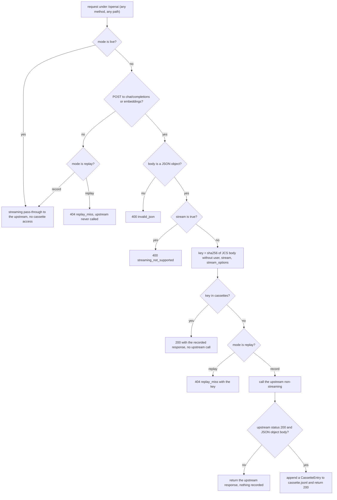

# llm-replay — LLM Record/Replay Proxy

**`llm-replay`** is the OpenAI-compatible proxy that sits in front of the [LLM gateway](/openwiki/integrations/llm-gateway.md). Every LLM call in the system — chat completions and embeddings from the Python services, the Java agents, LangChain4j running inside reused ArDoCo/LiSSA code, and plugged-in services — is addressed to `http://llm-replay:8000/openai` (`SANDMAN_LLM_BASE_URL` in the shared agent environment), never to the gateway directly. Depending on `SANDMAN_LLM_MODE` the proxy passes requests through unchanged (`live`), records gateway responses into per-experiment cassettes (`record`), or answers strictly from those cassettes (`replay`).

## Why it exists (ADR-0010, D-3)

ADR-0010 originally placed record/replay inside both agent libraries (option R1). Review decision **D-3** (finding R-017) moved it into **one proxy in front of the gateway** because library-level replay cannot see LLM calls made by code the libraries do not control — notably LangChain4j inside the reused LiSSA/ArDoCo Java code — and because a single choke point also covers the `embeddings` endpoint. The library `replay` modules were removed; the libraries contain no cassette code ([adr/0010-minimal-agent-library.md](../../adr/0010-minimal-agent-library.md)).

The consequence is the system's reproducibility mechanism (NFR-6): an experiment is run once in `record` mode, and every re-run in `replay` mode is deterministic regardless of provider drift, with no upstream or provider key involved at all. Temperature 0 and seeds are still sent by the clients but are *not* relied upon — providers do not guarantee determinism; the cassette is the guarantee.

Design ceilings accepted with D-3: **replay is strict** (a miss is an error, never a live call) and **streaming is rejected** in record/replay mode (SSE re-encoding was deliberately not built). Prompt-building KG reads elsewhere in the system must use `ORDER BY` so that requests themselves are reproducible; the proxy cannot fix a nondeterministic prompt.

## Runtime shape and entrypoints

`llm-replay` is deliberately **standalone**: the uv workspace package `sandman-llm-replay` does not import the shared `sandman_agent` library — its only dependencies are `httpx`, `rfc8785`, `starlette` and `uvicorn` ([services/llm-replay/pyproject.toml](../../services/llm-replay/pyproject.toml)).

- `python -m sandman_llm_replay` builds the app from `Settings.from_env()` and starts uvicorn on `0.0.0.0:$PORT` (default `8000`); a configuration `ValueError` becomes a clean `SystemExit` with a message ([services/llm-replay/src/sandman_llm_replay/__main__.py](../../services/llm-replay/src/sandman_llm_replay/__main__.py)).
- `sandman_llm_replay.app` exposes `app` lazily via a module `__getattr__`, so importing the module — as the tests do — requires no environment; uvicorn resolves `app` on demand.
- The image is `python:3.13-slim`, installs the workspace package with `uv sync --frozen`, runs as the non-root user `sandman` (uid 10001) and ships `/contracts` (`SANDMAN_CONTRACTS_DIR=/contracts`) ([services/llm-replay/Dockerfile](../../services/llm-replay/Dockerfile)).

The whole behavior lives in one file, [services/llm-replay/src/sandman_llm_replay/app.py](../../services/llm-replay/src/sandman_llm_replay/app.py); there is no database, no NATS, no KG connection — only the upstream HTTP client and the cassette directory.

## Modes and configuration

| Variable | Meaning | Failure semantics |
| --- | --- | --- |
| `SANDMAN_LLM_MODE` | `live` \| `record` \| `replay`; default `live` | any other value aborts startup (`invalid SANDMAN_LLM_MODE …`) |
| `SANDMAN_LLM_UPSTREAM` | gateway OpenAI base URL, trailing `/` stripped; compose: `http://llm-gateway:8080/openai` | **required in `live` and `record`**; optional in `replay`, where it is never used |
| `SANDMAN_LLM_RECORDS_DIR` | cassette directory, default `/llm-records`; compose sets `/llm-records/${SANDMAN_EXPERIMENT:-default}` | created on startup in `record` mode |
| `SANDMAN_SERVICE_VERIFY_FILE` | JSON mapping caller name → sha256(token); the values authorize `GET /v1/status` | unset → `/v1/status` always answers 401 |
| `PORT` | uvicorn port, default `8000` | – |
| `SANDMAN_VERSION` | `version` member of `/v1/status`, default `dev` | – |

In the reference deployment ([deploy/docker-compose.yml](../../deploy/docker-compose.yml)) the service runs on the egress-free `internal` network with `mem_limit: 512m`, mounts `../data/llm-records:/llm-records` (plus `../data/logs`), receives the `svc_tokens_verify` secret, and is health-gated on `llm-gateway` (`condition: service_healthy`). Agents in turn wait for *llm-replay* to be healthy before starting, so the proxy is a hard startup dependency of every LLM-using service. The dashboard's `SANDMAN_TARGETS` includes `llm-replay=http://llm-replay:8000` for the system overview.

## HTTP surface

| Route | Methods | Behavior |
| --- | --- | --- |
| `/healthz` | GET | always `{"status": "ok"}` (liveness) |
| `/readyz` | GET | `200`/`ok` unless in `record` mode the records dir is missing or not writable → `503`/`down` |
| `/v1/status` | GET | `ServiceStatus`; requires a Bearer service token (below) |
| `/openai/{path:path}` | GET, POST, PUT, PATCH, DELETE, OPTIONS, HEAD | proxy dispatch (below) |

## Request flow



*Dispatch of one request through `llm-replay` (`dispatch`, `passthrough`, `record` in app.py).*

Only **POST requests to `chat/completions` and `embeddings`** participate in record/replay. Anything else — `GET /openai/models`, other methods, unknown paths — is still forwarded upstream in `live` and `record` mode, but in `replay` mode it gets `404 replay_miss` without any upstream call: **in replay mode the proxy is strictly offline** and the gateway is never reached (which is also why `SANDMAN_LLM_UPSTREAM` is not required there).

**Forwarding mechanics** are the same in every mode that reaches the upstream (`send`/`passthrough`): the method, query string and headers are preserved except the hop-by-hop set plus `host` and `content-length` (recomputed); the caller's `Authorization` header — the **gateway virtual key**, e.g. `sk-bf-…` — is forwarded unchanged. The proxy holds no keys of its own and does not authenticate the proxy path; only `/v1/status` needs a token. Responses stream back with `content-encoding` stripped (httpx already decoded the body), and the upstream client uses a 600 s total / 10 s connect timeout so long completions pass through.

## Cassette keying

The lookup key is computed from the request body alone:

1. Drop the members `user`, `stream` and `stream_options` (`EXCLUDED_MEMBERS`).
2. Serialize the remaining object with **RFC 8785** (JSON Canonicalization Scheme, `rfc8785.dumps`) — property order, number formatting and escapes become canonical.
3. `key = sha256(canonical_bytes).hexdigest()`.

Consequences that matter:

- **`user` is the run id** the Python library sets for attribution; excluding it makes the key run-independent — the same prompt re-run under a different `run_…` id hits the cassette. `stream`/`stream_options` are excluded because streaming is rejected in record/replay anyway.
- **The key is body-only**: neither the endpoint nor headers participate (a `chat/completions` and an `embeddings` body cannot realistically collide because their shapes differ, but the rule to know is "body only").
- **The body contains the gateway model name** (e.g. `openai/gpt-4.1-mini-…`, resolved from the logical route in `config/llm/models.yaml`). Re-pointing a route therefore *changes the key* and **invalidates the recorded cassettes** instead of replaying stale answers — a deliberate safety property.
- The exact rule is a language-neutral contract: the `cassetteKey` cases in [contracts/conformance/vectors.json](../../contracts/conformance/vectors.json) (chat with `user` dropped, chat with `stream: false` dropped, embeddings) are asserted by this service's own tests, not by the agent libraries.

## Cassette storage and format

Cassettes are **JSONL files** in `SANDMAN_LLM_RECORDS_DIR` — one directory per experiment (`data/llm-records/<experiment>` on the host, `/llm-records/<experiment>` in the container).

- **Recording** appends one entry per line to `<records_dir>/cassette.jsonl` under an `asyncio.Lock` (concurrent requests serialize), with `ensure_ascii=False` and `recordedAt` as ISO-8601 UTC seconds.
- Each entry has exactly the members **`key`, `endpoint`, `request`, `response`, `recordedAt`** — the `CassetteEntry` contract in [contracts/common.schema.json](../../contracts/common.schema.json) (`key` a 64-hex sha256, `endpoint` ∈ `chat/completions`|`embeddings`, `request` the caller's body as sent, `response` the gateway's JSON body whose `model` member is the resolved model).
- **Loading**: at startup in `record` and `replay` mode, *all* `*.jsonl` files in the records dir are read (sorted by name, blank lines skipped) into a single in-memory `key → entry` map, so later files and later lines overwrite earlier entries with the same key. A non-blank line that is not an object carrying all five members aborts startup: `malformed cassette entry at <file>:<line>` — a corrupt cassette is a hard failure, never a silent miss.
- **`experiment`** reported by `/v1/status` is simply the records dir's base name.

Record-mode subtlety: the cassette is consulted *before* the upstream, so a key that is already recorded is served from the cassette **even in `record` mode** — re-recording a changed prompt requires deleting the old entry/line or using a fresh experiment directory, otherwise the old answer keeps being replayed.

## Status, counters and logging

`GET /v1/status` implements the shared `ServiceStatus` shape ([contracts/openapi/shared.yaml](../../contracts/openapi/shared.yaml)):

- **Auth**: the `Authorization: Bearer <token>` header is hashed with sha256 and compared (`hmac.compare_digest`) against the **values** of the `SANDMAN_SERVICE_VERIFY_FILE` JSON (`deploy/gen-secrets.sh` writes caller name → sha256(service token) there). Any service token from that file is accepted; anything else gets `401 {"error": … "unauthorized"}`. The proxy itself holds no outbound service token — it only verifies callers.
- **Body**: `service: "llm-replay"`, `version` (`SANDMAN_VERSION`, default `dev`), `state` = `working` iff `activeTasks > 0`, `activeTasks` = number of in-flight *proxied* requests (only the `/openai/{path}` route is counted — polling `/v1/status`, `/healthz` or `/readyz` never makes the service look busy), optional `lastActivityAt`, and `details` = `{mode, experiment, entries, hits, misses, recorded, forwarded}`.
- **Counters**: outcomes map to `hits` / `misses` / `recorded` / `forwarded`; a rejected request (invalid JSON or streaming) is logged with outcome `rejected` but not counted.

Every proxied request produces one JSON log line on stdout — `{"ts": …, "level": "INFO", "service": "llm-replay", "msg": "request", "mode": …, "path": …, "outcome": …, "status": …}` plus the `key` when one was computed — which is the fastest way to see what a replay run actually hit.

## Failure semantics

| Condition | Response |
| --- | --- |
| Body is not a JSON object (record/replay path) | `400` `invalid_request_error` / `invalid_json` |
| `stream: true` in record or replay mode | `400` `invalid_request_error` / `streaming_not_supported` (rejected *before* any upstream call) |
| Cassette miss in replay mode | `404` `replay_miss` with the computed `key` in the error body — the key is what you feed into a `grep` over the cassette to find what was expected |
| Any non-recordable request in replay mode (e.g. `GET /openai/models`) | `404` `replay_miss` |
| Upstream unreachable / transport error (live, record) | `502` `upstream_error` / `upstream_unreachable` (exception class name as the message) |
| Upstream answers non-200 in record mode | passed through to the caller, **not recorded** (`forwarded`); likewise a 200 whose body is not a JSON object |
| Corrupt cassette file at startup | startup abort with `file:line` |

All error bodies use the OpenAI-style envelope `{"error": {"type": …, "code": …, "message": …, …}}`.

## Running experiments

The knobs live in `deploy/.env` (see [deploy/.env.example](../../deploy/.env.example)): `SANDMAN_LLM_MODE` (`live` | `record` | `replay`) and `SANDMAN_EXPERIMENT` (the cassette subdirectory under `data/llm-records/`, default `default`).

```sh
# record once (per prompt/route version)
SANDMAN_EXPERIMENT=<name> SANDMAN_LLM_MODE=record make up
# deterministic re-runs, offline
SANDMAN_EXPERIMENT=<name> SANDMAN_LLM_MODE=replay make up
```

Operational notes:

- Compose always passes `SANDMAN_LLM_MODE` through, so *all* callers record/replay together — there is no per-service cassette.
- The reference compose health-gates `llm-replay` on `llm-gateway` even in replay mode (a pure replay stack could drop that dependency, since replay needs no upstream).
- Strict replay is the point: in CI, a missing cassette fails the test instead of silently calling a provider; changing a prompt or re-pointing a route requires re-recording, which makes such changes visible in review.

## Focused tests

[services/llm-replay/tests/test_app.py](../../services/llm-replay/tests/test_app.py) pins every invariant against a mocked upstream (`httpx.MockTransport`), with no network:

- the `cassetteKey` conformance vectors, and that `user`/`stream` do not change the key;
- live pass-through (query string and `Authorization` forwarded, nothing written);
- record: entry shape and key on first miss, dedupe on the second identical request (one upstream call, one line), and a hit served from a pre-existing cassette file without any upstream call;
- replay: hit returns the recorded body; a miss (changed model) is `404 replay_miss` with the key; `GET /openai/models` is `404`; no upstream request at all;
- `stream: true` rejected in both record and replay before any upstream call;
- non-200 upstream responses passed through unrecorded;
- a malformed cassette line aborts `create_app` (`bad.jsonl:1`);
- an invalid `SANDMAN_LLM_MODE` fails `Settings.from_env`;
- `/healthz` + `/readyz` in all modes; `/v1/status` returns 401 without/with a wrong token and counts hits/misses/entries/experiment correctly.

These tests run in the Python CI job (root `pytest` via `testpaths = ["services", …]`); `tests/test_import.py` additionally checks the package version.

## Relationships

- [LLM Gateway](/openwiki/integrations/llm-gateway.md) — the upstream; the proxy forwards the caller's virtual key unchanged and is invalidated by route re-pointing.
- [Contracts](/openwiki/architecture/contracts.md) — `CassetteEntry` in `common.schema.json` and the `cassetteKey` conformance vectors this service implements.
- [Agent Libraries](/openwiki/architecture/agent-libraries.md) — `OpenAiLlmClient`/`ModelSelector` (Python) and `LlmAccess` (Java, configuring LangChain4j) all point at `SANDMAN_LLM_BASE_URL` = this proxy.
- [Deployment](/openwiki/operations/deployment.md) and [Configuration](/openwiki/operations/configuration.md) — compose wiring, `.env` knobs, `data/llm-records` host volume.
- [Observability](/openwiki/operations/observability.md) — the shared `ServiceStatus`/`Health` contract this service implements with the `internal`-only network.
- [Testing and CI](/openwiki/testing/testing-and-ci.md) — strict-replay cassettes as the offline test strategy for LLM-dependent behavior.
