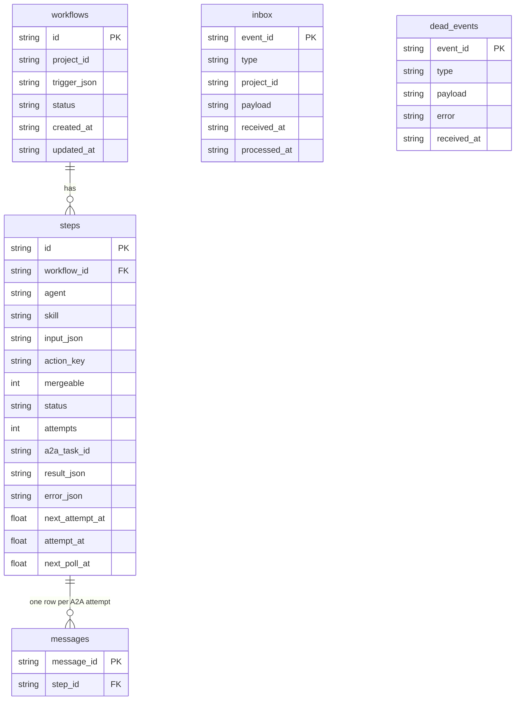
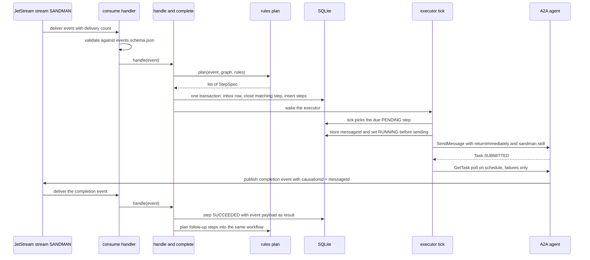
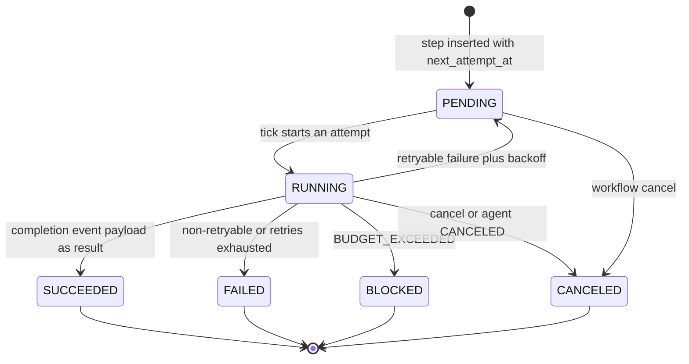

# Orchestrator

The **orchestrator** (`sandman-orchestrator` 0.1.0, Python 3.13 / FastAPI, port 8000, `python -m sandman_orchestrator`) is SANDMAN's rule-based workflow engine: it consumes domain events from NATS JetStream, decides which agent skill runs next from a fixed rule table, submits A2A tasks to the three agents, tracks every workflow and step in SQLite, and exposes the status/manual-trigger/dead-events REST API. [ADR-0006](repo://adr/0006-rule-based-orchestration.md) chose the **hybrid** option: deterministic rules for all event-driven reactions (reproducible, cheap, unit-testable), with an optional LLM planner for ad-hoc natural-language requests as a **planned M6 feature** behind a feature flag with an approval gate — the rule path is all there is today, and the planner is not present in the code.

The service is deliberately **a single instance** (ADR-0006: no leader election planned; fine on one server) with **one SQLite file** as its only durable state and **read-only** knowledge-graph access. It writes nothing to the KG; planning resolves version ids to artifacts/kinds through two read queries.

| Responsibility | Where |
| --- | --- |
| Rule table (event → steps), manual triggers, debounce/coalescing math | `rules.py` |
| SQLite schema and migrations, inbox/step transactions, executor loop, retries | `orchestrator.py` |
| REST API, security, NATS consumer, wiring/lifespan | `app.py` |
| Configuration consumed by the engine | `config/orchestrator/rules.yaml` |
| Contract of the HTTP surface | `contracts/openapi/orchestrator.yaml` |

## Entry points and wiring

`build(env)` in [app.py](repo://services/orchestrator/src/sandman_orchestrator/app.py#L173-L213) reads `Settings.from_env()`, requires `kg_uri`, `nats_url`, `service_token`, `config_dir` (one startup error naming everything missing), and adds two service-specific variables:

- `SANDMAN_STATE_DB` — SQLite path (default `/data/orchestrator.db`; compose mounts the `orchestrator-data` volume).
- `SANDMAN_AGENTS` — comma list `name=url`, e.g. compose's `extraction-agent=http://extraction-agent:8000,tlr-agent=http://tlr-agent:8080,inconsistency-agent=http://inconsistency-agent:8080`; this map is the only place agent addresses come from.

The lifespan connects NATS, idempotently ensures the `SANDMAN` stream, runs `recover()`, then starts two asyncio tasks that share one event loop and one SQLite connection: the **executor** (`orch.run()`) and the **consumer** (`consume(js, orch.consume)`). `/readyz` reports `sqlite` plus `executor` and `nats` task liveness (503 if any is down); `/v1/status` publishes the shared `ServiceStatus` shape with the orchestrator-specific `details` `runningWorkflows` and `pendingSteps`, `activeTasks` = running steps, `lastActivityAt` = newest workflow `updated_at`.

## Persistence model

State is a single `sqlite3` connection opened with `autocommit=False` ([orchestrator.py](repo://services/orchestrator/src/sandman_orchestrator/orchestrator.py#L62-L64)); every mutation runs inside a `with self.db:` block, which commits on success and rolls back on exception. Migrations are numbered `*.sql` files in `migrations/`, applied in filename order with the script **and** `PRAGMA user_version = n` executed and committed together — `PRAGMA user_version` is the schema version, so re-opening a database applies nothing twice (pinned by `test_migrations_apply_once`).

The persistence model: `workflows` (trigger + derived status), `steps` (one planned A2A task with its attempts, result and scheduling times), `messages` (the `messageId` of every A2A attempt, for completion-event matching), `inbox` (exactly-once event intake keyed by event id) and `dead_events` (events parked for operator replay). Schema: [001_init.sql](repo://services/orchestrator/src/sandman_orchestrator/migrations/001_init.sql).

Three scheduling columns on `steps` carry the executor's clock: `next_attempt_at` (earliest start of a `PENDING` step — debounce window or retry backoff, epoch seconds), `attempt_at` (start of the current attempt, the base for the skill timeout) and `next_poll_at` (next `GetTask` poll of a `RUNNING` step).

## Event intake: exactly once, with a dead-event outlet

The consumer loop ([app.py `consume`](repo://services/orchestrator/src/sandman_orchestrator/app.py#L159-L170)) is the library's durable pull consumer (durable name `orchestrator`, subject `sandman.>`, explicit ack, `max_deliver` 5, backoff 5/30/120/300 s); each delivery passes its `num_delivered` into the handler. `consume` then:

1. validates the envelope against `events.schema.json` — a **contract-invalid event goes to `dead_events` immediately and is acked** (retrying cannot fix a bad payload);
2. calls `handle`; if that raises and the delivery count is still below `MAX_DELIVER` (5, matching the consumer's `max_deliver`), the exception is **re-raised** so JetStream naks and redelivers; on the **last delivery** the event is stored in `dead_events` with `"<ExceptionType>: <message>"` and acked ([orchestrator.py `consume`](repo://services/orchestrator/src/sandman_orchestrator/orchestrator.py#L82-L95)).

`handle` ([orchestrator.py](repo://services/orchestrator/src/sandman_orchestrator/orchestrator.py#L97-L120)) is the exactly-once core: if an `inbox` row for the event id already has `processed_at` set, it returns immediately. Otherwise `plan()` computes the follow-up `StepSpec`s, and then **one transaction** writes the inbox row (insert-or-update with `processed_at = now`), closes the step the event completes (if any), and inserts the new steps. A crash therefore either commits both — the `processed_at` check then deduplicates the JetStream redelivery — or neither, in which case the redelivery starts from scratch; `process_inbox` additionally covers rows whose `processed_at` is still NULL (the replay path). `test_recovery_processes_unprocessed_inbox_exactly_once` and `test_duplicate_event_processed_once` pin both sides.

## Control flow: from event to next steps

The consume → plan → insert-steps → tick → submit → completion-event → next-steps loop: a completed step's own completion event re-enters the same `handle` path, where `_complete` marks the step done and the planned follow-ups are appended to the same workflow.

## The rule table

The rules are **fixed in code** ([rules.py](repo://services/orchestrator/src/sandman_orchestrator/rules.py#L135-L155)); `rules.yaml` only tunes timings, limits and the TLR kind pairs. Each step targets one skill, and the skill→agent routing is the constant `SKILL_AGENT` map:

| Skill | Agent |
| --- | --- |
| `extract-artifact-versions` | `extraction-agent` |
| `recover-trace-links` | `tlr-agent` |
| `detect-inconsistencies` | `inconsistency-agent` |

`plan(event)` — the rule table:

| Event | Planned steps |
| --- | --- |
| `sandman.ingestion.completed` | `extract-artifact-versions` on `createdVersionIds ∪ reactivatedVersionIds` (reactivated versions are handled like created ones); plus, if `deletedArtifactIds` is non-empty (deletion-only or mixed ingestion), a mergeable `detect-inconsistencies` scoped to the deleted artifacts so their findings resolve |
| `sandman.extraction.completed` | resolve the changed version ids via the KG; `recover-trace-links` for each configured kind pair (changed × counterpart **current** versions, both directions, with the pair's `approaches`); any changed version that no pair links triggers a mergeable `detect-inconsistencies` on its artifact — so a project whose kinds have no pair still gets detection |
| `sandman.tracelinks.updated` | resolve source and target version ids to artifacts via the KG; one mergeable `detect-inconsistencies` on that artifact set |
| `sandman.inconsistencies.updated` | nothing — detection's completion closes the workflow |
| `sandman.inconsistency.status.changed` | nothing (audit only; logged as `inconsistency status changed` with the event data as audit fields) |

Two properties come straight from ADR-0006's amendments: **detection scope is always a set of artifact ids** — the orchestrator resolves version ids to artifacts with a KG read because the rule fires on what *changed*, but detection re-checks whole artifacts; and the orchestrator's only KG access is the `Graph` protocol (`versions(project_id, ids)`, `current(project_id)`), implemented by `KgGraph` over `KgClient.read` read transactions.

The TLR kind pairs live in `rules.yaml` (`tlr.kindPairs`): `requirements ↔ code` and `architecture-doc ↔ architecture-model`, each with `approaches: [stub-name-match]`. Without any configured pair, `extraction.completed` plans only detection.

## Debounce, coalescing and actionKey dedup

Steps that are **mergeable** (`detect-inconsistencies` from events, `recover-trace-links` from events) are debounced and coalesced; steps that are not (`extract-artifact-versions`, every manual step) start as soon as they are due.

- **Debounce** — a mergeable step is inserted with `next_attempt_at = now + debounceSeconds` (10 s), so triggers arriving in the window coalesce instead of queueing a detection per event.
- **Coalescing** — before inserting, `_add_steps` looks for a `PENDING`, never-started (`attempts = 0`), mergeable step of the same skill and project whose **non-id-list members match** (`merge` returns non-`None` only if everything except the id lists is equal, e.g. the same projectId and approaches). If found, the two inputs merge: an id list present on both sides (`artifactVersionIds`, `sourceVersionIds`, `targetVersionIds`, `scopeArtifactIds`) is unioned and sorted, while an id list present on only one side is dropped — an absent `scopeArtifactIds` means whole-project detection, so merging a scoped request with an unscoped one widens the scope rather than losing it. The step's input is updated, its `actionKey` recomputed for the merged input, and the debounce window restarts. `test_debounce_merges_three_extractions_into_one_tlr_step` shows three extractions collapsing into one TLR step that does not start inside the window.
- **actionKey dedup** — `action_key = sha256_hex(canonical_json([agent, skill, input, trigger_id]))` (RFC 8785 JCS). A step whose `actionKey` already exists with status not in (`FAILED`, `CANCELED`) is skipped, unless `force` (which skips dedup but not coalescing). Because the **trigger id** (the causing event id or manual request id) is part of the key, only duplicates of the *same* trigger are suppressed — a later trigger with identical input (e.g. a revert) runs again, which is why the e2e asserts unchanged re-ingestions produce no workflow while reverts do. `test_identical_trigger_once_force_twice` pins all three behaviors.

A workflow row is created lazily by `_add_steps` — only when a step is actually inserted. Event-triggered steps create a workflow with trigger `{kind: "event", eventType, eventId}`; steps that follow a completed step are added to that step's existing workflow, so one ingest produces one workflow with `extract → tlr → detect` steps.

## The executor loop and its invariants

`run()` loops `tick()` and then waits on an asyncio wake event with a 1 s timeout, so a planned step starts immediately (`handle`/`trigger` set the wake) or at the latest within a second. One `tick`:

1. reads all `RUNNING` steps to compute the set of **locked projects** and the per-agent running counts;
2. builds `retrying` — `PENDING` steps with `attempts > 0`, keyed by project;
3. selects `PENDING` steps whose `next_attempt_at` is due (insertion order) and starts each unless (a) its project is locked, (b) its project has a retrying step that is not this one, or (c) its agent is at `maxConcurrentPerAgent`;
4. polls every `RUNNING` step whose `next_poll_at` is due.

Submits and polls run sequentially inside a tick — a hanging agent delays the others by the HTTP timeout (30 s), an accepted simplicity.

The invariants the executor maintains:

- **Per-project pipeline lock.** At most one step of a project is `RUNNING` at any time, so extract → tlr → detect never overlap and no detection runs on half-written links; **a step waiting for its retry keeps the lock** (it is `PENDING` with attempts > 0 and blocks its project). Projects run in parallel against each other.
- **Global per-agent concurrency.** `maxConcurrentPerAgent` (default 2) caps in-flight tasks per agent across all projects.
- **`messageId` before `SendMessage`.** `_start` chooses a fresh `messageId`, and inside one transaction inserts the `messages` row and flips the step to `RUNNING` (`attempts + 1`, `next_poll_at = now + poll.initial`) *before* the A2A call. A completion event that arrives before the HTTP response is therefore always matched to a stored message ([orchestrator.py `_start`](repo://services/orchestrator/src/sandman_orchestrator/orchestrator.py#L336-L348)).
- **Steps complete on their completion event, not on polling.** `_complete` joins `messages.message_id = event.causationid` to find the step, marks it `SUCCEEDED` with **the event payload as `result_json`**, and recomputes the workflow status. A completion event for an already-finished step is ignored **and its follow-ups suppressed** (a late duplicate event must not re-plan); polling never marks success — `TASK_STATE_COMPLETED` in `_on_snapshot` simply schedules the next poll, and the timeout branch excludes it, so a completed-but-eventless task waits for its event rather than being killed. If the step's workflow was triggered manually with a type other than `full`, follow-ups are suppressed (a manual `detect`/`extract`/`tlr` is intentionally single-step); `full` chains through the normal event rules and stays one workflow.
- **Polling only detects failures.** `GetTask` snapshots drive failures, rejections, cancellation and timeout only: `TASK_STATE_FAILED` with `BUDGET_EXCEEDED` ends the step `BLOCKED` (a user must act — no retry); other `FAILED` goes through the retry decision; `TASK_STATE_REJECTED` is non-retryable; `TASK_STATE_CANCELED` ends the step `CANCELED`; an unknown task (`TaskNotFoundError`, e.g. the agent restarted with its in-memory task store empty, or the orchestrator crashed between storing the attempt and sending) is retryable `TASK_NOT_FOUND`; any other poll error keeps the step polling with an `UNKNOWN` snapshot until the timeout. A poll finds no `a2a_task_id` when the process died between the attempt transaction and `SendMessage` — that attempt is failed retryably too. The poll interval grows with elapsed attempt time, clamped to `[poll.initial, poll.max]` (30 s → 2 min).
- **Timeouts.** A step not completed within `timeouts[skill]` (extraction 15 m, TLR 60 m, detection 30 m in `rules.yaml`) gets a best-effort A2A `CancelTask` and fails with retryable `TIMEOUT`.
- **Backoff and maxAttempts.** `_failed` retries only if the error is retryable and `attempt < maxAttempts` (3): the step returns to `PENDING` with `next_attempt_at = now + backoff[min(attempt, len(backoff)) - 1]` — the schedule `30s, 2m, 10m` from `rules.yaml`. A non-retryable error or an exhausted retry budget ends the step `FAILED`.

Step lifecycle as driven by the executor: PENDING (debounce or backoff) → RUNNING per attempt, terminal on the completion event or a poll-detected failure.

### Workflow and step status

Workflow status is **never set directly**; `_touch` recomputes it from the steps after every change: all `PENDING` → `PENDING`; any `PENDING`/`RUNNING` → `RUNNING`; otherwise the first of `BLOCKED`, `FAILED`, `CANCELED` present, else `SUCCEEDED`. A new workflow is inserted with placeholder `SUCCEEDED` and immediately recomputed, so an empty-then-filled workflow is consistent. `POST /v1/workflows/{id}/cancel` cancels every `PENDING` and `RUNNING` step (and sends A2A `CancelTask` for the running ones); an unknown workflow is 404, and a workflow with nothing active raises `Conflict` → 409.

## Manual triggers

`POST /v1/workflows` with `type` ∈ `full | extract | tlr | detect`, `projectId`, free-form `params` and `force` calls `Orchestrator.trigger`, which plans with `manual()` ([rules.py](repo://services/orchestrator/src/sandman_orchestrator/rules.py#L171-L189)):

- **`detect`** — one `detect-inconsistencies` step with `{projectId, **params}` (params can carry `detectors`, `scopeArtifactIds`).
- **`extract`** / **`full`** — one `extract-artifact-versions` step over all *current* version ids of the project; `full` then chains TLR and detection through the ordinary event rules.
- **`tlr`** — one `recover-trace-links` step per configured kind pair over all current versions of that pair, with the pair's approaches.

Every spec's input is validated against its `$defs` entry in `contracts/skills.schema.json` (`ExtractArtifactVersionsInput`, `RecoverTraceLinksInput`, `DetectInconsistenciesInput` — the schema name is derived from the skill id); a `ContractError` answers 400 "invalid skill input" with the validation messages. If nothing matches (no current versions), `ValueError` → 400 "nothing to run". Manual triggers always create the workflow (with trigger `{kind: "manual", type, actor}`) and their steps are **not** mergeable, so they start immediately. The trigger id is an optional caller-supplied `request_id` or a fresh UUID — the REST handler supplies none, so repeated REST triggers get different trigger ids and run again; `force: true` additionally bypasses actionKey dedup entirely. The actor recorded in the trigger is forwarded to the agent as A2A `sandman.actor` metadata (accepted by agents only from the orchestrator).

## REST API and security

`contracts/openapi/orchestrator.yaml` is the contract; all errors are RFC 9457 `application/problem+json`.

| Endpoint | Caller gate | Effect |
| --- | --- | --- |
| `GET /v1/workflows` (projectId, status, limit ≤ 500, cursor) | any verified service token | page of workflows **without** steps; offset cursor, `nextCursor` only on a full page |
| `POST /v1/workflows` (202) | admin callers | manual trigger; returns the workflow with steps |
| `GET /v1/workflows/{workflowId}` | any verified service token | workflow **with** steps (404 unknown) |
| `POST /v1/workflows/{workflowId}/cancel` (202) | admin callers | cancel pending and running steps; 409 `Conflict` if nothing active |
| `GET /v1/dead-events` | any verified service token | captured events ordered by received time |
| `POST /v1/dead-events/{eventId}/replay` (202) | admin callers | re-queue a dead event (404 unknown) |
| `GET /v1/status`, `GET /healthz`, `GET /readyz` | status needs a token | shared status contract |

Security has three layers ([app.py](repo://services/orchestrator/src/sandman_orchestrator/app.py#L37-L156)):

1. **Service tokens.** Every `/v1` route requires a verified service token (`require_service`): 401 for an unknown token, 403 for plugin callers.
2. **`ADMIN_CALLERS = {"query-service", "dashboard"}`** — trigger, cancel and replay are additionally restricted to those two callers; any other service (e.g. an agent) gets 403 (`test_auth` asserts this for a `tlr-agent` token).
3. **Actor forwarding.** `X-Sandman-Actor` is accepted only when the caller is the query-service (403 otherwise, via `trusted_actor`), must match `^user:[A-Za-z0-9._@-]+$` (400 otherwise), and defaults to `service:<caller>`. The query-service is the only user entry point: it authenticates users, checks per-project roles, and forwards list/create/get workflow calls with its own token plus the actor/roles headers ([query-service `service.py`](repo://services/query-service/src/sandman_query/service.py#L249-L259)) — users never call the orchestrator directly. The dashboard (M1) is the second intended admin caller for cancel/replay.

## Dead events, replay and recovery

- **`replay(eventId)`** moves a dead event back into the inbox (subject recovered from the payload, `processed_at = NULL`) and deletes it from `dead_events`, then processes the inbox; **`process_inbox`** handles every unprocessed inbox row through `handle`, and a replay that fails again is returned to `dead_events` (inbox row deleted) so it can be replayed later after the cause is fixed. Tests patch a dead event's payload to show a replay fully reprocesses.
- **`recover()`** runs at startup: every `RUNNING` step's `next_poll_at` is set to now, so restart-affected steps are polled immediately (a step that finished while the orchestrator was down is closed by its completion event — the stream redelivers it, or the event is already in the unprocessed inbox — while a step that merely looks stuck on a dead agent is detected by the poll), and unprocessed inbox rows are processed. A restart therefore resumes without losing steps or duplicating work; `test_restart_resumes_running_step` closes the loop by finishing the agent's task after the restart and asserting the step succeeds on its **first** attempt.

## Configuration

`Rules.load(Path(config_dir) / "orchestrator" / "rules.yaml")` parses [rules.yaml](repo://config/orchestrator/rules.yaml); durations accept `30s`, `2m`, `1h` or plain seconds.

| Key | Default in code | Meaning |
| --- | --- | --- |
| `debounceSeconds` | 10 | mergeable step debounce window (restarts on each coalesced trigger) |
| `maxConcurrentPerAgent` | 2 | global per-agent cap on running steps |
| `timeouts` | extract 15 m, tlr 60 m, detect 30 m | per-skill attempt timeout → CancelTask + retryable `TIMEOUT` |
| `poll.initial` / `poll.max` | 30 s / 2 m | failure-poll interval bounds (grows with elapsed attempt time) |
| `retry.maxAttempts` | 3 | attempts per step, including the first |
| `retry.backoff` | `[30s, 2m, 10m]` | delay before attempt *n*+1 |
| `tlr.kindPairs` | empty | kind pairs to link after changes, each with its `approaches` |

The engine also takes an injectable `clock` (used by tests to shrink every timing) — a hanging debounce, backoff or timeout is therefore testable without sleeping.

## Focused tests

`services/orchestrator/tests/` runs against fake A2A agents built from the real library (`sandman_agent.a2a.serve`) whose completion events flow through an in-memory bus straight into `Orchestrator.consume` — the executor is exercised end-to-end without containers:

- **`test_rules.py`** — the rule table: ingestion extracts created ∪ reactivated; deletion-only ingestion detects the deleted artifacts; extraction links changed × counterparts with the configured approaches; changed versions outside every kind pair trigger detection; `tracelinks.updated` detects the artifacts of source and target versions; `inconsistencies.updated` creates no steps; duplicate events process once; no step starts while another of the project runs.
- **`test_executor.py`** — the invariants: success closes the step **on the event** and forwards the actor/workflow/message id; a manual `full` run chains three steps in one workflow; `REJECTED` never retries; retryable failures retry then fail at `maxAttempts`; `BUDGET_EXCEEDED` blocks; `TaskNotFoundError` after an agent restart retries and succeeds on attempt 2; a timeout cancels the task and retries; the same trigger id runs once, `force` twice, a later trigger again; cancel sends `CancelTask`; restart resumes a running step; recovery processes an unprocessed inbox row exactly once; invalid events dead-letter and replay reprocesses; migrations apply once (`PRAGMA user_version` = 1).
- **`test_rest.py`** — REST responses validated against the OpenAPI schemas: 401/403 gates, workflow lifecycle (create 202 → get → list → cancel 202/409), problem+json errors, dead events, `/v1/status` details, `/readyz`.
- **`test_nats.py`** — Testcontainers NATS: publishing the same event id twice through JetStream yields exactly one step.
- **`tests/e2e/test_walking_skeleton.py`** — against the full stack: the pipeline workflow shows the three steps `SUCCEEDED` in order, and an unchanged re-ingestion triggers no workflow at all.

## Relationships

- Calls the three agents over A2A with pre-stored message ids: [A2A Skills](/openwiki/concepts/a2a-skills.md).
- Consumes `sandman.*` events and dead-letters them per the consumer contract: [Event Bus](/openwiki/concepts/event-bus.md).
- Read-only KG lookups for planning: [Knowledge Graph Schema](/openwiki/architecture/knowledge-graph.md).
- Reached by users through the query-service forwarder, plus the dashboard: [Query Service](/openwiki/services/query-service.md).
- Every `rules.yaml` knob and the `SANDMAN_STATE_DB`/`SANDMAN_AGENTS` wiring: [Configuration](/openwiki/operations/configuration.md).
- The extract → tlr → detect chain these rules implement, end to end: [Analysis Pipeline](/openwiki/workflows/analysis-pipeline.md).
