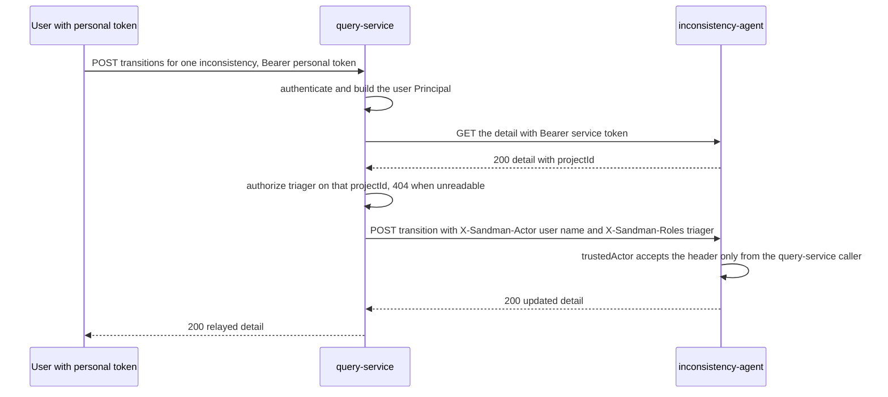
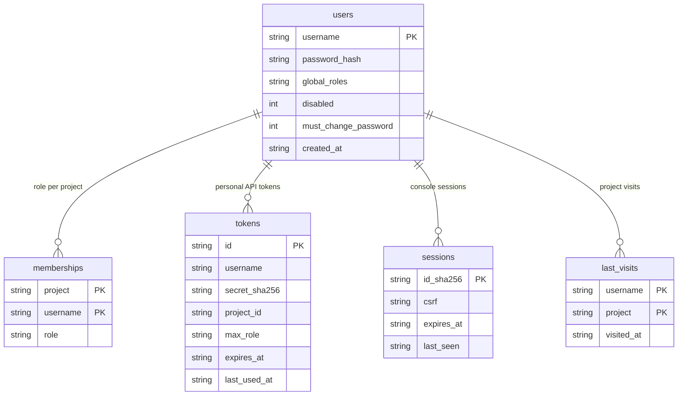

# Query Service

The **query-service** (`sandman-query-service` 0.1.0, Python 3.13 / FastAPI, port 8000, `python -m sandman_query`) is the single front door for humans and machines: everything a user can do — manage their account and tokens, administer users and project memberships, upload snapshots, triage inconsistencies, trigger workflows, query the knowledge graph, export results — happens through it, either on the REST API (`/v1/*`, **bearer tokens only**) or in the server-rendered console (`/console/*`, session cookie). Owner services ([extraction-agent](/openwiki/services/extraction-agent.md), [inconsistency-agent](/openwiki/services/inconsistency-agent.md), [orchestrator](/openwiki/services/orchestrator.md)) are never user-facing; the query-service is the *policy decision point* that authenticates the caller, checks the operation's minimum role, and then forwards the operation with its **own** service token plus the actor identity (ADR-0013, option A: "built-in user store, one exposed port, role checks in one place").

It publishes exactly one port in the deployment: the Caddy edge-proxy publishes `127.0.0.1:8080 → query-service:8000`; the service itself stays on the internal Docker network. The OpenAPI contract [contracts/openapi/query-service.yaml](repo://contracts/openapi/query-service.yaml) is authoritative — the FastAPI app is created with `docs_url=None, redoc_url=None, openapi_url=None`, so there is no generated spec; every operation's minimum role is declared there as `x-sandman-min-role` and loaded at startup.

| Responsibility | Where |
| --- | --- |
| REST routes, health/ready/status, error mapping, ASGI wiring | `services/query-service/src/sandman_query/app.py` |
| Console routes, Jinja2 rendering, CSRF, upload/ask pages | `services/query-service/src/sandman_query/console.py` |
| Shared state: authentication, principals, login, owner forwarding, documents | `services/query-service/src/sandman_query/service.py` |
| Trusted forwarding: owner HTTP clients, actor headers, `relay` | `services/query-service/src/sandman_query/forward.py` |
| SQLite user store: users, memberships, tokens, sessions, last visits | `services/query-service/src/sandman_query/store.py` |
| Roles/levels, `authorize`, `Principal`, login rate limiter, plugin grants | `services/query-service/src/sandman_query/auth.py` |
| Guarded reads, NL intent stub, export assembly | `services/query-service/src/sandman_query/query.py` |
| Read-only KG access, JSON conversion, result scope post-check | `services/query-service/src/sandman_query/reader.py` |
| Cypher scope guard (ADR-0009 D-2) | `services/query-service/src/sandman_query/guard.py` |

The console decision is ADR-0011, option C: a server-rendered console in the query-service (FastAPI + Jinja2, autoescape on, vendored `htmx.min.js`, no own JavaScript) calling the owner REST APIs server-side with the authenticated actor. Consequences: no third language or build chain, role checks in one place, but limited interactivity and console releases coupled to the query-service.

## Entry points and configuration

`build(env)` ([app.py](repo://services/query-service/src/sandman_query/app.py#L402-L418)) reads `Settings.from_env()` (shared `SANDMAN_*` settings: `service_token` always required, `kg_uri` required when no test reader is injected) plus service-specific variables read directly from the environment:

| Variable | Meaning |
| --- | --- |
| `SANDMAN_USER_DB` | SQLite path of the user store (default `/data/users.db`; compose mounts the `query-data` volume) |
| `SANDMAN_ADMIN_PASSWORD_FILE` | Bootstrap admin password; user `admin` is created **only when the store is empty**, with global role `admin` and `must_change_password = 1` |
| `SANDMAN_COOKIE_SECURE` | `"true"` → `Secure` on session and login-CSRF cookies (behind TLS) |
| `SANDMAN_EXTRACTION_URL` / `SANDMAN_INCONSISTENCY_URL` / `SANDMAN_ORCHESTRATOR_URL` | Owner base URLs; the map keys are fixed to the three owner names. An unset owner gets `http://unconfigured.invalid`, so calls fail into 503 rather than silently succeeding |

`SANDMAN_SESSION_SECRET_FILE` is provisioned in compose but not read: sessions are opaque server-side rows, not signed cookies. Two config files are loaded once at startup from the config dir (compose: `/config`): `query/plugins.yaml` (plugin read grants) and `query/intents.yaml` (NL stub templates, each of which must pass the Cypher guard or startup fails). The minimum-role table comes from `contracts/openapi/query-service.yaml` via `load_min_roles`. Run directly with `uvicorn --factory sandman_query.app:build` or `python -m sandman_query` (port 8000); the Dockerfile copies `contracts/` into the image and sets `SANDMAN_CONTRACTS_DIR=/contracts`.

Lifespan wires `setup_logging`, and on shutdown closes the owner clients, the KG reader and the SQLite connection.

## Authentication: bearer tokens only on the API

`Service.authenticate` ([service.py](repo://services/query-service/src/sandman_query/service.py#L141-L157)) resolves an `Authorization: Bearer …` header to a `Principal`:

1. Missing or non-bearer header → **401** with `WWW-Authenticate: Bearer`.
2. The token is first checked against the shared `svc_tokens_verify` hash map (`TokenVerifier`): a hit is a **service** principal, or a **plugin** principal (`plugin:<id>`) when the caller name carries the `plugin:` prefix — plugin grants come from `config/query/plugins.yaml`.
3. Otherwise the token is looked up as a **personal API token** in the user store (sha256 of the secret, unexpired, enabled user). A user whose `must_change_password` flag is set gets **403 "password change required"** even with a valid token; the principal carries the token's optional `projectId` scope and `maxRole` cap.

The session cookie is never consulted by `/v1/*`: `POST /v1/auth/login` *sets* the cookie and `POST /v1/auth/logout` *consumes* (revokes) it, and every other API route authenticates from the bearer header only — a stolen console cookie cannot drive the REST API (pinned by `test_login_sets_strict_httponly_cookie_and_v1_ignores_it`).

Login (`POST /v1/auth/login`, shared with the console form) is rate-limited in memory: **5 failures per username or per client address within 15 minutes → 429** with `Retry-After: 900`. Password verification runs in a thread against the SQLite store; unknown usernames are hashed against a pre-computed dummy hash so timing does not reveal whether a user exists.

## Authorization

The decision itself lives in [auth.py](repo://services/query-service/src/sandman_query/auth.py#L73-L88) and is documented with its trust model on [Auth and Roles](/openwiki/concepts/auth-and-roles.md): per-operation minimum role from the contract, caller-kind restrictions (plugins only `queryCypher`/`getSchema`, services read-only and excluded from the `USER_ONLY` account operations, admin operations require an *unrestricted* admin), and per-project levels where an unreadable project yields **404** (no existence leak) and an insufficient role **403**. The query-service's contribution is *where* the check runs: every API route calls `svc.check(who, op, projectId)` with the path's `projectId` when present; for object-addressed operations without a project in the path (`getInconsistency`, `transitionInconsistency`, `getWorkflow`) the object is fetched from the owner first and then authorized against the owner-reported `projectId` — so a hidden inconsistency is a 404 and the mutation is never forwarded. Two query-specific rules sit in the routes: `POST /v1/query/cypher` without a `projectId` requires an unrestricted global admin, and `POST /v1/auth/tokens` / `DELETE /v1/auth/tokens/{tokenId}` reject restricted tokens (project-scoped or role-capped) with 403 — restricted tokens cannot mint or revoke tokens.

## Route inventory

Minimum roles are `x-sandman-min-role` from [contracts/openapi/query-service.yaml](repo://contracts/openapi/query-service.yaml). Console routes (`/console/...`) are deliberately **not** part of the contract.

| Area | Operation | Method and path | `x-sandman-min-role` |
| --- | --- | --- | --- |
| health | — | `GET /healthz`, `GET /readyz` | none (no auth) |
| health | — | `GET /v1/status` | unrestricted admin or service caller (custom check, not the shared Status route) |
| auth | `login` | `POST /v1/auth/login` | none (sets `sandman_session` cookie) |
| auth | `logout` | `POST /v1/auth/logout` | session cookie |
| auth | `me` | `GET /v1/auth/me` | `authenticated` |
| auth | `listTokens` | `GET /v1/auth/tokens` | `authenticated` |
| auth | `createToken` | `POST /v1/auth/tokens` | `authenticated` |
| auth | `revokeToken` | `DELETE /v1/auth/tokens/{tokenId}` | `authenticated` |
| admin users | `listUsers` | `GET /v1/admin/users` | `admin` |
| admin users | `createUser` | `POST /v1/admin/users` | `admin` |
| admin users | `updateUser` | `PATCH /v1/admin/users/{username}` | `admin` |
| admin members | `putProject` | `PUT /v1/admin/projects/{projectId}` | `admin` (forwarded to extraction-agent) |
| admin members | `putMember` | `PUT /v1/admin/projects/{projectId}/members/{username}` | `admin` |
| admin members | `deleteMember` | `DELETE /v1/admin/projects/{projectId}/members/{username}` | `admin` |
| projects | `listProjects` | `GET /v1/projects` | `authenticated` |
| ingestions | `checkIngestion` | `POST /v1/projects/{projectId}/ingestions/check` | `maintainer` |
| ingestions | `createIngestion` | `POST /v1/projects/{projectId}/ingestions` | `maintainer` |
| workflows | `listWorkflows` | `GET /v1/projects/{projectId}/workflows` | `viewer` |
| workflows | `createWorkflow` | `POST /v1/projects/{projectId}/workflows` | `maintainer` |
| workflows | `getWorkflow` | `GET /v1/workflows/{workflowId}` | `viewer` |
| inconsistencies | `listInconsistencies` | `GET /v1/projects/{projectId}/inconsistencies` | `viewer` |
| inconsistencies | `getInconsistency` | `GET /v1/inconsistencies/{inconsistencyId}` | `viewer` |
| inconsistencies | `transitionInconsistency` | `POST /v1/inconsistencies/{inconsistencyId}/transitions` | `triager` |
| schema / query | `getSchema` | `GET /v1/schema` | `authenticated` |
| schema / query | `queryCypher` | `POST /v1/query/cypher` | `viewer` (unscoped queries: unrestricted admin only) |
| schema / query | `queryNl` | `POST /v1/query/nl` | `viewer` |
| exports | `exportTraceLinks` | `GET /v1/projects/{projectId}/export/tracelinks` | `viewer` |
| exports | `exportInconsistencies` | `GET /v1/projects/{projectId}/export/inconsistencies` | `viewer` |

`GET /v1/projects` is the one place where the two databases meet: projects are read from the KG (`MATCH (p:Project)`), and each is kept only if `Principal.level(project)` is non-zero — so the KG owns the project list and the SQLite store owns the membership that decides which entries and which `role` the caller sees.

## Trusted forwarding to owners

`Owners` ([forward.py](repo://services/query-service/src/sandman_query/forward.py#L21-L59)) holds one lazy `httpx.AsyncClient` per owner name (600 s timeout). `Owners.call` builds **every** header it sends: the query-service's own bearer token from `settings.service_token`, plus — only for user principals — `X-Sandman-Actor: user:<name>` and `X-Sandman-Roles` derived from the `Principal` (the effective role for the addressed project, plus `admin` for global admins). Nothing from the caller's request is copied, so a client-sent `X-Sandman-Actor`/`X-Sandman-Roles` never reaches an owner; the API test posts forged `user:root`/`admin` headers and asserts the owner saw `user:tina`/`triager` and the service token instead. Service and plugin principals have no actor (`Principal.actor` is only non-null for users), so their forwarded calls carry the service token alone. Owners accept the actor header only from the `query-service` caller (`ServiceAuth.trustedActor` in the Java lib, `trusted_actor` in the Python lib).

Figure: the two-step transition — fetch to learn the project, authorize against it, then forward the mutation with the actor.

Two failure mappings make the forwarding semantics precise:

- **`relay`** ([forward.py](repo://services/query-service/src/sandman_query/forward.py#L62-L66)) passes an owner's status and body through unchanged — except **401**, which becomes **503 `application/problem+json` "owner rejected the query-service token"**: a broken trust relationship between the services is *our* problem, not the user's. Other owner problems (403, 409, 422 …) reach the caller unchanged, including their `application/problem+json` content type.
- **`Service.forward`** wraps `Owners.call` and converts any `httpx.HTTPError` (unreachable/unconfigured owner) into **503** `"<owner> unavailable: <ExceptionType>"`.

Per-operation forwarding details that matter:

| Operation | Owner call | Notes |
| --- | --- | --- |
| `putProject` | extraction-agent `PUT /v1/projects/{projectId}` | body relayed as JSON |
| `checkIngestion` | extraction-agent `POST /v1/projects/{projectId}/ingestions/check` | manifest JSON relayed |
| `createIngestion` | extraction-agent `POST /v1/projects/{projectId}/ingestions` | requires `multipart/form-data` (400 otherwise) and **streams** the body (`request.stream()`), forwarding `content-type`/`content-length`; the archive is never buffered in the query-service |
| `listInconsistencies` | inconsistency-agent `GET /v1/projects/{projectId}/inconsistencies` | only the query params `status, type, severity, artifactId, changedSince, limit, cursor` are forwarded — anything else is dropped |
| `getInconsistency` | inconsistency-agent `GET /v1/inconsistencies/{id}` | owner 404 relayed; 200 → authorize against its `projectId` |
| `transitionInconsistency` | inconsistency-agent `POST /v1/inconsistencies/{id}/transitions` | detail fetch first (see the diagram); non-200 detail is relayed as-is, the POST then carries the body and the project-derived roles header |
| `listWorkflows` | orchestrator `GET /v1/workflows` | the query-service adds `projectId` and forwards only `status, limit, cursor` |
| `createWorkflow` | orchestrator `POST /v1/workflows` | the query-service **injects** `projectId` into the body (the caller cannot choose a different project), then relays the 202 |
| `getWorkflow` | orchestrator `GET /v1/workflows/{id}` | fetched with no project; owner 404 relayed; a 200 is re-authorized against the workflow's `projectId` |

## The console

`build_router(svc)` ([console.py](repo://services/query-service/src/sandman_query/console.py#L131-L490)) mounts everything under `/console`, renders Jinja2 templates with autoescape (XSS attempts from owner data come back escaped — asserted by `test_data_is_escaped`), and serves `/static` (a stylesheet and the vendored htmx 2.0.4) as the only script, configured in `base.html` with `allowEval: false` and `hx-boost` for page navigation. The ADR-0011 end-to-end confirmation is the triage loop: list → detail → transition → event published → history visible.

**Sessions and CSRF.** Every console request resolves a session through `ctx_dep` ([console.py](repo://services/query-service/src/sandman_query/console.py#L140-L165)): the `sandman_session` cookie is looked up in the store (live session of an enabled user, absolute + idle expiry, `last_seen` touched); no session → **303 to `/console/login`**. Every form POST goes through `form()`, which 403s unless the posted `csrf` token matches the session's token with `hmac.compare_digest` — this covers the login form too, which uses a separate pre-login cookie (`sandman_login_csrf`, HttpOnly + SameSite=Strict, set by `GET /console/login`). Session and login cookies are `HttpOnly`, `SameSite=Strict`, path `/`, `Secure` when `SANDMAN_COOKIE_SECURE=true`. Session revocation is server-side: logout deletes the row, so replaying the old cookie value does not work.

**Forced password change.** A user with `must_change_password` set is redirected to `/console/password` from every console page except the password and logout pages ([console.py](repo://services/query-service/src/sandman_query/console.py#L154-L155)); the password page requires the current password, at least 12 characters and a change of value, and completing it revokes the session and forces re-login. The bootstrap admin therefore cannot reach any project data before changing the password. The same flag blocks personal API tokens with 403, so a fresh admin or a user whose password another admin reset is effectively read-only until they change it.

**Middleware.** The ASGI `Middleware` ([app.py](repo://services/query-service/src/sandman_query/app.py#L52-L71)) adds `content-security-policy: default-src 'self'` to every response whose path starts with `/console` or `/static`, and counts in-flight requests for `/v1/status` — except the `QUIET` paths `/healthz`, `/readyz` and `/v1/status` themselves, which are not counted (a status request must not make the service look busy).

**Pages.**

| Route | Page |
| --- | --- |
| `GET /console` → `/console/projects` | project overview |
| `GET/POST /console/login`, `POST /console/logout`, `GET/POST /console/password` | session lifecycle |
| `GET /console/projects` | per project: status counts, "new since last visit" badge, last workflow status, links to Ask/Workflows/Upload (Upload only for maintainers) |
| `GET /console/projects/{p}/inconsistencies` | filterable list (status, severity, type, artifactId; sort by severity or `updatedAt`), paginated with the owner cursor; recording the visit |
| `GET /console/inconsistencies/{id}`, `POST /console/inconsistencies/{id}/transition` | detail with evidence, involved elements, history; transition form for triagers+ |
| `GET/POST /console/projects/{p}/upload` | archive upload (see below) |
| `GET/POST /console/projects/{p}/ask` | NL question |
| `GET/POST /console/projects/{p}/workflows` | workflow list and trigger (maintainers+) |
| `GET/POST /console/tokens`, `POST /console/tokens/{id}/revoke` | own personal API tokens |
| `GET /console/admin`, `POST /console/admin/users`, `.../users/{u}/disabled`, `.../users/{u}/password`, `POST /console/admin/members`, `POST /console/admin/members/remove` | admin-only user and membership management |

Three console behaviors are worth knowing:

- **Degraded project overview.** The projects page calls *both* owners per project (counts, changed-since, latest workflow); if an owner is down the exception is caught and the page still renders, with the workflow column showing `unavailable` ([console.py](repo://services/query-service/src/sandman_query/console.py#L245-L257)).
- **Last-visit badges.** `last_visits` (SQLite) stores per-user, per-project visit timestamps. The list page reads the previous visit, then records the new one, and marks items `is_new` when `updatedAt` is newer and the status is `OPEN`/`REOPENED`; the projects page asks the owner for `changedSince=<visit>` to count the badge. This is the "users are informed" channel of ADR-0011, alongside the structured `notification` log events the inconsistency-agent writes.
- **Upload builds the manifest server-side.** The upload page is the only place where the query-service inspects user content: `archive_manifest` streams a zip or tar(.gz), rejecting symlinks, non-regular files, absolute paths, `..` segments, duplicates and more than `MAX_FILES = 20000` entries, and computes a sha256 per file; `kind_rules` parses the `glob = kind[:format]` lines against the fixed kind set. It then assembles the manifest (`mode`, `files`, `kindRules`, optional `sourceRevision`) and forwards it as a multipart `manifest` + `archive` pair to the extraction-agent — the same two-call contract the [CLI](/openwiki/integrations/cli.md) uses, minus the deduplication pre-check.

## The user store (SQLite)

`UserStore` ([store.py](repo://services/query-service/src/sandman_query/store.py#L33-L210)) is a single SQLite connection (`autocommit=True`, `check_same_thread=False`, `PRAGMA foreign_keys = ON`). Migrations are the sorted `*.sql` files in `migrations/`, applied in filename order with `PRAGMA user_version` as the schema version — re-opening a database applies nothing twice. All methods are synchronous and fast; callers run password hashing (`asyncio.to_thread`) off the event loop.

Figure: the five tables of `SANDMAN_USER_DB` (migration [001_init.sql](repo://services/query-service/src/sandman_query/migrations/001_init.sql)); memberships and tokens cascade on user deletion.

Invariants and lifecycle:

- **Passwords** are Argon2id (`argon2-cffi PasswordHasher`); only the hash is stored and unknown users are hashed against a dummy hash for constant work.
- **Personal tokens** are `"sdm_" + token_urlsafe(32)`; only the sha256 of the secret is stored (unique), with a name, optional `project_id` scope, optional `max_role` cap (`viewer|triager|maintainer`), optional `expires_at`, and `last_used_at` recorded by `find_token` on every use. `find_token` matches only unexpired tokens of enabled users.
- **Sessions** store the sha256 of the session id plus its CSRF token; valid for **12 h absolute** (`SESSION_TTL`) and **2 h idle** (`SESSION_IDLE`), each lookup touching `last_seen`.
- **Revocation coupling**: disabling a user or changing their password (`update_user`) deletes all their sessions; a password reset by another admin sets `must_change_password` (self-service resets do not); disabling also fails `find_token`/`verify_password`.
- **Users created by an admin always start with `must_change_password = 1`.**
- `/readyz` pings Memgraph (`RETURN 1`) and the SQLite store, reporting both as `checks` and 503 when either is down.

## Queries and exports

All KG reads go through one path: `Runner` ([query.py](repo://services/query-service/src/sandman_query/query.py#L92-L142)) → the Cypher guard → `Reader` (driver **read** transaction) → post-hoc scope check. The full pipeline, error mapping, limits and the NL stub are documented on [Cypher Guard and NL Querying](/openwiki/concepts/cypher-guard.md); the query-service-specific facts:

- `POST /v1/query/cypher` binds `$projectId` itself, rejects caller params named `projectId`, `cypher` or `timeout`, caps the timeout at 10 s for users and 30 s for services/plugins, appends `LIMIT {limit+1}` when the statement has no LIMIT and always `QUERY MEMORY LIMIT` (default `100 MB`), and reports `truncated` when `limit+1` rows came back.
- `POST /v1/query/nl` is the M0 regex-intent stub: `config/query/intents.yaml` maps whole-question regexes to fixed anchored Cypher templates (five intents: untraced-requirements, links-of, open-inconsistencies, components-without-documentation, changes-since); an unmatched question is 422 with the supported intents listed. `mode: cypher-only` or `execute: false` returns the generated Cypher without running it.
- `GET /v1/schema` returns `contracts/kg/schema.yaml` as JSON, loaded once at startup — the KG contract the guard and NL templates are grounded in.
- **Exports read the KG directly** (not through the owners) with the service's own fixed templates at the service timeout:
  - `GET /v1/projects/{projectId}/export/tracelinks` — active TraceLinks whose source and target resolve to *current* artifact versions, with `approach`, `minConfidence` and `includeRejected` filters; default `format=csv`, `format=json` returns the raw row objects. The CSV has the **fixed column set** `source_key,target_key,link_type,approach,approach_version,confidence,status,run_id`.
  - `GET /v1/projects/{projectId}/export/inconsistencies` — InconsistencyDetail documents assembled like the inconsistency-agent's detail view (properties, `involved` elements/links with artifact paths, `evidence`, `history`, mirrored `allowedTransitions` from the ADR-0007 lifecycle table in [query.py](repo://services/query-service/src/sandman_query/query.py#L25-L32)); default `format=json`, `format=csv` produces one row per inconsistency with the fixed columns `id,type,severity,title,status,verification,detector,detectorVersion,confidence,createdAt,updatedAt` plus `involved` and `history` as JSON cells.
- `GET /v1/status` is the query-service's own variant of the shared status endpoint: it allows only unrestricted admins and service callers (plugins and ordinary users get 403) and reports the `StatusTracker` snapshot; `activeTasks` is the in-flight request count from the middleware.

Errors are uniformly `application/problem+json`: the app's `HTTPException` handler renders problems for API paths and the console error template for `/console` paths (a 303 exception becomes the redirect), and `RequestValidationError` becomes a 400 problem with a `loc`-joined `errors` list.

## Extension points

- **Adding an API operation**: declare it in `contracts/openapi/query-service.yaml` with an `x-sandman-min-role` (a route whose operationId is missing from the contract fails with a `KeyError` in `authorize`, and `test_authz.py::test_every_operation_is_covered` asserts the matrix covers exactly the declared operations), add the route in `app.py`, and extend the caller-kind matrix in the authorization test.
- **Granting a plugin read access**: `config/query/plugins.yaml` (`{plugin-id: [project, ...] | "*"}`) — the only place plugin visibility is configured, loaded once at startup.
- **New NL intents**: append to `config/query/intents.yaml`; templates must pass the guard at load time or the service refuses to start.
- **New user-store schema**: add `NNN_*.sql` to `migrations/` (applied by `PRAGMA user_version` order); the compose `query-data` volume persists it across restarts.
- **Replacing the console**: the triage REST contract is the boundary; the console can be swapped without changing owners (ADR-0011).

## Tests that pin this behavior

- [test_api.py](repo://services/query-service/tests/test_api.py) — login cookie flags and `/v1` ignoring it, rate limiting, token lifecycle (secret shown once, hash-only storage, restricted tokens cannot mint/revoke, expiry), disabled/must-change users, admin user and membership management, project listing confinement, and the forwarding contract: forged actor headers never reach the owner, service callers forward without actor, hidden inconsistencies are 404 with nothing forwarded, owner 409/401 → 409/503, unreachable owner → 503, multipart upload streamed verbatim, workflow bodies get `projectId` injected, `build(env)` from environment.
- [test_authz.py](repo://services/query-service/tests/test_authz.py) — the full operation × caller matrix (anonymous, stranger, viewer, triager, maintainer, admin, service, two plugins, and capped/project-scoped tokens), asserting expected status codes and problem+json on denials, plus coverage of every contract operation.
- [test_console.py](repo://services/query-service/tests/test_console.py) — CSP and cookie flags, CSRF on every form, forced bootstrap password change, expired/idle sessions, XSS escaping, transition form and 409 rendering, viewer restrictions, 404 for unreadable projects, last-visit badge, upload manifest and archive rules, ask page, workflow trigger, token management, administration.
- [test_query.py](repo://services/query-service/tests/test_query.py) — cypher binding/limits/reserved params/guard rejection/truncation/scope-violation logging, unscoped queries admin-only, plugin grants, per-kind timeout caps, NL intents and modes, schema, exports, `/v1/status` in-flight counting.
- [test_memgraph.py](repo://services/query-service/tests/test_memgraph.py) — the same read path, guard corpus, NL intents and exports against a real Memgraph 3.13.1 Testcontainer (skipped without Docker): project isolation, the read transaction blocking writes even with the guard bypassed, memory-limit and timeout behavior, export contents.
- The walking skeleton ([tests/e2e/test_walking_skeleton.py](repo://tests/e2e/test_walking_skeleton.py)) drives the whole stack through the edge proxy: console login of the bootstrap admin, console-created tokens, `PUT /v1/admin/projects/...`, `sandman ingest`, role-separated triage (carol 403, bob 409 on stale, then 200), read isolation and the exports.

## Related pages

- [Auth and Roles](/openwiki/concepts/auth-and-roles.md) — the credential planes, `Principal.level`, the `authorize` decision and the trusted-forwarder model this service implements.
- [Cypher Guard and NL Querying](/openwiki/concepts/cypher-guard.md) — the guarded read pipeline behind `/v1/query/*` and the exports.
- [Inconsistency Agent](/openwiki/services/inconsistency-agent.md) — the triage API whose lifecycle and actor contract the console drives.
- [Orchestrator](/openwiki/services/orchestrator.md) — the workflow API forwarded by `listWorkflows`/`createWorkflow`/`getWorkflow`.
- [SANDMAN CLI](/openwiki/integrations/cli.md) — the machine client of this API (ingest, workflows, export) behind the edge proxy.
