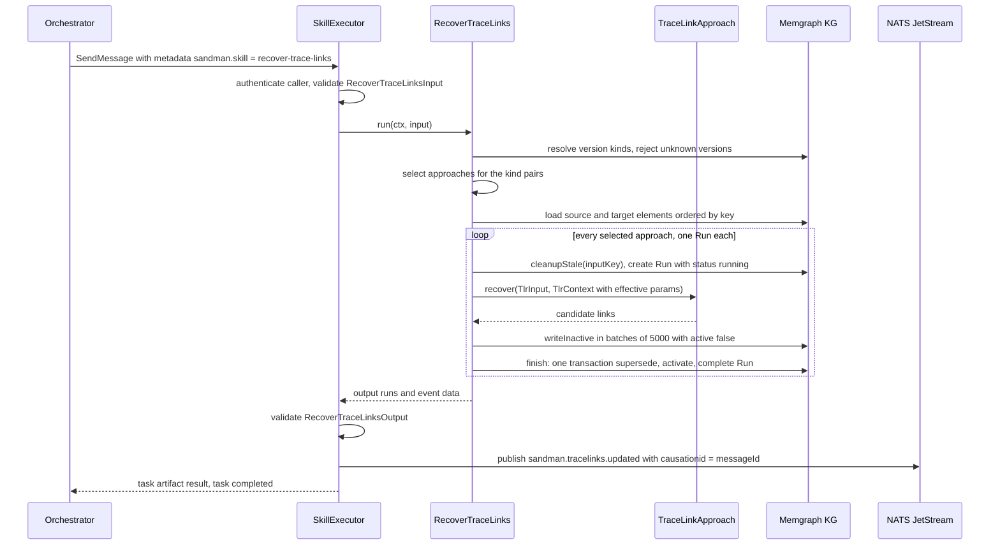
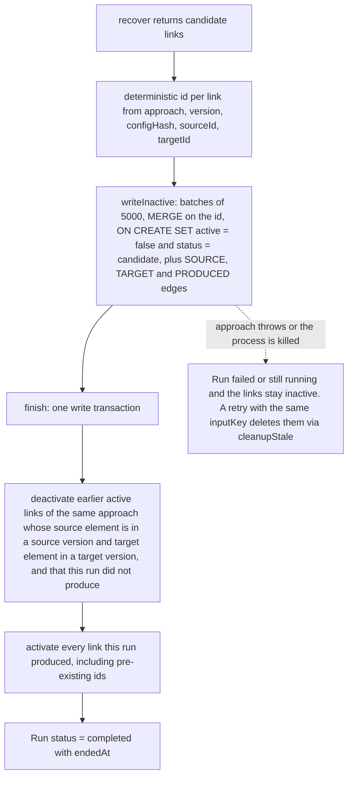

# TLR Agent (Trace-Link Recovery)

The **tlr-agent** (`sandman-tlr-agent`, Java 21 / Quarkus, port 8080) is the second SANDMAN agent: it runs pluggable trace-link recovery (TLR) approaches over the extracted elements of given artifact versions and persists the resulting candidate links with full provenance. Per the KG contract it is the **single writer of `TraceLink` nodes** (`contracts/kg/schema.yaml#L96-L112`) — the only co-owner is the extraction-agent, which writes `explicit-reference` links during extraction. It offers two surfaces on one Vert.x router:

- the A2A skill **`recover-trace-links`** (`contracts/agent-cards/tlr-agent.json`, JSON-RPC at `/a2a`, served by the shared `A2aServer`/`SkillExecutor` from `libs/java/agent-lib-a2a`), invoked by the orchestrator as the middle step of the analysis pipeline; and
- the **approach catalog** `GET /v1/approaches` (`contracts/openapi/tlr-agent.yaml`), a plain REST route — deliberately *not* an A2A skill, because a static list needs no task lifecycle (ADR-0012, [a2a-skills](/openwiki/concepts/a2a-skills.md)).

Java was chosen for this agent (ADR-0001) because its whole purpose is to run the Java research tools ArDoCo and LiSSA **in-process**; Quarkus is on the classpath only for the CDI-based `a2a-java` server. Note the fixed Java naming: the Maven module is `io.github.ardoco:sandman-tlr-agent` under the parent `io.github.ardoco:sandman-parent`, and all code lives in the package `edu.kit.kastel.mcse.ardoco.sandman.tlr` — ArDoCo's own Maven group and package namespace, so the planned in-process adapters share it.

| Responsibility | Where (all under `services/tlr-agent/src/main/java/edu/kit/kastel/mcse/ardoco/sandman/tlr/`) |
| --- | --- |
| Approach SPI: id, version, supported kind pairs, recover | `TraceLinkApproach`, `KindPair`, `CandidateLink`, `TlrInput`, `TlrContext` |
| Registry over `config/tlr/approaches.yaml` + ServiceLoader | `Approaches` |
| A2A skill `recover-trace-links` (one Run per approach, one event) | `RecoverTraceLinks` |
| KG access: element loading, inactive batch writes, final activation, startup deactivation | `LinkStore` |
| The M0 stub approach | `StubNameMatch` |
| REST catalog `GET /v1/approaches` | `ApproachesRoute` |
| Wiring: KG client, approaches bean, JetStream event sink, startup | `Beans` |

## The TraceLinkApproach SPI

In-process approaches implement `TraceLinkApproach` (`TraceLinkApproach.java#L6-L21`) and are discovered via `java.util.ServiceLoader`; a production implementation registers itself in `src/main/resources/META-INF/services/edu.kit.kastel.mcse.ardoco.sandman.tlr.TraceLinkApproach` (today only `StubNameMatch`):

```java
String id();                                  // stable, e.g. "stub-name-match"
String version();                             // enters link ids and Run.toolVersion
Set<KindPair> supports();                     // (source, target) artifact kinds this approach can link
List<CandidateLink> recover(TlrInput in, TlrContext ctx);
default boolean usesLlm() { return false; }   // true → LlmAccess is resolved for the project policy
```

- **`KindPair`** (`KindPair.java#L8-L18`) is the record `(source, target)` over the six `ArtifactKind` values of `common.schema.json` (`requirements`, `architecture-doc`, `architecture-model`, `code`, `test`, `other`); `KindPair.all()` is the full 6 × 6 = 36 combinations — what `stub-name-match` reports as `supports()`.
- **`CandidateLink`** (`sourceId`, `targetId`, `linkType`, `confidence`, `rationale`-or-null) is the raw approach output *before* ids/provenance are assigned — the owner computes ids and writes the KG.
- **`TlrInput`** (`projectId`, `sources`, `targets`) carries the elements of the given source and target versions, each list loaded **once** from the KG by `LinkStore.elements` and `ORDER BY key`. An `Element` entry has `id`, `key` (stable `artifactId#localKey`), `label` (the secondary KG label: `Requirement`, `TextUnit`, …), `kind`, `name`, `text` and the owning `artifactKind`.
- **`TlrContext`** (`TlrContext.java#L9-L11`) gives the approach per-run services: `LlmAccess` (**only** when `usesLlm()` is true — `null` otherwise), the `ArtifactStore` (`null` when no store is configured), a `cancelled` flag the approach should poll, a dedicated `Logger`, and `params` — the **effective parameters** (config defaults merged with per-request overrides). Approaches never touch the KG, NATS or ids themselves; they receive data and return candidates.

Adding an approach requires no change outside this module and `config/` (ADR-0012): implement the SPI, register it in the services file, add an `approaches.yaml` entry. The Maven enforcer still **bans LangChain4j** in this module (`pom.xml#L163-L172`) — it is admitted later only inside the ArDoCo/LiSSA adapter modules via an explicit exception.

## Enabling approaches: config/tlr/approaches.yaml

`Approaches` (`Approaches.java#L16-L66`) is a CDI-produced singleton built once at startup from the YAML file and the ServiceLoader-discovered implementations (`Beans.java#L49-L57`). The production file `config/tlr/approaches.yaml`:

```yaml
# config/tlr/approaches.yaml
approaches:
  stub-name-match: { enabled: true, params: { minTokenLength: 4, confidence: 0.5 } }
  lissa: { enabled: false, params: { retrieval: { k: 10 }, model: chat-default, embed: embed-default } }
  ardoco: { enabled: false, params: {} }
```

- An approach is **enabled only if its entry says `enabled: true`**; a ServiceLoader implementation without an entry is simply not enabled. Enabled entries keep their `params` object as configured defaults.
- `Approaches.effective(defaults, override)` computes the effective parameters: a deep copy of the configured defaults with the request's per-approach overrides applied **member-wise (shallow)** — a nested object from the request replaces the configured one entirely.
- `disabledIds()` collects exactly the ids configured with `enabled: false`. **Approaches absent from the file are untouched** — this is why the extraction-agent's `explicit-reference` links (no TLR approach at all) survive the startup deactivation.

### `lissa` and `ardoco` are disabled placeholders

Only `stub-name-match` is registered in the production services file. The **`lissa` and `ardoco` entries are placeholders for approaches that do not exist in this repository yet**: the ArDoCo/LiSSA integration is decided but not built — ADR-0015 (*ArDoCo integration*, status **proposed**) plans in-process pipelines with a pinned-commit build (`spikes/T0.12/bootstrap.sh` clones ArDoCo at `0d1f22b…` from `feature/make-inconsistency-great-again` and patches the `named-architecture-entity-recognition` version to the released 2.1.0), and open points (upstream changes, ArDoCo on the Quarkus classpath, the doc/model pairs to run) are the reason it stays `proposed`. Until those adapters land, `enabled: false` keeps the catalog honest and the startup deactivation removes any leftover links of those ids.

## The recover-trace-links skill

### Input and approach selection

`RecoverTraceLinks` (`RecoverTraceLinks.java#L32-L198`) is a `@Singleton` CDI bean implementing the shared `Skill` interface; its input validates against `contracts/skills.schema.json#/$defs/RecoverTraceLinksInput` (`#L107-L145`):

| Field | Meaning |
| --- | --- |
| `projectId` | required |
| `sourceVersionIds` / `targetVersionIds` | required, ≥ 1 each — which artifact versions to link |
| `approaches` | optional id list; **absent = every enabled approach whose `supports()` intersects the kind pairs of the given versions** |
| `params` | optional per-approach overrides keyed by approach id; enters `configHash` |

Selection happens in three steps (`run`, `#L54-L75`):

1. **Version kinds.** One KG read resolves every source and target version id to its artifact's `kind`. If any id is unknown *or belongs to another project*, the task fails with a non-retryable `INVALID_INPUT` ("unknown artifact versions in project …") — before anything is written and before any event is published.
2. **Kind pairs.** The cross product of source kinds × target kinds forms a `LinkedHashSet<KindPair>`.
3. **Approaches.** `select` (`#L160-L175`): with an explicit list, every id must name an *enabled* approach (unknown or disabled → `INVALID_INPUT`); without one, all enabled approaches whose `supports()` contains at least one of the pairs.

Note that these expected failures surface as `TASK_STATE_FAILED` with `sandman.error.code = INVALID_INPUT` (the `SkillExecutor` fails, not rejects, exceptions thrown inside a skill) — pinned by `unknownApproachAndUnknownVersionsAreInvalidInput`.

### One Run per approach



The skill run, end to end (`RecoverTraceLinks.java#L54-L158`). Cancellation is checked before each approach; the project's `llmPolicy` is read from the KG only when a selected approach `usesLlm()`.

Per approach (`runApproach`, `#L88-L158`) the agent:

1. computes **effective params** = configured defaults + `input.params[approach.id]` overrides, and `configHash = sha256Hex(JCS.canonicalize(params))` (RFC 8785 via `Jcs`, so key order in the YAML never matters);
2. computes `inputKey = sha256Hex(JCS.canonicalize({input, tool: approach.id, configHash}))` and calls **`RunRecorder.cleanupStale(inputKey)`** — facts of earlier `running`/`failed` runs with the same input key (links via their `PRODUCED` edge and `runId`) are deleted and those runs marked `failed`, so aborted attempts leave no garbage (`RunRecorder.java#L108-L118`);
3. **starts a `Run`** (`RunRecorder.java#L56-L82`): skill `recover-trace-links`, `tool` = approach id, `toolVersion` = approach version, the params JSON string, `configHash`, `inputKey`, `usedVersionIds` = the distinct source+target versions, `workflowId`, `a2aTaskId`, `triggeredBy` = the actor or `service:<caller>`, `replayMode` `live`;
4. builds the `TlrContext` — `LlmAccess.forPolicy(settings, llmPolicy)` only for `usesLlm()` approaches, an `ArtifactStore` only when `SANDMAN_ARTIFACT_STORE` is set, the cancellation flag, a logger named after the approach class, and the effective params;
5. iterates `approach.recover(in, ctx)`, assigning each candidate its **deterministic id** and collecting them in an id-keyed map (duplicates collapse);
6. writes the links inactive (`store.writeInactive`) and activates them in one final transaction (`store.finish`);
7. appends the run summary `{approach, approachVersion, runId, status, linkCount[, error]}` to the output.

### Deterministic identity: configHash and link ids

Two hashes make re-runs idempotent and results attributable (`RecoverTraceLinks.java#L99-L135`):

- **`configHash`** — sha256 of the JCS of the effective parameters. Per the schema's id convention (`contracts/kg/schema.yaml#L101`), the link id is

  ```
  tl_<sha256(approach ␟ approachVersion ␟ configHash ␟ sourceId ␟ targetId)[:32]>
  ```

  so the **configuration enters the link identity**: re-running the same approach/version/config on the same pair yields the *same node* (`MERGE` hits it, `ON CREATE SET` leaves it untouched), while changed parameters produce *new* ids — and the final transaction supersedes the old ones.
- **`inputKey`** — sha256 of the JCS of `{input, tool, configHash}`; a retry of the same task (e.g. after a publish failure) finds the same key, cleans up the interrupted run's facts and rebuilds them.

### Writing links: inactive batches, one activating transaction



The link write discipline (`LinkStore.java`) that implements the KG contract's `active_facts` rule (`contracts/kg/schema.yaml#L10`):

- **`writeInactive` (`#L52-L80`)** writes in batches of `BATCH_SIZE = 5_000`, each batch its own write. The Cypher `MERGE (x:TraceLink {id: l.id}) ON CREATE SET … x.status = 'candidate', x.active = false, x.runId = $runId …` plus `MERGE (x)-[:SOURCE]->(s)`, `MERGE (x)-[:TARGET]->(t)`, `MERGE (r)-[:PRODUCED]->(x)` — existing links with the same id are **kept as they are** (only the edges are re-merged), and links whose endpoints no longer exist are silently skipped by the `MATCH`.
- **`finish` (`#L82-L110`)** is the run's **single final transaction**: it first deactivates every *earlier* active link of the same approach whose `SOURCE` element hangs under one of the run's source versions and whose `TARGET` element under one of the target versions — **unless this run (re)produced it** (`NOT (r)-[:PRODUCED]->(old)`); then it activates **all** links the run produced (also pre-existing ids, which is why a re-run of identical input keeps them active); then it sets the `Run` to `completed` with `endedAt`. Because activation is the last, atomic step, **readers only ever see active links** — detection, the console, exports and NL queries never observe a half-applied run and never need to check `Run.status` ([knowledge-graph](/openwiki/architecture/knowledge-graph.md)).
- **`deactivate` (`#L112-L117`)** runs at startup: all active links whose `approach` is in `disabledIds()` are set inactive, so switching an approach off in `approaches.yaml` cannot leave its old results visible.

The supersede step matches *any* version and *any* `configHash` of the same approach between the same source/target versions — exactly the "changed parameters leave only the new links active" semantics. Links on other versions stay untouched (history is preserved; "current" is a read-side notion).

### Failures, retries and cancellation

- **Failure isolation** (`#L149-L156`): a `RuntimeException` from one approach is caught per approach — its `Run` is marked `failed` with the error string (`RunRecorder.fail`), its run entry reports `status: "failed"`, `linkCount: 0` and the error, **its links stay inactive** (never activated), and the remaining approaches run normally. A later run with the same `inputKey` deletes those inactive leftovers via `cleanupStale`.
- **Event publish failure**: the KG is already committed when `SkillExecutor` publishes the completion event; a failure there ends the task as retryable `DEPENDENCY_UNAVAILABLE` and the retried task republishes (`SkillExecutor.java#L141-L169`).
- **Cancellation**: `ctx.cancelled()` is checked before each approach (`#L72-L75`) and the flag is handed to approaches through `TlrContext`; a task cancelled mid-run completes neither its result nor its event (the `SkillExecutor` drops the output for cancelled tasks), and any approach runs already finished remain committed — links already activated by a completed approach stay active, which is safe because each approach's activation is independent.

### Output and the single completion event

The skill output is `RecoverTraceLinksOutput` = `{runs: [...]}` where each run is `{approach, approachVersion, runId, status: completed|failed, linkCount, error?}` (`contracts/skills.schema.json#L146-L193`) — and the task publishes **exactly one** `sandman.tracelinks.updated` event for *all* runs, failed ones included (`RecoverTraceLinks.java#L78-L85`, payload `TracelinksUpdated` in `contracts/events.schema.json#L78-L89`): `projectId`, the echoed `sourceVersionIds`/`targetVersionIds`, and the same `runs` array. Per the A2A convention the event has `causationid` = the request's `messageId` and `correlationid` = the workflow id, and it is what tells the orchestrator the step is done ([a2a-skills](/openwiki/concepts/a2a-skills.md)).

## stub-name-match (the M0 approach)

`StubNameMatch` (`StubNameMatch.java#L12-L69`) is the deliberately trivial approach that exercises the whole path — SPI, registry, runs, batched writes, activation, event — for the walking skeleton:

- `id` = `stub-name-match`, `version` = `"1"`, `supports()` = all 36 kind pairs, no LLM.
- **Tokenization**: element names are split on camelCase boundaries and non-alphanumeric runs (`(?<=[\p{Ll}\p{N}])(?=\p{Lu})|(?<=\p{Lu})(?=\p{Lu}\p{Ll})|[^\p{L}\p{N}]+` — so `MediaCache.java` → `media`, `cache`, `java`, and `HTTPServer` → `http`, `server`), lowercased with `Locale.ROOT`, and tokens shorter than `minTokenLength` (config default 4) are dropped.
- **Linking**: for every source × target element pair (skipping identical ids), a non-empty token intersection produces a `CandidateLink` with `linkType = "relates"`, `confidence` from config (default 0.5) and a rationale listing the shared tokens.

Its parameters come from `approaches.yaml` (`minTokenLength: 4`, `confidence: 0.5`), and the same ids appear in `config/orchestrator/rules.yaml`'s kind pairs, so the orchestrator explicitly selects it.

## GET /v1/approaches

`ApproachesRoute` (`ApproachesRoute.java#L23-L52`) serves the catalog on the shared Vert.x router:

- **Auth**: a valid service bearer token is required — `server.authenticate(...)` returning null (missing token, unknown caller, plugin caller) answers **401** with `{"error":"missing or invalid token"}`; there is no unauthenticated variant.
- **Body**: `ListApproachesOutput` (`contracts/skills.schema.json#L194-L249`) — `{approaches: [{id, version, kindPairs: [{source, target}] sorted by source then target, usesLlm}]}`. Only **enabled** approaches appear; the disabled `lissa`/`ardoco` placeholders are absent (asserted by `approachesEndpointMatchesTheContract`).

The route is the counterpart of the inconsistency-agent's `GET /v1/detectors` and backs the manual `tlr` workflow and any future planner that needs to know which approaches exist before choosing one.

## Wiring, startup and operations

`Beans` (`Beans.java`) is the production CDI wiring:

| Setting | Meaning |
| --- | --- |
| `sandman.tlr.approaches-file` | Overrides the approaches file (tests point it at `src/test/resources/approaches.yaml`); default `<configDir>/tlr/approaches.yaml`, falling back to `<contractsDir>/../config/tlr/approaches.yaml` |
| `SANDMAN_CONFIG_DIR` | With compose `/config` → the file is `/config/tlr/approaches.yaml` |
| `SANDMAN_KG_URI` (+ user/password `*_FILE`) | Bolt URL, required by the `KgClient` producer (`settings.require("kgUri")`) |
| `SANDMAN_NATS_URL` | Required **lazily**: the JetStream `EventSink` opens the NATS connection on the first published event (`IllegalStateException` "cannot connect to NATS" on failure) |
| `SANDMAN_LLM_KEY` / `SANDMAN_LLM_LOCAL_KEY` / `SANDMAN_LLM_BASE_URL` / `SANDMAN_LLM_MODELS_FILE` | Resolved by `LlmAccess.forPolicy` **only when a selected approach `usesLlm()`** — the enabled stub does not, so the tlr-agent runs without ever touching its mounted LLM keys ([llm-gateway](/openwiki/integrations/llm-gateway.md)) |
| `SANDMAN_ARTIFACT_STORE` | Optional; when set, approaches get an `ArtifactStore` in their context |
| `SANDMAN_AGENT_CARD` | `contracts/agent-cards/tlr-agent.json` (set in the Dockerfile) |
| `SANDMAN_SERVICE_TOKEN_FILE`, `SANDMAN_SERVICE_VERIFY_FILE` | Own outbound token; caller→sha256 map for verifying callers |

On `StartupEvent` (`Beans.java#L85-L89`) the agent initializes the KG schema from `contracts/kg/init.cypher` (idempotent, statement by statement), deactivates the links of approaches disabled in the config, and logs `tlr-agent ready, approaches …, deactivated links of …`. The shared `A2aServer` adds `/healthz`, `/readyz` (both liveness-only today) and the authenticated `GET /v1/status`; the compose healthcheck curls `/readyz`.

Deployment (`deploy/docker-compose.yml#L138-L161`): 5 GB memory with `JAVA_TOOL_OPTIONS: -XX:MaxRAMPercentage=75`, the `internal` network only, `/config` read-only, `/logs`, and the artifact store mounted **read-only** at `/artifacts`; secrets `svc_token_tlr-agent`, `svc_tokens_verify`, `memgraph_password` and the two LLM virtual keys. The Dockerfile builds with Maven, copies `contracts/` to `/contracts`, sets `SANDMAN_CONTRACTS_DIR`/`SANDMAN_AGENT_CARD`, and runs as the non-root `sandman` user on port 8080.

## How the orchestrator calls it

The orchestrator is the only caller of the skill ([orchestrator](/openwiki/services/orchestrator.md)):

- On `extraction.completed`, for every kind pair configured in `config/orchestrator/rules.yaml` (`tlr.kindPairs`), `tlr_steps` (`services/orchestrator/src/sandman_orchestrator/rules.py#L117-L132`) builds one step per pair *side*: the changed versions of one kind against the current versions of the counterpart kind, with the pair's `approaches` list (`[stub-name-match]` for `requirements → code` and `architecture-doc → architecture-model` in the default config). Steps are debounced and coalesced per project; a per-project pipeline lock keeps extract → TLR → detect from overlapping.
- On `tracelinks.updated`, the next rule schedules `detect-inconsistencies` scoped to the artifacts of the event's source and target versions (`rules.py#L152-L154`) — the [inconsistency-agent](/openwiki/services/inconsistency-agent.md) then consumes **the active links of all approaches** from the KG (Q-20), so any approach that produces better links improves detection without adapter changes.
- Manual `tlr` workflows link all current versions per configured kind pair with the same approach lists.

The walking-skeleton e2e test (`tests/e2e/test_walking_skeleton.py#L148-L172`) pins the pipeline order (`extract-artifact-versions` → `recover-trace-links` → `detect-inconsistencies`) and that active links of both `explicit-reference` and `stub-name-match` exist after the first snapshot.

## Fixed Java naming

The module uses ArDoCo's own coordinates deliberately: Maven `io.github.ardoco:sandman-tlr-agent` (parent `io.github.ardoco:sandman-parent`, root `pom.xml#L7-L18`), packages `edu.kit.kastel.mcse.ardoco.sandman.tlr` (agent library: `…sandman.agent[.a2a]`). ADR-0001 chose this so ArDoCo — published as `io.github.ardoco` and packaged `edu.kit.kastel.mcse.ardoco.*` — plugs in in-process without a namespace seam; new classes in this service must follow it.

## Focused tests

All under `services/tlr-agent/src/test/java/…/tlr/` (Memgraph-backed `@QuarkusTest`s need Docker and self-skip otherwise; `TestBeans` starts a `memgraph/memgraph:3.13.1` testcontainer and records events with an in-memory `EventSink`):

- **`StubNameMatchTest`** — token splitting: camelCase, punctuation, acronyms (`HTTPServer` → `http`, `server`), short tokens dropped.
- **`RecoverTraceLinksTest`** — the contract behaviors end to end (`RecoverTraceLinksTest.java#L159-L379`):
  - `createsOneActiveLinkRunAndEvent`: seeded `Requirement "Cache media files"` × `CodeUnit MediaCache`/`UserDB` → exactly one active link with the expected deterministic id, one completed `Run` (`tool = stub-name-match`, `configHash` = the hash of the default params), and one valid `tracelinks.updated` with `causationid` = the request's `messageId`.
  - `defaultSelectionRunsAllEnabledApproachesAndIsolatesFailures`: with no `approaches` input, the stub completes while the test-only `test-failing` approach fails with its error — one event lists both runs (tests register `FailingApproach` via their own services file and `test-failing` in `src/test/resources/approaches.yaml`).
  - `sameInputTwiceKeepsOneActiveLink` and `changedParamsLeaveOnlyTheNewLinksActive`: idempotent re-runs keep the identical link ids active; a rerun with `confidence: 0.9` leaves exactly the new-config links active.
  - `linksOfAnInterruptedRunAreNeverActive`: links written by `writeInactive` without `finish` are never active, and `cleanupStale` on the same input key deletes them.
  - `writesInBatches`: `BATCH_SIZE + 1` links across two batches all activate in `finish`.
  - `unknownApproachAndUnknownVersionsAreInvalidInput`: `TASK_STATE_FAILED` with `INVALID_INPUT`, no event published.
  - `startupDeactivatesLinksOfDisabledApproachesOnly`: `lissa` links deactivated, `explicit-reference` and `stub-name-match` untouched.
  - `skillInvocationVectors`: the four `skillInvocation` conformance cases from `contracts/conformance/vectors.json` replay through the real Quarkus A2A endpoint (valid input accepted; missing skill / schema-invalid input / unknown skill rejected).
  - `approachesEndpointMatchesTheContract`: 401 without a token; the body validates as `ListApproachesOutput` with 36 kind pairs, `version: "1"`, `usesLlm: false`, and no `lissa` entry.

## Related pages

- [/openwiki/architecture/knowledge-graph.md](/openwiki/architecture/knowledge-graph.md) — the `TraceLink`/`Run` nodes, the `active_facts` write disciplines and the deterministic id conventions this agent implements.
- [/openwiki/concepts/a2a-skills.md](/openwiki/concepts/a2a-skills.md) — the invocation convention, the exactly-one completion-event rule and submit/poll/cancel.
- [/openwiki/integrations/llm-gateway.md](/openwiki/integrations/llm-gateway.md) — `LlmAccess`, logical routes and the `llmPolicy` rules that LLM approaches will run under.
- [/openwiki/services/inconsistency-agent.md](/openwiki/services/inconsistency-agent.md) — the consumer of the active links (and the parallel detector SPI design).
- [/openwiki/workflows/analysis-pipeline.md](/openwiki/workflows/analysis-pipeline.md) — how extraction, TLR and detection chain on events.
