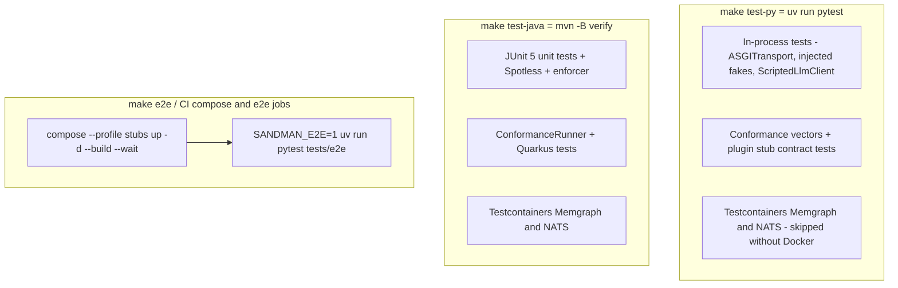
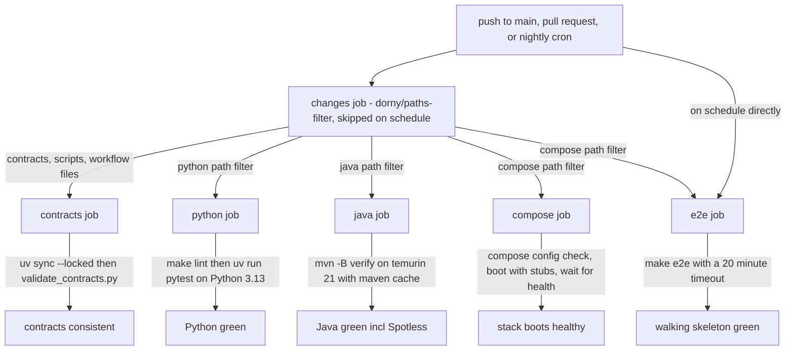

# Testing and CI

## Overview

SANDMAN is verified at five levels, each with a single documented entry point:

| Level | Entry point | What it proves |
|---|---|---|
| Static gates | `make lint`, `make guard` | No agent frameworks (NFR-3), formatting, strict typing |
| Contract validation | `make contracts` | `contracts/` is internally consistent and self-describing |
| In-process unit/REST tests | `make test-py`, `make test-java` | Behavior of every library, service and plugin, with no network |
| Container-backed integration tests | same targets (auto-skipped without Docker) | Real Memgraph/NATS semantics: read/write split, dedup, retries |
| Whole-system checks | CI `compose` job, `make e2e` | The composed stack boots healthy; the walking skeleton works end to end |

Two invariants hold across the whole suite. First, **unit tests never touch the network**: HTTP is exercised in-process through `httpx.ASGITransport` / `httpx.MockTransport` and injected transports, and LLM/event dependencies are scripted fakes. Second, **contract drift is a test failure**: conformance vectors are reproduced by *both* agent libraries, and REST responses are validated against the OpenAPI documents during tests.



*The test levels and the make targets that run them; container-backed tests live inside the language test suites and simply skip when no Docker daemon is reachable.*

## Make targets

From the [Makefile](repo://Makefile) (Python via `uv` only, Java via Maven only):

| Target | Command | Notes |
|---|---|---|
| `test` | `test-py test-java` | Both language suites |
| `test-py` | `uv run pytest` | Test collection comes from the root `pyproject.toml` (below) |
| `test-java` | `mvn -B verify` | Aggregator build incl. tests, Spotless and the enforcer |
| `lint` | `guard` + `uv run ruff check .` + `uv run ruff format --check .` + `uv run mypy libs/python` | `guard` runs first as a prerequisite; Java formatting is enforced inside `mvn verify` |
| `guard` | `grep -rEn --include='*.py' '^\s*(import\|from)\s+(langchain\|langgraph\|deepagents\|llama_index\|crewai\|autogen)\b' libs services` | Fails if an agent framework is imported anywhere under `libs/` or `services/` (NFR-3) |
| `contracts` | `uv run python scripts/validate_contracts.py` | Validates `contracts/` |
| `e2e` | depends on `secrets`, then `docker compose -f deploy/docker-compose.yml --profile stubs up -d --build --wait --wait-timeout 300`, then `SANDMAN_E2E=1 uv run pytest tests/e2e -q` | Walking skeleton; secrets are generated first and never overwritten |
| `backup` | `echo "not implemented (T5.3)"; exit 1` | Intentional placeholder |

The `compose`/`images` targets are not test targets, but the CI compose job reuses exactly the `--profile stubs up -d --build --wait --wait-timeout 300` invocation, so a healthy boot is checked on every relevant change.

## Static gates

### Python: guard, ruff, mypy

`make lint` is a merge gate composed of four checks ([pyproject.toml](repo://pyproject.toml#L60-L77)):

- **`make guard`** — the framework import grep. The `FRAMEWORKS` regex (`langchain|langgraph|deepagents|llama_index|crewai|autogen`) is applied to `libs` and `services` only; `tools/`, `tests/` and `spikes/` are out of scope.
- **`ruff check .`** — `line-length = 120`, `target-version = "py313"`, rules `E`, `F`, `I`, `B`, `UP`; `spikes/` is excluded because spike scripts are throwaway.
- **`ruff format --check .`** — formatting is enforced, not auto-fixed, in CI.
- **`mypy libs/python`** — `strict = true` for Python 3.13, but only over the library code.

### Java: Spotless and the enforcer (inside `mvn -B verify`)

`make test-java` is `mvn -B verify` over the aggregator [pom.xml](repo://pom.xml#L13-L18), whose modules are `libs/java/agent-lib`, `libs/java/agent-lib-a2a`, `services/tlr-agent` and `services/inconsistency-agent`. `verify` therefore *is* the formatting gate:

- **Spotless** runs `check` in the `verify` phase with `palantirJavaFormat` + `removeUnusedImports` — a formatting violation fails the build ([pom.xml](repo://pom.xml#L177-L195)).
- **maven-enforcer-plugin** requires Maven ≥ 3.9, Java ≥ 21, and bans `dev.langchain4j`, `org.springframework.ai` and `org.bsc.langgraph4j` — the Java counterpart of `make guard` ([pom.xml](repo://pom.xml#L147-L175)).
- Surefire runs JUnit 5 (`junit-bom` 5.14.4); testcontainers is managed by a BOM (2.0.5) and only a test dependency.

## Contract validation: `make contracts`

`scripts/validate_contracts.py` is the single validator for the whole `contracts/` directory ([scripts/validate_contracts.py](repo://scripts/validate_contracts.py#L56-L124)). In one pass it:

1. Validates `common.schema.json`, `skills.schema.json` and `events.schema.json` against the 2020-12 meta-schema.
2. **Re-implements** the conformance vector rules (stable ids, section keys, sentence keys, fingerprints, cassette keys via RFC 8785, event envelopes) and checks every `expected*` value — an independent self-check that the vector *specification* is self-consistent.
3. Resolves every Agent Card `params.skills` input/output `$ref` to an existing `$defs` entry.
4. Validates all OpenAPI documents with `openapi-spec-validator`.
5. Sanity-checks that `kg/schema.yaml` defines `nodes` and `relationships`.

All errors are collected and reported together; the exit code is 1 if any check fails. `scripts/test_validate_contracts.py` adds a pytest case that the repository's own contracts validate, plus a negative test that a corrupted schema or vector is actually reported (it is on `testpaths`, so `make test-py` covers it too). See [Contract-First Interfaces](/openwiki/architecture/contracts.md) for the contract families themselves.

## The pytest layout

Root [pyproject.toml](repo://pyproject.toml#L72-L77) configures pytest:

```toml
[tool.pytest.ini_options]
addopts = "--import-mode=importlib"
asyncio_mode = "auto"
asyncio_default_fixture_loop_scope = "function"
pythonpath = ["scripts"]
testpaths = ["libs/python", "services", "tools", "tests/plugin-stubs", "tests/conformance", "scripts"]
```

Consequences worth knowing:

- **Everything is collected by one command.** `uv run pytest` runs library tests (`libs/python`), all Python services (`services`), the CLI (`tools`), the plugin stubs (`tests/plugin-stubs`), the conformance suite (`tests/conformance`) and the contract validator's own tests (`scripts`, importable because of `pythonpath = ["scripts"]`). The e2e directory is deliberately *not* on `testpaths` — it runs only under `SANDMAN_E2E=1` via `make e2e`.
- **`asyncio_mode = "auto"`** means `async def test_*` functions need no `@pytest.mark.asyncio` decorator; fixtures use the function scope loop.
- **`--import-mode=importlib`** means `tests/` directories are not put on `sys.path`. Test helper modules (`fakes.py`, `helpers.py`) are therefore imported with an explicit `sys.path.insert` in the service `conftest.py` files — a pattern you must follow when adding shared test helpers.
- Dev dependencies pin the toolchain: `ruff==0.16.10`, `mypy==2.4.0`, `pytest==9.1.1`, `pytest-asyncio>=1.4.0`, `testcontainers>=4.15.0`. A separate `contracts` dependency group (jsonschema, referencing, rfc8785, openapi-spec-validator, pyyaml) is included by `dev` and can be synced alone (`uv sync --group contracts`) to run `scripts/validate_contracts.py` without any test tooling.

### What lives where

| Suite | Focus |
|---|---|
| `libs/python/sandman-agent/tests/` | Library units (`test_units.py`), A2A round trips over `ASGITransport` (`test_a2a.py`), plugin-mode client (`test_plugins.py`), real-container integration (`test_integration.py`) |
| `services/orchestrator/tests/` | Rules (`test_rules.py`), executor against fake A2A agents (`test_executor.py`), REST validated against `orchestrator.yaml` (`test_rest.py`), real NATS JetStream (`test_nats.py`) |
| `services/extraction-agent/tests/` | Ingestion + extraction against Testcontainers Memgraph/NATS with an in-process fake plugin |
| `services/query-service/tests/` | API/authz/console with an injected fake reader and fake owner services; a real-Memgraph suite (`test_memgraph.py`); the Cypher guard corpus (`test_guard.py`) |
| `services/llm-replay/tests/` | Record/replay proxy behavior and the `cassetteKey` vectors |
| `tools/cli/tests/` | Manifest/kind-rule logic and `ingest` against a `MockTransport` server |
| `tests/conformance/` | The shared vectors, run through the Python library |
| `tests/plugin-stubs/tests/` | Contract tests for the reference plugin stubs |

## Test design patterns

### No network: in-process HTTP

Every HTTP surface is a plain ASGI/Starlette/FastAPI app built by a `create_app(...)`-style factory that accepts injected transports and collaborators, so tests drive them with `httpx.ASGITransport`:

- `A2aClient` and `A2aPluginClient` take an optional `httpx.AsyncBaseTransport` ([plugins.py](repo://libs/python/sandman-agent/src/sandman_agent/plugins.py#L24-L37)), so a served agent is tested in-process: `A2aPluginClient("http://plugin-stubs:8000", "inbound", CONTRACTS, poll=(0.01, 0.05), transport=httpx.ASGITransport(app=app))`.
- Outbound dependencies are stubbed with `httpx.MockTransport`: the CLI tests fake the query-service, the detect plugin tests fake the query-service (and record the requests it received), the llm-replay tests fake the upstream gateway.
- The orchestrator tests go one step further with a host-routing `Router(httpx.AsyncBaseTransport)` that dispatches by request host to whichever app instance is currently registered — which lets a test "restart" an agent by swapping the app ([fakes.py](repo://services/orchestrator/tests/fakes.py#L107-L115)).

### Injected readers, owners, plugins, LLMs

`sandman_agent.testing` ships the shared fakes ([testing.py](repo://libs/python/sandman-agent/src/sandman_agent/testing.py#L14-L53)):

- `ScriptedLlmClient` — returns queued `ChatResponse`s / embeddings in order and records every request, so LLM-dependent code is deterministic and assertion-friendly.
- `InMemoryEventBus` — an `EventSink` that validates and stores published events, so tests assert "exactly one event, published before completion".

Service suites build on this: the orchestrator's `Env` wires `FakeSkill` (scripted `ok` / `hang` / `SkillError` behaviors), `FakeGraph` (canned versions), a `Bus(InMemoryEventBus)` that delivers published events straight into the orchestrator's consumer handler, and fast `Rules` with 5-second timeouts; the query-service's `build_env` injects a `FakeReader` (canned Cypher results, recorded queries, an optional gate to block `run()`) and a `FakeOwner` ASGI app standing in for extraction-agent/inconsistency-agent/orchestrator, plus a cheap argon2 hasher; the extraction-agent's `env` fixture injects a `FakePlugin` through `serve()` and a `plugin_transport`.

### Contract-checked responses

REST tests validate response bodies against the OpenAPI contracts as they go: `helpers.validate(path, method, status, body)` in the query-service builds a `Draft202012Validator` from the operation's response schema in `query-service.yaml` (with a `referencing` registry resolving cross-file `$ref`s into `contracts/`); the orchestrator (`test_rest.py`) and extraction-agent (`openapi_validate`) do the same against their specs. An OpenAPI change that breaks a response is therefore caught in the language test suite, not in review.

### Testcontainers: real Memgraph and NATS

Integration tests boot the real infrastructure and **skip cleanly without Docker**:

- **Python** (`libs/python/sandman-agent/tests/test_integration.py`, `services/extraction-agent/tests/conftest.py`, `services/query-service/tests/conftest.py`): a `_docker_available()` probe pings the Docker daemon; whole modules use `pytestmark = pytest.mark.skipif(...)`, session-scoped fixtures call `pytest.skip(...)` inside the fixture. Containers: `memgraph/memgraph:3.13.1` with `--telemetry-enabled=false` on port 7687, and `nats:2.15.0-alpine` with `-js` on 4222 (the orchestrator's JetStream test uses `nats:2.10`). Readiness is a bolt/NATS ping retried for up to 60 s in 0.5 s steps.
- **Java** (`libs/java/.../IntegrationTest.java`): `@Testcontainers(disabledWithoutDocker = true)` with `@Container` `GenericContainer`s for the same Memgraph/NATS images, using `Wait.forListeningPort()` and `Wait.forLogMessage(".*Server is ready.*", 1)`.
- **Java under Quarkus** (`services/tlr-agent`, `services/inconsistency-agent`): `@EnabledIf("...Docker#available")` instead, because Quarkus replaces the context class loader, which breaks Testcontainers' ServiceLoader lookup — [Docker.java](repo://services/inconsistency-agent/src/test/java/edu/kit/kastel/mcse/ardoco/sandman/inconsistency/Docker.java#L10-L21) temporarily restores the right loader around `isDockerAvailable()`. `TestKg` holds a static shared Memgraph container with fixture helpers that seed projects/artifacts/elements.

These tests pin the non-fakeable invariants: the read transaction rejects writes (and nothing is created), `init_schema` is idempotent, `RunRecorder.cleanup_stale` drops only facts of unfinished runs (marking their runs `failed`), the Memgraph memory-limit error is *not* retried (asserted to surface in under 5 s), and event publish/consume round-trips with `Nats-Msg-Id` deduplication (publishing the same `event_id` twice yields one delivered message and one stream message). The orchestrator additionally runs the consumer against a real JetStream container and asserts a duplicate publication is delivered exactly once ([test_nats.py](repo://services/orchestrator/tests/test_nats.py#L16-L37)).

## Cross-language conformance

`contracts/conformance/vectors.json` is the parity oracle between the Python and Java agent libraries. Who checks what:

| Vector group | Checked by | Mechanism |
|---|---|---|
| `stableId`, `sectionKey`, `sentenceKey`, `fingerprint` (+ `expectedInconsistencyId`), `eventEnvelope` | Python `run_conformance` ([testing.py](repo://libs/python/sandman-agent/src/sandman_agent/testing.py#L56-L79)) via [tests/conformance/test_python_conformance.py](repo://tests/conformance/test_python_conformance.py); Java `ConformanceRunner` via [ConformanceTest.java](repo://libs/java/agent-lib/src/test/java/edu/kit/kastel/mcse/ardoco/sandman/agent/ConformanceTest.java) | Pure functions + JSON Schema validation, no containers. Both runners return a list of failure descriptions and the tests assert it is empty |
| `skillInvocation` (4 cases) | Needs a *served* skill: Python `test_a2a.py::test_skill_invocation_vectors` (parametrized straight from the vectors file, in-process `serve()`), Java `A2aServerTest.skillInvocationVectors` (`@QuarkusTest` test agent) | Asserts the task state / `SkillError` code for valid, missing-metadata, schema-invalid and unknown-skill messages |
| `cassetteKey` | **Only** `services/llm-replay` — `test_app.py::test_vectors` asserts the RFC 8785 canonical form and the derived key | The libraries deliberately do not implement cassette keys (ADR-0010 D-3) |

`run_conformance`/`ConformanceRunner` intentionally do **not** re-implement the rules: they call the library's own `Ids`/`ids` functions, so a drift in either language breaks that language's CI job. Adding a vector case is therefore the way to pin a new cross-language rule — both suites pick it up automatically.

## The plugin-stub contract tests

`tests/plugin-stubs` is a uv workspace member (`sandman-plugin-stubs`) that contains the **reference plugin** used by both the walking skeleton and plugin authors ([concepts/plugins.md](/openwiki/concepts/plugins.md)). `app.py` implements:

- **A2A extract stub** (port 8000): `serve()` in plugin mode with the extract Agent Card and `SANDMAN_PLUGIN_INBOUND_TOKEN`; the `Extract` skill does regex class extraction (`CodeUnit`/`TestCase` elements keyed by qualified name), `DEPENDS_ON` relations resolved across `context.currentArtifacts`, and `REQ-\d+` explicit references from comments — reading files only via absolute `storagePath` values inside the artifact store.
- **Plain-HTTP detect stub** (port 8001, FastAPI per `contracts/openapi/plugin-http.yaml`): `GET /healthz` (public), `GET /manifest` and `POST /v1/detect` guarded by the inbound token, body validated against `PluginDetectInput`, a `queryServiceUrl` hint that must match the configured query-service origin, one outbound `POST /v1/query/cypher` with the plugin's *own* outbound token, and `503` problem+json when the query-service fails.

`__main__.py` serves both in one process (8000 + 8001), which is exactly what the compose `plugin-stubs` service (profile `stubs`) runs.

[test_stubs.py](repo://tests/plugin-stubs/tests/test_stubs.py) is the contract test suite for that behavior, and a template for testing real plugins:

- **A2A side, through the real owner client**: `plugin_client()` builds the stub app and calls it with `A2aPluginClient` over `ASGITransport` — the same client the extraction-agent uses. Tests pin element/relation/reference extraction of the `mini` fixture, import resolution via current artifacts, non-retryable `PluginError` for paths outside (or relative to, or unreadable in) the artifact store, and that `/healthz` and the agent card are public.
- **HTTP side, with a faked query-service**: a `MockTransport` records the requests the plugin made, so tests can assert the plugin sent `Bearer outbound` (its own service token), a `projectId`-anchored `COUNT` query, and that a foreign `queryServiceUrl` is rejected with `400` *without any outbound call*; auth tests assert `401` for missing/wrong/non-ASCII tokens and `400` problem+json for malformed or schema-invalid bodies; `SANDMAN_QUERY_SERVICE_URL` overrides the configured origin.

The suite reuses the e2e fixture (`tests/e2e/fixtures/mini/s1`), so the stub tests, the CLI manifest tests and the walking skeleton all exercise the same files.

## The e2e walking skeleton

`tests/e2e/test_walking_skeleton.py` is the whole-system test. Mechanics ([test_walking_skeleton.py](repo://tests/e2e/test_walking_skeleton.py#L1-L30)):

- **Gated**: `pytestmark = pytest.mark.skipif(not os.environ.get("SANDMAN_E2E"), ...)` — it never runs as part of `uv run pytest`, only under `make e2e` (which sets `SANDMAN_E2E=1` after booting the stack) or manually with the stack already up.
- **Environment**: `SANDMAN_E2E_URL` (default `http://127.0.0.1:8080`), admin password from `SANDMAN_E2E_ADMIN_PASSWORD` or `$SANDMAN_E2E_SECRETS/admin_bootstrap_password` (secrets dir default `deploy/secrets`), and the post-change password from `SANDMAN_E2E_ADMIN_NEW_PASSWORD` or `e2e_admin_password` — both generated by `deploy/gen-secrets.sh`.
- **Isolated per run**: a module-scoped `stack` fixture first asserts `GET /readyz` is 200, then creates a fresh project `e2e-<hex>`, walks the admin through the console (login → forced password change → personal API token), and provisions `alice` (maintainer), `bob` (triager) and `carol` (viewer) with per-user tokens.

The single test then drives the full pipeline against `tests/e2e/fixtures/mini`:

1. **Snapshot 1 via the real CLI**: `Stack.ingest` shells out to `sandman_cli.__main__.main(["ingest", ...])` with alice's token and asserts the printed `Ingestion` (6 created versions). It waits (2 s polls, 240 s deadline) for a workflow and asserts its steps are exactly `extraction-agent/extract-artifact-versions`, `tlr-agent/recover-trace-links`, `inconsistency-agent/detect-inconsistencies`, all `SUCCEEDED`.
2. **KG content**: the three requirements exist; `MediaCache` is a `CodeUnit`; run tools include `code-extractor`, `stub-name-match` and `stub-untraced,detect-stub` (the detector run records its tools comma-joined); trace links exist for the `explicit-reference` and `stub-name-match` approaches; the two unlinked requirements are `OPEN` `untraced-requirement` inconsistencies.
3. **Triage and authorization**: carol's transition is `403`, a stale `expectedStatus` is `409`, bob's valid transition succeeds → `DEFERRED`.
4. **Read isolation**: carol can run a `projectId`-anchored count (3) but an unanchored query is `422`, and another project is `403`/`404`.
5. **Exports**: the trace-link CSV export contains both approaches.
6. **Incremental semantics**: snapshot 2 (one changed, one deleted file) yields 1 created + 1 deleted version; re-sending it unchanged creates/reactivates/deletes nothing and triggers *no* workflow; REQ-2 becomes `RESOLVED` with `verification: confirmed` and a `system:stub-untraced` history actor; reverting to snapshot 1 reactivates 2 versions and moves REQ-2 to `REOPENED` while REQ-3 stays `DEFERRED`.

Because the stubs implement the plugin contracts, this one test verifies ingestion, orchestration rules, A2A skill invocation, both plugin transports, KG writes, query-service authz, the inconsistency lifecycle and the CLI — the reason the CI runs it nightly and on every compose-relevant change.

## The CI pipeline

[.github/workflows/ci.yml](repo://.github/workflows/ci.yml) triggers on pushes to `main`, all pull requests and a nightly schedule (`cron: "0 3 * * *"`) with `permissions: contents: read`.



*The path-filtered CI pipeline: the `changes` job computes the filters once; the `e2e` job additionally runs unconditionally on the nightly schedule.*

### The `changes` job

Skipped on schedule (`if: github.event_name != 'schedule'`). It runs `dorny/paths-filter@v4` and exports four outputs. The filters encode the dependency graph:

| Output | Matches |
|---|---|
| `contracts` | `contracts/**`, `scripts/**`, `.github/workflows/**` |
| `python` | `contracts/**`, `libs/python/**`, the Python services, `tools/**`, `tests/plugin-stubs/**`, `scripts/**`, `pyproject.toml`, `uv.lock`, `.github/workflows/**` |
| `java` | `contracts/**`, `libs/java/**`, `services/tlr-agent/**`, `services/inconsistency-agent/**`, `pom.xml`, `.github/workflows/**` |
| `compose` | `deploy/**`, `services/**`, `libs/**`, `contracts/**`, `config/**`, `tools/**`, `tests/plugin-stubs/**`, `tests/e2e/**`, `pom.xml`, `pyproject.toml`, `uv.lock`, `.github/workflows/**` |

Both language filters include `contracts/**`, which is what makes the conformance vectors run in both jobs whenever the shared contracts change.

### Language jobs

- **`contracts`** — checkout, `astral-sh/setup-uv@v10` with Python 3.13, `uv sync --locked`, then `uv run python scripts/validate_contracts.py`.
- **`python`** — same setup, then `make lint` and `uv run pytest`. Note the job runs the make target, so the guard grep, ruff and mypy all gate the merge.
- **`java`** — `actions/setup-java@v6` (temurin 21, `cache: maven`), then `mvn -B verify`.

### The `compose` job

Two steps ([ci.yml](repo://.github/workflows/ci.yml#L104-L128)):

1. **`docker compose config` with generated secrets**: `deploy/` is copied into a fresh `mktemp -d` directory, `./gen-secrets.sh` runs there, and `docker compose config -q` is checked for the profile combinations `""` and `"--profile stubs --profile obs --profile local-llm"`, plus the `docker-compose.yml` + `docker-compose.dev.yml` overlay. Copying to a temp dir keeps generated secrets out of the workspace.
2. **Build, start, wait for health**: `deploy/gen-secrets.sh` again in the real tree, then `docker compose -f deploy/docker-compose.yml --profile stubs up -d --build --wait --wait-timeout 300` — the same invocation as `make e2e`'s boot step. `--wait` makes compose block until every health check passes (services define healthchecks, e.g. the Python `readyz` probe and Memgraph's `mgconsole` query).

On failure the job dumps the last 200 log lines per service; regardless of outcome it runs `docker compose ... down -v` so volumes never leak between runs.

### The `e2e` job

Runs when `!cancelled() && (github.event_name == 'schedule' || needs.changes.outputs.compose == 'true')` — i.e. nightly plus any PR matching the `compose` filter. It has `timeout-minutes: 20`, checks out, sets up uv, `uv sync --locked`, and runs **`make e2e`** (which regenerates secrets, boots the stubs stack and runs the walking skeleton). On failure it dumps 300 log lines per service; it always tears down with `down -v`.

### Other workflows

`.github/workflows/openwiki-update.yml` is a separate scheduled/dispatch workflow that regenerates this wiki and opens a pull request; it is documentation tooling, not a system test, and does not gate merges.

## Operational notes and failure modes

- **"My tests silently passed"**: if no Docker daemon is reachable, all container-backed tests *skip*. CI runners have Docker, so the compose/e2e jobs are the backstop; locally, check for the skip summary before trusting a green run.
- **Formatting failures look like build failures**: Java formatting errors surface as Spotless `check` failures during `mvn verify` (run `spotless:apply` locally); Python formatting as `ruff format --check` (run `uv run ruff format .`).
- **A new shared vector case** must be reproduced by both libraries and by `scripts/validate_contracts.py`'s self-check; adding a case without updating an implementation turns that language's job red.
- **e2e flakiness**: the walking skeleton waits up to 240 s per workflow and 300 s for stack health; if it fails, the job's log dump is the first place to look (the failure step prints which service was unhealthy or which assertion broke).
- **Secrets in CI**: both compose-related jobs generate secrets into a temp copy or the workspace and never commit them; `gen-secrets.sh` never overwrites existing files, which is why `make e2e` can be re-run.

## Related pages

- [Agent Libraries](/openwiki/architecture/agent-libraries.md) — what the conformance suites are checking, per library.
- [Contract-First Interfaces](/openwiki/architecture/contracts.md) — the contract files and the validation pipeline this page runs.
- [Plugin System](/openwiki/concepts/plugins.md) — the plugin contracts the stubs implement and how to test a real plugin against them.
- [Deployment](/openwiki/operations/deployment.md) — the compose file, profiles and secrets generation the compose/e2e jobs exercise.
- [Analysis Pipeline](/openwiki/workflows/analysis-pipeline.md) — the workflow the e2e test observes end to end.
