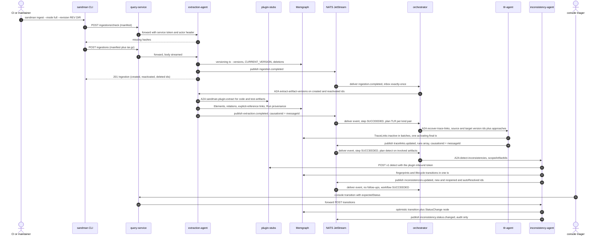

# End-to-End Analysis Pipeline

SANDMAN's core loop is a **chain of reactions to one ingestion**: a user (or CI) uploads a project snapshot through the CLI, the extraction-agent turns it into artifact versions and publishes `sandman.ingestion.completed`, and from there the orchestrator drives the three analysis agents step by step — extraction (`extract-artifact-versions`), trace-link recovery (`recover-trace-links`), inconsistency detection (`detect-inconsistencies`) — each step triggered by the completion event of the previous one, until `sandman.inconsistencies.updated` closes the workflow. Users then triage findings through the console, and later ingestions auto-resolve or reopen them through the same chain.

This page documents the pipeline **as a cross-service flow**: the event-to-step rule table ([rules.py](repo://services/orchestrator/src/sandman_orchestrator/rules.py), Stage 1 §6), how steps complete and how late or duplicate events are handled, the per-project pipeline lock, the manual trigger types, and the walking-skeleton e2e test (`tests/e2e/test_walking_skeleton.py`, Stage 2 §5) that proves the entire chain against a running stack. Service internals live on their own pages; this page connects them.

The key design fact (ADR-0003, ADR-0006): **events are the only signal the orchestrator chains steps on**, and the chaining rules are deterministic code, not an LLM. That makes the whole pipeline reproducible — the same ingestion produces the same workflow — and unit-testable without containers.

## The chain in one picture

*The walking-skeleton chain as wired by `deploy/docker-compose.yml` and exercised by `tests/e2e/test_walking_skeleton.py`: one CLI ingestion becomes one workflow of chained steps; user triage afterwards publishes an audit-only event that triggers no further steps.*

Three transports cooperate: **REST** for the user-facing intake (CLI → query-service → extraction-agent, and console → query-service → inconsistency-agent triage), **A2A** for commands from the orchestrator to the agents, and **NATS JetStream** for the domain events that carry the chain forward ([System Overview](/openwiki/architecture/system-overview.md), [Event Bus](/openwiki/concepts/event-bus.md)). The workflow id travels with the chain as `correlationid` (event) / `sandman.workflowId` (A2A metadata); each completion event carries `causationid` = the `messageId` of the A2A request that started the task ([events.schema.json](repo://contracts/events.schema.json#L28)).

## The event-to-step rule table

The rules are **fixed in code** in [`plan()`](repo://services/orchestrator/src/sandman_orchestrator/rules.py#L135-L155) (Stage 1 §6); `config/orchestrator/rules.yaml` tunes only timings, limits and the TLR kind pairs. Steps are routed to agents by the constant `SKILL_AGENT` map ([rules.py](repo://services/orchestrator/src/sandman_orchestrator/rules.py#L12-L14)):

| Skill | Agent |
| --- | --- |
| `extract-artifact-versions` | `extraction-agent` |
| `recover-trace-links` | `tlr-agent` |
| `detect-inconsistencies` | `inconsistency-agent` |

| Event | Planned steps |
| --- | --- |
| `sandman.ingestion.completed` | `extract-artifact-versions` on `createdVersionIds ∪ reactivatedVersionIds` (reactivated versions — reverts, re-added files — are handled exactly like created ones); this step is **not** debounced and starts as soon as its project lock frees. Additionally, whenever `deletedArtifactIds` is non-empty — deletion-only *or* mixed ingestions — a mergeable `detect-inconsistencies` scoped to the deleted artifacts, so their findings resolve ([rules.py](repo://services/orchestrator/src/sandman_orchestrator/rules.py#L138-L145)). |
| `sandman.extraction.completed` | Resolve the changed version ids to artifacts/kinds with a read-only KG query; for each configured kind pair, `recover-trace-links` over **changed × counterpart current** versions in both directions, with the pair's `approaches` ([`tlr_steps`](repo://services/orchestrator/src/sandman_orchestrator/rules.py#L117-L132)); every changed version no pair covers additionally triggers a mergeable `detect-inconsistencies` on its artifact — so a project whose kinds have no configured pair still gets detection ([rules.py](repo://services/orchestrator/src/sandman_orchestrator/rules.py#L146-L151)). |
| `sandman.tracelinks.updated` | One mergeable `detect-inconsistencies` on the artifacts of the source **and** target versions (resolved via KG read) — detection re-checks whole artifacts even though the event lists version ids ([rules.py](repo://services/orchestrator/src/sandman_orchestrator/rules.py#L152-L154)). |
| `sandman.inconsistencies.updated` | Nothing — this completion event closes the pipeline's last step and the workflow ends. |
| `sandman.inconsistency.status.changed` | Nothing; audit only (logged with the event data). |
| *(no event)* | An ingestion that changed nothing publishes no event at all, so nothing is planned — see below. |

Two structural invariants come with the table:

- **Detection scope is always a set of artifact ids.** The rule fires on what *changed* (version ids), but detection re-checks whole artifacts; the orchestrator's only KG access is the read-only `Graph` protocol (`versions`, `current`) implemented by `KgGraph` over read transactions ([rules.py](repo://services/orchestrator/src/sandman_orchestrator/rules.py#L80-L106)).
- **The TLR kind pairs are configuration.** [rules.yaml](repo://config/orchestrator/rules.yaml) ships `requirements ↔ code` and `architecture-doc ↔ architecture-model`, each with `approaches: [stub-name-match]`. Without a matching pair, `extraction.completed` plans only detection for the changed artifacts.

### The chain's starting gate: an ingestion must change something

`sandman.ingestion.completed` is published **only when the ingestion changed the current state** — at least one created, reactivated or deleted item ([events.schema.json](repo://contracts/events.schema.json#L46-L49)). The extraction-agent implements this with an `eventPublished` flag initialized to `true` when nothing changed, a deterministic event id (`uuid5` of the ingestion id, so JetStream dedupes re-publishes), and a re-publish of still-pending events at startup and before every intake ([ingest.py](repo://services/extraction-agent/src/sandman_extraction/ingest.py#L245-L262)). An unchanged snapshot therefore triggers **no workflow at all** — the property CI relies on (a push of unchanged files does no work) and the e2e test asserts explicitly.

## Step completion: events, not polls — and late or duplicate events

Each of the three agents publishes **exactly one completion event per A2A task**, after its output was validated and before the task completes, with `causationid` = the request `messageId` ([a2a.py](repo://libs/python/sandman-agent/src/sandman_agent/a2a.py#L215-L232)). The orchestrator exploits this:

1. **`messageId` before `SendMessage`.** `_start` picks a fresh `messageId`, and in one SQLite transaction inserts the `messages` row and flips the step to `RUNNING` *before* the A2A call — so a completion event that arrives before the HTTP response still finds its step ([orchestrator.py](repo://services/orchestrator/src/sandman_orchestrator/orchestrator.py#L336-L348)).
2. **`_complete` closes the step on the event.** The `causationid` is joined against `messages.message_id`; the matching step becomes `SUCCEEDED` with **the event payload as `result_json`**, the workflow status is recomputed, and the planned follow-up specs are appended **to the same workflow** ([orchestrator.py](repo://services/orchestrator/src/sandman_orchestrator/orchestrator.py#L122-L144)). A2A `GetTask` polling only detects failures, rejections, cancellation and timeouts — polling never marks success.
3. **Late or duplicate completion events are inert.** A completion event for a step that is no longer `PENDING`/`RUNNING` is logged ("completion event for finished step ignored") and returns a sentinel that **suppresses all follow-ups** — a redelivered `extraction.completed` must not re-plan TLR and detection. A completion event whose `causationid` matches no stored message (no step claims it) is instead treated like any fresh event: the planned steps start a *new* workflow. Manual workflows of type `extract`, `tlr` or `detect` are single-step by design, so their completion also suppresses follow-ups; only manual `full` chains through the normal event rules.
4. **Intake is exactly-once.** `handle` writes the `inbox` row (keyed by event id, `processed_at` set) and the resulting steps in **one transaction**; a redelivered event whose inbox row is already processed returns immediately ([orchestrator.py](repo://services/orchestrator/src/sandman_orchestrator/orchestrator.py#L97-L120)). On top of that, the consumer contract (`max_deliver` 5) parks contract-invalid events immediately and events that keep failing on their **fifth** delivery in `dead_events`, from which an operator can replay them via `POST /v1/dead-events/{eventId}/replay` ([orchestrator.py](repo://services/orchestrator/src/sandman_orchestrator/orchestrator.py#L82-L95), [app.py](repo://services/orchestrator/src/sandman_orchestrator/app.py#L159-L170)).

## Sequencing: the per-project pipeline lock, debounce and dedup

The chain must not interleave: detection must never run on half-written links, and the three agents of one project must not write the KG concurrently. The executor enforces this in every `tick` ([orchestrator.py](repo://services/orchestrator/src/sandman_orchestrator/orchestrator.py#L304-L334)):

- **Per-project pipeline lock.** At most one step of a project is `RUNNING` at any time; a step waiting for its retry **keeps** the lock (it is `PENDING` with attempts > 0 and blocks its project). Projects run in parallel against each other. This is the invariant that makes `extract → tlr → detect` strictly sequential per project (ADR-0006 amendment).
- **Global per-agent cap.** `maxConcurrentPerAgent` (2 by default) bounds in-flight tasks per agent across all projects.

Triggers that arrive while a project is busy do not queue up one-for-one; they are **debounced and coalesced** ([rules.py](repo://services/orchestrator/src/sandman_orchestrator/rules.py#L158-L168), [orchestrator.py](repo://services/orchestrator/src/sandman_orchestrator/orchestrator.py#L169-L184)):

- Mergeable steps (event-planned `recover-trace-links` and `detect-inconsistencies`) are inserted with `next_attempt_at = now + debounceSeconds` (10 s), so triggers inside the window collapse instead of stacking.
- Before inserting, a spec whose **non-id-list members** match a `PENDING`, never-started, mergeable step of the same skill and project merges into it: the id lists (`artifactVersionIds`, `sourceVersionIds`, `targetVersionIds`, `scopeArtifactIds`) are unioned and sorted, an id list present on only one side is **dropped** (an absent `scopeArtifactIds` means whole-project detection, so merging widens scope rather than losing it), and the debounce window restarts.
- Non-mergeable steps (`extract-artifact-versions`, everything manual) start as soon as they are due.

Finally, **actionKey dedup** ([orchestrator.py](repo://services/orchestrator/src/sandman_orchestrator/orchestrator.py#L26-L27)): `action_key = sha256(canonical_json([agent, skill, input, trigger_id]))`. A step whose key already exists with status not `FAILED`/`CANCELED` is skipped unless `force`. Because the **trigger id** (the causing event id, or the manual request id) is part of the key, only duplicates of the *same* trigger are suppressed — a later trigger with identical input runs again. This is exactly the revert semantics: re-ingesting snapshot 1 after snapshot 2 reactivates the old versions, a *new* ingestion event plans a new extract step, and the pipeline re-runs; whereas an unchanged re-ingestion never publishes an event in the first place.

## Manual triggers

The pipeline can be started by hand. `POST /v1/workflows` on the orchestrator (`type` ∈ `full | extract | tlr | detect`, `projectId`, free-form `params`, `force`) plans via [`manual()`](repo://services/orchestrator/src/sandman_orchestrator/rules.py#L171-L189):

| Type | Planned steps |
| --- | --- |
| `detect` | One `detect-inconsistencies` step with `{projectId, **params}` — params can carry `detectors` and `scopeArtifactIds`. |
| `extract` / `full` | One `extract-artifact-versions` step over **all current** version ids of the project; `full` then chains TLR and detection through the ordinary event rules, staying one workflow. |
| `tlr` | One `recover-trace-links` step **per configured kind pair** over all current versions of that pair, with the pair's approaches. |

Behavioral details that matter in operation:

- Every spec input is validated against its `$defs` entry in `skills.schema.json` (`ExtractArtifactVersionsInput`, `RecoverTraceLinksInput`, `DetectInconsistenciesInput` — the schema name is derived from the skill id); a `ContractError` answers 400 "invalid skill input". A project with nothing to run (no current versions / no matching kind pair) answers 400 "nothing to run" ([orchestrator.py](repo://services/orchestrator/src/sandman_orchestrator/orchestrator.py#L211-L232)).
- Manual steps are never mergeable, so they start immediately; and per the completion rules above, a manual `extract`/`tlr`/`detect` is **single-step** — only `full` chains.
- **Who may trigger:** the orchestrator restricts trigger/cancel/replay to `ADMIN_CALLERS = {query-service, dashboard}` ([app.py](repo://services/orchestrator/src/sandman_orchestrator/app.py#L39)); users therefore trigger through the query-service (`POST /v1/projects/{projectId}/workflows`) or the console's workflows page, which forward with the query-service's own token plus the acting user in `X-Sandman-Actor` ([service.py](repo://services/query-service/src/sandman_query/service.py#L253-L259)). The actor is forwarded to the agent as A2A `sandman.actor` metadata, so runs record who asked for them.
- The REST handler supplies no request id, so repeated identical REST triggers get different trigger ids and **run again**; `force: true` additionally bypasses actionKey dedup entirely.

## What each step does (M0 walking skeleton)

Each step is a full agent skill; only the pipeline-relevant behavior is summarized here — see the service pages for depth.

- **`extract-artifact-versions`** (extraction-agent, [extract.py](repo://services/extraction-agent/src/sandman_extraction/extract.py#L108-L143)) rewrites the structural facts of the given versions in one KG transaction per version: stub extraction (a file element per version; requirements Markdown additionally one `Requirement` per `## <ID> <title>` heading), routing of artifacts matching `config/extraction/plugins.yaml` to extraction plugins (A2A `sandman.plugin.extract`, e.g. the `code-extractor` stub for code/test), and explicit-reference links (`REQ-\d+` matches, approach `explicit-reference`). A failing plugin only degrades the run to `status: partial`. Emits `sandman.extraction.completed` with `runId`, `status`, `artifactVersionIds`, `elementCount`, `explicitLinkCount`, `pluginRuns`.
- **`recover-trace-links`** (tlr-agent, [RecoverTraceLinks.java](repo://services/tlr-agent/src/main/java/edu/kit/kastel/mcse/ardoco/sandman/tlr/RecoverTraceLinks.java#L54-L86)) runs one `Run` per selected approach (the input's `approaches` from the kind pair, or the enabled ones supporting the observed kind pairs) over the elements of the source and target versions — in M0 `stub-name-match`, which links elements whose names share a token ≥ 4 chars. Links are written **inactive in batches** and activated in one final transaction that supersedes the approach's earlier active links between the same versions ([LinkStore.java](repo://services/tlr-agent/src/main/java/edu/kit/kastel/mcse/ardoco/sandman/tlr/LinkStore.java#L82-L110)); a failed approach is isolated (its links stay inactive) and merely reported. Emits exactly **one** `sandman.tracelinks.updated` per task, listing every approach run in `runs[]` — including failed ones.
- **`detect-inconsistencies`** (inconsistency-agent, [DetectionService.java](repo://services/inconsistency-agent/src/main/java/edu/kit/kastel/mcse/ardoco/sandman/inconsistency/DetectionService.java#L84-L127)) runs the in-process detectors (`stub-untraced`: current Requirements without an active, non-rejected link to a current element) plus HTTP detector plugins (`detect-stub`), fingerprints the findings, and applies the ADR-0007 lifecycle in **one KG transaction** — see [Inconsistency Lifecycle](/openwiki/concepts/inconsistency-lifecycle.md). Emits `sandman.inconsistencies.updated` with `newIds`, `reopenedIds`, `autoResolvedIds`, `stillOpenCount` and optional `scopeArtifactIds`, and logs one notification line per new/reopened finding.

The detection run's **auto-transitions** are what tie the pipeline to triage ([DetectionService.write](repo://services/inconsistency-agent/src/main/java/edu/kit/kastel/mcse/ardoco/sandman/inconsistency/DetectionService.java#L268-L357)): findings whose artifacts were **deleted** resolve (`artifact-deleted`) regardless of scope; auto-resolvable findings (OPEN, REOPENED, DEFERRED — see [`Lifecycle.autoResolvable`](repo://services/inconsistency-agent/src/main/java/edu/kit/kastel/mcse/ardoco/sandman/inconsistency/Lifecycle.java#L58-L64)) that were **not re-detected**, fully inside the run's scope and produced by a detector that completed, resolve as `not-redetected` with `verification: confirmed` and actor `system:<detector>`; re-detected `RESOLVED` findings reopen; `ACCEPTED`/`REJECTED` findings reopen only when their evidence hash changed. Every system write is conditional on the status observed before the detectors ran, so a user decision always wins.

## Failure semantics along the chain

- **Retryable failures** (agent unreachable, submit errors, `TASK_NOT_FOUND` after an agent restart, timeouts) retry up to `maxAttempts` (3) with backoff `30s, 2m, 10m`; per-skill timeouts (extract 15 m, TLR 60 m, detection 30 m in [rules.yaml](repo://config/orchestrator/rules.yaml)) cancel the A2A task and fail the attempt retryably. A non-retryable error (e.g. `INVALID_INPUT`) fails the step at once, which fails the workflow — the chain stops there; a later ingestion or a manual trigger starts a new one.
- **`BUDGET_EXCEEDED`** ends the step `BLOCKED` — the workflow waits for a human (raise the budget or cancel), it does not retry.
- **Partial success still completes the chain**: a failed extraction plugin or detector only marks the run `partial`; the completion event is still published and the step still `SUCCEEDED`, with the degradation visible in the event payload (`status: partial`, `pluginRuns`/`detectorRuns`, warnings).
- **Event loss is impossible in practice**: producers re-publish pending ingestion events, the JetStream duplicate window dedupes same-id retries, and the orchestrator's inbox/dead-events machinery covers the consumer side ([Event Bus](/openwiki/concepts/event-bus.md)).

## The walking-skeleton e2e test

`tests/e2e/test_walking_skeleton.py` is the proof that the whole chain works — one test, real stack, no LLM keys needed.

### Operational requirements

- **Entry point**: `make e2e` = `make secrets` (gen-secrets.sh, never overwrites) → `docker compose -f deploy/docker-compose.yml --profile stubs up -d --build --wait --wait-timeout 300` → `SANDMAN_E2E=1 uv run pytest tests/e2e -q` ([Makefile](repo://Makefile#L45-L47)). The `stubs` profile adds the `plugin-stubs` container — the reference plugin serving the A2A extract stub on port 8000 and the plain-HTTP detect stub on port 8001 ([docker-compose.yml](repo://deploy/docker-compose.yml#L295-L308)) — which is why the walking skeleton exercises both plugin transports.
- **Gating**: the whole suite skips unless `SANDMAN_E2E` is set; it is not on the default pytest `testpaths`. It first asserts `GET /readyz` on `SANDMAN_E2E_URL` (default `http://127.0.0.1:8080`, the published edge-proxy port) — so the proxy path is proven too.
- **Admin bootstrap password rotation**: the admin account is forced to change its bootstrap password on first use. The suite logs in with the bootstrap password (from `SANDMAN_E2E_ADMIN_PASSWORD` or `$SANDMAN_E2E_SECRETS/admin_bootstrap_password`), performs the forced change to the new password (from `SANDMAN_E2E_ADMIN_NEW_PASSWORD` or `e2e_admin_password`, both written by [gen-secrets.sh](repo://deploy/gen-secrets.sh#L63-L64)), re-logs in and mints a personal API token through the console ([test_walking_skeleton.py](repo://tests/e2e/test_walking_skeleton.py#L32-L57)). It tries the new password first (`reused=True`), because a previous run already rotated it and a failed probe counts against the login rate limit. Consequence: **`make e2e` permanently changes the running stack's admin password** — run it against a throwaway deployment.
- **Per-run isolation**: every run creates its own project `e2e-<6-hex>` (registered with `llmPolicy: local-only`) and its own users `alice`/`bob`/`carol` with roles maintainer/triager/viewer, random initial passwords, forced password change, and per-user personal tokens ([test_walking_skeleton.py](repo://tests/e2e/test_walking_skeleton.py#L71-L94)).
- **Waiting discipline**: workflows are polled every 2 s with a 240 s deadline; a workflow counts as observed only when its status is terminal, and every new workflow must be `SUCCEEDED`. After the deliberate no-op ingestion the suite sleeps 15 s — past the 10 s debounce window — before asserting that no workflow was created.

### The scenario, step by step

The fixture is `tests/e2e/fixtures/mini`: snapshot `s1` has six files (requirements.md, two docs, one PCM model, one Java class, one Java test — `sandman.yaml` itself is never ingested), `s2` renames the REQ-2 heading to "Upload audio into cache" and deletes `docs/old-notes.md`.

| Phase | What happens | What it proves about the pipeline |
| --- | --- | --- |
| **Snapshot 1** via the real CLI (`sandman ingest --mode full --revision s1`) | 6 `createdVersionIds`; the CLI's two-call upload (hash check, then only-missing archive) runs against the stack | Intake, hashing, dedup by content, event publication |
| Workflow 1 | Exactly three steps, in order and all `SUCCEEDED`: `extraction-agent/extract-artifact-versions` → `tlr-agent/recover-trace-links` → `inconsistency-agent/detect-inconsistencies` | The rule table chains exactly as specified; coalescing merged the two kind pairs' TLR specs and the unlinked-test-artifact detect into single steps |
| KG content | 3 `Requirement` nodes; `MediaCache` is a `CodeUnit` (from the `code-extractor` plugin stub); `Run` tools include `code-extractor`, `stub-name-match` and `stub-untraced,detect-stub` (detector run ids comma-joined); active trace links exist for `explicit-reference` (REQ-1 ↔ `MediaCacheTest`, from the `// REQ-1` comment) and `stub-name-match` (REQ-1 ↔ `MediaCache`, shared token "cache") | Every step wrote its output with provenance; both plugin transports ran |
| Detection | Exactly two `OPEN` `untraced-requirement` findings: REQ-2 "Upload audio files" and REQ-3 "Encrypt user passwords" | The stub detector sees the links the previous steps wrote |
| **Triage and authorization** | carol (viewer) gets 403 on a transition; a stale `expectedStatus` gets 409 (optimistic concurrency); bob (triager) defers REQ-3 → `DEFERRED` | Role enforcement and the lifecycle's user transitions ([Inconsistency Lifecycle](/openwiki/concepts/inconsistency-lifecycle.md)) |
| Read isolation and exports | carol can run a `projectId`-anchored count but an unanchored query is 422, another project is 403/404; the trace-link CSV export contains both approaches | Project isolation and exports (query-service concerns, verified in passing) |
| **Snapshot 2** (1 created, 1 deleted) | The ingestion event plans extraction of the changed requirements version **plus** a debounced detect scoped to the deleted artifact; TLR then links REQ-2 ("Upload audio into cache") to `MediaCache` via the shared token "cache"; detection re-runs and auto-resolves REQ-2: `RESOLVED`, `verification: confirmed`, history actor `system:stub-untraced` (reason `not-redetected`) | The changed × counterpart rule, deletion-triggered detection, and the auto-resolution half of the lifecycle — a finding disappears because a *link* appeared, with no human involved |
| Unchanged re-send | `created/reactivated/deleted` all empty; after 15 s still no new workflow | The "no event on no change" gate, end to end |
| **Revert to snapshot 1** | 2 `reactivatedVersionIds`, 0 created; re-extraction + TLR drop the REQ-2 link again; the finding is re-detected with the same fingerprint and moves `RESOLVED → REOPENED`; REQ-3 stays `DEFERRED` (re-detected, refreshed, not resolved) | Reactivated versions flow through the pipeline like created ones, and the reopen half of the lifecycle — the full circle |

## Focused tests

The chain is verified at two levels:

- **In-process, network-free** — `services/orchestrator/tests/` runs the real orchestrator against fake A2A agents built from the real `sandman_agent.a2a.serve`, whose completion events flow through an in-memory bus straight into `Orchestrator.consume`. `test_rules.py` pins each rule row (ingestion extracts created ∪ reactivated; deletion-only ingestion detects the deleted artifacts; extraction links changed × counterparts with the configured approaches; changed versions outside every kind pair trigger detection; `tracelinks.updated` detects the artifacts of both sides; `inconsistencies.updated` creates no steps; duplicate events process once; no step starts while another of the project runs). `test_executor.py` pins the chaining and failure invariants (success closes the step on the event; a manual `full` run chains three steps in **one** workflow; retries, timeout, `BLOCKED`, agent-restart recovery, cancel, replay) — see [Orchestrator](/openwiki/services/orchestrator.md).
- **Whole-system** — the walking skeleton above, run by the CI `e2e` job nightly and on every compose-relevant change, with the `compose` job booting the same `--profile stubs` stack as a health gate ([Testing and CI](/openwiki/testing/testing-and-ci.md)).

The plugin-stub contract tests and the CLI manifest unit tests reuse the same `mini/s1` fixture, so the stubs, the CLI and the walking skeleton all exercise identical files.

## Relationships

- The engine behind every rule described here: [Orchestrator](/openwiki/services/orchestrator.md)
- The transport that carries the chain and its delivery guarantees: [NATS JetStream Event Bus](/openwiki/concepts/event-bus.md)
- The step implementations: [Extraction Agent](/openwiki/services/extraction-agent.md), [TLR Agent](/openwiki/services/tlr-agent.md), [Inconsistency Agent](/openwiki/services/inconsistency-agent.md)
- The lifecycle the detection step applies and triage edits: [Inconsistency Lifecycle](/openwiki/concepts/inconsistency-lifecycle.md)
- The front door of the pipeline and how CI waits for it: [SANDMAN CLI](/openwiki/integrations/cli.md), [System Overview](/openwiki/architecture/system-overview.md)
- Running the skeleton and the CI jobs around it: [Testing and CI](/openwiki/testing/testing-and-ci.md), [Deployment](/openwiki/operations/deployment.md); every `rules.yaml` knob: [Configuration](/openwiki/operations/configuration.md)
